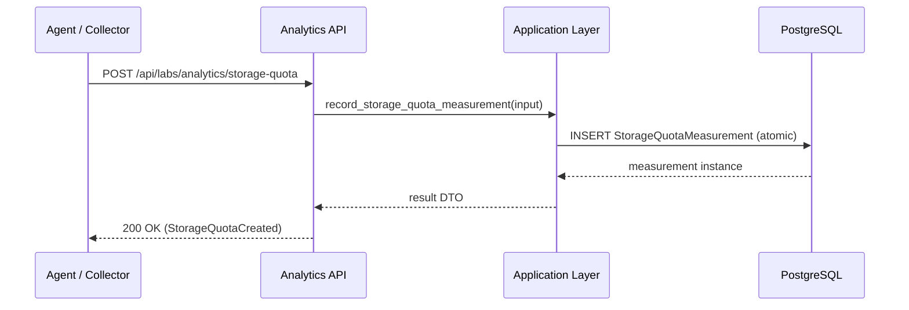

# Analytics Feature Architecture

> Status: Verified against code on 2026-10-18 · Owner: Labs Engineering (Analytics)

## 1. Purpose and scope

The analytics feature provides operational business intelligence, usage metrics, and capacity tracking across laboratory benches, computing equipment, projects, and users.

- **In Scope:**
  - Aggregated KPIs and time-bounded volume observations (`BookingVolumeObservation`, `ActiveLaboratoryObservation`, `ActiveUserObservation`, `VisitorVolumeObservation`).
  - Utilization projections and efficiency metrics across benches, projects, users, and 2-hour daily timeslot intervals.
  - Computing asset storage capacity measurements and quota alert notifications (`StorageQuotaMeasurement`).
  - Laboratory access visit event tracking (`LaboratoryVisitEvent`).
  - Periodic Celery aggregation and snapshot tasks.
- **Out of Scope:**
  - Authoritative lifecycle state mutations for benches, bookings, or equipment.
  - Interactive booking scheduling or approval decisions.
  - Telemetry agent communication protocols (handled by collector/monitoring integrations).

---

## 2. Responsibilities and ownership

| Concept / Rule | Owned Here? | Notes |
|---|---|---|
| `BookingVolumeObservation` | Yes | Daily/weekly booking volume summaries |
| `ActiveLaboratoryObservation` | Yes | Active bench counts over calendar periods |
| `ActiveUserObservation` | Yes | Active user metrics |
| `VisitorVolumeObservation` | Yes | Physical/remote visitor observations |
| `StorageQuotaMeasurement` | Yes | Storage capacity logs and utilization percent |
| `LaboratoryVisitEvent` | Yes | Access visit events |
| `BenchBooking` | No (Dependency) | Owned by `core.labs.features.bench_bookings` |
| `Bench`, `BenchGroup` | No (Dependency) | Owned by `core.labs.features.benches` |
| `Equipment`, `ComputingEquipment` | No (Dependency) | Owned by `core.labs.features.equipment` |
| `LabSessionLog` | No (Dependency) | Owned by `core.labs.models.session` |

---

## 3. Public interface and contracts

The feature exposes its boundary strictly through `public.py`:

- **Commands:**
  - `record_storage_quota_measurement(input_data: RecordStorageQuotaInput, *, actor: Any = None) -> StorageQuotaMeasurement`
  - `record_facility_visit(input_data: RecordFacilityVisitInput, *, actor: Any = None) -> LaboratoryVisitEvent`
- **Scheduled Tasks:**
  - `snapshot_daily_booking_volume()`
  - `snapshot_daily_active_benches()`
  - `snapshot_daily_active_users()`
  - `snapshot_daily_facility_visitors()`
  - `send_storage_quota_alerts()`
- **Query Selectors:**
  - `get_booking_volume_metrics(*, unit: str | None = None)`
  - `get_active_bench_metrics(*, unit: str | None = None)`
  - `get_active_user_metrics(*, unit: str | None = None)`
  - `get_facility_visit_metrics(*, unit: str | None = None)`
  - `get_bench_group_distribution()`
  - `get_equipment_status_distribution()`
  - `get_bench_efficiency_rankings(*, from_date_time, to_date_time, sort_order, top_n)`
  - `get_project_utilization(*, from_date_time, to_date_time, sort_order, top_n)`
  - `get_user_utilization(*, from_date_time, to_date_time, sort_order, top_n)`
  - `get_user_booking_compliance(*, from_date_time, to_date_time, sort_order, top_n)`
  - `get_timeframe_utilization(*, from_date_time, to_date_time)`
  - `list_storage_quota_measurements(*, log_date, top_n)`
  - `get_dashboard_summary(*, from_date_time, to_date_time)`
  - `get_booked_vs_used(*, from_date_time, to_date_time)`
  - `get_equipment_availability(*, from_date_time, to_date_time)`
- **HTTP Endpoints (mounted under `/api/labs/analytics/`):**
  - `GET /booking` (Polymorphic: trend count or historical list)
  - `GET /lab-count` (Polymorphic: trend count or historical list)
  - `GET /user-count` (Polymorphic: trend count or historical list)
  - `GET /bench-group`
  - `GET /lab-equipment-status`
  - `GET /lab-efficiency`
  - `GET /project-usage`
  - `GET /user-lab-usage`
  - `GET /user-booking-efficiency`
  - `GET /lab-usage-by-timeframe`
  - `GET, POST /storage-quota`
  - `GET, POST /lab-visits`
  - `GET /dashboard-summary` (KPI cards with previous-period trend; requires `from_date_time`, `to_date_time`)
  - `GET /booked-vs-used` (reserved bench hours vs recorded session hours; per-bench booked hours, laboratory-wide used hours)
  - `GET /equipment-availability` (uptime percent, unavailable hours, outage count per equipment from status history)

---

## 4. Dependencies and layer separation

```mermaid
flowchart LR
  api[api/views.py] --> public[public.py facade]
  public --> app[application/commands.py & tasks.py]
  public --> queries[queries/observations.py, utilization.py, storage.py]
  app --> models[core.labs.models.analytics]
  queries --> models
  queries --> dep_models[core.labs.models (benches, bookings, equipment)]
```

- API views never import Django models directly (`test_public_boundary.py` enforced).
- All writes execute within atomic transactions.
- Queries are strictly read-only and side-effect free.

---

## 5. Main workflows

### Storage Quota Ingestion & Alerting


---

## 6. Invariants, concurrency, and failure handling

1. **Unique Observation Intervals:**
   Observations enforce database unique constraints on `(period_start, period_end, granularity, source)` to prevent duplicate snapshots.
2. **Quota Math:**
   `utilization_percent` is derived and validated in `clean()`; non-negative constraints enforced on storage fields.
3. **Atomic Writes:**
   All command implementations are decorated with `@transaction.atomic`.
4. **Idempotent Ingestion:**
   External collectors pass external references to avoid duplicate visit logs.

---

## 7. Security and authorization

- **Authentication:** All analytics endpoints require `HasAPIKey | IsAuthenticated` via `FeatureAPIView`.
- **Query Parameter Validation:** Date strings, sort order, and limit values are strictly validated via DRF serializers with explicit bounds.

---

## 8. Observability and operations

- **Celery Tasks:** Scheduled tasks run daily via Celery beat (`snapshot_daily_booking_volume`, etc.).
- **Email Notifications:** RFC 5545 `.ics` attachments generated cleanly with CRLF line endings and line folding at 75 octets.
- **OpenAPI Integration:** Fully documented in `openapi/labs-analytics.yml` through `drf-spectacular`.

---

## 9. Tests and boundary enforcement

- `core/labs/features/analytics/tests/test_public_boundary.py`: Enforces zero model imports in API views and full public export coverage.
- `tests/integration/test_analytics_api.py`: 37 behavioral integration tests covering all 12 original endpoints.
- `tests/integration/test_analytics_insights_api.py`: 23 integration tests covering the three insight endpoints (auth, strict query 400s, envelope, KPI values).
- `tests/unit/test_analytics_helpers.py`: 19 unit tests for calculation utilities and bucket aggregations.
- `tests/unit/test_analytics_tasks.py`: 21 mock-based tests for Celery tasks and alert dispatch.
