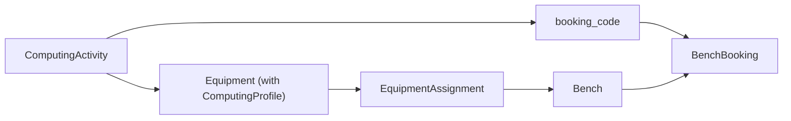
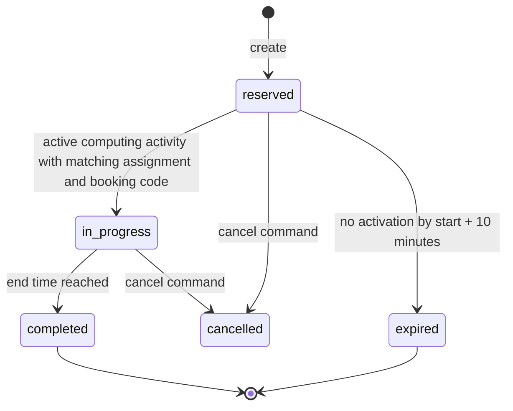

# Bench Booking Architecture

**Status:** Proposed. This document is located at the feature-local documentation path specified as `CONFIRM` in `docs/ai-team/documentation-map.md`; owner confirmation is required.

## Scope

`core.labs.features.bench_bookings` owns creation, updates, conflict detection, and lifecycle transitions for the existing `labs.BenchBooking` model. It does not own computing-activity ingestion, equipment assignment, or project lifecycle.

It also owns approval decisions for pending bench bookings. Dedicated approve and reject commands authorize only lab coordinators and administrators, lock the bench before the booking (the same order used by schedule writers), then recheck the state while locked. A decision is valid only for a `reserved` booking whose approval status is `pending`. Approval and rejection are an independent state machine from booking lifecycle. Both outcomes record the acting coordinator/admin and decision timestamp using the existing `approved_by` and `approved_at` fields; rejection additionally stores a required nonblank reason (maximum 500 characters). Repeated or reverse decisions conflict. The commands do not change lifecycle status or emit notification intents. The database overlap exclusion constraint remains the final guard; pending bookings already reserve their bench interval, so approval does not newly claim a reservation.

Approve/reject API actions require a UUID `Idempotency-Key` and retain completed success receipts for 24 hours. The receipt is scoped to actor, method, canonical action path, and key, and stores the request fingerprint and original success status/body. A transaction-scoped PostgreSQL advisory lock serializes same-key attempts before receipt lookup; the decision, response projection, and receipt are committed atomically. A matching retry replays the stored response; a different request under the same key is rejected. A concurrent waiter replays the committed result instead of returning `409 request_in_progress`. A distinct key against an already-decided booking continues to conflict. Failed validation or state transitions do not create receipts. Expired records are removed when the same key scope is reused.

All public booking codes are opaque SHA-256-derived identifiers. The generator includes a cryptographically random nonce; the `Booking.booking_code` database unique constraint remains the durable system-wide uniqueness guard. Creation retries a booking-code uniqueness collision at most three times.

Booking creation and updates require a minimum duration of 10 minutes. A start time may be up to 10 minutes in the past.

## Verified Model Ownership

- `labs.BenchBooking` is the concrete booking record and inherits shared fields and statuses from `labs.Booking`.
- `labs.ComputingActivity` owns the current state and booking code reported by a computing resource.
- `labs.EquipmentAssignment` owns the active relationship from equipment to a bench.
- `labs.Bench` owns the booked resource.

The activity-to-booking association is resolved through the existing chain:

An activity can activate a booking only when all of these are true:

1. The computing activity status is `active`.
2. The activity carries a non-empty booking code.
3. The computing equipment has an active assignment to the booking's bench.
4. The booking code identifies a `reserved` booking for that bench.
5. The current time falls in the booking interval: `$starts_at \le now < ends_at$`.

## State Machine

The lifecycle command is idempotent: every transition targets its source status. A subsequent invocation updates zero rows after a prior successful transition.

The shared transition policy is deny-by-default: terminal `completed`, `cancelled`, and `expired` bookings cannot transition to `reserved` or any other status. `in_progress` bookings can move only to `completed` or `cancelled`.

## Application Interface

### Agent end-time update

The agent end-time command resolves `agent_uid` through `agents.public.require_active_agent_identity`;
it never accepts a caller-supplied equipment identifier. This identifies the credential subject only;
it is not API authentication and does not replace transport authentication. It derives the identity's
equipment and locks that equipment through `equipment.public.lock_active_equipment_bench_assignment`,
which returns an immutable projection of its active equipment-to-live-bench binding. The booking must
belong to that bound bench. These are reviewed internal boundaries, not HTTP endpoints.

The transaction's explicit lock order is **agent identity → equipment → bench → booking**. Identity
validation holds its row lock through the outer command transaction, preventing revocation from
racing past the subject lookup. Equipment assignment and unassignment writers lock the equipment
row before modifying assignment rows, so holding that same owner-row lock keeps the authorized
binding stable until this command commits. The existing assignment write paths lock equipment before
bench. This command does not lock an assignment row first and therefore avoids reversing that order.
Booking conflict checks remain protected by the bench lock and database overlap guard.

An unchanged end time is a no-op for persistence and notification intent creation. This does not make distinct
changed requests idempotent, and `request_id` is not persisted as an audit record here. No durable
audit or notification-delivery guarantee is claimed.

`application/state_transitions.py` exposes the supported lifecycle commands:

- `activate_bench_booking_for_computing_activity(computing_id, now)`: resolves the activity-to-bench relationship and activates the matching booking.
- `activate_bench_bookings(bench_id, booking_code, now)`: smaller verified-facts command that performs the `reserved -> in_progress` transition.
- `reconcile_bench_booking_statuses(now)`: expires overdue reserved bookings and completes elapsed in-progress bookings.

Each command uses an atomic database transaction and locks the booking rows before updating their status.

## API Lookup

The feature supports numeric and public-code detail routes:

- `GET` and `PATCH` `/api/labs/bench-bookings/<booking_id>`
- `GET` and `PATCH` `/api/labs/bench-bookings/code/<booking_code>`

The public-code route resolves the booking internally and delegates updates to the same application command as the numeric route. Missing codes return the standard not-found response.

Numeric booking routes also expose `POST /api/labs/bench-bookings/<booking_id>/actions/approve` and `/actions/reject`. Both are restricted at the API and command layers to coordinators/admins; rejection requires a trimmed, nonblank reason of at most 500 characters. Action requests lock bench then booking and validate `reserved` + `pending` after acquiring the locks. The existing booking response shape remains unchanged and does not reveal decision actor/time or the stored rejection reason.

Creation requires a nonblank `reason` and a valid `project`. PATCH accepts partial schedule, bench, reason, project, and status updates. A status update is allowed only when the shared booking state machine permits that transition.

`in_progress` and `expired` are system-managed and cannot be submitted through PATCH. Only confirmed computing activity may transition a reserved booking to `in_progress`; only scheduled reconciliation may transition a reserved booking to `expired` after its activation grace window passes.

## Scheduled Reconciliation

`tasks.py` defines the Celery task name `labs.bench_bookings.reconcile_statuses`. It must run at least once per minute for timely lifecycle transitions.

**Current implementation gap:** Celery `app.autodiscover_tasks()` discovers app-level `tasks.py` modules, but the task is nested under `core.labs.features.bench_bookings`. The task must be explicitly imported or included in Celery configuration before it can be consumed by a worker. The repository's static Beat schedule is commented out; the deployment owner must create a `django-celery-beat` periodic task or explicitly enable an equivalent schedule.

## Guarantees and Constraints

- Time intervals use the half-open convention `$[starts_at, ends_at)$`.
- Status transitions only occur from their valid source state.
- Booking status updates do not call model-level business workflows; lifecycle orchestration remains in the booking application layer.
- The scheduler may run on multiple workers because source-status filters make repeated reconciliation safe.

## Testing and Operations

Required PostgreSQL tests:

- active activity on an assigned computing resource activates the matching reservation;
- inactive, missing-code, wrong-bench, future, and elapsed activity does not activate a booking;
- exact ten-minute expiration boundary and the instant before it;
- exact end-time completion boundary and the instant before it;
- duplicate task invocation is idempotent;
- concurrent activity activation and reconciliation preserve a valid terminal state.

The current focused database tests are blocked before execution by the existing test-database migration issue: `common_apilog.creator_id` references a missing `users_user` table. Static lint, formatting, and byte-compilation must be rerun after lifecycle changes.
