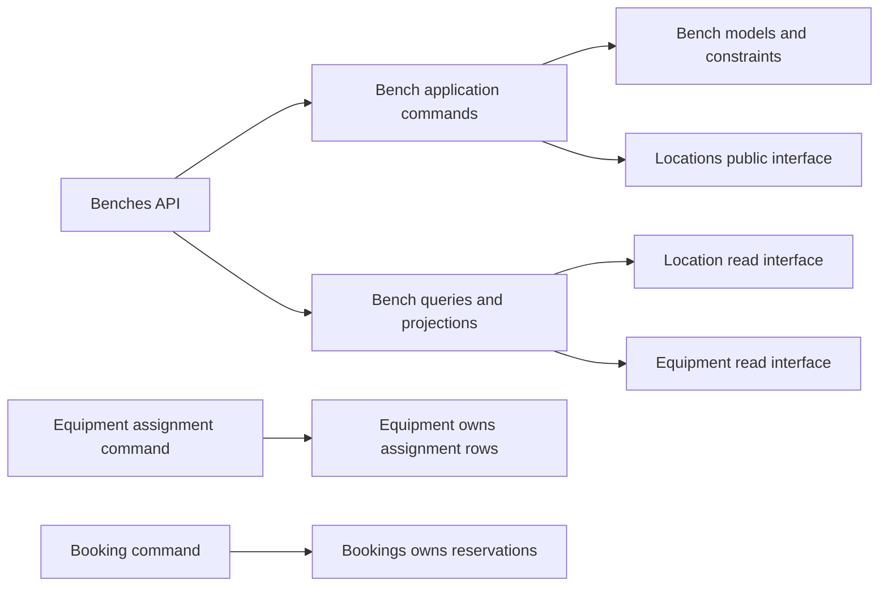
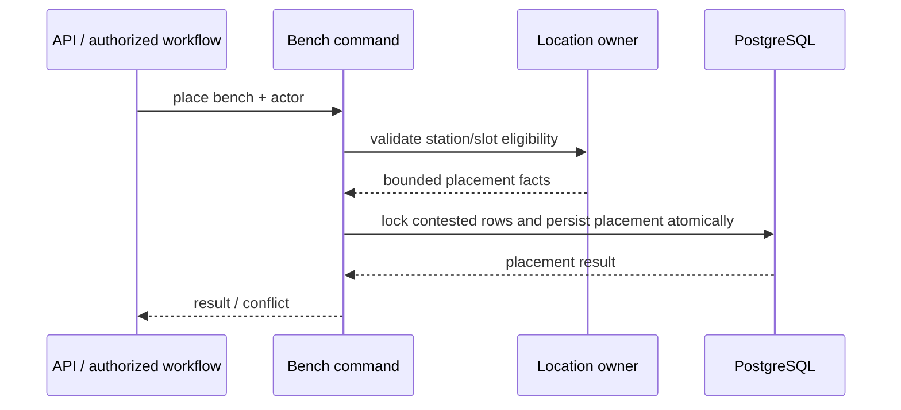

# Benches Feature Architecture

> Status: Proposed target, verified against repository sources on 2026-10-15. **Verified** statements describe inspected code; **Proposed** statements describe desired boundaries, not implemented guarantees. Owner: Labs / Benches.

## 1. Purpose and scope

**Verified.** The benches feature contains API, application services and policies, selectors, public exports, URLs, and feature-local tests.

**Proposed.** Benches owns virtual lab workspaces, bench lifecycle and configuration, bench groups/types/favorites, and placement of a bench into an eligible station/slot. It does not own the physical room/station layout, equipment identity or assignment history, or booking state transitions.

## 2. Responsibilities and ownership

| Concept | Owner | Boundary |
| --- | --- | --- |
| `Bench`, `BenchGroup`, `BenchType`, `BenchFavorite` | Benches | Models remain centralized under `core/labs/models/`; feature owns commands and reads |
| Bench lifecycle, requirements/capacity validation | Benches | Separate from booking and equipment operational status |
| Bench setup placement | Benches | Uses location-owned station/slot data and policies via an approved interface |
| Equipment assignment history | Equipment | Benches may show assignment projections; it must not write assignment rows |
| Station/room slots and physical status | Locations | Benches calls location behavior when a location-owned mutation is required |
| Booking/availability | Bookings | A bench's lifecycle field is not a reservation |

**Verified model location:** [bench models](../../../models/resource/bench/bench.py). `Bench.LIFECYCLE_STATUSES` defines `planned`, `in_service`, `out_of_service`, and `retired` (check `bench_lifecycle_valid`; redesign step 5). "Reserved" and "active" are computed from bookings and computing activity, never stored. Only an `in_service` bench accepts bookings. `Bench.clean()` checks station-slot ownership, slot status, bench-type compatibility, and power/load capacity. Bench has an optional `setup_location` station relation and an optional one-to-one station-slot relation. Its query selector currently prefetches active equipment assignments for projections.

## 3. Public interface and dependencies

**Historical implementation, superseded 2026-10-20:** an enriched ordinary bench
detail GET composed centralized assignment reads with equipment activity and
booking facades. The approved current contract makes ordinary bench detail lean;
the dashboard clicked-bench endpoint owns operational details. The earlier
projection remains internal pending usage cleanup, not the ordinary GET contract.
See the current [bench and station API guide](bench-station-apis.md). Resource graphic mappings are
provided separately by the resource-mappings feature.

**Verified.** The feature exposes commands and queries through `public.py`; API code uses feature-local application and query modules directly. `list_benches()` reads bench, station, favorite, and active equipment assignment data.

**Proposed:**

- External consumers use benches `public.py`; cross-feature schemas and DTOs use `contracts.py` when stable sharing is needed.
- Location placement rules/commands remain owned by Locations. Benches owns the semantic action of placing/configuring a bench; the command must call or coordinate with location-owned operations rather than mutate private location workflows.
- Equipment assignment/unassignment is invoked through Equipment's public command. Setup projection reads may use an approved bounded query.
- Booking rules are invoked through a booking-owned command; do not encode booking status in bench lifecycle.
- Avoid introducing a generic shared feature package. Keep a rule here if it is bench-specific; move only proven domain-neutral functionality to the owning shared platform.

## 4. Main workflows

### Create/update/delete bench

**Verified.** Bench application services lock relevant station/bench records, apply fields, validate references/capacities, and persist via service commands. **Proposed.** These commands remain the only business write path for bench state; API handlers only validate transport shape and delegate.

### Place or move a bench

**Verified.** The model and feature include station/slot placement concepts; application policies validate slots, capacity, utilities, and placement constraints.

**Proposed flow:**

Confirm the transaction owner and exact cross-feature API before changing placement behavior. A read-time capacity check is not a concurrency guard; enforce contested slot uniqueness/invariants in PostgreSQL or through appropriate locking plus a database guard.

### Favorite and reference data

**Verified.** Application services include favorite and reference-data commands; selectors expose reference lists. **Proposed.** Keep user-specific favorites separate from bench lifecycle; reference-data retirement must preserve historical references where required.

## 5. Lifecycle and invariants

- **Verified:** Bench has an explicit lifecycle-status field with choices and placement validation in model/application code.
- **Proposed:** Lifecycle transitions belong to Benches and must not mirror booking status or equipment status.
- Bench may be unplaced; slot assignment requires a consistent station and slot. Placement must honor slot compatibility and station capacity/power/load/utilities rules.
- Bench commands must not create equipment or operational status records as a side effect of a read/projection.
- Test placement races and constraint failure behavior using PostgreSQL for database-specific guards.

Exact lifecycle transitions and concurrent capacity semantics need product confirmation before being treated as formal state-machine guarantees.

## 6. Security and failure handling

**Proposed.** Enforce authorization for bench list/detail visibility and every create/update/delete/place/favorite/reference command. Object IDs do not confer access. For cross-feature calls, pass explicit actor/context and only the identifiers/data needed. Return stable bench conflicts for expected placement errors; allow unrelated database errors to surface.

**Not verified:** complete permissions and queryset object scoping across every bench endpoint.

## 7. Integration and operations

**Proposed.** Keep equipment/location notifications and external effects outside bench row locks. Best-effort effects use `on_commit`; durable cross-feature follow-up requires an outbox record in the owning transaction and idempotent delivery. Preserve current route prefixes and API contracts unless explicitly migrated.

## 8. Tests and boundary enforcement

**Verified.** The benches feature has API/application/query tests and a public-boundary test ([test_public_boundary.py](../tests/test_public_boundary.py)). `tests/architecture/` contains no bench-specific checks (grep 2026-10-15). Placement and bench writes use `select_for_update` in [services.py](../application/services.py). **Proposed** additions and maintained coverage:

- lifecycle transitions distinct from booking/status;
- placement compatibility, capacity, and competing placement cases;
- authorization denial and object-scoped list/detail queries;
- command atomic rollback and expected conflict mapping;
- projections including active equipment without writes, plus query budgets;
- URL names, payload compatibility, reverse resolution, and OpenAPI.

Add CI architecture checks preventing private imports into benches and restricting cross-feature calls to public/contracts interfaces. Existing architecture tests do not currently certify that feature-level boundary.

## 9. Open questions

1. Does bench placement own the full cross-feature transaction, or should location own a primitive placement command while benches owns workflow orchestration?
2. What is the authoritative concurrency rule for station/slot capacities when more than one placement is attempted at once?
3. Are lifecycle transitions explicitly constrained by product workflow, and which actor roles may trigger them?
4. Which permission scope applies to bench favorites and reference-data administration?
