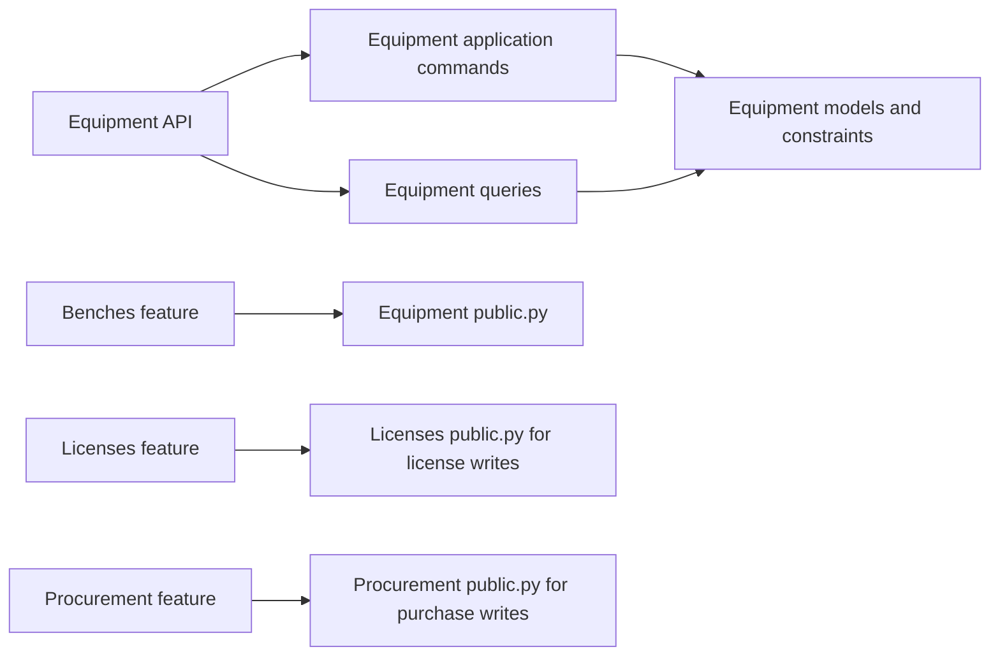
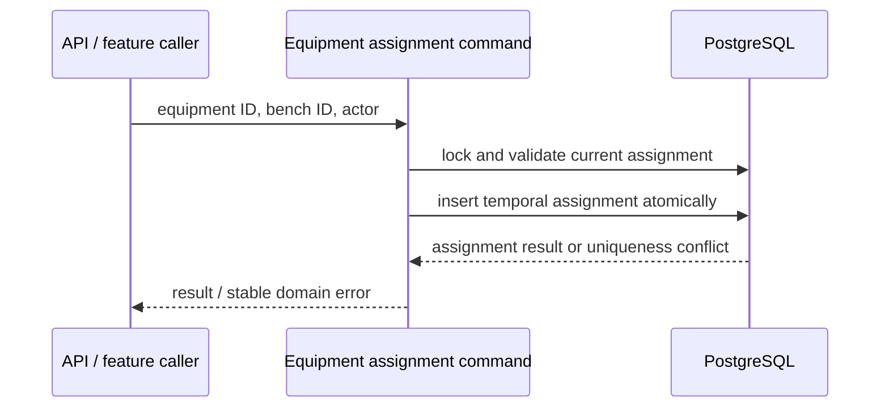

# Equipment Feature Architecture

> Status: Proposed target, verified against repository sources on 2026-10-15. **Verified** statements describe inspected code; **Proposed** statements describe desired boundaries, not implemented guarantees. Owner: Labs / Equipment.

## 1. Purpose and scope

**Verified.** The equipment feature provides equipment API endpoints, application commands, queries, category APIs, status handling, assignment handling, and reference data behavior in `core/labs/features/equipment/`.

**Proposed.** Equipment owns the canonical hardware identity and equipment-specific lifecycle/status, category capabilities, equipment reference data, and the temporal assignment relation between equipment and benches. It does not own bench placement/setup, license lifecycle, purchase workflow, or finance expense/payment records.

## 2. Responsibilities and ownership

| Concept | Owner | Boundary |
| --- | --- | --- |
| `Equipment`, equipment reference rows, equipment status records | Equipment | Authoritative equipment data; model code remains centralized under `core/labs/models/` |
| Equipment category behavior and category-specific API mapping | Equipment | Variants remain inside the equipment feature; avoid sibling feature packages per category |
| `EquipmentAssignment` | Equipment | Owns assignment/unassignment commands and assignment history |
| Bench lifecycle / station-slot placement | Benches | Equipment may read a bench identifier; it does not position benches |
| License and license assignment | Licenses | Equipment does not write license state |
| Acquisition records | Procurement | Equipment does not own purchase allocations or acquisition transactions |

**Verified model locations:** [equipment models](../../../models/resource/equipment/) and [equipment assignment model](../../../models/resource/equipment/assignment.py). The feature's queries also read supported purchase allocation data for equipment projections; such read use does not transfer procurement ownership.

**Reference-data provisioning:** See [reference data defaults and deletion policy](../../../../../docs/architecture/reference-data.md) for the proposed reusable pattern, current equipment-category setup, and protection/recovery scope. Baseline seeding does not imply a default value for every foreign key.

## 3. Public interface and dependencies

**Verified.** The feature exports equipment command inputs/commands and query functions from `public.py`. Its API registers list/detail, assignment, status, reference-data, and category routes through `urls.py` and `api/urls.py`.

**Proposed:**

- External features use `public.py`; stable DTOs/events/ports, if needed, belong in `contracts.py`.
- Equipment application may use its own models and queries directly. No other feature imports equipment private API, serializer, application implementation, or model internals for behavior.
- Bench projections can consume equipment read projections, but bench workflows must not create or close `EquipmentAssignment` rows directly.
- License assignment writes remain exclusively in the licenses feature. Procurement may associate a purchase allocation to an equipment identity through an explicit allowed model relationship, but may not run equipment lifecycle/status transitions as a side effect.
- Keep feature dependencies acyclic. If callers need a cross-feature operation, define which command owns the write and call that public command.

## 4. Main workflows

### Create/update/status

**Verified.** Feature-local application modules include create, update, delete, and status-transition operations. **Proposed.** API, admin, tasks, and scripts delegate to a single owning application command for each write. Keep category-specific validation/mapping in the equipment feature and generic hardware identity rules in canonical Equipment ownership.

### Assignment

**Verified.** Equipment assignment application handles assignment to a bench and equipment status updates. The model has an active-row uniqueness constraint and a time-order check.

**Proposed write path:**

The service/API should translate only the known active-assignment constraint into the stable equipment conflict; unrelated integrity failures must propagate. Race correctness relies on the database constraint, not only a pre-check.

### Placement (redesign step 1)

**Implemented.** `EquipmentAssignment` rows now record every placement: a bench, a station, a room, or only a `location_note` (check constraints `equipment_placement_one_target`, `equipment_placement_bench_fields`; `one_active_bench_per_equipment` is one active placement per unit). `EquipmentAssignment.objects` returns bench placements only, so pre-existing readers keep their meaning; `EquipmentAssignment.all_placements` and the proxy `EquipmentPlacement` return every placement. Join-based readers starting from equipment must add `bench__isnull=False` when they mean a bench. `place_equipment` and `remove_placement` (`application/place_equipment.py`) lock `Equipment`, then the target, then placement rows; bench targets delegate to `assign_equipment` / `unassign_equipment`. A resting unit moves; a unit on a bench must leave it first. `Equipment.storage_room` is a compatibility mirror written only by `_placement.py`; `storage_room_id` on create and update is translated into a room placement. `delete_room` and `delete_station` refuse while equipment rests there (`public.has_active_placements`). Plan and decisions: `docs/proposals/equipment-management-redesign.md`, "Step 1 implementation plan".

### Queries

**Verified.** Equipment selectors filter deleted resources, support search/reference/status/assignment filters, and build category projections. **Proposed.** Queries remain read-only and apply caller visibility where policy requires it. Querysets remain internal to the Labs app; external feature boundaries should prefer bounded projections/DTOs.

### Relationship-based inventory facets

**Implemented equipment pilot.** The owner-authorized pilot adds GET `/api/labs/equipment/facets` and `/api/labs/equipment/{existing-category}/facets`. The generic adapter and generated category adapters reuse their respective list providers and membership/search FilterSpecs, removing only client ordering. Optional CSV `department_id` and `product_model_id` are equipment-local additions; shared resource filters and catalog options are unchanged.

`queries/facets.py` owns immutable explicit relationship dimensions and dependency descriptions: category → kind → type, category → manufacturer, (manufacturer, type) → product model, department → group. These paths are server configuration, never automatically discovered or exposed to clients. The owner query isolates matching IDs in a subquery, groups canonical inventory relationships in SQL, and counts distinct equipment IDs. No per-bucket queries or catalog-active predicates are used. Retired references and unset/null buckets remain represented when matching inventory exists.

Counts apply **all selections**, including the requested dimension's selection, before equipment pagination. Frontend requests each dimension with the complete current selection/search state. Standard pagination applies to buckets (25 default / 100 maximum), ordered by name then ID with null last. The read population remains the deployed `HasAPIKey | IsAuthenticated` non-deleted inventory population; this change does not introduce new object permissions or claim target actor scoping is complete. Existing metadata payloads gain no dependency keys; dependency metadata is documented here rather than changing their shape.

Verification and remaining gate/review limitations are recorded in the task handoff. Representative-volume aggregate/search execution plans are not verified; no new indexes, dependencies, migrations, caches, or writes are introduced.

### Computing activity

**Verified.** Category-specific behaviour lives in `categories/<category>/` with the same layering as the feature: `application.py` (commands), `queries.py` (reads), `api.py` (HTTP adapter and serializers). Only categories with logic beyond the generic category builder get code there; the rest keep one-line placeholder holders, and `CATEGORIES_WITH_CODE` in the boundary test lists the exceptions. Generic category views stay in `api/categories.py` and take category extras through config such as `detail_relations`, never a per-category branch.

`categories/computing/application.py` owns writes to `ComputingActivity`: `ensure_computing_activity` (idempotent get-or-create as `offline`, called by `create_equipment` for computing) and `sync_computing_activity` (row-locked, atomic; rejects unknown or server-managed fields and invalid statuses; maintains `offline_at`, `inactive_at`, and `inactive_reminder_count` on transitions). `GET`/`PATCH /api/labs/equipment/computing/sku/<sku>/activity` expose it; reads are open to authenticated users, writes require an API key or a lab coordinator. `GET` on a computer that has not reported returns an unsaved `offline` default and writes nothing. The computing detail response includes a read-only nullable `activity` object; list responses do not.

**Status-change notification.** A `post_save` signal on `ComputingActivity` (`core/labs/signals.py`) publishes only real status changes, and only after the transaction commits, so a rolled-back write never notifies. The payload carries `computer_id`, `status`, `previous_status`, and `bench_id` (null when unassigned). It is published to `ws:computing:<id>` (WebSocket `ws/computing/{computing_id}`) always, and to the bench (`ws/monitoring/{bench_id}`) and dashboard channels when the computer has an active bench assignment. The WebSocket handler authenticates the JWT but does not check per-object access, like the other Labs handlers. Delivery is best-effort Redis pub/sub with no replay.

**Agent heartbeat and offline timeout.** Every successful agent (API-key) report sets `last_agent_report_at`; coordinator edits never change it, and a repeated same-status report (for example `inactive`) refreshes it while keeping `inactive_at`. The Celery task `labs.equipment.computing.mark_stale_activities_offline` sets any non-offline activity whose heartbeat is older than 10 minutes to `offline` (rows with no heartbeat are ignored). It is not scheduled by code: an operator defines it in Django admin under *Django Celery Beat > Periodic tasks* with task `labs.equipment.computing.mark_stale_activities_offline` and crontab `*/10 * * * *`, then keeps it enabled. Offline detection can therefore lag the 10-minute threshold by up to one further run interval.

## 5. Lifecycle and invariants

- Equipment resource lifecycle remains distinct from equipment operational status history.
- Assignment has an active period (`unassigned_at` null) and historical periods; it is not a status value.
- **Verified:** the assignment model's conditional unique constraint allows at most one active bench assignment per equipment; a check constraint prevents an end time preceding its start time.
- **Proposed:** all assignment mutations occur in atomic application commands. Use database constraints as the final concurrency guard and test simultaneous conflicting assignments on PostgreSQL.
- Do not infer booking availability or a live computing activity from equipment assignment/status alone.

No complete equipment state-transition table is specified here; confirm allowed lifecycle and status transitions before changing them.

## 6. Security and failure behavior

**Proposed.** Authenticate and authorize every equipment command server-side. Scope detail and list queries to permitted resources. Passing a bench or equipment ID is not proof of access. Background processes use explicit, narrowly scoped actors. Keep permission logic independent of DRF and test denied object access.

**Implemented (redesign Step 0).** Every equipment HTTP adapter (`EquipmentAPIView` and `EquipmentRetrieveUpdateDeleteAPIView`) uses `HasAPIKey | IsLabCoordinator`: reads stay open to authenticated users and API keys; writes need the coordinator role (or admin), or an API key. Every create under `equipment/reference-data/` (the catalog and the lookups equipment references by foreign key, such as departments, resource groups and materials) additionally requires the Labs admin role in `application/reference_data.py`, on top of the shared Django model permission. API keys keep full equipment write access (owner decision, 2026-11-10); the shared reference layer already rejects actorless (API-key) reference creates. `delete_equipment` locks the `Equipment` row and refuses with `equipment_in_use` (409, `details.blockers`) while the unit has an active bench assignment, an active license seat, or a reserving equipment booking. Department scope is not implemented yet.

Translate expected not-found, invalid-transition, and assignment-conflict cases into stable feature errors at the API boundary. Do not turn broad `IntegrityError` exceptions into a generic conflict.

**Not verified:** exhaustive endpoint permission coverage and object-level query scoping.

## 7. Integration and observability

**Proposed.** Avoid external calls within equipment transactions or while holding row locks. Emit best-effort effects after commit; if a side effect must be durably delivered, persist outbox intent with the assignment/status change and require idempotent consumers. Log equipment/assignment identifiers and outcomes without secrets or unnecessary personal data.

No outbox or full equipment telemetry contract is asserted to exist.

## 8. Tests and boundary enforcement

**Verified.** Equipment has feature-local API/application/query tests and a public-boundary test. **Proposed** coverage should include:

- public exports and prevention of external private imports;
- command authorization, validation, rollback, and expected error translation;
- concurrent assignment attempts and database constraint enforcement on PostgreSQL;
- lifecycle/status transition tests separately from assignment tests;
- query visibility, category projection correctness, and query-count budgets;
- route names, payload compatibility, permissions, and OpenAPI schema.

Enforce the public/contracts-only cross-feature dependency rule with a Labs feature import architecture test and run it in CI. Existing scope of the architecture tests does not prove this rule today.

## 9. Open questions

1. Which equipment reference-data entities are owned operationally by this feature versus centrally governed Labs reference data?
2. What exact lifecycle and status transition tables are contractually supported?
3. Which callers need cross-feature equipment projections, and can each use an explicit bounded public query result?
4. What authorization actor/context is the target for commands, and what is the approved policy for system/agent submissions?
5. **Selector narrowing (breaking, awaiting owner).** Large Equipment selectors currently require `q` or a
   declared parent filter (`required_any`); `include_ids` alone no longer qualifies and never returns
   soft-deleted rows. Decide: whether lifecycle status/assignability count as narrowing; approval of this
   VER-2 breaking change and the frontend release plan; the actor-scoped read-visibility rule for users and
   API keys (add unreadable-ID and query-budget tests); how the conditional requirement appears in OpenAPI;
   and whether the existing full-schema Spectral errors block this change.
