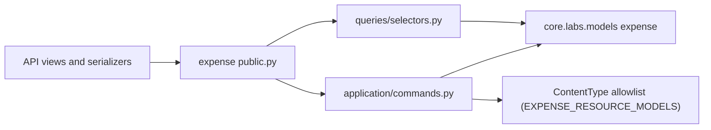
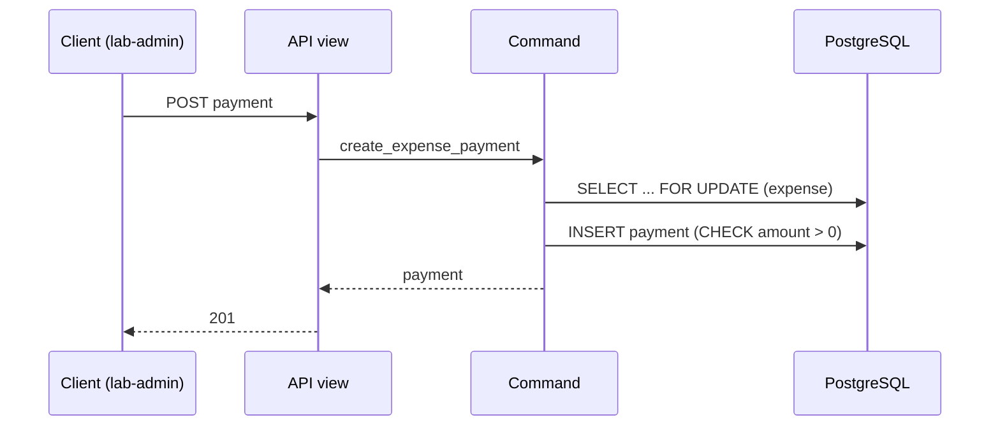

# Expense Feature Architecture

> Status: Verified against code on 2026-10-19 · Owner: Labs / Finance

**Verified** statements describe inspected code. **Proposed** statements are not implemented guarantees.

## 1. Purpose and scope

**Verified.** The expense feature records ongoing resource-scoped expense obligations (`Expense`, including recurring `license_fee` costs) and the actual payments or refunds made against them (`ExpensePayment`). Supported target resources are `room`, `station`, `bench`, `equipment`, and `license` (`EXPENSE_RESOURCE_MODELS`). It exposes list and create endpoints only; there is no update or delete endpoint.

**Does not own:** purchase orders and acquisition cost (procurement) or resource identity (the room, station, bench, equipment, and license features).

## 2. Responsibilities and ownership

| Concept / rule | Owned here? | Notes |
| --- | --- | --- |
| `Expense` (obligation) | Yes (commands and reads) | Model centralized under `core/labs/models/finance/expense.py` |
| `ExpensePayment` (actual payment or refund) | Yes | Child of `Expense`; does not redefine the obligation |
| Target resource (`room`, `station`, `bench`, `equipment`, `license`) | No | Referenced through content type and object ID |
| Procurement acquisition cost | No | Procurement feature |

Models owned by this feature (link to authoritative docs; do not copy definitions):
[Labs model architecture, procurement and expenses section](../../../models/docs/labs-model-architecture.md#procurement-and-expenses).

## 3. Public interface and contracts

**Verified.**

- `public.py` exports the read selectors (`list_expenses`, `list_room_expenses`, `list_expense_payments`, `get_financial_report`, `aggregate_expense_cash_flow`), the command inputs (`CreateExpenseInput`, `CreateExpensePaymentInput`), the commands, and `ExpenseConflict`.
- `exceptions.py` defines `ExpenseConflict(ValueError)` with code `expense_conflict`. It has no HTTP concepts.
- Commands are frozen dataclasses with keyword-only `actor`.
- Routes in `api/urls.py`, included under `labs/` in `core/labs/api_urls.py`:

| Method | Path | Notes |
| --- | --- | --- |
| GET, POST | `/api/labs/expenses` | Multi-resource collection (`resource_kind` + `resource_id` across room, station, bench, equipment, license); missing/soft-deleted target returns 404 |
| GET, POST | `/api/labs/rooms/<room_id>/expenses` | Room-scoped shortcut; room missing returns 404; invalid dates or amount return 422 |
| GET, POST | `/api/labs/expenses/<expense_id>/payments` | Expense missing returns 404 |

**Verified (permissions).** Expense views set `permission_classes = FINANCE_ACCESS` (`finance.manage`, or an API key). Writes: holders of `finance.manage` (Lab Coordinators and Lab Administrators) and API keys. Plain-user writes and unauthenticated requests without an API key get 403. Reads: holders of `finance.manage` only (owner decision 2026-11-11); plain users and users without a Labs role get 403. API-key writes record no creator because the actor is `None`. Access-control change: requires human approval before merge (T2).

**Verified (OpenAPI).** Responses use `drf_api_contracts` and are generated in `openapi/labs-expense.yml`.

## 4. Dependencies

| Depends on | Through | Direction rule |
| --- | --- | --- |
| `core.common.api` (`AppListAPIView`) | Import | Shared code |
| `core.labs.features.base.access` (`FINANCE_ACCESS`) | Import | Labs endpoint policies; who holds `finance.manage` is decided in `core.users` |
| `core.labs.features.base` (`CommandAPIView`) | Import | Shared Labs base |
| `core.labs.models` (`Expense`, `ExpensePayment`, `Room`, `Station`, `Bench`, `Equipment`, `License`) | Import | Models centralized |

## 5. Workflows

### Create expense for a resource

**Verified.** `create_expense` is `@transaction.atomic`. It resolves `resource_kind` against `EXPENSE_RESOURCE_KIND_MODELS`, locks the live target resource row (`select_for_update().get(pk=..., deleted_at__isnull=True)`; `DoesNotExist` maps to 404), checks its content type against `EXPENSE_RESOURCE_MODELS`, runs `full_clean()`, and saves with `actor`.

### Record a payment

**Verified.** `create_expense_payment` locks the parent `Expense` with `select_for_update`, runs `full_clean()`, and saves with `actor`. Because the lock is on the expense row, concurrent payments against the same expense serialize.

## 6. Lifecycle and state transitions

**Verified.** `Expense` has no status field in the API. Obligation lifecycle is defined by `valid_from` and `valid_until`; a DB check enforces valid date ordering.

**Verified (Financial Reporting & Payment Status Derivation).** Payment status is derived dynamically in financial reports (`get_financial_report`):
- `paid`: `net_paid >= expense.amount`
- `partially_paid`: `0 < net_paid < expense.amount`
- `overdue`: `net_paid < expense.amount` and `valid_until < today`
- `unpaid`: `net_paid <= 0` and (`valid_until` is None or `valid_until >= today`)

Financial report endpoints:
- `GET /api/labs/expenses/report`
- `GET /api/labs/rooms/<room_id>/expenses/report`

## 7. Invariants, concurrency, failure handling

**Database-enforced (verified in models).**
- `expense_amount_positive` and `expense_valid_dates` constraints on `Expense`.
- Positive amount on `ExpensePayment`.
- `ExpensePayment` is protected by its parent.

**Application-enforced (verified).**
- The target resource exists (`Room.objects.get`).
- The generic target allowlist (`EXPENSE_RESOURCE_MODELS`).

**Not enforced (known gap).** A generic content-type target cannot be protected by a foreign key, so a room deleted by a non-soft path could leave an orphaned expense. Room deletion is soft in the resource base, which limits this risk, but it is not guaranteed by the database.

**Proposed.** Decide whether total paid must not exceed the expense amount (for refunds, net paid must stay within bounds). This is not implemented; it needs an owner decision and, if required, a database or locked-aggregate guard.

**Failure behavior.** Validation errors map to 422, missing room or expense to 404.

## 8. Security and authorization

**Verified.** Writes: holders of `finance.manage` and API keys (`FINANCE_ACCESS`). Reads: lab coordinators and admins (see above). Deny by default: plain-user reads and writes get 403, and unauthenticated requests without an API key are rejected for writes.

**Open.** Align the reads-versus-writes comment with the behavior (see section 3).

## 9. Observability and operations

**Not verified.** No expense-specific logging or metrics were inspected. The Labs migration check currently reports an unrelated `computingequipment.rdp_file` change, which this feature does not own.

## 10. Tests and enforcement

**Verified.**
- `core/labs/features/expense/tests/test_public_boundary.py`: AST checks on exports, exception stability, API boundaries, frozen dataclasses, and keyword-only `actor`.
- `core/labs/features/expense/tests/test_expense_api.py`: HTTP tests for room expense create and list, payment create, 403 for non-admin writes, 404 for a missing room, 422 for invalid dates, and 422 or 400 for non-positive payment amount.

**Gaps.**
- No test for listing payments per expense or for a missing expense on payment create.
- No schema diff review.

## 11. Decisions, assumptions, open questions

- **Open:** read permission for non-admin users (align code and comment).
- **Open:** whether payments must be bounded by the expense amount, and where that is enforced.
- **Open:** whether a room deletion should block or cascade to expenses (currently a soft delete leaves rows referencing it).
- **Assumption:** `billing_period` defaults to `one_time` and `ExpensePayment.transaction_type` defaults to `payment`, per the model definitions; not re-read for this document.
