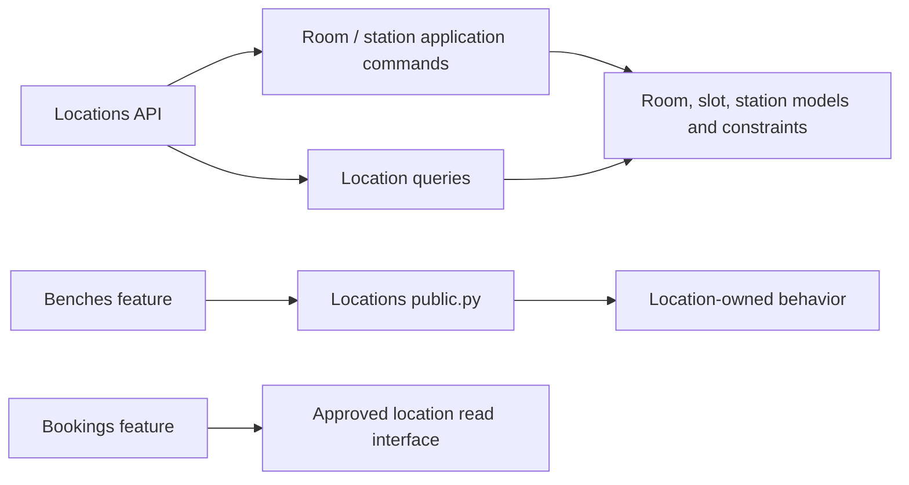
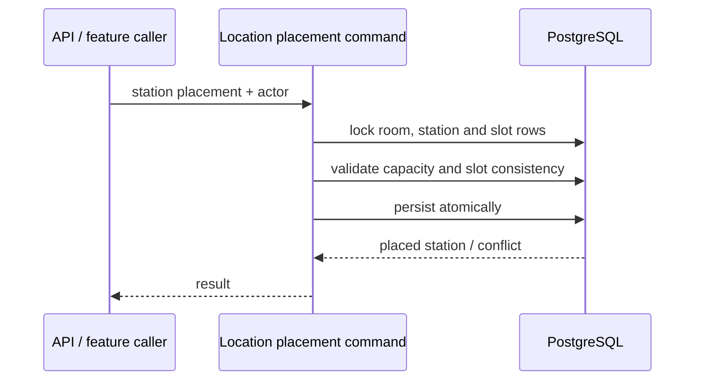

# Locations Feature Architecture

> Status: Proposed target, verified against repository sources on 2026-10-15. **Verified** statements describe inspected code; **Proposed** statements describe desired boundaries, not implemented guarantees. Owner: Labs / Locations.

## 1. Purpose and scope

**Verified.** Locations groups room and station APIs, application services/policies, queries, and public exports under `core/labs/features/locations/`.

**Proposed.** Locations owns physical laboratory geography and placement infrastructure: location reference entities, rooms, room slots, stations, station slots, location status records, and room observations. It does not own bench lifecycle, equipment assignment, or booking decisions.

## 2. Responsibilities and ownership

| Concept | Owner | Boundary |
| --- | --- | --- |
| Country/city/building references, room and room-slot models | Locations | Persistence stays centralized under `core/labs/models/` |
| Station/station-slot models and physical placement | Locations | Own station-to-room and station-slot rules |
| Room/station operational status and room observations | Locations | Distinct from resource lifecycle and live activity |
| Bench lifecycle and station-slot occupation by a bench | Benches | Location provides physical facts/constraints; bench owns its setup command |
| Equipment assignment and hardware status | Equipment | Not a locations responsibility |
| Booking workflow | Bookings | Not a location status or placement lifecycle |

**Verified model locations:** [location models](../../../models/resource/location/). Rooms and stations inherit the shared resource model; station has room and room-slot relations, with a database uniqueness constraint on non-null slot assignment. Room and station each store their current `status` as a column (default `available`, check constraint `room_status_valid` / `station_status_valid`); status records are the separate append-only history.

## 3. Public interface and dependencies

**Verified.** `locations/public.py` aggregates room/station commands and queries. Room and station behavior is organized as nested capability slices under the feature. The feature URL facade includes its room and station APIs.

**Proposed:**

- Other features use `locations.public` for supported commands/queries; stable cross-feature values belong in `contracts.py` if needed.
- Location owns room/station/slot mutations and physical invariants. Bench placement may be initiated by Benches but must not write private location model state directly; define one explicit collaboration direction for the workflow.
- Queries are read-only and expose authorized physical-location facts. Avoid exporting broad unrestricted querysets across feature boundaries.
- No imports from Locations into Equipment, Benches private modules, or booking private implementation. If a flow needs multiple owners, assign a one-way orchestration boundary and keep the graph acyclic.

## 4. Main workflows

### Room layout and slots

**Verified.** Room application services create/update/delete rooms, validate layout, generate room slots, record statuses, and record observations. **Proposed.** Slot generation and layout updates are atomic and must define behavior when occupied slots would be removed or moved. Capacity checks should use locks/database constraints where concurrent changes can conflict.

### Station placement

**Verified.** Station application services create/update/place stations; lock relevant rooms/stations; and validate slot, capacity, and placement details. The model requires a room when a station has a room slot, and the slot must belong to that room.

**Proposed flow:**

A separate Bench command is required for bench placement into station slots. Keep the slot owner and transaction boundary explicit in any cross-feature placement operation.

### Status and observations

**Verified.** Room and station status records are distinct from static room/station fields; room observations are timestamped observations. **Proposed.** Status changes are append/transition commands, not incidental serializer writes; observations and telemetry do not directly mutate resource lifecycle.

## 5. State and data integrity

- Location resource lifecycle, operational status history, booking status, and live activity are separate concepts.
- **Verified:** room layout row/column pairing and positive values have database checks; room dimensions have positive checks; station non-null room-slot use is unique; application/model validation also checks placement relationships.
- **Proposed:** audit each invariant for application-only gaps and migrate database enforcement only with a documented data-compatibility plan and human approval.
- Use `PROTECT`/`SET_NULL` semantics intentionally for historical and occupied relations; do not delete a room/station as a shortcut around occupied slots or dependent records.
- Retain observations/status history according to explicit audit/retention policy; do not infer data-retention rules from model names.

## 6. Security and failure handling

**Proposed.** Every room/station/slot write and status/observation endpoint must enforce server-side permissions. Queries must scope lists/details to the authorized laboratory/organizational context. Validate that related objects are visible and belong to the expected room/station; a supplied slot ID is not authorization.

Map expected invalid placement/capacity conflicts to stable location errors. Translate only known database constraints and do not hide unrelated integrity failures.

**Not verified:** complete endpoint security and object-level scoping.

## 7. Integration and observability

**Proposed.** Location commands should emit changes only after successful commit. If consumers require guaranteed delivery, use an outbox rather than relying on an in-memory callback. Avoid network calls while holding room/station locks. Record operation IDs and resource identifiers in logs; avoid unnecessary personal data.

## 8. Tests and boundary enforcement

**Verified.** Locations has feature tests, including public-boundary tests, and nested room/station API/application/query organization. **Proposed** coverage:

- room layout/slot generation with occupied-slot edge cases;
- station-room-slot consistency and capacity under competing writes;
- model/database constraint tests on PostgreSQL;
- status/observation history separated from lifecycle changes;
- denial and object-scoped query tests;
- atomic rollback, known-constraint translation, query budgets, route and OpenAPI contracts.

Add a CI architecture test that prevents other features importing private location modules and prevents locations importing sibling private modules. The current shared/infrastructure boundary test does not enforce this feature rule.

## 9. Open questions

1. Which Geography reference entities are actively managed by Locations and what are their authoritative identifiers?
2. For room/station/bench slot changes, which feature owns cross-feature orchestration and the transaction boundary?
3. What is the required historical retention/deletion policy for status records and room observations?
4. What authorization dimensions scope visibility: lab, building, group, role, or another verified domain concept?
