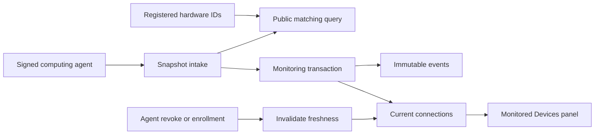

# Monitored device connections

Implemented backend and frontend contract. The external agent collector and physical
hardware behavior are not verified in the selected repositories.

## Ownership and behavior

An enrolled computing-equipment agent reports device observations with the **hardware IDs** it read
(Windows PnP device instance ID, kind `pnp_id`; Vector device name, kind `vector_device`). Equipment
matches them against IDs a coordinator **registered** on units (`EquipmentHardwareId`):
`matched` when they belong to one active unit, `ambiguous` when to several, `unmatched` otherwise.
`Equipment.serial_number` is a human label and is never used to match or written by monitoring. A
PnP ID whose last segment contains `&` was generated from a USB port; it is registered with the
computer it was read on and only matches there. Matching never creates inventory or changes
assignments, lifecycle, activity, bookings, RDP targets or session logs.

**Link** (`POST /api/labs/device-connections/{id}/actions/link`) registers the connection's reported
hardware IDs on the chosen unit and re-matches every observation that reported them; an ID already
registered on another unit → `409 hardware_id_in_use`, a device without IDs →
`409 hardware_id_unavailable`. IDs can also be managed directly:
`GET/POST /api/labs/equipment/{id}/hardware-ids`, `DELETE …/hardware-ids/{hardware_id_id}`.

**Watch list.** `GET /agent/monitoring-policy` returns `expected_devices`: the `ExpectedDevice`
rows of the agent's computer with each unit's registered IDs valid there. The agent reports only
devices on that list (plus a one-off discovery snapshot when an administrator asks for it in the
agent), so other peripherals never leave the computer. Discovery snapshots use collector
`discovery` and are evidence for linking only: they never confirm an expected device's presence,
never count as the computer reporting, and never raise disconnect alerts.

Equipment owns matching queries and frozen DTOs through `public.py`/`contracts.py`.
Monitoring owns observations, replay receipts and current connections. Agents owns
credential identity and revocation fencing. Legacy `computing.monitored_devices`
JSON and its operator write behavior are preserved; the UI uses the typed API.



## Endpoints and wire contract

| Endpoint | Access | Result |
| --- | --- | --- |
| `GET /agent/monitoring-policy` | Existing signed agent authentication | Current `generation_key`, limits and up to 200 catalog interface names |
| `POST /agent/device-observations/actions/report` | Existing signed agent authentication | Report action acknowledgment; UUID `Idempotency-Key` header required |
| `GET /api/labs/device-connections?computing_id=42` | Existing Labs coordinator/admin or enabled API key policy | Paginated typed connections, maximum page size 100 |

`/agent/info` advertises the new capability and paths. The server derives the
reporting computing equipment from the signing identity. Client-selected computing/agent fields
and unknown nested fields are rejected. Catalog hints do not claim OS collector
support. Report network devices only through explicitly configured targets.

Example POST body; replace the generation with the actual policy result:

```json
{
  "generation_key": "be0cde7f-9d44-482e-9328-4aaf0cb92434",
  "collector_key": "usb",
  "sequence": 1,
  "collected_at": "2026-11-17T03:00:00Z",
  "is_complete": true,
  "devices": [{
    "observation_key": "usb:stable-instance",
    "interface_name": "USB",
    "name": "Measurement probe",
    "hardware_ids": [{"kind": "pnp_id", "value": "USB\\VID_0403&PID_6001\\LABPROBE001"}],
    "state": "connected"
  }]
}
```

Collector keys are lowercase slugs, maximum 32 characters. Device strings are
bounded to 255 characters. Send at most 200 records and 256 KiB, with at most 200
connected devices per computing equipment/collector across partial updates. Sequence is a
persisted positive integer, maximum 9007199254740991. Collection time must be
timezone-aware and no more than five minutes in the future.

The first report per collector/enrollment generation must be a complete snapshot.
Incremental (`is_complete: false`) batches must continue the collector cursor exactly
(`sequence = cursor + 1`). An incremental batch that skips ahead returns 409
`snapshot_required` and writes nothing; the agent recovers by sending a complete
snapshot with a newer sequence. Complete snapshots may skip ahead because they are
self-contained. This guarantees a lost or delayed delta (for example a detach) is never
silently dropped.
A complete snapshot disconnects omitted currently connected devices only within
that collector. Partial updates never disconnect omitted devices. Empty complete
snapshots are valid. A detach without hardware IDs preserves known evidence for that
instance; a reconnect without IDs remains unresolved. Multipart snapshots are
not supported: never mark a truncated
or failed collector result complete. Instance keys must be stable across snapshots.

Acknowledgment is `data: {batch_key, sequence, disposition: {value, label}, received_at}`.
Disposition is `applied` or `stale`. Canonically identical retry returns the original
body with `Idempotency-Replayed: true`, with no freshness or event side effects.
Missing Idempotency-Key returns 400 `idempotency_key_required`; malformed/overlength
keys return 400 `invalid_idempotency_key`. Reusing the header key with changed content
returns 422 `idempotency_key_reuse`.
Reusing a sequence with a different key returns 409 `observation_conflict`. Older
sequences are acknowledged as stale without changing current state. Receipts are
purged after `DEVICE_OBSERVATION_RECEIPT_RETENTION_DAYS` (default 14), so retries must
complete within that window; see [Retention](#retention).

Read rows contain computing/equipment references `{id, uid, name}` and lookup interface
references `{id, name}`, nullable unresolved
references, reported `interface_name`, hardware IDs and name evidence, collector/observation
keys, enum-shaped state/match/freshness, and observed/received timestamps.

## Integrity and freshness

| Invariant | Guard |
| --- | --- |
| Authenticated identity stays valid through commit | Equipment → identity locks; recheck ACTIVE, fingerprint, enrollment time and equipment |
| No cross-enrollment sequence reset | Server-derived generation from agent/key/enrollment; first generation report must be complete |
| One ordered collector cursor | `device_cursor_computing_collector`, positive-sequence check and parent lock |
| Durable batch/sequence identity | `device_batch_replay_key`, `device_batch_sequence`, content hash and original receipt |
| One projection per device instance | `device_connection_observation`, valid-enum and positive-sequence checks |
| No partial writes or side effects | One transaction for receipt, projections, cursor and existing `MonitoringEvent` |
| Bounded synchronous reconciliation | Active-count cap; SQL updates only connected omissions; no repeated historical disconnect updates |

Lock order is equipment → authenticated identity → monitoring cursor/projections.
Lifecycle commands already holding identity lock invalidate cursors in the same
transaction without acquiring equipment afterward. No external I/O runs under locks.
Concurrent exact retries return 409 `request_in_progress` while the first transaction
is active. A retry after completion returns the original acknowledgment. A transaction-scoped
nonblocking PostgreSQL advisory claim runs before resource locks; its SHA-256-derived
64-bit scope can conservatively report busy on a hash collision, never grant duplicate execution.

Observed connected/disconnected state is independent of freshness. `fresh` requires a
current-generation cursor whose last applied batch was both received and collected
within 120 seconds. Because applied incremental batches are contiguous, that batch
confirms every device of the collector, including ones it did not mention. Agents must
apply at least one batch per collector within `freshness_seconds` from the monitoring
policy; an incremental batch with no devices is a valid keep-alive.
Older evidence is `stale`; recovery/revocation/enrollment makes prior state `unknown`
immediately. Heartbeats and replay do not refresh device evidence. Loss of the agent
does not prove physical disconnection. New complete snapshots reconcile connected
devices; historical disconnected observations preserve their original timestamps.

Each accepted snapshot writes an immutable `inventory_snapshot` event with its
typed records and completeness flag. Inventory lookups use a bounded joined result
(one query per batch over the `equipment_hardware_id_lookup` index). The index is reasoned,
not measured on production data. Reads use one joined serialization query or two
with pagination, verified with multiple related rows. Rows are ordered connected first,
then by most recent observation, with collector/observation key as a stable tiebreak.
Only active (not soft-deleted) inventory is a match candidate, and soft-deleted
computing equipment cannot report. `equipment` and `interface` are derived matches: removing the
referenced inventory row clears them (`SET NULL`) instead of blocking the delete. The UI fetches only while
open, polls every 30 seconds, and provides pagination, loading, empty and retry states.

## Lab-wide monitoring, inventory linking and expected devices

All endpoints below use the Labs staff policy (coordinators and admins, or an enabled API key).

| Endpoint | Purpose |
| --- | --- |
| `GET /api/labs/device-connections` | Paginated list. `computing_id` is optional; filters `bench_id`, `state`, `is_attention_required` (`true`/`false`) and `q` (device, serial, equipment or computing name/SKU). Ordered by computing unit, connected first, newest observation first. Rows add `bench` (`{id, name}` or null), `is_attention_required` and `expected_device_id`. |
| `GET /api/labs/device-connections/summary` | `connected` (connected and fresh), `needs_matching`, `unconfirmed` (last reported connected, not fresh), `missing` (expected, agent reporting, not connected) and `computing_units`; optional `bench_id`. Two aggregate queries. |
| `GET /api/labs/device-connections/{id}` | One row plus `first_seen_at` and `history`: state changes, newest first, derived from the latest 200 `inventory_snapshot` events of its collector (at most 20 changes). A complete snapshot that omits the device records it disconnected. |
| `POST /api/labs/device-connections/{id}/actions/link` | Body `{equipment_id}`. Registers the connection's reported hardware IDs on that active unit (`EquipmentHardwareId`, port-bound PnP IDs scoped to the reporting computer), then re-matches every observation that reported them. 409 `hardware_id_unavailable` (no ID reported), `hardware_id_in_use` (registered on another unit; never moved). `Equipment.serial_number` is not written. Repeating a successful link is a no-op. |
| `GET /api/labs/expected-devices` | Paginated; filters `computing_id`, `bench_id`, `presence`. Each row has `presence`: `present`, `missing` or `unconfirmed`, plus `last_seen_at`. Missing first. |
| `POST /api/labs/expected-devices` | Body `{computing_id, equipment_id, is_disconnect_alert_enabled}`. 409 `expected_device_exists` on a duplicate (`expected_device_unique`); 422 when the unit is expected on itself (`expected_device_not_self`). |
| `PATCH /api/labs/expected-devices/{id}` | Body `{is_disconnect_alert_enabled}`. |
| `DELETE /api/labs/expected-devices/{id}` | 204; 404 when already gone. |

`is_attention_required` is true when a row is not matched to exactly one unit, or was last reported
connected and is no longer fresh. Presence is `unconfirmed` whenever no collector of the
computing unit reported within the freshness window, because losing the agent never proves a
device left.

**Disconnect alerts.** When a report moves a matched device from connected to disconnected
(an explicit detach or a complete snapshot that omits it) and an `ExpectedDevice` for that
computing unit and equipment has its disconnect alert enabled (`notify_on_disconnect`), the expectation's creator receives an
in-app `Notification` (warning, kept 7 days). The row is written in the reporting transaction;
the websocket push to that user's channel only (never the broadcast channel) runs after commit.
Repeated snapshots of an already-disconnected device do not alert again.

**Lock order for linking.** Reporting computing unit → target equipment row → projection rows,
the same parent-first order as ingestion. A hardware ID is unique per kind (and computer, for
port-bound IDs) in the schema, so a concurrent link of one ID to two units fails for the second
with `hardware_id_in_use` instead of creating a duplicate.

## Retention

Celery beat runs `labs.monitoring.purge_device_observation_history` daily at 02:40
(`CELERY_TIMEZONE`). It deletes, in chunks of 5,000 rows with one short transaction
each and at most 200,000 rows per table per run:

| Data | Kept for | Setting |
| --- | --- | --- |
| Batch receipts (`DeviceObservationBatch`) | 14 days | `DEVICE_OBSERVATION_RECEIPT_RETENTION_DAYS` |
| Disconnected projections (`DeviceConnection`) | 90 days since last observation | `DEVICE_CONNECTION_DETACHED_RETENTION_DAYS` |

Connected projections and cursors are current state and are never purged. A late
duplicate after its receipt is gone is either stale (at or behind the cursor) or needs
a complete snapshot, so it cannot rewind state. `inventory_snapshot` monitoring events
follow the monitoring-event history policy and are not purged here; each is bounded to
200 devices. Indexes on `received_at` (partial for detached rows) keep both purge scans bounded.

## Compatibility and rollout

This is an additive T2 change. The tables, constraints and the hardware-ID indexes
(`EquipmentHardwareId`, `DeviceConnection.hardware_ids`) are folded into `labs/0001_initial` (ADR 005: one initial migration until the first
database is deployed). Development databases must be recreated, as with every 0001 fold.
Deploy backend, then frontend, then the agent collector.

Rollback frontend/API first; retaining new tables and index is compatible with old
code. Migration reversal deletes new monitoring/replay data and requires an archive
and owner approval in production. Existing initial migrations and field meanings
are preserved. No automatic backfill or production deployment occurs.

The external agent must persist queued batches/sequences, retry with stable keys
and fresh signature nonces, fetch policy after enrollment, report within the freshness
window, answer `snapshot_required` with a complete snapshot, and report the PnP IDs of
the devices on its watch list. Vendor/product-only matching and configurable detector
rules are not implemented. Do not log raw inventories or credentials. Physical
integration requires agent source and representative devices.

## API rule review

| Rule | Result | Implementation |
| --- | --- | --- |
| VER-2 | pass | Additive endpoints and capability; legacy JSON unchanged |
| ENV-1, ERR-1/3 | pass | Standard envelopes, strict semantic validation and malformed/query errors |
| TRN-4, NAM-3/8 | pass | No slash aliases; `_at` times and `_key` external identifiers |
| REL-3, ENU-1 | pass | Named references and enum value/label objects |
| RW-6 | pass | Required UUID header, canonical hash, durable replay body/header |
| COL-1/4/5, PRF-2 | pass | Required computing filter, capped pagination, stable order and query budgets |
| ACB/BLK | not applicable | One atomic reporting action, not generic bulk operations |


## Compliance corrections and verification scope

The report workflow now lives in the existing Agents application layer and takes a
frozen command. Agent generation is an intrinsic identity property; monitoring policy
is a read-only query. Equipment locking lives in its application layer, not queries.
Reporting and invalidation both require explicit neutral ActorContext scope and
capabilities. Invalidation has a frozen input and its own atomic boundary while
remaining within the lifecycle transaction. New adapters delegate authentication
failure mapping to the central handler, including the authentication challenge.

The two signed routes opt into bounded pre-authentication body reading and strict
JSON object parsing. Duplicate keys, invalid UTF-8/surrogates, non-finite constants,
excessive depth (32), and excessive object keys (1000) are rejected. Bodies are capped
at 256 KiB, and at most 100 semantic error details are returned. Unknown queries are
rejected on reads and writes. Strings normalize to NFC, reject control characters,
and preserve nonblank whitespace; whitespace-only required identifiers are rejected.
UUIDs must be hyphenated, and collection timestamps require RFC 3339 offsets.
Request schemas are closed objects; pagination parameters and 429 responses are
explicit in generated schemas. Connection/receipt timestamps use UTC Z with six
fractional digits.

Signed policy reads use strong content ETags and conditional 304 responses. Authenticated
reads declare private/no-cache; errors and POST responses declare no-store. Vary preserves
Accept and Accept-Language. Transport header, connection and slow-client deadlines remain
responsibilities of the deployed HTTP server/gateway; no production gateway was exercised.

Schema changes live in `labs/0001_initial` (ADR 005). Application-only rollback can
retain the expanded schema.


The new intake is a collection-level reporting action under ACT-1/ACB-1:
`POST /agent/device-observations/actions/report`, returning 200 acknowledgment.
It does not expose a primary snapshot resource requiring 201/Location. The earlier
uncommitted prototype route was corrected before publication, with no legacy alias.
Existing deployed routes are unchanged. Migration 0004 records the explicit ORM
boolean default False without PostgreSQL schema operations or row rewrites; reversal
is also state-only.
