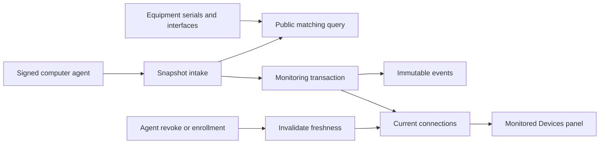

# Monitored device connections

Implemented backend and frontend contract. The external agent collector and physical
hardware behavior are not verified in the selected repositories.

## Ownership and behavior

An enrolled computer agent reports device observations. Equipment matches exact,
nonblank serial numbers against the equipment-declared interfaces (interface names
are case-insensitive). Capability names alone never identify an asset. Unknown
serials remain `unmatched`; incompatible interfaces are `interface_mismatch`;
multiple compatible candidates remain `ambiguous`. Matching never creates inventory
or changes assignments, lifecycle, activity, bookings, RDP targets or session logs.

Equipment owns matching queries and frozen DTOs through `public.py`/`contracts.py`.
Monitoring owns observations, replay receipts and current connections. Agents owns
credential identity and revocation fencing. Legacy `computing.monitored_devices`
JSON and its operator write behavior are preserved; the UI uses the typed API.



## Endpoints and wire contract

| Endpoint | Access | Result |
| --- | --- | --- |
| `GET /agent/monitoring-policy` | Existing signed agent authentication | Current `generation_key`, limits and up to 200 catalog interface names |
| `POST /agent/device-observations/actions/report` | Existing signed agent authentication | Report action acknowledgment; UUID `Idempotency-Key` header required |
| `GET /api/labs/device-connections?computer_id=42` | Existing Labs coordinator/admin or enabled API key policy | Paginated typed connections, maximum page size 100 |

`/agent/info` advertises the new capability and paths. The server derives the
reporting computer from the signing identity. Client-selected computer/agent fields
and unknown nested fields are rejected. Catalog hints do not claim OS collector
support. Report network devices only through explicitly configured targets.

Example POST body; replace the generation with the actual policy result:

```json
{
  "generation_key": "be0cde7f-9d44-482e-9328-4aaf0cb92434",
  "collector_key": "usb",
  "sequence": 1,
  "collected_at": "2026-11-17T03:00:00Z",
  "is_complete": true,
  "devices": [{
    "observation_key": "usb:stable-instance",
    "interface_name": "USB",
    "name": "Measurement probe",
    "serial_number": "LAB-PROBE-001",
    "state": "connected"
  }]
}
```

Collector keys are lowercase slugs, maximum 32 characters. Device strings are
bounded to 255 characters. Send at most 200 records and 256 KiB, with at most 200
connected devices per computer/collector across partial updates. Sequence is a
persisted positive integer, maximum 9007199254740991. Collection time must be
timezone-aware and no more than five minutes in the future.

The first report per collector/enrollment generation must be a complete snapshot.
A complete snapshot disconnects omitted currently connected devices only within
that collector. Partial updates never disconnect omitted devices. Empty complete
snapshots are valid. A detach without a serial preserves known evidence for that
instance; a reconnect without a serial remains unresolved. Multipart snapshots are
not supported: never mark a truncated
or failed collector result complete. Instance keys must be stable across snapshots.

Acknowledgment is `data: {batch_key, sequence, disposition: {value, label}, received_at}`.
Disposition is `applied` or `stale`. Canonically identical retry returns the original
body with `Idempotency-Replayed: true`, with no freshness or event side effects.
Missing Idempotency-Key returns 400 `idempotency_key_required`; malformed/overlength
keys return 400 `invalid_idempotency_key`. Reusing the header key with changed content
returns 422 `idempotency_key_reuse`.
Reusing a sequence with a different key returns 409 `observation_conflict`. Older
sequences are acknowledged as stale without changing current state. Receipts are
retained indefinitely in this implementation; no background purge is installed.

Read rows contain computer/equipment references `{id, uid, name}` and lookup interface
references `{id, name}`, nullable unresolved
references, reported `interface_name`, serial/name evidence, collector/observation
keys, enum-shaped state/match/freshness, and observed/received timestamps.

## Integrity and freshness

| Invariant | Guard |
| --- | --- |
| Authenticated identity stays valid through commit | Equipment → identity locks; recheck ACTIVE, fingerprint, enrollment time and equipment |
| No cross-enrollment sequence reset | Server-derived generation from agent/key/enrollment; first generation report must be complete |
| One ordered collector cursor | `device_cursor_computer_collector`, positive-sequence check and parent lock |
| Durable batch/sequence identity | `device_batch_replay_key`, `device_batch_sequence`, content hash and original receipt |
| One projection per device instance | `device_connection_observation`, valid-enum and positive-sequence checks |
| No partial writes or side effects | One transaction for receipt, projections, cursor and existing `MonitoringEvent` |
| Bounded synchronous reconciliation | Active-count cap; SQL updates only connected omissions; no repeated historical disconnect updates |

Lock order is equipment → authenticated identity → monitoring cursor/projections.
Lifecycle commands already holding identity lock invalidate cursors in the same
transaction without acquiring equipment afterward. No external I/O runs under locks.
Concurrent exact retries return 409 `request_in_progress` while the first transaction
is active. A retry after completion returns the original acknowledgment. A transaction-scoped
nonblocking PostgreSQL advisory claim runs before resource locks; its SHA-256-derived
64-bit scope can conservatively report busy on a hash collision, never grant duplicate execution.

Observed connected/disconnected state is independent of freshness. `fresh` requires
current-generation cursor and both receipt and collection time within 120 seconds.
Older evidence is `stale`; recovery/revocation/enrollment makes prior state `unknown`
immediately. Heartbeats and replay do not refresh device evidence. Loss of the agent
does not prove physical disconnection. New complete snapshots reconcile connected
devices; historical disconnected observations preserve their original timestamps.

Each accepted snapshot writes an immutable `inventory_snapshot` event with its
typed records and completeness flag. Inventory lookups use a bounded joined result
(4001 rows); saturation fails closed as ambiguity. The serial index is reasoned,
not measured on production data. Reads use one joined serialization query or two
with pagination, verified with multiple related rows. The UI fetches only while
open, polls every 30 seconds, and provides pagination, loading, empty and retry states.

## Compatibility and rollout

This is an additive T2 change. Apply migrations `0002_device_observations` and
`0003_equipment_serial_lookup`, deploy backend, then frontend, then the actual agent
collector. Retain the original migrations and both `_safe` replacement migrations. Fresh databases
use timeout-protected new-table DDL and `CREATE INDEX CONCURRENTLY`; installations
with originals applied adopt replacement history without schema work. Lock waits are
bounded to five seconds; the concurrent operation restores prior session settings.
Do not remove original migration files until deployment convergence and separate review. Only local databases were migrated in this task.

Rollback frontend/API first; retaining new tables and index is compatible with old
code. Migration reversal deletes new monitoring/replay data and requires an archive
and owner approval in production. Existing initial migrations and field meanings
are preserved. No automatic backfill, production deployment or deletion occurs.

The external agent must persist queued batches/sequences, retry with stable keys
and fresh signature nonces, fetch policy after enrollment, and collect real serial
and interface evidence. Vendor/product-only matching and configurable detector
rules are not implemented. An explicit retention policy is needed before running
indefinite observation history at production scale. Do not log raw inventories or
credentials. Physical integration requires agent source and representative devices.

## API rule review

| Rule | Result | Implementation |
| --- | --- | --- |
| VER-2 | pass | Additive endpoints and capability; legacy JSON unchanged |
| ENV-1, ERR-1/3 | pass | Standard envelopes, strict semantic validation and malformed/query errors |
| TRN-4, NAM-3/8 | pass | No slash aliases; `_at` times and `_key` external identifiers |
| REL-3, ENU-1 | pass | Named references and enum value/label objects |
| RW-6 | pass | Required UUID header, canonical hash, durable replay body/header |
| COL-1/4/5, PRF-2 | pass | Required computer filter, capped pagination, stable order and query budgets |
| ACB/BLK | not applicable | One atomic reporting action, not generic bulk operations |


## Compliance corrections and verification scope

The report workflow now lives in the existing Agents application layer and takes a
frozen command. Agent generation is an intrinsic identity property; monitoring policy
is a read-only query. Equipment locking lives in its application layer, not queries.
Reporting and invalidation both require explicit neutral ActorContext scope and
capabilities. Invalidation has a frozen input and its own atomic boundary while
remaining within the lifecycle transaction. New adapters delegate authentication
failure mapping to the central handler, including the authentication challenge.

The two signed routes opt into bounded pre-authentication body reading and strict
JSON object parsing. Duplicate keys, invalid UTF-8/surrogates, non-finite constants,
excessive depth (32), and excessive object keys (1000) are rejected. Bodies are capped
at 256 KiB, and at most 100 semantic error details are returned. Unknown queries are
rejected on reads and writes. Strings normalize to NFC, reject control characters,
and preserve nonblank whitespace; whitespace-only required identifiers are rejected.
UUIDs must be hyphenated, and collection timestamps require RFC 3339 offsets.
Request schemas are closed objects; pagination parameters and 429 responses are
explicit in generated schemas. Connection/receipt timestamps use UTC Z with six
fractional digits.

Signed policy reads use strong content ETags and conditional 304 responses. Authenticated
reads declare private/no-cache; errors and POST responses declare no-store. Vary preserves
Accept and Accept-Language. Transport header, connection and slow-client deadlines remain
responsibilities of the deployed HTTP server/gateway; no production gateway was exercised.

Retain originals 0002/0003 and both `_safe` replacements together. Fresh databases
select bounded table DDL and concurrent index DDL. Databases with original applied
history adopt replacements without schema changes; a partial 0002-only installation
runs only concurrent replacement 0003. Do not fake migrations or remove originals until
all installations converge and a separate finalization is reviewed. A failed concurrent
index build may leave an INVALID index; inspect PostgreSQL metadata and remove only the
failed index concurrently before retry. Schema rollback requires stopping writers and
exporting new data first; application-only rollback can retain the expanded schema.


The new intake is a collection-level reporting action under ACT-1/ACB-1:
`POST /agent/device-observations/actions/report`, returning 200 acknowledgment.
It does not expose a primary snapshot resource requiring 201/Location. The earlier
uncommitted prototype route was corrected before publication, with no legacy alias.
Existing deployed routes are unchanged. Migration 0004 records the explicit ORM
boolean default False without PostgreSQL schema operations or row rewrites; reversal
is also state-only.
