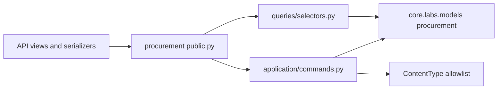
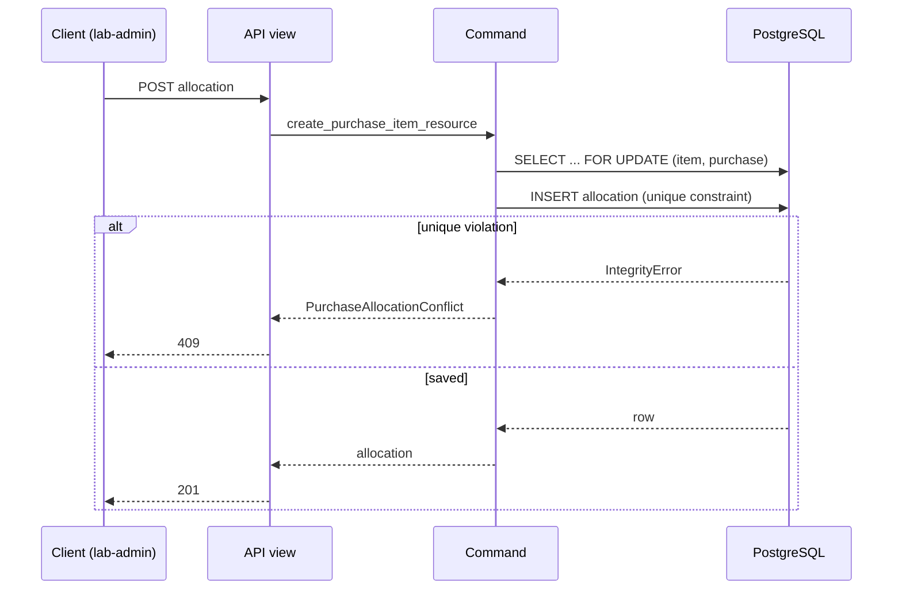

# Procurement Feature Architecture

> Status: Verified against code on 2026-10-19 · Owner: Labs / Procurement

**Verified** statements describe inspected code with `path:line` references. **Proposed** statements are not implemented guarantees.

## 1. Purpose and scope

**Verified.** Procurement records purchase orders, their line items, allocation of purchased items to supported resources (acquisition cost), and purchase payment/refund transactions. It exposes list and create endpoints only; there is no update, delete, or status-transition endpoint.

**Does not own:** resource identity or lifecycle (equipment, rooms, benches), license agreement terms or recurring entitlement costs (licenses), or general expense obligations and payments (expense feature).

## 2. Responsibilities and ownership

| Concept / rule | Owned here? | Notes |
| --- | --- | --- |
| `Purchase`, `PurchaseItem` | Yes (commands and reads) | Models centralized under `core/labs/models/procurement/purchase.py` |
| `PurchaseItemResource` (acquisition allocation) | Yes | Generic link to a resource; allowlist `PURCHASE_RESOURCE_MODELS` |
| `PurchaseTransaction` (payment/refund activity) | Yes | Distinct from the purchase commitment amount |
| Resource identity and lifecycle | No | Owned by the resource feature; procurement only references the object |
| License agreements and recurring costs | No | Licenses feature |
| General expenses and expense payments | No | Expense feature |

Models owned by this feature (link to authoritative docs; do not copy definitions):
[Labs model architecture, procurement section](../../../models/docs/labs-model-architecture.md#procurement-and-expenses).

Models used but owned elsewhere: resource models referenced by `PurchaseItemResource` (for example `Room`, equipment models), through their content type and object ID.

## 3. Public interface and contracts

**Verified.**

- `public.py` exports the read selectors (`list_purchases`, `list_purchase_items`, `list_purchase_item_resources`, `list_purchase_transactions`), the command inputs (`CreatePurchaseInput`, `CreatePurchaseItemInput`, `CreatePurchaseItemResourceInput`, `CreatePurchaseTransactionInput`, `PurchaseLineInput`), the commands, and `PurchaseAllocationConflict`.
- `exceptions.py` defines `PurchaseAllocationConflict`, which maps to HTTP 409. It has no HTTP concepts.
- Commands are frozen dataclasses with keyword-only `actor` (`application/commands.py`).
- Routes are in `api/urls.py`:

| Method | Path | Notes |
| --- | --- | --- |
| GET, POST | `/api/labs/purchases` | Create accepts optional nested `items` |
| GET, POST | `/api/labs/purchases/<purchase_id>/items` | Parent missing returns 404 |
| GET, POST | `/api/labs/purchase-items/<purchase_item_id>/resources` | Duplicate allocation returns 409 |
| GET, POST | `/api/labs/purchases/<purchase_id>/transactions` | `purchase_id` comes from the URL, not the body |

**Verified (routing).** `core/labs/api_urls.py` includes this URL module under `labs/`, so the routes are active.

**Approved additive contract.** Allocation create accepts `resource_kind` (`bench`, `equipment`, `license`, or `station`) as the stable public resource identifier. The server maps each value to the corresponding canonical Labs `ContentType`; clients do not discover these values through a GET endpoint. The legacy `resource_type_id` input remains accepted. At least one identifier is required, and when both are present they must resolve to the same content type. Allocation reads expose the read-only `resource_kind`; storage remains the existing generic relation (`resource_type` plus `resource_id`).

**Verified (permissions).** `ProcurementAPIView` sets `permission_classes = [HasAPIKey | IsLabCoordinatorReadWrite]`. Writes: lab admins (who inherit the coordinator role), coordinators, and API keys. Plain-user writes and unauthenticated requests without an API key get 403. Reads: lab coordinators and admins only (`IsLabCoordinatorReadWrite`, owner decision 2026-11-11); plain users and users without a Labs role get 403. API-key writes record no creator because the actor is `None`. Roles resolve from `URSGroup.labs_role` (`core/users/access.py`). Access-control change: requires human approval before merge (T2).

**Verified (OpenAPI).** Responses are declared with `drf_api_contracts`. The allocation-create schema publishes the supported `resource_kind` enum, documents legacy `resource_type_id`, and applies `anyOf` to require at least one identifier. Runtime validation additionally requires both identifiers to agree when both are supplied; this data-dependent comparison is documented on the schema but is not expressible as a static schema constraint.

## 4. Dependencies

| Depends on | Through | Direction rule |
| --- | --- | --- |
| `core.common.api` (`AppListAPIView`) | Import | Shared code, no feature imports |
| `core.users.public` (`IsLabCoordinatorReadWrite`) | Import | Users app; owns the Labs role mapping |
| `core.labs.features.base` (`CommandAPIView`) | Import | Shared Labs base |
| `core.labs.models` (procurement models) | Import | Models are centralized |
| Resource models (generic link) | Content type and object ID | No ordinary FK protection |

## 5. Workflows

### Create purchase with optional items

**Verified.** `create_purchase` is `@transaction.atomic`. It validates total (non-negative), currency (3 characters), status (in `PurchaseStatus.values`), and supplier (non-blank), then saves the purchase and each item. Item validation is an explicit check before each save.

### Add an item

**Verified.** `create_purchase_item` locks the parent `Purchase` with `select_for_update`, validates, runs `full_clean()`, and saves.

### Allocate an item to a resource

**Verified.** `create_purchase_item_resource` locks the item and parent purchase, checks the resource content type against `PURCHASE_RESOURCE_MODELS`, runs `full_clean()` (422 on failure), then saves inside a nested atomic block. An `IntegrityError` is converted to `PurchaseAllocationConflict` (409). The unique constraint on resource content type and object ID is the race guard.

### Record a transaction

**Verified.** `create_purchase_transaction` locks the parent purchase, runs `full_clean()`, and saves.

## 6. Lifecycle and state transitions

**Verified.** `Purchase.status` accepts values from `PurchaseStatus`. The API exposes no transition endpoint, so status is set only at creation.

**Proposed.** Define the allowed transitions (for example draft to ordered to received to closed) and enforce them in the command layer before a status endpoint is added. Do not add a status endpoint without this.

## 7. Invariants, concurrency, failure handling

**Database-enforced (verified in models).**
- `PurchaseItem` and `PurchaseTransaction` reference `Purchase` with `PROTECT`.
- Quantity and amount checks on purchase, item, and transaction models.
- Unique resource content type and object ID on `PurchaseItemResource`.

**Application-enforced (verified; may race).** Aggregate rules (allocated value or quantity not exceeding item totals) are checked in `clean()`. The parent row lock serializes writes that go through these commands. A write path that bypasses these commands would not be guarded.

**Proposed.** Confirm the aggregate invariant with the owner. If it must hold under concurrency, enforce it in the database (for example a trigger or a constraint over a computed total) rather than relying only on the parent lock.

**Failure behavior.** Validation errors map to 422 (`ValidationError`), missing parents to 404 (`ObjectDoesNotExist`), and allocation duplicates to 409.

## 8. Security and authorization

**Verified.** Writes: lab admins, coordinators, and API keys, enforced by `HasAPIKey | IsLabCoordinatorReadWrite` at the view level. Reads: lab coordinators and admins (see above). Deny by default: plain-user reads and writes get 403, and unauthenticated requests without an API key are rejected for writes. Object scoping is not applicable because access is role-wide.

**Open.** The permission comment and behavior disagree on whether non-admin reads are allowed (see section 3). Decide, then align the code and comment.

## 9. Observability and operations

**Not verified.** No logging or metrics specific to procurement were inspected. Migration state for the procurement models was not part of this document's scope; the Labs migration check currently reports an unrelated `computingequipment.rdp_file` change.

## 10. Tests and enforcement

**Verified.**
- `core/labs/features/procurement/tests/test_public_boundary.py`: AST checks for public exports, exception stability, and API-to-public-only imports.
- `core/labs/features/procurement/tests/test_resource_kind_serializer.py`: stable-kind, legacy and paired-input validation; allocation response kind; HTTP create wiring; and schema behavior.

**Gaps.**
- HTTP-level tests cover allocation create payload compatibility; broader allocation authorization matrix, 409 duplicate behavior, and other procurement endpoints remain untested.
- Status transition rules are not tested because none exist.
- No schema diff review.

## 11. Decisions, assumptions, open questions

- **Open:** read permission for non-admin users (align code and comment).
- **Open:** aggregate invariant (allocated amount versus item total) and whether it must be enforced in the database.
- **Open:** status transition model and endpoint, if needed.
- **Open:** N+1 on item counts in `list_purchases` (the `prefetch_related("items")` is present, but the serializer's count behavior was not re-verified).
- **Assumption:** `PurchaseItemResource` allowlist is the set in `PURCHASE_RESOURCE_MODELS`; the exact contents were not re-read for this document.
