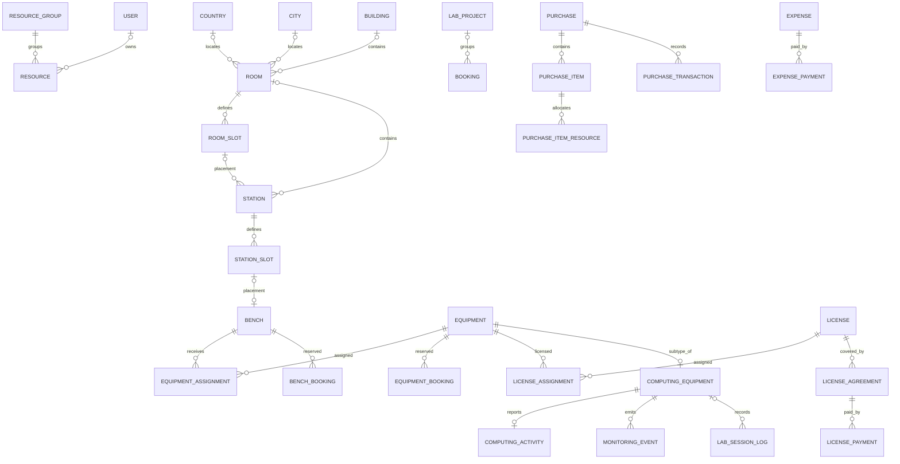
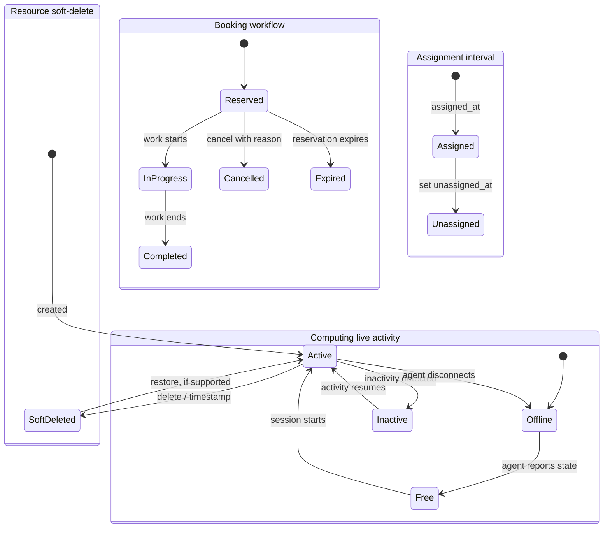

# Labs model architecture

> Status: Existing inventory coverage check is dated 2026-10-15; routing section additions were checked against source on 2026-11-07 · Authoritative owner: `core.labs` model packages

## Responsibility

Labs models persist physical resources and their operational relationships: locations, benches, equipment, licenses, bookings, procurement, expenses, audit history, analytics, monitoring, and remote-session activity. The model package is the authoritative source for exact fields, constraints, and deletion behavior; this document records the domain shape and material integrity properties.

Keep these concepts separate: a resource's soft-delete/lifecycle state, its status history, booking workflow, equipment/license assignment intervals, and live computing activity are not interchangeable. Purchase/expense/license agreement amounts also differ from actual transaction/payment records.

**Scope limits:** applied production schema, migration/deployment parity, production query plans, and all external readers/writers are not verified. This worktree contains Labs migrations `0001` through `0011`; migrations `0008`–`0011` are local and their deployment status is unverified. This document makes no claim that they match any deployed schema or establish production constraint coverage.

## Relationships

`COMPUTING_EQUIPMENT` is a multi-table subtype of `EQUIPMENT` (`ComputingEquipment(Equipment)`), so its primary key is the parent's key. The diagram omits abstract bases and non-relational identifiers. `RESOURCE` and `BOOKING` are abstract concepts, while purchase allocations use generic content-type links; these are not ordinary FK-backed relationships. Analytics frequently retains identifiers rather than foreign keys. The optional one-to-one `STATION_SLOT`–`BENCH` relationship is modeled as one slot having zero or one bench and one bench having zero or one slot. See each section below for actual relation behavior.

## Models

### Shared resource identity and model bases

**Models:** `ResourceGroup`; abstract `ResourceModel`, `ResourceStatusRecordModel`, `AgentReportedModel`, and `PhysicalLocationNode`.

- `ResourceModel` contributes a unique UUID `uid`, SKU, name, optional group and owner, remark, image, timestamps, and soft-delete behavior to concrete resources. Active SKU uniqueness is a conditional constraint inherited by concrete resource models.
- The default and all-object managers distinguish normal and soft-deleted rows; consult the soft-delete mixin for exact manager behavior.
- `ResourceStatusRecordModel` provides status and metadata fields to status-history models. `AgentReportedModel` provides agent/event identity and report timestamp fields; idempotency depends on concrete model constraints.
- `ResourceGroup.name` is unique; deleting a group referenced by a resource is protected.

### Locations and physical placement

**Models:** `Country`, `City`, `Building`, `Room`, `RoomSlot`, `RoomObservation`, `RoomStatusRecord`, `StationType`, `Station`, `StationSlot`, `StationStatusRecord`. `PhysicalLocationNode` is abstract. `RoomStatus` and `StationStatus` are choices, not models.

- Geography records are protected references from `Room`. A room owns its room slots; slots cascade when the room is deleted. `RoomObservation` and `RoomStatusRecord` are protected child histories.
- A station can reference a room and optionally a room slot; its type is protected. The station's room-slot FK is set null if the slot is deleted. `StationSlot` belongs to a station; compatible bench types are many-to-many. Station status history protects its station.
- Database constraints cover paired positive room layout dimensions, positive room dimensions, uniqueness of a station's non-null room slot, and the room/station slot coordinate/code constraints defined in the relevant models. The station's room/slot parent match is checked in `clean()`, not represented as a simple database constraint.
- Room/station operational-status strings, resource soft deletion, and status-history choices are distinct fields/concepts. Status records are indexed for latest-by-parent access.

### Benches

**Models:** `Bench`, `BenchGroup`, `BenchType`, `BenchFavorite`.

- `Bench` is a resource with optional protected group/type and setup-location station/slot references; it does not inherit the physical-location hierarchy. Its station-slot FK is one-to-one and protected. Placement/capacity compatibility rules are checked in model/feature validation and application commands.
- `BenchGroup` and `BenchType` have unique names. `BenchFavorite` joins a user and bench, uniquely per pair, cascading when either parent is removed.
- Feature commands use row locking for contested placement operations; this is application behavior, not a general property of the model.

### Equipment, categories, and assignments

**Models:** `Equipment`, `EquipmentStatusRecord`, `EquipmentAssignment`; references `EquipmentCategory`, `EquipmentKind`, `EquipmentType`, `EquipmentManufacturer`, `EquipmentProductModel`; subtypes `AccessoryEquipment`, `ComputingEquipment`, `DebuggingEquipment`, `DisplayEquipment`, `FurnitureEquipment`, `InstrumentEquipment`, `LaboratoryEquipment`, `MechanicalEquipment`, `NetworkingEquipment`, `OtherEquipment`, `PowerEquipment`, `SampleEquipment`; related reference models `TechnicalUser`, `EquipmentInterface`, `DisplayResolution`, `DisplaySize`, `Material`, `NetworkingProtocol`, `SampleCharacteristic`, `SampleCustomer`.

- `Equipment` extends resource identity and references a required kind plus optional type, manufacturer, and product model. Validation aligns type and kind. Concrete category models add category-specific fields and relationships.
- `EquipmentAssignment` connects equipment to a bench over an interval. Both FKs are protected. A conditional unique constraint permits at most one active bench assignment per equipment; a check enforces `unassigned_at >= assigned_at` when ended. There is no reciprocal active-capacity constraint per bench in this model.
- Equipment lifecycle/status history, bench assignment, and equipment booking are distinct. Consult category model source for exact fields and deletion semantics.

### Licenses, assignments, agreements, and payments

**Models:** `LicenseProduct`, `LicenseVendor`, `LicenseType`, `LicenseCategory`, `LicenseRestriction`, `License`, `LicenseStatusRecord`, `LicenseAssignment`, `LicenseAgreement`, `LicensePayment`. `LicenseStatus` and the shared `BillingPeriod` are choices.

- `License` extends resource identity. Product, vendor, type, category, and optional restriction relations are protected. Status history protects its license.
- `LicenseAssignment` links a license and equipment; both are protected. A conditional unique constraint prevents a duplicate active license/equipment pair, and a check validates the interval. The constraint does not limit a license to one equipment globally.
- `LicenseAgreement` is the dated price/billing obligation; `LicensePayment` records payments against an agreement. An agreement is not a payment. Agreement period checks are database-enforced; the payment model has a date index, with no explicit amount check found in its source.

### Bookings and projects

**Models:** abstract `Booking`; concrete `BenchBooking`, `EquipmentBooking`; `BenchBookingDecisionReceipt`; `LabProject`. `BookingStatus` and `BookingApprovalStatus` are choices.

- Concrete bookings point to a bench or equipment and inherit booking code, start/end, workflow and approval status, project, approver, and reason fields. Project and approver deletion sets the reference null. A database check enforces end after start.
- `Booking.is_reserving` combines booking and approval states. Booking status is separate from resource lifecycle and live activity.
- `BenchBookingDecisionReceipt` retains a successful coordinator/admin decision response for 24 hours to replay a matching
  idempotent request. It protects actor and booking references, uniquely scopes actor + booking + operation + UUID key,
  stores a request fingerprint and JSON response, and indexes expiry. The decision command removes expired receipts within
  its transaction before key lookup; this also permits expired keys to be reused. Receipt rows are operational replay
  records, not approval history; booking approval fields remain the decision state.
- Verified (grep 2026-10-15): no `ExclusionConstraint` or `btree_gist` usage exists under `core/labs/`. Bench and equipment reservations have no database overlap guard. Valid period checks alone do not prevent concurrent overlapping reservations; do not claim race-safe availability without an agreed invariant and database/transaction enforcement.

### Procurement and expenses

**Procurement models:** `Purchase`, `PurchaseItem`, `PurchaseItemResource`, `PurchaseTransaction`; choices `PurchaseStatus` and the shared `PaymentTransactionType`.

- Purchase items and transactions reference `Purchase` with `PROTECT`. Quantity and amount checks are defined on purchase/item/transaction models. `PurchaseItemResource` uses `ContentType` plus object ID for a generic resource association, so the target has no normal FK protection.
- A unique resource content-type/object-id pair prevents duplicate allocation of the same resource. `clean()` checks resource allowlist/existence and aggregate quantity/value rules; aggregate invariants are application-enforced and may race unless writes are serialized.
- `PurchaseTransaction` represents payment/refund activity rather than the purchase commitment.

**Finance models:** `Expense`, `ExpensePayment`; choices `ExpenseType`, the shared `BillingPeriod`, and `PaymentTransactionType`.

- `Expense` points to a generic resource through content type/object ID. The declared allowlist is the Labs room model; validation checks target existence. Database checks cover positive amount and valid dates, but generic target existence cannot be enforced by an ordinary FK.
- `ExpensePayment` is a protected child and records actual positive payment/refund activity; it does not redefine the expense obligation. Its amount constraint is database-enforced.

### Auditing

**Models:** `ResourceAudit`, `ResourceChangeLog`.

Both models refer to resource targets with generic content-type/object-id associations rather than a concrete FK. They include time/target-oriented indexes. Generic target references can become orphaned; retention and audit immutability depend on policy beyond the FK layer.

### Analytics and measured events

**Abstract models/choices:** `AnalyticsObservation`, `AnalyticsEvent`, `AnalyticsSource`, `AnalyticsGranularity`.

**Observation models:** `ActiveUserObservation`, `ActiveLaboratoryObservation`, `BookingVolumeObservation`, `VisitorVolumeObservation`, `ResourceUtilizationObservation`, `BookingOutcomeObservation`, `LaboratoryAvailabilityObservation`, `ProjectUsageObservation`.

**Other models:** `LaboratoryVisitEvent`, `StorageQuotaMeasurement`.

- Observation periods are checked for valid ordering in model validation; metric models declare natural-period unique keys. Utilization has a database check that booked duration does not exceed available duration.
- `ProjectUsageObservation` may reference a project with `SET_NULL` and retains a stable identifier. `LaboratoryVisitEvent` may reference a visitor with `SET_NULL`. Analytics events support source/external-reference uniqueness where the reference is nonempty.
- `StorageQuotaMeasurement` uses external identifiers, nonnegative capacity values, and measurement uniqueness. Used-capacity-versus-quota validation is in `clean()`, not a database check in the inspected source.
- Analytics identifiers and retention/correction policy are intentionally decoupled from live operational row lifecycle in several models.

### Monitoring, live activity, and sessions

- `MonitoringEvent` extends `AgentReportedModel`, protects its `ComputingEquipment` relation, and has an idempotency key on computer/agent/event ID plus time-oriented indexes. Custom-action naming and JSON-object validation are model-level behavior.
- `ComputingActivity` is one-to-one with `ComputingEquipment` and stores current remote-access/activity state. Its `offline`, `free`, `active`, `inactive`, and `maintaining` choices are live activity, not equipment lifecycle or booking status. Equipment deletion cascades to this row.
- `LabSessionLog` retains remote session identifiers/times and optionally references computing equipment with `SET_NULL`. It enforces agent/event uniqueness per equipment, a valid login/logout interval, and nonnegative duration; history can remain if equipment is deleted.

### Agent identity and enrollment

**Models:** `AgentIdentity`, `EnrollmentGrant`.

- `AgentIdentity` belongs to one `ComputingEquipment` and has a server-generated `agent_uid`. The device-generated
  Ed25519 public key is stored for proof verification; no private key is accepted or persisted by the backend.
- An identity is pending, active, revoked, or decommissioned. A conditional unique constraint permits at most one
  pending or active identity per equipment, and a check requires an active identity to have a public key and digest.
  Revoked/decommissioned identities remain as audit history and do not block a replacement enrollment.
- `EnrollmentGrant` is equipment/identity-bound, expires, and is one-use. Only its SHA-256 digest is persisted;
  the raw grant is returned once at issuance. The grant row is protected from cascading deletion with its identity.
- Enrollment proof of possession binds the configured backend identifier, agent UID, grant digest, and submitted public key.
  Key storage tier and client-reported fingerprint/version are metadata, not remotely verified hardware attestation.
- Access-token issuance, refresh/revocation records, assertion replay nonces, rotation/recovery workflows, and agent
  identity lifecycle operations are not implemented by the R0 routing schema.

### Routing and sync projection (R0 schema plus bounded R1 producers in worktree)

**Models:** `SyncState`, `RoutingChange`, `RoutingEntity`, in `core/labs/models/routing/` and exported
through the Labs root model package. The R0 worktree schema adds stream version/epoch state, versioned
change records with immutable event payloads, and a latest-entity projection with tombstones. PostgreSQL
constraints enforce stream/version and stream/key uniqueness plus upsert/delete and live/tombstone payload
shape. Source-specific publishers and bounded agent/user producers now write these models transactionally;
existence in source does not establish that the migration was applied in any database or deployed.

- Revised target streams are `users` and `agents`; there is no active or populated equipment ownership stream.
  User routing keys are derived from the persisted Entra `tenant_id` and `object_id` UUID pair. User routes are
  eligible only for active local users with an Entra binding; unlink, deactivation, replacement, or deletion tombstones
  the prior key. User lifecycle writes belong to `core.users` commands; routing receives only derived scalar identity data
  through its public publisher and imports no users ORM at runtime. Admin activity/binding edits are restricted; login,
  operator binding, and URS activity changes use the owner command.
- Agent routing uses `AgentIdentity.agent_uid`, not the linked equipment UID. Only active agent identities are
  eligible; leaving active state tombstones the route, and reactivation republishes the same key. These route projections
  contain identity and active-state data only, not public keys or other credentials.
- This bounded producer coverage does not establish a complete writer inventory or backfill/reconciliation; R1 user
  stream readiness remains blocked until external/direct ORM/SQL paths are covered and population is reconciled. No API
  endpoint is mounted.
- Schema compatibility: the owner reports migration 0011 applied, but its status is not independently verified in this workspace; it established `equipment` and `agent_keys`
  stream constraints. A forward migration adds `users` and `agents` while temporarily allowing the legacy labels.
  Legacy labels are not enabled streams and must not be seeded or written; a future contraction requires verified zero
  legacy rows and no remaining writers.
- `RoutingChange` must retain immutable upsert payload/hash so compacted deltas do not accidentally serialize a newer
  projection value for an older event. Per-stream `SyncState` locking serializes version assignment before projection
  row lookup/insertion. Detailed hash, pagination, retention, and security gates are in
  [the routing-sync spec](../../../../docs/agent-platform/routing-sync.md).
- Migration `0011` creates these tables but does not seed `SyncState` rows; the forward migration changes allowed
  stream labels but likewise does not seed state rows. Stream initialization/seeding, immutable
  snapshot generation, retention, and consistent snapshot paging remain
  separate design/implementation gates; mutable live projection rows alone do not provide snapshot consistency.
  Schema or runtime behavior must not be treated as deployed or production-approved; the R2 endpoint remains blocked
  from exposure until the trusted proxy mTLS attestation boundary is concretely reviewed and tested.

## Lifecycle

Labs does not expose one common lifecycle state machine for all models. These conceptual tracks are separate; `ResourceModel.deleted_at` is soft deletion, not a replacement for them.

Verified: the booking states shown match `BookingStatus` (`reserved`, `in_progress`, `completed`, `cancelled`, `expired`) in [booking base](../booking/base.py). The Assignment and Activity tracks are conceptual; transition guards are not centralized in the model package.

## Relationships to other groups and domains

| Related model/domain | Owning document | Direction | Notes |
| --- | --- | --- | --- |
| User | Not identified in the documentation map | Labs models reference user for ownership, stamps, favorites, approvals, and audits | User deletion behavior varies by relation. |
| Content types | Django contenttypes framework | Procurement, expense, and audit records use generic references | No FK to each concrete resource target. |
| Labs feature modules | Feature source under `core/labs/features/` | Feature modules operate on Labs persistence models | Public facades exist for locations, benches, equipment, licenses, and procurement. |

## Dependents

Verified feature packages with `public.py` facades: locations, benches, equipment, licenses, procurement. Other Labs model groups (booking, finance, audit, analytics, monitoring, activity, session) exist, but their complete public integration boundaries are not established by this model document. Several feature implementation modules import model classes directly; whether each import is an approved internal boundary requires a separate dependency review.

## Open questions

1. Confirm accountable owners and public write interfaces for booking, finance/expense, auditing, analytics, monitoring, live activity, and session records.
2. Decide reservation overlap semantics and a PostgreSQL/transaction strategy that prevents concurrent conflicting bookings.
3. Confirm whether cross-parent slot consistency, purchase allocation aggregates, and used-storage-versus-quota must be concurrency-safe invariants.
4. Confirm generic-reference allowlists, orphan handling, retention, and audit immutability policy.
5. Reconcile model source with the maintained Labs migration history (`0001`–`0011` in this worktree) and deployed database before schema changes; deployed migration parity remains unverified.
6. Proposed enforcement: add an architecture test that fails when a class under `core/labs/models/` is absent from this document's inventory, so the coverage claim cannot drift silently.

## Coverage and verification

Coverage check (2026-10-15): source search found 107 class declarations across 46 Python files, including choices, querysets, and abstract bases. The concrete model classes and abstract model bases have been inventoried by group above; choices and querysets are not models. The inventory is an architecture-level model coverage pass, not an exhaustive field-by-field schema audit; equipment category fields, every index, and all migration/deployment behavior were not individually listed.

Source of truth for detailed fields and constraints: model modules under `core/labs/models/`; model registration exports: `core/labs/models/__init__.py`. The 2026-11-07 verification covers the routing additions, not a re-audit of the older inventory. No migrations were applied and no production schema, query plans, or Mermaid renderer were checked/run during this documentation update.
