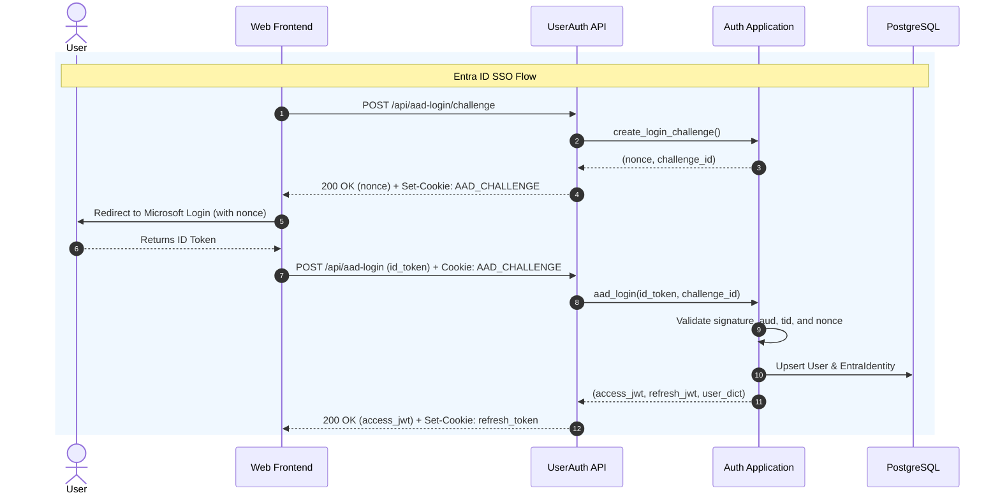

# Feature Specification: User Authentication (`core/users/features/auth`)

## 1. Domain Overview & Purpose
The Authentication feature manages session establishment, token lifecycle, local credentials verification, multi-factor OTP delivery, and enterprise Microsoft Entra ID (Azure AD) Single Sign-On (SSO) for the Lab Mango platform.

---

## 2. Data Models & Database Invariants

### 2.1 `core.users.models.User`
- **Inheritance:** `AbstractUser`, `TimeStampedModel`, `TimestampedSoftDeleteMixin`.
- **Key Fields:**
  - `username` (CharField(150), unique, indexed, case-insensitive normalization).
  - `email` (EmailField, normalized to lowercase).
  - `display_name` (CharField(255), optional human display name).
  - `name` (CharField(255), full name).
  - `department` (CharField(100), corporate department identifier).
  - `is_active` (BooleanField, default=True).
  - `is_staff` / `is_superuser` (BooleanField).
  - `deleted_at` (DateTimeField, nullable, indexed).
- **Constraints & Invariants:**
  - Soft-deleted users (`deleted_at IS NOT NULL`) cannot authenticate or establish active sessions.
  - Email uniqueness enforced across active records.

### 2.2 `core.users.models.EntraIdentity`
- **Purpose:** Maps corporate Azure AD enterprise identities to local Lab Mango users.
- **Key Fields:**
  - `user` (OneToOneField `User`, on_delete=CASCADE, related_name="entra_identity").
  - `oid` (UUIDField, unique, indexed — Microsoft Object ID of user).
  - `tid` (UUIDField, indexed — Microsoft Tenant ID).
  - `preferred_username` (CharField(255)).
  - `email` (EmailField).
  - `last_synced_at` (DateTimeField).

### 2.3 `core.users.models.LabManagementEmail`
- Pre-approved corporate email whitelist for elevated lab administrative operations.

---

## 3. Architecture & Security Policies

### 3.1 Dual-Token Authentication Policy
- **Access Token:** Short-lived JWT (default: 15–60 minutes) returned in HTTP response JSON payload for `Authorization: Bearer <token>` header transmission.
- **Refresh Token:** Long-lived JWT delivered strictly via `HttpOnly`, `SameSite=Lax`, `Secure` cookies (`settings.REFRESH_TOKEN_COOKIE_NAME`).
- **Never In Body:** Refresh tokens are never accepted in, nor emitted to, request/response bodies.

### 3.2 Anti-CSRF & Replay Defense
- **Cookie Mutations:** All endpoints that accept credentials or tokens via cookies enforce `CookieCSRFPermission` checking `X-CSRFToken` request headers.
- **Entra Anti-Replay:** Azure AD authentication requires pre-flight challenge generation (`POST /api/aad-login/challenge`) issuing a cryptographically secure nonce stored in an HttpOnly challenge cookie (`AAD_LOGIN_CHALLENGE_COOKIE`).

### 3.3 Rate Limiting & Throttling
- All public endpoints enforce `ScopedRateThrottle` (`auth_login`, `auth_refresh`, `auth_otp`).

---

## 4. API Endpoints & Transport Contracts

| Method & Path | View Class | Request Payload | Success Response (200/201) | Problem Codes |
|---|---|---|---|---|
| `POST /api/login` | `UserLoginView` | `LoginSerializer` (`username`, `password`) | `LoginResponseSerializer` (`token`, `user`) | 400 (`invalid_request`), 401 (`invalid_credentials`), 422, 503 |
| `POST /api/logout` | `UserLogoutView` | Empty | 200 `EmptyPayloadSerializer` | 403 (`forbidden`) |
| `POST /api/refresh-token` | `UserRefreshTokenView` | Cookie only (`refresh_token`) | `RefreshTokenResponseSerializer` (`token`, `user`) | 401 (`invalid_refresh_token`), 403, 503 |
| `POST /api/send-otp` | `SendUserOTPView` | `SendOTPSerializer` (`username`, `otp`) | `SendOTPResponseSerializer` (`message`) | 400, 403, 422, 503 (`service_unavailable`) |
| `POST /api/aad-login/challenge` | `UserAADChallengeView` | Empty | `AADChallengeResponseSerializer` (`nonce`, `csrf_token`) | 503 |
| `POST /api/aad-login` | `UserAADLoginView` | `AADLoginSerializer` (`id_token`) | `AADLoginResponseSerializer` (`token`, `user`) | 401 (`unauthorized`), 422, 503 |

---

## 5. Domain Workflow & State Transitions

