# Agent: Backend-Facing Device Design

Status: Proposed device behavior · mTLS direction accepted by owner · 2026-11-08
Owner: Agent team · Device implementation outside this backend workspace

The [backend Agent API design](backend-agent-api-spec.md) owns lifecycle/reporting routes and protocol
gates. This document owns Windows/Linux client behavior only. The [routing-sync design](backend-routing-sync-spec.md)
remains routing authority, unchanged. Neither document approves final schemas, implementation or release.

## 1. Repository facts and scope

**Verified — source only, not runtime certification:** backend has
[identity/enrollment commands](../core/labs/features/agents/public.py#L3-L38),
[Computing fields](../core/labs/models/resource/equipment/computing.py#L23-L43),
[separate activity commands](../core/labs/features/equipment/categories/computing/application.py#L69-L107),
[monitoring public commands](../core/labs/features/monitoring/public.py#L1-L15) and
[narrow Agent-associated end-time command](../core/labs/features/bench_bookings/application/update_agent_booking_end_time.py#L29-L108).
These do not establish mounted mTLS/CSR/booking-session APIs. Desktop/service/platform adapters were not inspected.

**Proposed scope:** trusted bootstrap, locally held installation key/certificate, direct backend
reporting, bounded recovery/retries and optionally approved booking gate. External configuration/update
delivery is outside scope; no endpoints/trust/release infrastructure defined here. Locally trusted
policy and safe service maintenance remain requirements, not assumed remote contracts.

## 2. Components and independent identities

**Proposed smallest design:**

| Component | Responsibility |
| --- | --- |
| Identity/key adapter | Locally generate/use keys; restrictive handles/files; Windows/Linux provider adapters |
| Enrollment/certificate client | Server-TLS bootstrap, fresh proof, same-result recovery, validation/install/renew/confirm |
| Backend client | Canonical trusted HTTPS origin, mTLS, capabilities/limits/errors; never forward credentials on redirects |
| Collectors | Allowlisted snapshot, separate activity, monitoring and heartbeat; no private-key access |
| Outbox/operation journal | Bounded immutable event retries, unsent snapshot coalescing, non-secret issuance/generation recovery |
| Optional privileged booking service | OS session reconciliation, check-in/leases/actions, local throttle and gate enforcement |
| Optional UI/local IPC | Presentation/masked code only, peer/session authorization; no key or backend network access |

Logical `agent_uid`, Agent installation certificate and independent Router service certificate have
separate lifecycles. Renewal preserves logical identity. Equipment UID/hostname/agent UID are not
credentials; Router provisioning registers no Lab Mango entity. Routing contains no credentials and
cannot authorize cross-backend adoption or queued-data transfer.

**Proposed storage:** usable TPM-backed non-exportable Windows CNG/Linux TPM/PKCS#11 preferred, not
mandatory. Approved OS/software fallback needs restrictive service-account permissions/backup exclusion.
Claims are not attestation; test algorithms/providers against approved profile, including current
Ed25519 foundation. Private keys never leave device and are unavailable to UI/collectors/diagnostics.
Expiry/key loss/reimage/TPM reset requires operator recovery, never export or automatic trust fallback.

## 3. Bootstrap, renewal and denial

**Proposed workflow; schemas/proof encoding pending:**

1. Trusted provisioning gives canonical backend origin/identity, pending `agent_uid`, protocol and
   server trust. Receive grant transiently via masked prompt/protected channel, never URL/CLI/config/log.
2. Validate server TLS, generate local key, atomically journal non-secret operation context/CSR digest/
   key handle. Retain same key after lost response, do not silently create another installation.
3. `POST /agent/enrollment-challenges` gets fresh nonce for bound enrollment/recovery. Approved proof
   binds backend/domain/protocol, identity, operation, grant/CSR/key digest and nonce; CSR alone insufficient.
4. `POST /agent/enrollments` creates issuance operation with grant/CSR/proof; no existing client cert
   required for bootstrap. Pending issuance is not activation or signing success.
5. `POST /agent/enrollments/actions/recover` uses fresh bound-key proof/context for SAME recorded result;
   never re-redeem grant or retrieve by identifier alone. Issuer/DB ambiguity must be reconciled by provider.
6. Verify chain/profile/identity/validity/key match, install crash-safely, clear transient grant best-effort.
7. Renew with jitter: `POST /agent/certificates/actions/renew` uses currently usable mTLS credential
   and new CSR/key proof. Journal generations; install/test new then
   `POST /agent/certificates/actions/confirm` proves it through new mTLS before old retirement under overlap.
   Reconcile crash/loss; bounded cleanup, never discard sole usable key early.

**Proposed trust:** every installation-authenticated request checks usable DB credential, active identity,
operation and object permission, including TLS reuse/resumption. Bootstrap uses the separate grant/proof
policy above and needs no existing certificate. Local certificate validity cannot override DB denial.
Revocation/deactivation stops operations; no endless renewal/issuance, identity switch or cross-backend
adoption. In-flight completion and measured denial objectives require approval. Neither key usable →
operator recovery. Windows/Linux share protocol, not necessarily storage implementation.

## 4. Reporting and actual consumers

**Proposed routes, not deployed APIs:** use only implemented approved capabilities in `GET /agent/info`;
validate standard envelopes and limits. Backend owns exact schemas and
[consumer/owner ledger](backend-agent-api-spec.md#2-owner--consumer-ledger-and-smallest-design).

| Route | Client behavior |
| --- | --- |
| `GET /agent/info` | Canonical identity/capabilities/limits; no separate ping needed; read does not refresh liveness |
| `POST /agent/heartbeat` | Bounded Agent health/liveness, approved cadence/jitter; not activity freshness or booking lease |
| `PATCH /agent/equipment/state` | On change/approved cadence, hostname/OS/IP/disks/typed system information; coalesce unsent snapshots |
| `PATCH /agent/equipment/activity` | Separate live resource activity, including unchanged reports when owner freshness policy requires |
| `POST /agent/events` | Bounded typed monitoring batches; stable durable IDs/content, remove only acknowledged records |

**Proposed single source:** hardware only inside typed allowlisted `system_info`, disks in `disk_usage`.
Equipment detail/dashboard consumers justify snapshot, not speculative duplicate inventory or time-series
stores. No separate inventory/metrics ingestion. Events do not implicitly update snapshot/activity/liveness/
bookings or populate `LabSessionLog`; dedicated raw-session ingestion deferred until mapping/minimization/
retention approved. Licenses/procurement/expenses have no new ingestion requirement.

**Proposed freshness:** observation identity/content, `collected_at`, backend `received_at`, ordering/
retry/tie/stale rules required protocol work, not assumed current columns. Agent liveness separate from
activity `last_agent_report_at`: unrelated heartbeat cannot keep stale activity alive without explicit
equipment-owner policy. Resource lifecycle, assignment, booking and live activity remain distinct.

Typed allowlists/units and body/depth/string/array/frequency limits, approved privacy only. Existing
session/user fields are not automatic collection permission; no unrestricted processes/command lines/
environment data. Deadlines/bounded queues contain failures; restricted worker isolation for blocking
collectors as needed. Collection cannot starve lease enforcement. Backend decides hostname versus RDP
target and file recovery; Agent never changes RDP files or technical-user settings.

## 5. Durability, retry and diagnostics

**Proposed bounded outbox:** persist before transmission, partition by identity/backend/protocol.
Stable immutable event ID/content survives retries/rebatching. Reimage/transfer quarantines old queue
instead of reattributing data. Specify fsync/WAL/checkpoint or segments, disk reserve/retention/crash
recovery in implementation; no storage dependency selected here.

- Explicit priority/retention/counted loss; coalesce unsent snapshots under approved ordering. No
  unlimited retention or exactly-once promise. Disk-full/corruption observable, not busy loops.
- Provider acknowledges accepted/duplicate/rejected records or atomic batch acceptance. Existing
  monitoring conflicts are not replay acknowledgments. Transactionally delete acknowledged records;
  retain transient failures, bounded quarantine terminal failures.
- `Idempotency-Key`: original status/body replay + `Idempotency-Replayed: true`; changed body →
  `422 idempotency_key_reuse`; pending → `409 request_in_progress`. Domain `409 enrollment_conflict`
  separate. Fresh-proof recovery is new exchange for same operation, not expired-challenge replay.
- Bounded exponential backoff/jitter, `Retry-After` wins. Split `413` only under approved stable-ID/
  atomic semantics; quarantine single oversized record. `412/428` reread/reconcile, not blind extension.
  Timeout/`5xx` outcome unknown; retain same write intent/retry key.
- Never queue grant/code/private-key bytes. Booking journal only approved non-secret intent/session
  references; expired intent reconciles, not delayed execution. No raw rejection-body diagnostic dumps.
- Monotonic deadlines, UTC wire times, bounded trusted correction. Sleep/reboot/clock rollback cannot
  extend lease authority. Collectors/downsampling bounded, control service remains responsive.

**Proposed diagnostics:** redacted structured request IDs, version/provider/cert expiry, last operation
success, bounded queue/drop counters and local health. No code/grant/key/raw system/session or personal
payload. Local CLI/file/service-manager health, no listening endpoint. Restrictive service/IPC files,
least privilege and safe maintenance handoff; external update delivery remains outside scope.

## 6. Additional gated booking capability

**Proposed and independently approved, not implicit core delivery:**

| Route | Meaning |
| --- | --- |
| `GET /agent/bookings` | Bounded scoped display list |
| `GET /agent/bookings/{id}` | Scoped ID detail, bodyless |
| `GET /agent/bookings/code/{booking_code}` | Read-only lookup of eligible booking by code; does not check in or create session; security/API release gate |
| `POST /agent/bookings/actions/checkin` | Code in body creates/resumes an Agent-bound backend session; no OS access enforcement implied |
| `POST /agent/booking-sessions/{id}/actions/keepalive` | Reconcile lease/termination |
| `POST /agent/booking-sessions/{id}/actions/end` | Session only, not booking |
| `PATCH /agent/bookings/{id}` | Only end-time mutation + session reference in body, strong If-Match and retry key |
| `POST /agent/bookings/{id}/actions/complete` | Separately enabled explicit completion, session reference in body |

The owner selected a read-only `GET /agent/bookings/code/{booking_code}` lookup, separate from body-based
check-in; the path credential risk requires explicit Security/API release approval and verified end-to-end
redaction, throttling, `no-store`, generic errors and no-echo behavior. Check-in body remains strict,
bounded and secret-safe; GET has no body. Reads minimize ID/times/status, no code/creator/reason; scoped,
throttled and `no-store`, with generic `404 booking_not_available`. Cached reads never grant access;
verified mTLS and backend object authorization remain required. Backend booking sessions do not enforce
desktop login or OS-level workstation access.
Command-owned Computing assignment → bench → eligible booking, never arbitrary shared-bench authority.

### 6.1 Service enforces, UI presents

The user-entered booking code is a booking-scoped login credential, not verified named-user identity.
The service's mTLS proves the device; the code authorizes eligible use of the associated booking.
Preview GET is optional and cannot open the gate. Successful check-in returns an Agent/booking/OS-bound
session plus permitted actions; retries recover the same session after response loss. Clear the code
after check-in and use the session reference with mTLS for keepalive and permitted booking updates.
The backend rechecks session/booking eligibility on every action. Updating the booking means permitted
end-time/completion changes, not replacing `booking_code`; code rotation requires a separate design.

**Proposed:** privileged service detects OS session, applies approved immutable SID/UID exemptions,
launches UI, throttles and calls check-in. UI no keys/network; masked code through bounded Windows pipe/
Unix socket IPC with ACL, peer user/session checks; reject cross-session/impersonation. No echo/log/disk
code. UI failure cannot release gate; restart/watchdog/maintenance requires real-platform tests.

```mermaid
stateDiagram-v2
    [*] --> Gated: OS session detected; confirmation policy applies
    Gated --> Active: online check-in succeeds; bound lease valid
    Gated --> Ending: deadline expires; approved lock/logoff
    Active --> Disconnected: OS disconnect; bounded grace
    Disconnected --> Active: same OS identity/session reconnects; lease valid
    Disconnected --> Ending: grace expires or lease unavailable
    Active --> Ending: lease expires or backend terminates
    Ending --> [*]: OS action and session reconciliation
```

**Proposed safety:** new check-in always online; no offline code validation. Existing session at most
earlier of booking end and approved maximum offline lease; extensions require online confirmation.
Bounded revocation latency, not immediate offline denial. Persist non-secret session/boot generation,
reconcile restart before resume, clock changes cannot extend authority; failure applies approved lock.
Session end/logoff not implicit completion; Finish uses separate action. Warning/deadline/disconnect/
exemption/break-glass policies need approval; no historical defaults declared production requirements.
Topmost application UI is not OS credential/isolation boundary: pre-confirmation access may exist and
admins can defeat it. Strict denial needs separately designed/tested OS integration, not UI promise.

## 7. Delivery and validation gates

**Accepted six-phase direction; Proposed evidence, not completed:** follow
[backend core plan](backend-agent-api-spec.md#9-six-phase-core-plan-and-acceptance-evidence).

| Phase | Client evidence required |
| --- | --- |
| 1 — Protocol/CA/profile | Windows/Linux key/CSR/TLS fixtures, trusted bootstrap/proof/recovery, storage/privacy/trust approval |
| 2 — Creation/enrollment APIs | Strict challenge/grant schemas/errors, enrollment journal/crash tests, no pending activation |
| 3 — Issuance/mTLS | Lost-response same-result recovery, profile/key validation, spoof/cross-identity/per-request denial |
| 4 — Computing state, activity, monitoring and heartbeat | Bounds/order/ties/retry, atomic acknowledgment, outbox/disk/isolation, independent freshness |
| 5 — Renewal/revocation/recovery | Every journal phase crash/loss, confirm/overlap/cleanup, expired/key-loss operator recovery, no disabled revival |
| 6 — End-to-end staging | Real Windows/Linux, TLS-reuse denial, issuer outage/restore/rotation, maintenance/rollback, soak/fleet jitter and release approval |

Optional bookings add independent ID/code non-disclosure/secrecy, no search-based authority, assignment/
session/throttle/precondition/concurrency, completion separation, UI/service failure and offline/reboot/
clock/maintenance tests. Simulator alone not production certification.

**Open decisions:** API/security auth extension/grant replay/schemas; CA/profile/issuer/termination;
proof/recovery retention/replacement/state; snapshot order/hostname/RDP; event mapping/bounds/retention;
booking code/session/OS/offline. Respective data/equipment/monitoring/booking owners, QA and operations
must settle gates before implementation. No new dependency, schema or infrastructure change and no
fresh Python/runtime certification in this documentation task.
