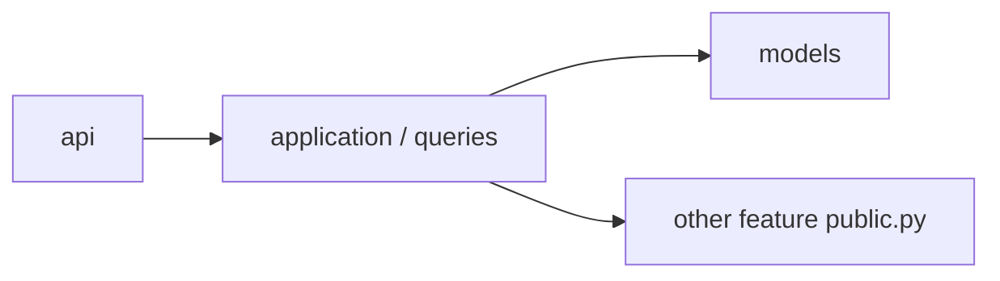
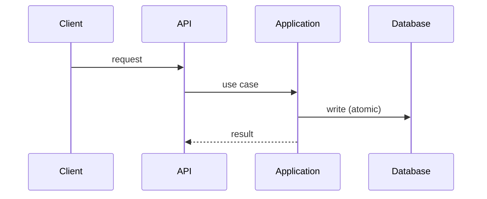
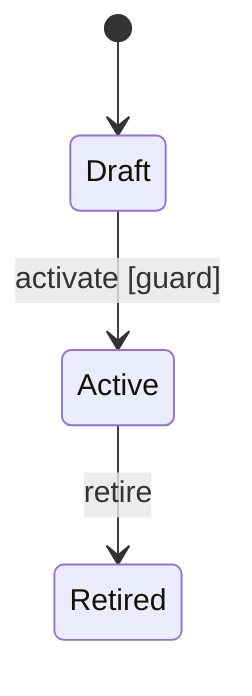

# <Feature> architecture

> Status: Proposed | Verified against code on YYYY-MM-DD (commit <sha>) · Owner: <name>

## 1. Purpose and scope
What business capability this feature owns, and what it explicitly does not.

## 2. Responsibilities and ownership
| Concept / rule | Owned here? | Notes |
|---|---|---|

Models owned by this feature (link to authoritative docs; do not copy definitions):
Models used but owned elsewhere (dependency only):

## 3. Public interface and contracts
`public.py` exports, `contracts.py` DTOs/ports/events, API endpoints (link to schema).

## 4. Dependencies
| Depends on | Through | Direction rule |
|---|---|---|

## 5. Workflows
Main use cases with transaction boundaries and side effects (after commit / outbox).

## 6. Lifecycle and state transitions

## 7. Invariants, concurrency, failure handling
Database-enforced invariants · contested operations and how they are protected · retries and idempotency.

## 8. Security and authorization
Who may do what to which object; where it is enforced.

## 9. Observability and operations
Logs, metrics, alerts; migration and rollback notes.

## 10. Tests and enforcement
Test layers covering the invariants · import-linter / architecture checks that guard the boundaries.

## 11. Decisions, assumptions, open questions
ADR links · assumptions to confirm · questions for the owner.
