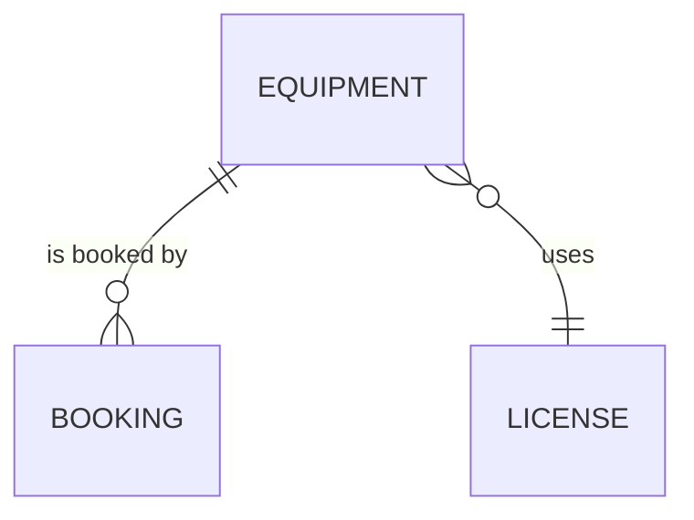
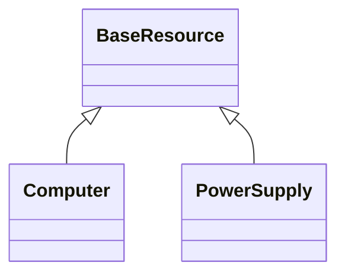

# <Domain> model catalog

<!-- Layout B (catalog plus groups). Only when adopted for this domain in docs/ai-team/documentation-map.md.
     Navigation and overview only. Never repeat model definitions: they live in the group documents. -->

> Status: Proposed | Verified against code on YYYY-MM-DD (commit <sha>) · Owner: <name>

## Scope
What this domain owns and what it does not. Where the models are implemented (`core/<domain>/models/`).

## Model groups
| Group | Purpose | Models (owned) | Document | Status |
|---|---|---|---|---|
| Equipment | | `Equipment`, `EquipmentType` | [equipment.md](equipment.md) | Verified |

Every model class in the domain appears in exactly one row.

## Domain ER overview
Entities and relationships only: no fields. Detailed diagrams live in the group documents.

## Hierarchy overview
Class names only: no fields. Detailed hierarchies live in the group documents that own the base classes.

| Base class | Kind | Subclasses | Owner document |
|---|---|---|---|

## Cross-domain dependencies
| This domain's model | Related model | Owner (domain/doc) | Direction | Defined in |
|---|---|---|---|---|

Defined on the owning side, linked from the other.

## Shared concepts and glossary
Terms used across groups (link to `docs/ai-team/domain-glossary.md`). Keep lifecycle, assignment, booking,
runtime-activity, and financial concepts separate.

## Open questions and coverage notes
Undocumented, stale, or duplicated models found by the coverage check.
