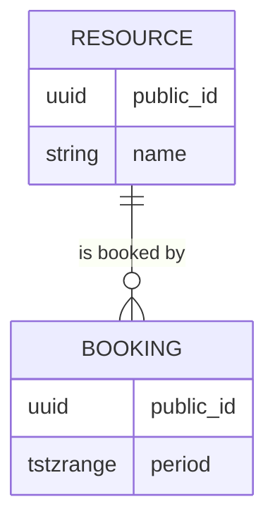
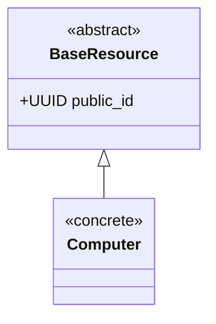
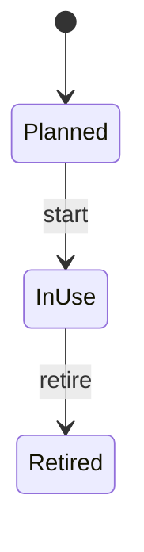

# <Model group> models

<!-- Location and file name: follow docs/ai-team/documentation-map.md (e.g. core/<domain>/models/docs/<domain>-model-architecture.md) -->

> Status: Proposed | Verified against code on YYYY-MM-DD · Authoritative owner: <feature or central package>
> Catalog: [README.md](README.md) (only if this domain uses catalog plus groups)

## Responsibility
What these models represent and what they do not (separate lifecycle, assignment, booking,
runtime-activity, and financial concepts).

## Relationships

## Models
### <Model>
| Field | Type | Null | Default | Notes |
|---|---|---|---|---|
- Keys and cardinality:
- Inheritance (base class and kind):
- Constraints and indexes:
- Invariants (database-enforced vs application-enforced):
- Lifecycle and transitions:
- Deletion, retention, audit history:
- Concurrency and transaction requirements:
- Query patterns and indexes:
- Migration and backward-compatibility notes:

## Inheritance and hierarchy

<!-- Document each hierarchy once, in the document that owns its base class. Link, do not copy, for bases owned elsewhere.
     Prefer composition (FK/OneToOne) unless the subtype truly "is a" base with the same invariants. -->

| Class | Base class(es) | Kind | Owner doc | What it adds | Notes |
|---|---|---|---|---|---|
| `BaseResource` | `models.Model` | abstract | this doc | shared identity and audit fields | no table |
| `Computer` | `BaseResource` | concrete | this doc | type-specific fields | own table |

Kinds: abstract base (no table) · multi-table (parent table plus child table with an implicit one-to-one link) ·
proxy (no schema change, behavior/manager only) · mixin (technical behavior only) · single table with discriminator.

- Invariants every subclass must honor:
- Why this kind (abstract vs multi-table vs proxy) and what it costs: joins, constraint/index naming on abstract bases
  (`%(app_label)s_%(class)s`), migration difficulty of changing the kind later:
- Polymorphic access: how callers get the right subtype; query cost:
- Lifecycle, booking, assignment, activity, and financial concepts are not merged through a shared base:

## Lifecycle

## Relationships to other groups and domains
Defined here when this group owns the relationship; otherwise link to the owning document. Do not copy
the other side's model definition.

| Related model | Owning document | Direction | Notes |
|---|---|---|---|

## Dependents
Features that use these models and through which interface.

## Open questions
