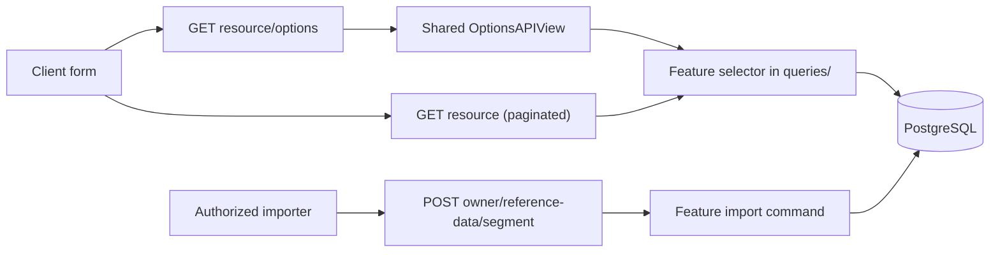

# ADR 002 — Catalog and selector API standard

- Status: **Accepted** (repository owner, 2026-11-01; Phase 0 decisions 2026-11-02, section 20). Implementation not started.
- Date: 2026-11-01, amended 2026-11-02
- Decision owner: repository owner
- Scope: every lookup, catalog and selector endpoint under `/api/` (Labs and Support Desk today, every future domain)
- Binding rules: [response standard](../../ai-team/api/response-standard.md) section 26 (OPT-1 to OPT-13) and REL-5. This ADR records the decisions, the route ledger and the rollout; the standard holds the rules.
- Related: [ADR 001](001-common-foundation.md), [request standard](../../ai-team/api/request-standard.md), [reference import inventory](../../reference-data-defaults.md)

## 1. Context (verified)

Several surfaces currently answer "give me the list of X", and they mean different things:

| Surface | Purpose | Example |
| --- | --- | --- |
| Import collection | Authorized bulk write (`POST`), with a `GET` read of the same rows | `equipment/reference-data/manufacturers` |
| Aggregate form data | One response bundling several lookups for a form | `equipment/reference-data`, `benches/reference-data`, `stations/reference-data` |
| Filter metadata | Values for list filters | `licenses/filters` |
| Selector | Bounded dropdown data `{id, sku, name}` | `benches/options`, Support Desk `<resource>/options` |

The common transport factory binds owner-declared `GET` collection/detail and `POST` import routes ([reference factory](../../../core/common/api/reference_views.py)). An import collection is not a dropdown.

| Owner | Verified routes | Source |
| --- | --- | --- |
| Equipment | 17 import segments under `equipment/reference-data/{segment}`; aggregate `equipment/reference-data`. `equipment/options` and category `options` select **assets**, not makers or models. | [registrations](../../../core/labs/features/equipment/api/reference_data.py), [routes](../../../core/labs/features/equipment/api/urls.py), [category routes](../../../core/labs/features/equipment/api/categories.py) |
| Bench bookings | Import `bench-bookings/reference-data/projects`; reads `lab-projects`, `lab-projects/{id}`. No project selector. | [import](../../../core/labs/features/bench_bookings/api/reference_data.py), [routes](../../../core/labs/features/bench_bookings/api/urls.py) |
| Benches | Import `benches/reference-data/{groups,types}`; catalogs `bench-groups`, `bench-types`; selector `benches/options`; aggregate `benches/reference-data`. | [import](../../../core/labs/features/benches/api/reference_data.py), [routes](../../../core/labs/features/benches/api/urls.py) |
| Licenses | Import `licenses/reference-data/{vendors,products,types,categories,restrictions}`; filter metadata `licenses/filters`. | [import](../../../core/labs/features/licenses/api/reference_data.py), [routes](../../../core/labs/features/licenses/api/urls.py) |
| Locations | Import `locations/reference-data/{countries,cities,buildings,station-types}`; catalog `station-types`; aggregate `stations/reference-data`. | [import](../../../core/labs/features/locations/api/reference_data.py), [station routes](../../../core/labs/features/locations/stations/api/urls.py) |
| Support Desk | Selectors `{categories,priorities,statuses,teams,labels}/options`; management `admin/<resource>`; inverse aliases `options/{categories,priorities,statuses}`. | [routes](../../../core/support_desk/features/tickets/api/urls.py) |
| Resource audit | `audits/options` returns the `ResourceAudit.Result` enum with synthetic ids. | [routes](../../../core/labs/features/resource_audit/api/urls.py), [selectors](../../../core/labs/features/resource_audit/queries/selectors.py) |

Labs routes are under `/api/labs/`, Support Desk under `/api/support/` ([router](../../../config/api_router.py)). This inventory covers the declared routes of the groups above, **not** every frontend or importer consumer; that audit is part of Phase 0.

### Problems

| Problem | Effect |
| --- | --- |
| Four surfaces return "the list of X" | Clients choose inconsistently; behavior diverges |
| No selector for projects, makers, models, vendors, cities | Each form over-fetches or builds its own query |
| OPT-2 requires `sku`, but most lookups have no secondary identifier | Selectors stall on schema debates; some derive `sku` from rank or name |
| Route naming differs by owner | New domains copy whichever example they saw first |
| Selectors re-implemented per feature; only one has a cap | Unbounded responses; four copies of the same contract |

## 2. Decisions

| ID | Decision | Rationale |
| --- | --- | --- |
| D1 | One flat route shape for every domain: `/api/<root>/<resource>`, `/api/<root>/<resource>/{id}`, `/api/<root>/<resource>/options`. | Uniform; no owner-specific exceptions. |
| D2 | `<resource>` is `<subject>-<plural-noun>` (`equipment-manufacturers`, `license-vendors`). Existing routes keep their names. Bare nouns only from the allowlist in section 3. | A mechanical rule gives every author the same answer. |
| D3 | No catalog is nested under another resource. Relationships are query parameters. | URL depth would imply ownership or dependency that does not exist. |
| D4 | `/options` is a sibling sub-path of its collection, never a query mode of the list and never an inverse `/options/<resource>`. | One meaning per surface. |
| D5 | Selector items are exactly `{id, sku, name}` for every resource. `sku` is a stable string or `null` (option B, accepted 2026-11-02; section 8). | One schema and one frontend component for every dropdown; no invented identifiers. |
| D6 | Every selector accepts `q`. Each declares a size class; large catalogs require `q` or a parent filter. One project cap. | Bounded responses that keep working as data grows. |
| D7 | Retired values already referenced by a record are fetched with `include_ids`. | Edit forms render history without making retired rows selectable. |
| D8 | Enums get no `/options` endpoint. | Synthetic ids for code-defined values are unstable and duplicate the schema. |
| D9 | Imports, aggregates and filter metadata stay as separate, unchanged surfaces. | No regression to importer clients. |
| D10 | Management writes use the flat collection URL, gated by a role permission. Support Desk `admin/{categories,priorities,statuses,teams,labels}` move to `<resource>` and `<resource>/{id}` in the breaking release (Phase 3). | One convention for every domain. |
| D12 | All breaking changes ship in **one** coordinated backend and frontend release. No deprecated aliases, no transition period (owner decision 2026-11-02; allowed by VER-1 during the redesign). | One cut-over is cheaper than maintaining aliases; every client changes once. |
| D13 | Read access to every catalog and selector: valid API key **or** authenticated user (`HasAPIKey \| IsAuthenticated`, the `FeatureAPIView` default). Primary-resource selectors keep the object scope of their list. Writes and `is_active=false` need the owner's role permission; an API key never grants writes. | Matches the existing project-wide read policy (ADR 001); integrations can fill dropdowns. |
| D11 | One shared selector implementation in `core/common/api`; features supply only query, filters and permissions. | Identical behavior everywhere; rules enforced in one place. |



## 3. Route rules

| # | Rule |
| --- | --- |
| R1 | Path is `/api/<root>/<resource>[/{id}][/options]`. `<root>` is the domain (`labs`, `support`). The owning feature is not in the URL; it is declared as `x-owner` in OpenAPI. |
| R2 | `<resource>` is `<subject>-<plural-noun>`. Exceptions: routes that already exist, and the allowlist below. |
| R3 | No nested catalog paths. `/equipment/manufacturers` and `/equipment/{id}/manufacturers` are both disallowed. |
| R4 | One owner per resource. Other features consume it through its routes or the owner's `public.py`, never by redeclaring it. |
| R5 | Names are lowercase, hyphenated, plural and unique within a root. The name is reserved for its `/options`. |
| R6 | `options` is registered before `{id}`, and `{id}` uses the `int` converter, so they cannot collide. |
| R7 | Slashless paths (TRN-4, PTH-5). No trailing-slash alias. |

**Bare-noun allowlist** (globally unambiguous): `countries`, `cities` (owner-approved 2026-11-01), `buildings`, `departments` (2026-11-02, so the location trio and the organization unit are named alike). Existing bare routes (`equipment`, `benches`, `licenses`, `rooms`, `stations`, `station-types`, `lab-projects`, `bench-groups`, `bench-types`, and Support Desk `categories`, `priorities`, `statuses`, `teams`, `labels`) are grandfathered. Adding a noun to the allowlist is an owner decision recorded here.

**Why not `/equipment/manufacturers`.** `equipment` already means assets (`equipment`, `equipment/options`, `equipment/{id}`). Nesting makers under it gives the prefix two meanings, risks a collision with `{id}`, and implies manufacturers belong to asset instances when they are shared lookups.

**Cross-domain use.** A resource belongs to one feature but serves every form. A Support Desk form selecting a project calls `/api/labs/lab-projects/options`; the URL does not move with the consumer.

## 4. Lookup classes

Every resource in the ledger declares one class. The class decides identity, audit fields and whether a selector exists.

| Class | Examples | Identity | Audit fields | Write surface | Selector |
| --- | --- | --- | --- | --- | --- |
| **Enum** (fixed in code, drives behavior; ENU-5) | audit result, booking status | `value` string | none | none | **None** (OPT-12). Published as `{value, label}` in the schema or filter metadata. |
| **Controlled vocabulary** (admin-managed, small; REL-5) | ticket priorities and statuses, license types, station types | seeded fixed `id` | none (STR-8) | seed migration or admin | Yes; `sku` = stable `code` or `null` |
| **Reference catalog** (imported or user-created, may grow) | manufacturers, product models, projects, cities, buildings | database `id`, not seeded | `created_at`, `updated_at` (STR-2) | import or owner-approved management contract | Yes; `sku` = natural code or `null` |
| **Primary resource** | equipment, benches, rooms, stations | database `id` | full | its own CRUD contract | Yes; `sku` = business identifier |

## 5. Route ledger

Labs paths are relative to `/api/labs/`, Support Desk to `/api/support/`. Final as of 2026-11-02 (section 20). **Selection rule:** a resource gets a selector when it is the target of a foreign key that a write form sets (verified in the models), or the parent of such a filter. Existing import paths are unchanged.

The full row per resource (`sku` source, active field, size class, filters) is in section 20.3. Summary:

| Root | Owner | Selectors (catalog + `/options`) | Status |
| --- | --- | --- | --- |
| labs | Equipment | `equipment` (existing), `equipment-categories`, `equipment-kinds`, `equipment-types`, `equipment-manufacturers`, `equipment-product-models` | build |
| labs | Equipment (organization) | `departments`, `resource-groups` | build |
| labs | Bench bookings | `lab-projects` | build |
| labs | Benches | `benches` (existing), `bench-groups`, `bench-types` | build |
| labs | Licenses | `license-vendors`, `license-products`, `license-types`, `license-categories`, `license-restrictions` | build |
| labs | Locations | `countries`, `cities`, `buildings`, `rooms`, `station-types`, `stations` | build |
| labs | Equipment (specification lookups) | technical users, interfaces, materials, display sizes and resolutions, networking protocols, sample customers and characteristics, specification definitions | **deferred**: added with the same pattern when a write form needs one |
| labs | Resource audit | `audits/options` | **removed** (enum, OPT-12) |
| support | Tickets | `categories`, `priorities`, `statuses`, `teams`, `labels` | migrate to shared base |

The ledger accounts for all 17 equipment, five license, four location, two bench and one project import segments.

## 6. Request conventions

| Purpose | Parameter | List | Options |
| --- | --- | --- | --- |
| Text search | `q`: 1 to 100 characters, case-insensitive, matches `name` and `sku` (QRY-7, OPT-9) | yes | yes |
| Parent filter | `<relation>_id` (NAM-6), multi-value `category_id=3,7` (QRY-2) | yes | yes |
| Active state | `is_active=true\|false`; `false` needs manage permission | yes | no (active only) |
| Retired values | `include_ids`: positive integers, comma-separated, unique, at most 50 (OPT-10, TYP-15) | no | yes |
| Paging | `page` ≥ 1, `page_size` 1 to 100, default 25 (COL-2) | yes | no (OPT-6) |
| Ordering | allowlisted `ordering` where implemented (COL-3) | optional | no; fixed `name, id` (OPT-7) |

- **One name per parameter.** `q` only, never `search`. One name per filter (`bench_group_id`, never also `bench_group`). Aliases are breaking to remove, so they are never added.
- **No empty values.** `?q=` returns `400 invalid_query` (QRY-4). Query serializers never use `allow_blank=True`.
- **Same validator as the list.** The options query serializer is the list query serializer minus paging and ordering, plus `include_ids` (OPT-5).
- Unknown, repeated or malformed parameters return `400 invalid_query` (COL-4, QRY-1, QRY-2).

## 7. Response contracts

### 7.1 Catalog list

```json
{
  "data": [
    {
      "id": 41,
      "name": "Bosch",
      "categories": [{"id": 3, "name": "Computing"}, {"id": 7, "name": "Measurement"}],
      "is_active": true,
      "created_at": "2026-03-02T09:14:00Z",
      "updated_at": "2026-09-18T13:02:11Z"
    }
  ],
  "meta": {"pagination": {"count": 1, "page": 1, "page_size": 25, "next": null, "previous": null}}
}
```

Envelope per ENV-2 and COL-2. Relations read as `{id, name}` (REL-3, REL-9), written as `<relation>_ids` (NAM-6). Audit fields per the class in section 4. Other fields are documented per resource in OpenAPI.

### 7.2 Selector

```json
{"data": [{"id": 41, "sku": null, "name": "Bosch"}]}
```

- Always the `data` envelope; empty match is `{"data": []}` (ENV-1, ENV-4, OPT-2).
- Exactly `id`, `sku`, `name` (OPT-4). `sku` is a string or `null` (OPT-3).
- Active rows only, plus readable rows named in `include_ids` (OPT-10).
- Fixed order `name`, then `id` (OPT-7).
- Visibility never wider than the matching list and detail.

### 7.3 Dependent dropdowns

Parent relationships are declared query parameters, never path depth: category → kind → type (`category_id`, `kind_id`); product model by `manufacturer_id` and `type_id`; license product by `vendor_id`; city by `country_id`; building by `city_id`. Each filter is confirmed with the feature owner before implementation. Many-to-many filters use `Exists(...)` and never return duplicates (OPT-8).

### 7.4 Size classes and cap (OPT-6, OPT-11)

| Class | Examples | Behavior |
| --- | --- | --- |
| Small | priorities, statuses, license types, countries | Returns all active rows |
| Large | cities, buildings, product models, projects | `q` or a declared parent filter is required; without one, `400 invalid_query` naming the missing parameters |

- One project constant `OPTIONS_MAX_RESULTS = 1000` in `core/common/api`, overridable only downward per resource.
- The query fetches `cap + 1` rows; if the extra row exists the response is `400 too_many_results`. Never truncate, never `count()` the full table.
- Moving a resource from small to large adds a required parameter and is breaking (VER-2). Classify conservatively at first release.

### 7.5 Retired values (OPT-10)

An edit form passes the ids it already references as `include_ids`. The server returns the active matching rows plus those ids when the caller may read them. Unreadable or missing ids are omitted silently (REL-11). `include_ids` rows ignore `q` and parent filters, count toward the cap, and are merged into the fixed order. Writes still reject retired ids (`422 does_not_exist` or a documented `inactive` code), so `include_ids` never makes a retired value submittable for new records. A UI that must label a value as retired reads the detail endpoint, because OPT-4 forbids an `is_active` key on selector items.

## 8. The `sku` decision (D5, option B accepted 2026-11-02)

**What the question is.** Every dropdown item has three keys. `id` is what the form submits. `name` is what the user sees. `sku` is a short secondary code shown as a badge or used for search, for example an asset tag `EQ-COMP-001` or a country code `DE`. Equipment and benches have a real `sku`. Most lookups (manufacturers, vendors, cities, labels) only have a name, so the question is what to put in `sku` for them.

| Option | What it means | Trade-off |
| --- | --- | --- |
| A | Lookups return only `{id, name}`; assets keep `{id, sku, name}` | Two selector shapes; every client must know which one a resource uses |
| **B (recommended)** | Always three keys; `sku` is `null` when there is no real code | One shape and one frontend component; clients render nothing when `sku` is `null` |
| C | Add a new `code` column to every lookup table | Meaningful codes everywhere, but migrations, backfills and duplicate-code risk for data that never needed a code |

With B, a real code is used only where the model already has one. The per-resource source is fixed in section 20.3; no column is added to fill `sku`.

Rules that apply whichever option is chosen (OPT-3):

- `sku` is a **string or `null`** on every endpoint, never an integer (FMT-5).
- Stable: never derived from display text, rank or sort position.
- Never a copy of `id` (`"sku": "41"`), never an invented column.
- Display and search only. Clients never submit or branch on `sku`; writes use `id`.
- A new `code` column is added only when the business needs one, through a reversible migration owned by the Data Architect.

## 9. Errors

One envelope (ERR-1, ERR-11). Error responses carry `Cache-Control: no-store` (CCH-1).

```json
{"error": {
  "code": "invalid_query",
  "message": "One or more query parameters are invalid.",
  "details": [
    {"field": "include_ids", "code": "max_items", "message": "Ensure this list has at most 50 items."},
    {"field": "sort", "code": "unknown_field", "message": "Unknown query parameter."}
  ],
  "request_id": "b1f2c3d4e5f60718293a4b5c6d7e8f90"
}}
```

| Status | `code` | Trigger |
| --- | --- | --- |
| 400 | `invalid_query` | Unknown, repeated, empty or malformed parameter; bad `include_ids`; missing required filter on a large catalog |
| 400 | `too_many_results` | Result would exceed the cap |
| 401 | per SEC-1 | Missing or invalid credentials, with `WWW-Authenticate` |
| 403 | `insufficient_scope` | No view permission, or `is_active=false` without manage permission (SEC-16) |
| 404 | `not_found` | Missing or hidden detail (ERR-5) |
| 429 | per SEC-10 | With `Retry-After` |

## 10. Security

- A selector uses the same permission class and object scope as its list. It never exposes data hidden by list or detail (SEC-2).
- Selectors are read-only. They do not change import permissions, idempotency or concurrency guards.
- `/options` implies no write method. Management writes need their own approved contract.
- Read policy (D13): `HasAPIKey | IsAuthenticated` for every catalog list, detail and selector. Primary-resource selectors (`equipment`, `benches`, `rooms`, `stations`) additionally apply the object scope of their list selector.
- `is_active=false` on lists, and every write, require the owning feature's role permission. An API key alone never authorizes a write or inactive rows.
- Write permission is never inferred from current import reads.
- **Access change to note:** Support Desk selectors are today restricted to `IsSupportRequester` ([base.py](../../../core/support_desk/features/tickets/api/base.py#L25)). D13 opens them to any authenticated user and to API keys. Approved by the repository owner on 2026-11-02; the Security Engineer reviews the implementation PR.

## 11. Caching, performance, observability

| Area | Requirement |
| --- | --- |
| Caching | `Cache-Control: private, no-cache`, strong `ETag` over the body, `304` on `If-None-Match` (CCH-1, CCH-2, OPT-13). `Vary: Accept-Language` (CCH-4). `max-age` only as an owner-approved per-resource exception. |
| Query | One query selecting `id`, annotated `sku`, `name`; `Exists(...)` for relation filters, no `distinct()` (OPT-8). Query count asserted equal for 1 and 100 rows (PRF-2). |
| Search | `icontains` on `name` and `sku`. Every large-class resource has a `pg_trgm` GIN index on its search column (section 20.4). |
| Indexes | Existing FK indexes cover parent filters. No additional B-tree index is added until `EXPLAIN` on production-sized data shows a need. |
| Targets | p95 under 100 ms for options and 150 ms for list on production-sized data (target, not measured). |
| Observability | Structured log with `request_id`, actor, route, status, latency (OBS-3); metrics for `too_many_results` and `304` ratio. |

## 12. Shared implementation (`core/common/api`)

`core/common` imports no business app (AGENTS.md rule 3). Not a model-discovery framework.

| Component | Responsibility |
| --- | --- |
| `CatalogOptionSerializer` | Exactly `id` (int), `sku` (`CharField(allow_null=True)`), `name`; OpenAPI component `CatalogOption`, wrapped as `CatalogOptionList` |
| `OptionsQueryMixin` | Adds `q` (1 to 100, no blank) and `include_ids` to a feature's list query serializer |
| `OptionsAPIView` | Validates the query, enforces the size class, calls the feature selector, applies `cap + 1`, merges `include_ids`, sets `ETag`, returns the envelope or the error |
| `OPTIONS_MAX_RESULTS` | The single cap constant |

The feature supplies a selector function in its `queries/` layer (queryset annotated with `sku`, using `.only()`), its query serializer, its permission class, its size class and `x-owner`. The view never builds a queryset.

```python
# Shape of a feature endpoint (illustrative; not implemented)
class ManufacturerOptionsAPIView(OptionsAPIView):
    query_serializer = ManufacturerOptionsQuerySerializer  # list filters + OptionsQueryMixin
    permission_classes = (CanViewEquipmentCatalogs,)
    size_class = SizeClass.LARGE
    required_any = ("q", "category_id")
    owner = "equipment"

    def select(self, *, actor, filters):
        return selectors.manufacturer_options(actor=actor, **filters)
```

## 13. Enforcement

`tests/architecture/test_options_contract.py` (new; same pattern as [test_import_boundaries.py](../../../tests/architecture/test_import_boundaries.py)) walks the resolved URL patterns and the generated OpenAPI. Existing violations (section 17) go into an allowlist in the test that may only shrink.

- Every path ending in `/options` is `GET`-only, has a sibling collection route, declares `x-owner`, and its 200 response `$ref`s `CatalogOptionList`.
- No `options/<resource>` path, no `select-list` path, no path ending in `/`.
- Names match R5 and are unique within a root; no catalog nested under another resource.
- `options` resolves before `{id}`; no options route dispatches an import command.
- Options query serializers have no `search`, `ordering`, `page`, `page_size` or `allow_blank=True` field.

Per-resource tests: exact keys and types (`sku` is `str` or `None`); order with `id` tie-break; empty result; no duplicates under M2M filters; `400 invalid_query` for unknown, empty and missing-required parameters; `400 too_many_results` with a patched cap (as [test_select_list_options.py](../../../core/labs/features/benches/tests/test_select_list_options.py) already does); hidden, inactive and `include_ids` cases per permission level; query count; import regression.

## 14. Rollout

| Phase | Content | Breaking |
| --- | --- | --- |
| 0 | Decisions (done 2026-11-02, section 20). | — |
| 1 | Shared components (section 12), the architecture test with its allowlist, and the trigram index migration (section 20.4). | No |
| 2 | New catalogs and selectors from section 20.3. Imports untouched. | No |
| 3 | **One breaking release (D12)**, backend and frontend together, with regenerated schema and changelog: every existing selector moves onto the shared base (cap, `q`, `include_ids`, `ETag`, D13 auth); all items in section 20.2 are removed or renamed in the same release. No aliases, no deprecation period. | Yes |

No `/api/v2/` (VER-1). Breaking changes are allowed in the approved redesign (VER-1); VER-3 deprecation is waived for this release by D12.

## 15. Worked example: equipment manufacturers

| Method | Path | Purpose |
| --- | --- | --- |
| GET | `/api/labs/equipment-manufacturers` | Paginated catalog |
| GET | `/api/labs/equipment-manufacturers/{id}` | Detail, including inactive for permitted callers |
| GET | `/api/labs/equipment-manufacturers/options` | Selector |
| POST | `/api/labs/equipment/reference-data/manufacturers` | Existing import, unchanged |

```
GET /api/labs/equipment-manufacturers/options?category_id=3&q=bos&include_ids=58
```

```json
{"data": [
  {"id": 41, "sku": null, "name": "Bosch"},
  {"id": 58, "sku": null, "name": "Boston Dynamics"}
]}
```

Row 58 is retired and appears only because of `include_ids`.

```yaml
/api/labs/equipment-manufacturers/options:
  get:
    operationId: listEquipmentManufacturerOptions
    x-owner: equipment
    parameters:
      - {name: q, in: query, schema: {type: string, minLength: 1, maxLength: 100}}
      - {name: category_id, in: query, schema: {type: integer, minimum: 1}}
      - {name: include_ids, in: query, style: form, explode: false,
         schema: {type: array, maxItems: 50, uniqueItems: true, items: {type: integer, minimum: 1}}}
    responses:
      "200":
        headers: {ETag: {schema: {type: string}}}
        content:
          application/json:
            schema: {$ref: "#/components/schemas/CatalogOptionList"}
      "304": {description: Not modified}
      "400": {$ref: "#/components/responses/Error"}
      "403": {$ref: "#/components/responses/Error"}
components:
  schemas:
    CatalogOptionList:
      type: object
      additionalProperties: false
      required: [data]
      properties:
        data: {type: array, items: {$ref: "#/components/schemas/CatalogOption"}}
    CatalogOption:
      type: object
      additionalProperties: false
      required: [id, sku, name]
      properties:
        id: {type: integer}
        sku: {type: [string, "null"]}
        name: {type: string}
```

`Error` stands for the component the generator already emits for ERR-1. OpenAPI is regenerated from code, never edited by hand.

## 16. Alternatives considered

| Option | Benefits | Costs | Decision |
| --- | --- | --- | --- |
| Only add missing selectors next to current routes | Fewest changes | Naming, aliases and unbounded selectors stay | Rejected |
| Break in steps with deprecated aliases (VER-3) | Clients migrate gradually | Two contracts maintained per endpoint; aliases tend to stay | Rejected by D12 |
| Flat qualified collection + `/options`, imports retained | Uniform, ownership local, imports keep working | More endpoints; naming and permission audit | **Chosen** |
| Nested per owner (`/equipment/manufacturers`) | Familiar grouping | Collides with asset meaning and `{id}`; implies dependency | Rejected |
| Domain namespace (`equipment-catalog/...`) | Grouping without collision | When to use it is a judgment call; styles diverge | Rejected |
| Extend aggregate `reference-data` | No new routes | Not bounded, not filterable | Rejected |
| Selector as list mode (`?view=options`) | Fewer routes | Two meanings on one URL; hard to cache and document | Rejected |
| Also move import routes | Fewer route families | Breaks importers; no benefit for dropdowns | Rejected (D9) |

## 17. Current drift (verified 2026-11-01)

Becomes the shrinking allowlist of the architecture test. Aggregate `reference-data` and `filters` routes were not re-audited.

| ID | Priority | Location | Evidence | Fix (phase) |
| --- | --- | --- | --- | --- |
| DRIFT-1 | High | [tickets/queries/options.py](../../../core/support_desk/features/tickets/queries/options.py#L15-L69) | All five Support Desk selectors materialize the full table; no cap | Shared base (3) |
| DRIFT-2 | High | [equipment/api/views.py](../../../core/labs/features/equipment/api/views.py#L338-L362) | `equipment/options` returns `list(queryset)` without a cap | Shared base (3) |
| DRIFT-3 | Medium | [tickets/queries/options.py](../../../core/support_desk/features/tickets/queries/options.py#L29-L40) | Priority `sku = Coalesce(rank, 0)`: integer, mutable | `NULLIF(code, '')` (3) |
| DRIFT-4 | Medium | [tickets/queries/options.py](../../../core/support_desk/features/tickets/queries/options.py#L65-L69) | Label `sku = name` | `null` (3) |
| DRIFT-5 | Medium | [tickets/api/urls.py](../../../core/support_desk/features/tickets/api/urls.py#L41-L43) | Inverse aliases `options/{categories,priorities,statuses}` | Remove (3) |
| DRIFT-6 | Medium | [equipment/api/urls.py](../../../core/labs/features/equipment/api/urls.py#L42), [equipment/api/categories.py](../../../core/labs/features/equipment/api/categories.py#L418) | Slash aliases `equipment/options/` and `<category>/options/` (TRN-4) | Remove (3) |
| DRIFT-7 | Medium | [resource_audit/queries/selectors.py](../../../core/labs/features/resource_audit/queries/selectors.py#L281-L291) | Enum served as `/options` with synthetic ids 1 to 3 | Enum metadata (3) |
| DRIFT-8 | Medium | [benches/api/serializers.py](../../../core/labs/features/benches/api/serializers.py#L288-L299) | Duplicate filter names (`bench_group`/`bench_group_id`, `type`/`type_id`, `setup_location`/`setup_location_id`, `status`/`lifecycle_status`); `search` with `allow_blank` | Keep `*_id`, `lifecycle_status`, `q` (3) |
| DRIFT-9 | Low | [tickets/api/serializers.py](../../../core/support_desk/features/tickets/api/serializers.py#L50-L54), [equipment/api/serializers.py](../../../core/labs/features/equipment/api/serializers.py#L355-L376) | `search` and `q` both accepted, `allow_blank=True`; equipment filters `category`, `kind`, `type`, `manufacturer` | `q`; `category_id`, `kind_id`, `type_id`, `manufacturer_id` (3) |
| DRIFT-10 | Low | Support `OptionSerializer`, resource-audit `OptionSerializer`, `EquipmentOptionsSerializer`, `BenchSelectSerializer` | Same contract defined four times; Support `sku` is `allow_blank`, not nullable | `CatalogOptionSerializer` (1) |
| DRIFT-11 | Low | [equipment/api/categories.py](../../../core/labs/features/equipment/api/categories.py#L406-L407) | `<category>/filters` registered twice | Remove the duplicate (3) |

`benches/options` ([views.py](../../../core/labs/features/benches/api/views.py#L169-L197)) is closest to the target (`cap + 1`, `too_many_results`, patched-cap test) and is the reference implementation.

## 18. Merge checklist for every selector

| # | Check | Rule |
| --- | --- | --- |
| C1 | `GET /api/<root>/<resource>/options`, slashless, sibling of the collection | OPT-1, R1, R7 |
| C2 | Resource is not an enum | OPT-12, section 4 |
| C3 | Response `{"data": [CatalogOption]}` via the shared serializer | OPT-2, OPT-4 |
| C4 | `sku` stable string or `null`; source recorded in the ledger | OPT-3, section 8 |
| C5 | Query = list filters + `q` + `include_ids`; one name per filter; no blank, `search` or `ordering` | OPT-5, OPT-7, OPT-9, QRY-4 |
| C6 | Size class declared; large requires `q` or a parent filter; `cap + 1` | OPT-6, OPT-11 |
| C7 | Same permission and scope as the list; unreadable `include_ids` omitted | SEC-2, OPT-10 |
| C8 | One query, `Exists` filters, query count asserted | OPT-8, PRF-2 |
| C9 | `ETag`, `private, no-cache`, `Vary: Accept-Language` | OPT-13, CCH-1, CCH-4 |
| C10 | `x-owner` set; OpenAPI regenerated in the same change; ledger row updated | DOC-1, R1 |
| C11 | Tests from section 13 present | PRF-2, DOC-4 |

## 19. Open items and owners

| # | Item | Owner | Needed by |
| --- | --- | --- | --- |
| 1 | Frontend inventory of every call to the routes and parameters in section 20.2, so the single release changes all of them | Frontend lead | Phase 3 |
| 2 | Security review of the D13 access change (Support Desk selectors) in the implementation PR | Security Engineer | Phase 3 |
| 3 | Trigram index migration (section 20.4) | Data Architect, Backend Engineer | Phase 1 |
| 4 | Shared components, architecture test, new selectors, tests | Backend Engineer, QA | Phases 1 and 2 |
| 5 | Breaking release: schema, changelog, coordinated deploy | Repository owner | Phase 3 |

## 20. Phase 0 decisions (repository owner, 2026-11-02)

### 20.1 Decisions

| Phase 0 item | Decision |
| --- | --- |
| 0.1 `sku` | Option B (D5): `sku` is a stable string or `null`. |
| 0.2 Breaking changes | Everything breaks once, in one release (D12). No consumer-driven aliases. |
| 0.3 Which selectors | FK-target rule (section 5); final list in 20.3. |
| 0.4 Access | `HasAPIKey \| IsAuthenticated` for reads (D13). |
| 0.5 Data changes | No new columns. Trigram indexes for large-class resources that lack one (20.4). |

### 20.2 Removed or renamed in the breaking release

| Current | Replacement |
| --- | --- |
| `/api/support/options/{categories,priorities,statuses}` | `/api/support/{categories,priorities,statuses}/options` |
| `/api/support/admin/{categories,priorities,statuses,teams,labels}[/{id}]` | `/api/support/{resource}[/{id}]` with role permission for writes |
| `/api/labs/equipment/options/`, `/api/labs/equipment/<category>/options/` | slashless forms |
| `/api/labs/audits/options` | `ResourceAudit.Result` as `{value, label}` in the audits filter schema |
| `search` parameter on every selector | `q` |
| benches `bench_group`, `type`, `setup_location`, `status` | `bench_group_id`, `type_id`, `setup_location_id`, `lifecycle_status` |
| equipment `category`, `kind`, `type`, `manufacturer` | `category_id`, `kind_id`, `type_id`, `manufacturer_id` |
| priority `sku` = rank (integer); label `sku` = name | priority `NULLIF(code, '')`; label `null` |
| bare-array or unwrapped selector bodies, if any | `{"data": [...]}` |

`admin/transitions`, `admin/canned-responses` and `admin/settings` are not lookups and stay outside this ADR.

### 20.3 Final selector ledger

Size: **S** = small, returns all active rows; **L** = large, requires `q` or a listed parent filter (OPT-11). "Active" is the field used for active-only filtering; "none" means every row is selectable and `include_ids` is unused.

| Route (`/options` sibling) | Model | Class | `sku` source | Active | Size | Filters (besides `q`) |
| --- | --- | --- | --- | --- | --- | --- |
| `equipment` | `Equipment` | primary | `sku` | soft delete (`deleted_at`) | L | `category_id`, `kind_id`, `type_id`, `manufacturer_id`, `lifecycle_status`, `assignable` |
| `equipment-categories` | `EquipmentCategory` | vocabulary | `key` | `active` | S | — |
| `equipment-kinds` | `EquipmentKind` | vocabulary | `null` | `active` | S | `category_id` |
| `equipment-types` | `EquipmentType` | vocabulary | `null` | `active` | L | `kind_id`, `category_id` |
| `equipment-manufacturers` | `EquipmentManufacturer` | reference | `null` | `active` | L | `category_id` (M2M, `Exists`) |
| `equipment-product-models` | `EquipmentProductModel` | reference | `null` | `active` | L | `manufacturer_id`, `type_id` |
| `departments` | `Department` | reference | `null` | `active` | S | — |
| `resource-groups` | `ResourceGroup` | reference | `null` | `active` | S | `department_id` |
| `lab-projects` | `LabProject` | reference | `code` (nullable) | `active` | L | `active_on` (date within `starts_on`..`ends_on`) |
| `benches` | `Bench` | primary | `sku` | soft delete (`deleted_at`) | L | `bench_group_id`, `type_id`, `setup_location_id`, `lifecycle_status`, `favorite` |
| `bench-groups` | `BenchGroup` | vocabulary | `null` | `active` | S | — |
| `bench-types` | `BenchType` | vocabulary | `null` | `active` | S | — |
| `license-vendors` | `LicenseVendor` | reference | `null` | none | L | — |
| `license-products` | `LicenseProduct` | reference | `null` | none | L | `vendor_id` |
| `license-types` | `LicenseType` | vocabulary | `null` | none | S | — |
| `license-categories` | `LicenseCategory` | vocabulary | `null` | none | S | — |
| `license-restrictions` | `LicenseRestriction` | vocabulary | `null` | none | S | — |
| `countries` | `Country` | reference | `code` | none | S | — |
| `cities` | `City` | reference | `null` | none | L | `country_id` |
| `buildings` | `Building` | reference | `null` | none | L | `city_id` |
| `rooms` | `Room` | primary | `sku` | soft delete (`deleted_at`) | L | `building_id`, `city_id` |
| `station-types` | `StationType` | vocabulary | `null` | none | S | — |
| `stations` | `Station` | primary | `sku` | soft delete (`deleted_at`) | L | `room_id`, `station_type_id` |
| `categories` (support) | `SupportCategory` | vocabulary | `code` | `is_active` | S | — |
| `priorities` (support) | `SupportPriority` | vocabulary | `NULLIF(code, '')` | `is_active` | S | — |
| `statuses` (support) | `SupportStatus` | vocabulary | `null` (`system_state` is a shared enum, not an identifier) | `is_active` | S | `system_state` |
| `teams` (support) | `SupportTeam` | vocabulary | `code` | `is_active` | S | — |
| `labels` (support) | `SupportLabel` | reference | `null` | none | L | — |

Not verified: whether catalog list routes already exist for `rooms`, `stations`, `departments`, `resource-groups`, `countries`, `cities`, `buildings` under these names; Phase 2 adds any that are missing. Lookups without an active field cannot be retired; adding one is a separate data-model decision, not part of this ADR.

### 20.4 Data changes

- No new `code` columns. `sku` comes only from existing fields (20.3).
- One reversible migration adds `pg_trgm` GIN indexes on the search column of large-class resources that lack one: `EquipmentType.name`, `EquipmentManufacturer.name`, `EquipmentProductModel.name`, `LabProject.project_name`, `City.name`, `Building.name`, `SupportLabel.name`. License lookups already have them ([license.py](../../../core/labs/models/resource/license/license.py#L36)). Primary resources reuse their existing list-search indexes.
- Use `AddIndexConcurrently` (non-atomic migration) so production tables are not locked. The `pg_trgm` extension is already in use.
