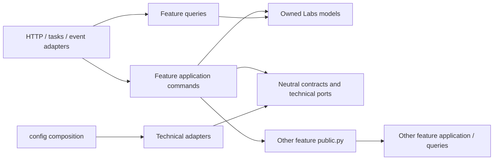
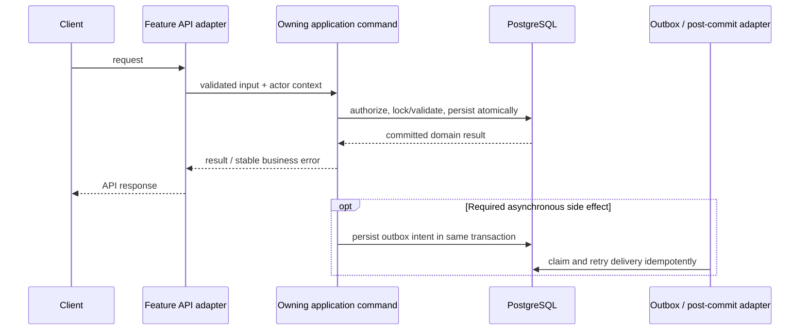

# Labs Features Architecture

> **Status:** Cross-feature index and domain map only. Detailed feature architecture belongs beside its owning implementation: [Equipment](../../core/labs/features/equipment/docs/architecture.md), [Benches](../../core/labs/features/benches/docs/architecture.md), [Locations](../../core/labs/features/locations/docs/architecture.md), [Analytics](../../core/labs/features/analytics/docs/architecture.md), [Leaderboard](../../core/labs/features/leaderboard/docs/architecture.md), and [Dashboard](../../core/labs/features/dashboard/docs/architecture.md). Add an architecture document to a specific feature folder when that feature is designed or materially reviewed. This index must not substitute a single aggregated spec for feature-owned architecture. Present facts are verified against repository sources on 2026-10-18; target boundaries are proposed. Owner: Labs engineering. The canonical feature and app conventions remain [Feature Template Specification](feature-template.md) and [Super-App Core Architecture](core-architecture.md).

## 1. Purpose and scope

**Verified.** Labs is a single Django app with business data models centralized under `core/labs/models/` and feature behavior under `core/labs/features/`. The app currently combines resource management, physical locations, bookings, operational records, procurement, finance, monitoring, analytics, and audit data. Named features are deployed as a modular monolith, not independently deployed services.

**Proposed.** Keep Labs as one Django app and organize its capabilities as vertical features. Each feature owns one business capability and its write rules, even though Django model discovery and migrations remain app-centralized. Do not split into microservices or add generic feature registries without a measured ownership, scaling, or operational need.

Scope: feature responsibilities, model ownership, dependencies, workflow boundaries, and enforcement. This is not an implementation certification, API redesign, schema change, or authorization grant.

## 2. Verified repository facts

- `core/labs/models/__init__.py` explicitly aggregates models from resource, booking, monitoring, procurement, finance, activity, session, analytics, and auditing packages.
- The implemented feature packages currently include `base`, `benches`, `equipment`, `licenses`, `locations`, `procurement`, `analytics`, and `leaderboard`.
- The active `core/labs/api_urls.py` includes URL facades for equipment, licenses, benches, locations, analytics, and leaderboard. Procurement has an API URL module, but it is not included there. Booking and monitoring includes remain dormant.
- Benches, equipment, licenses, locations, and procurement have feature-local API and test packages; several expose `public.py`. Current feature maturity/layout differs, so feature roots should not be inferred from a single tree.
- `tests/architecture/test_import_boundaries.py` currently checks that `core.common` and `core.infrastructure` do not import business apps. It does not establish Labs feature-to-feature import rules.
- The repository contains `docs/architecture/feature-template.md`, which governs canonical feature boundaries and paths. This document adds Labs-specific capability ownership but does not override it.

## 3. Responsibility and ownership map

**Proposed target ownership.** The table assigns a single business owner to each capability. Centralized model files remain in `core/labs/models/`; the mapping does not propose moving the models.

| Feature | Owns | Does not own |
| --- | --- | --- |
| `resources` (app-owned foundation, not generic CRUD) | Cross-resource identity conventions and genuinely shared resource projections/policies; shared `ResourceGroup` ownership should be confirmed | Domain-specific lifecycle decisions, universal write endpoints, other feature models |
| `locations` | Country/city/building reference data as adopted; rooms, room slots, stations, station slots, location placement and location status/observations | Bench setup lifecycle, equipment assignment, booking lifecycle |
| `benches` | Bench lifecycle/setup, bench placement into station slots, bench groups/types/favorites, capacity and utility checks | Physical location layout, direct equipment-assignment writes, booking lifecycle |
| `equipment` | Equipment identity/lifecycle, equipment reference data and category behavior, assignment history, equipment status | Bench placement, license lifecycle, procurement/payment truth |
| `licenses` | License identity/lifecycle/status, license agreements and billing terms, equipment-license assignment, payments against license agreements | Equipment identity/assignment, procurement acquisition costs, expenses |
| `bookings` | Booking and approval state machines, schedule/availability decisions, booking-specific reminders and transitions | Resource lifecycle status, live activity status, infrastructure scheduling |
| `procurement` | Purchase orders/items, acquisition allocation to supported resources, purchase transactions and acquisition cost facts | License agreements/recurring entitlement costs; general expense/payment accounting |
| `finance` | Expense types, expenses, billing periods, and payments/refunds against expenses | Purchase order/acquisition allocation, license agreement terms and payments |
| `monitoring` | Incoming monitoring facts/events, source reconciliation and monitoring adapters | Resource lifecycle or booking state transitions unless an explicit command is invoked |
| `activity` | Live computing activity and its transitions, derived from telemetry/agent facts | Booking state and resource lifecycle state |
| `session` | Lab session logs and session-specific activity records | Booking approval or resource assignment |
| `auditing` | Resource audit and change-log records, audit read projections and recording contract | Owning feature's business decision or workflow orchestration |
| `analytics` | Derived observations, event summaries, aggregates and reporting queries | Source-of-truth mutations or authoritative lifecycle state |
| `leaderboard` | User persona engagement scoring, laboratory and bench utilization rankings, and weekly heatmaps | Raw telemetry ingestion, booking mutations, or direct lifecycle transitions |
| `dashboard` | Operational laboratory bench overview, real-time telemetry projections, active booking status, computing activity, and aggregate dashboard metrics | Source-of-truth mutations, booking scheduling, or equipment lifecycle transitions |

**Verified model grouping.** The package names and model exports listed above are confirmed in `core/labs/models/__init__.py`. The feature mappings for `bookings`, `monitoring`, `finance`, `activity`, `session`, `auditing`, and `analytics` are proposed ownership boundaries; matching feature implementations were not found under `core/labs/features/` at inspection time.

## 4. Dependency architecture

**Proposed dependency direction:**



Rules:

1. A feature write is performed by the owning feature's application command. API views, admin actions, tasks, scripts, and event handlers are adapters and must delegate rather than reproduce the write.
2. Feature queries own read composition and authorization-scoped visibility. Cross-feature read dependencies are documented; avoid exposing mutable ORM objects across feature boundaries where a DTO or projection is sufficient.
3. Calls between Labs features use the owner's explicit `public.py` entry point. Stable DTOs, protocol ports, and event schemas belong in `contracts.py`. No consumer imports another feature's private application, query, serializer, or API module.
4. A feature's own API/tasks may import its own application and query modules directly; they should not route through their own external `public.py` facade.
5. Database foreign keys between same-app models are persistence relationships, not permission to mutate another feature's model. Cross-feature writes still use the owner's command.
6. Events are for decoupled follow-up, not synchronous invariants. Best-effort effects may run via `transaction.on_commit`; required delivery needs an outbox intent written atomically and retryable, idempotent consumers. No current Labs outbox implementation is asserted here.
7. `core.common` stays domain-neutral; `core.infrastructure` contains technical provider adapters; `config` wires providers and deployment. None imports Labs features.
8. Keep the feature graph acyclic. If a workflow genuinely spans several features, assign orchestration to a deliberate application boundary (typically the initiating capability or a named workflow owner); do not create mutual feature imports.

## 5. Critical domain distinctions and interactions

These state concepts remain separate and have separate owners:

- **Resource lifecycle:** owned by each resource feature (for example bench lifecycle); not equivalent to operational status history.
- **Operational status records:** owned by the corresponding resource feature (equipment, location, license); status histories do not replace lifecycle transitions.
- **Booking status and approval:** owned by bookings.
- **Live activity status:** owned by activity/monitoring workflows, not booking.
- **License agreement and entitlement terms:** licenses; **acquisition cost:** procurement allocation; **realized expenses/payments:** finance or the applicable payment owner.

**Verified relationship examples:**

- Room contains stations through the room relation; stations may occupy room slots. Benches optionally refer to a station and a unique station slot. Equipment assignment rows associate equipment and benches; a conditional unique constraint prevents an equipment item from having more than one active bench assignment.
- License assignments associate licenses and equipment. Purchase items and resource allocation records represent acquisition allocation separately from license agreements. These are different business facts and must not be collapsed into one generic financial record.
- Booking models are abstracted around shared schedule/state fields and concrete bench/equipment bookings. Their feature ownership and API activation remain to be implemented/verified.

The examples above are verified from the model code; they do not imply that every business invariant is database-enforced or that runtime authorization has been reviewed.

## 6. Workflow and transaction boundaries

**Proposed write path:**



- Command input should be a typed immutable value where useful and use an explicit actor/context; never treat a missing actor as an authorization bypass.
- Use database constraints for invariants expressible by PostgreSQL, and row locks or exclusion/unique constraints for contested operations. Pre-validation is user feedback, not race protection.
- Keep provider/network calls outside database locks and transactions. Persist the intent or resulting fact before dispatch, based on whether delivery is best-effort or required.
- Read commands should not create statuses, repair state, or otherwise mutate data.
- Feature APIs preserve existing prefixes, payloads, route names, and OpenAPI behavior unless a separate approved compatibility plan changes them.

## 7. Authorization, failure handling, and observability

**Proposed requirements.** Every write command enforces its applicable policy server-side; every list/detail query scopes objects to the caller's authorized domain. DRF permission classes alone are not a substitute for object-scoped query behavior. System actors and background jobs use explicit narrowly scoped contexts.

Translate known domain conflicts to stable feature errors and map those at the API boundary. Do not catch broad database exceptions as business conflicts; identify the specific constraint and preserve unrelated failures. Log identifiers and operation outcomes without secrets or unnecessary personal data. For asynchronous integrations, record retry state, idempotency keys, and terminal failures where delivery is required.

Current permission coverage, object scoping, log/metric coverage, and retry behavior have not been exhaustively reviewed for every Labs feature.

## 8. Feature-level target shape

Use the canonical [feature template](feature-template.md); do not mechanically create every optional module. A typical Labs capability uses:

```text
core/labs/features/<feature>/
├── public.py              # supported external commands / queries
├── contracts.py           # stable DTOs / ports / events when needed
├── exceptions.py          # stable business errors
├── api/                    # HTTP adapters; optional for non-HTTP capability
├── application.py          # small feature, or application/ package for larger one
├── queries.py              # small feature, or queries/ package for larger one
├── tasks.py                # optional, thin asynchronous entry points
├── handlers.py             # optional event entry points
├── tests/                  # feature-private tests
└── docs/architecture/README.md    # only when feature complexity warrants it
```

Model ownership stays visible through `core/labs/models/<group>/` and explicit exports in `core/labs/models/__init__.py`. Avoid a `features/_shared` package: promote stable shared business meaning to a named Labs-owned module only after it has real consumers; keep technical primitives in common/infrastructure.

## 9. Adoption plan

**Proposed incremental plan; not implementation authorization:**

1. **Inventory and freeze contracts:** map all model owners, routes, task names, registered signals/handlers, callers, migration ownership, and OpenAPI operations. Confirm missing capability owners and current installed/API wiring.
2. **Enforcement baseline:** add feature-boundary architecture tests that parse production imports, excluding tests and migration history. Start with explicit allowed public/contracts edges; capture existing violations in a shrinking, named allowlist.
3. **Stabilize shipped features:** bring benches, equipment, licenses, locations, and procurement to the canonical feature boundary without changing behavior or routes; document approved transitional imports.
4. **Assign dormant model groups:** design booking, monitoring, finance, activity, session, auditing, and analytics feature boundaries only when those capabilities are enabled or actively changed. Do not create empty scaffolds merely to mirror model directories.
5. **Migrate one capability at a time:** move a caller and its tests with each command/query ownership change; update URL/task registration and OpenAPI in the same slice. Preserve compatibility facades as needed.
6. **Retire compatibility:** remove old entry points only after repository search, tests, runtime registration checks, and an approved client/worker migration demonstrate they are unused.

Any schema migration, access-control change, public contract change, or cross-feature behavior remains high risk and requires the relevant design/review and human approval defined in `AGENTS.md`.

## 10. Tests and boundary enforcement

**Proposed additions:**

- Architecture tests enforce: no feature-private cross-imports; contracts contain only neutral type dependencies; model modules do not import feature/API/task/provider code; config is the only deployment composition root; the feature dependency graph is acyclic.
- Public API tests verify intended exports and reject accidental private imports.
- Model tests verify real database constraints and app registration.
- Command tests cover authorization denial, atomic rollback, constraint-conflict translation, and race-sensitive operations; use PostgreSQL for PostgreSQL-only behavior.
- Query tests verify object-scoped visibility, side-effect freedom, bounded query counts, and deterministic filtering.
- API/contract tests verify routes, permission denials, errors, serialization, reverse names, and OpenAPI compatibility.
- Task/event tests verify registration, retry/idempotency, and outbox durability when required.

**Verified current guard:** only shared-kernel/infrastructure dependency tests were found in `tests/architecture/test_import_boundaries.py`; Labs feature-level enforcement is incomplete. CI execution of any new check should be wired and observed before it is described as active.

## 11. Assumptions, decisions, and open questions

### Assumptions

- Labs remains one Django app while features are modularized.
- The existing canonical feature template and core architecture are authoritative.
- Centralized model registration/migrations remain in `core/labs/models/`.

### Decisions needed from the owner

1. Should the `base` API abstractions remain compatibility-only, or may feature-local adapters continue using them where they are HTTP-neutral? Verify their consumers before deciding.
2. Confirm whether procurement should be enabled at the current Labs API aggregator, since a procurement URL facade exists but is not included there.
3. Confirm which of booking, monitoring, finance, activity, session, auditing, and analytics are active product capabilities versus intentionally dormant models.
4. Confirm ownership of cross-resource `ResourceGroup`, resource audit recording, and acquisition/expense reconciliation if those workflows cross feature boundaries.
5. Keep LicensePayment (payments against a license agreement) distinct from ExpensePayment (payments/refunds against an expense); only introduce reconciliation if a documented business workflow requires it.
6. Identify the authorization policy/actor abstraction that the Labs feature commands must consume; this document does not assume it is fully implemented.

### Not verified

No exhaustive import graph, endpoint authorization review, migration-constraint audit, PostgreSQL concurrency suite, production URL/OpenAPI diff, or CI architecture enforcement run was performed for this architecture document.
