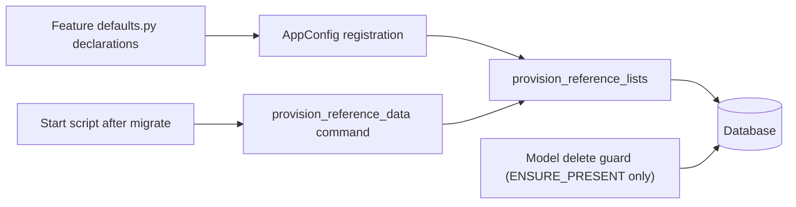

# Reference data provisioning framework

> Status: Partially implemented. The shared declaration, registry, provisioner, marker model, command, and deletion guard exist; only equipment categories currently have a registered declaration.
> Owner: shared core framework; each owning app or feature declares its own lists.
> Scope: any Django model in the application that needs baseline rows.

## 1. Purpose

Some lists must exist for the application to work. The framework provides two modes for declaring them, so a list can be added with minimal code:

| Mode | Behavior | Use when |
|---|---|---|
| `SEED_ONCE` | Creates the declared rows on the first run only. Later absence of a row is not repaired. Users may edit and delete rows freely. | The list is an initial starting point, not something the system depends on. |
| `ENSURE_PRESENT` | Creates any declared row that is missing on every provisioning run. Rows are not overwritten. The model layer blocks deletion through standard ORM paths; admin deletion is separately disabled. | The system depends on these rows, for example equipment categories. |

Mode is chosen per list. It is not inferred from `on_delete`, FK targets, or base classes.

Foreign-key defaults are out of scope. Creating a baseline row does not make it the default value of any FK.

## 2. Current equipment behavior (verified)

- `EquipmentCategory` in `core/labs/models/resource/equipment/reference_data.py` uses a string `key` primary key and opts into `ProtectedReferenceMixin`; its admin uses `ProtectedReferenceAdmin` and is view-only (no add, change or delete).
- Standard categories are declared in `core/labs/features/equipment/defaults.py`. The local and production start scripts call `provision_reference_data` after `migrate`.
- A legacy `provision_equipment_categories` command remains as an alias to the shared command.
- Categories cannot be created through the import API either: `equipment/reference-data/categories` is list/retrieve only (`POST` returns 405). To add or change a category, edit the declaration and run `provision_reference_data`.

This is the `ENSURE_PRESENT` pattern implemented for one Labs model using the shared framework. Other apps can register declarations through their own `AppConfig` without being imported by the framework.

## 3. Declaration

Each feature declares its lists in its own `defaults.py` (or a similarly named module that does not conflict with model modules). A list is a plain declaration, with no logic:

```python
ReferenceList(
    key="labs.equipment.categories",
    model=EquipmentCategory,   # the Django model
    identity="key",            # stable natural key, never the integer PK
    mode=ReferenceMode.ENSURE_PRESENT,  # or SEED_ONCE
    rows=(
        {"key": "computing", "label": "Computing", "definition": "...", "active": True},
    ),
)
```

Rules for declarations:

- The identity field must have a database unique constraint.
- Rows include only the values needed to create the row. Later user edits are never reverted.
- Declarations are imported by the owning feature only. Other features read rows through their public interface.

## 4. Framework modules

The framework consists of these small parts:

1. **Declaration type** (`ReferenceList`, `ReferenceMode`) in `core/reference_data/declarations.py`.
2. **Registry** in `core/reference_data/registry.py`. Each owning app registers its declaration tuple in `AppConfig.ready()`; the shared framework does not import domain features.
3. **Provisioner** (`provision_reference_lists(lists, *, using)`) in `core/reference_data/provisioning.py`. It creates missing identities idempotently, validates identity uniqueness, and uses the caller's database alias.
4. **Run-once marker** (`SeededReferenceList`) in `core/reference_data/models.py`. A database row records successful `SEED_ONCE` completion per list key; provisioning rows and marker are written atomically.
5. **Command** (`provision_reference_data --database`) in `core/reference_data/management/commands/`. It provisions registered declarations. Start scripts call it after `migrate`; the equipment-specific command remains a compatibility alias.

Deletion protection for `ENSURE_PRESENT` lists is explicit and opt-in:

- Model `delete()`, the protected queryset manager, and a `pre_delete` collector guard block standard ORM deletion, including queryset, base-manager, and cascade paths.
- Bulk admin delete actions are removed through `ProtectedReferenceAdmin`.
- Only models inheriting `ProtectedReferenceMixin` are protected; other models are not affected.

Protected admin models inherit `ProtectedReferenceAdmin`.



## 5. Provisioning semantics

- Identify rows by the declared identity field, never by the generated PK.
- Create missing identities only. Never update, rename, or reactivate an existing row.
- Concurrency: rely on the unique constraint; tolerate a concurrent insert only when the identity now exists.
- `AppConfig.ready()` only registers declarations; it performs no ORM work. The start-script command repairs `ENSURE_PRESENT` lists after normal restarts.
- `SEED_ONCE` lists are created by the same command and then skipped when their marker exists. Marker creation occurs in the same transaction as row creation, so a failed run can be retried.
- No `post_migrate` receiver is used; normal startup owns the explicit provisioning step.

## 6. Limits

## Reference import HTTP APIs

The baseline provisioner remains separate from the explicit owner-registered import API.
`core/common/api/reference_views.py` supplies transport; the existing equipment, licenses,
locations, benches and bench-bookings features register their own allowlisted catalogs.
No model is exposed merely because Django discovers it. Existing asset and lookup routes
are preserved. This implementation is create/list/retrieve only, not an upsert or delete API.

### Routes and import order

Every collection below accepts `GET` (page-number pagination) and `POST` (one JSON record),
except read-only catalogs marked *(read-only)*, which accept `GET` only (`POST` returns 405).
Append `/{id}` for single-record `GET`. All paths are slashless beneath `/api/labs/`.

| Owner prefix | Catalog segments |
|---|---|
| `equipment/reference-data/` | `categories` *(read-only)*, `kinds`, `types`, `manufacturers`, `product-models`, `specification-definitions`, `product-model-specifications`, `interfaces`, `materials`, `display-sizes`, `display-resolutions`, `networking-protocols`, `sample-customers`, `sample-characteristics`, `technical-users`, `departments`, `groups` |
| `licenses/reference-data/` | `vendors`, `products`, `types`, `categories`, `restrictions` |
| `locations/reference-data/` | `countries`, `cities`, `buildings`, `station-types` |
| `benches/reference-data/` | `groups`, `types` |
| `bench-bookings/reference-data/` | `projects` |

Import parents first: kind (under a provisioned category) → type; manufacturer with category memberships →
product model → specification values; license vendor → product; country → city → building;
department → group. Look up category IDs with `GET equipment/reference-data/categories`. Use returned integer IDs in `*_id` input fields and category
ID arrays in manufacturer input. OpenAPI documents the exact allowed fields for each catalog.
Technical users are account identifiers only: there is no password/token import field.

### Safety and retry semantics

- Authentication is required. New import routes require the model's Django `add_*` permission
  for writes. `is_staff` alone is not sufficient; API-key-only requests cannot import.
  Reads are shared reference catalogs available to active authenticated users.
- Each POST requires a non-empty `Idempotency-Key` of at most 128 characters. Keep the same
  key and JSON payload when retrying a failed connection. A successful replay returns the
  stored data with `201`, `Location`, and `Idempotency-Replayed: true`.
- Receipts are scoped to user ID, catalog operation, and key. Reusing a key with different
  validated input returns `422 idempotency_key_reuse`. Receipts have no automatic expiry;
  do not purge them while clients may retry. A future retention policy must explicitly
  coordinate the retry window and database growth.
- A different key cannot silently overwrite an existing natural identity. Duplicate exact
  identities return `409 reference_already_exists`; other model uniqueness/validation
  failures return `422`. Clients should list/filter/retrieve existing IDs instead.
- Unknown, read-only and wrong-type body fields are rejected; model `full_clean()` runs in
  the command, including parent-state, hierarchy, dates and specification value checks.
- The command atomically commits the row, many-to-many memberships, actor stamps and receipt.
  PostgreSQL transaction advisory locks serialize same-key replay and same-model imports.
  Related rows are locked in table-label/primary-key order; database FKs and uniqueness are
  the final guards. Existing admin/other write paths do not participate in advisory locks;
  cross-row lifecycle changes through those paths retain their existing coordination limits.
- Lists default to 25 rows and cap at 100, support bounded scalar query filters and stable
  ordering. There is no synchronous bulk-upload endpoint; importers send one validated row
  per request and retain the returned ID/key mapping.

### Migration and rollout

Since the migration reset ([ADR 005](decisions/005-migration-reset.md)) the replay-receipt table is part of `reference_data.0001_initial`; the text below describes the original rollout of `0002_referenceimportreceipt`.

`reference_data.0002_referenceimportreceipt` adds only the replay-receipt table. Apply it
before serving import POSTs. Existing lookup tables/data are untouched. Roll back the code
first, then reverse this migration only when losing replay receipts is acceptable; removing
the table invalidates the retry history. No migration is automatically applied by this task.
Authorization, API contracts, and the new table require owner approval before merge/release.

### Extending the catalogs

Add an explicit definition in the owning feature's API reference module with its model,
field allowlist, natural identity, label and callbacks. Add owner-specific validation in its
application command when model validation is insufficient; never add unrestricted model
resolution from request input. Register list/create/detail tests, permission denial, invalid
relations, replay/mismatch tests, query budgets and concurrency checks. Regenerate OpenAPI.

---

- Direct SQL and superuser database access bypass Python guards. `ENSURE_PRESENT` recovers missing rows on the next startup run; it does not restore dependents or user edits.
- A database trigger is not part of this framework.
- Recovery recreates only the declared initial values.

## 7. Adding another reference list

Add a list by writing a declaration, registering it from its owning `AppConfig.ready()`, and opting the model into the deletion mixin for `ENSURE_PRESENT`. Open items:

- Whether worker containers run the command or only web/release startup does.
- PostgreSQL behavior tests and an independent review remain to be completed before merge.
