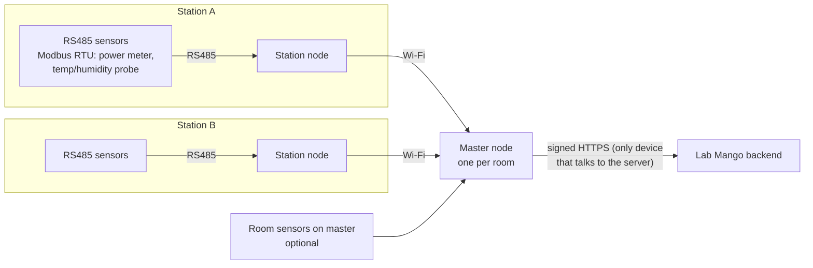
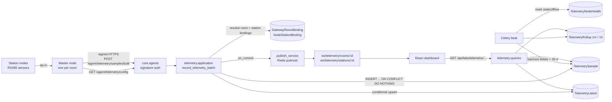
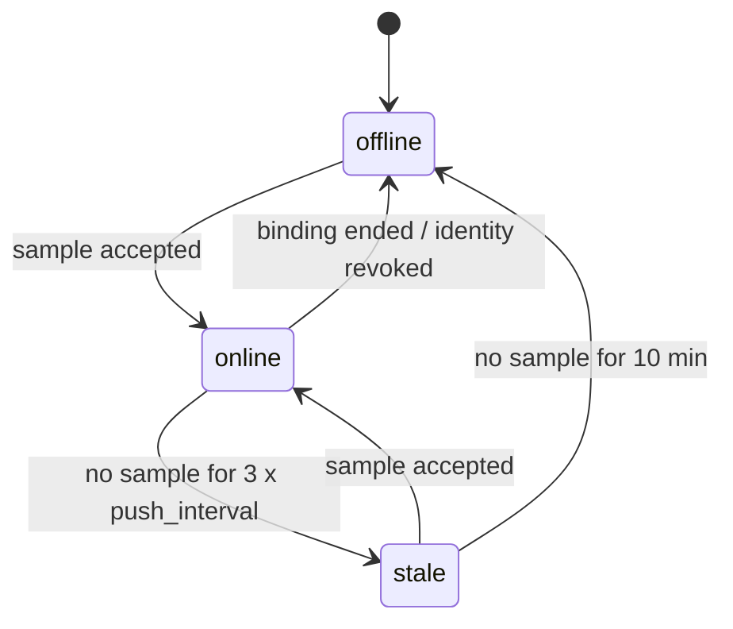
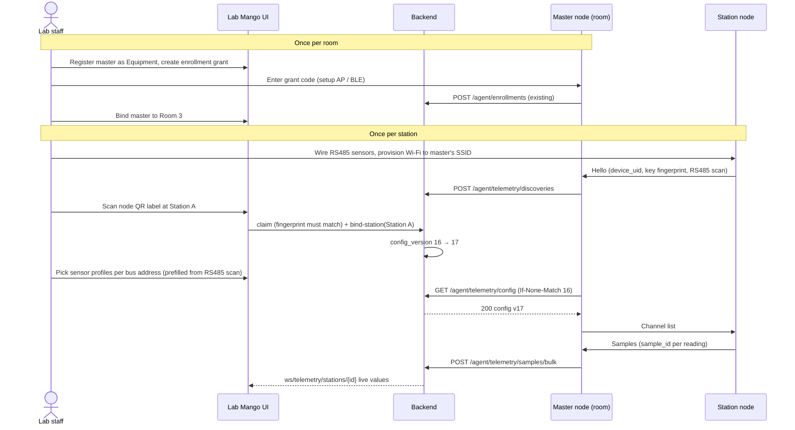

# Environment telemetry: real-time room and station power, temperature, humidity

> Status: **Proposed** (not approved, not implemented) · Risk tier: **T2** (new migrations and constraints,
> new device and operator API contracts, device authn, object-scoped authz, background jobs, cross-feature
> dependencies, retention) · Owner decision required before implementation.

IoT nodes in rooms and on stations push power, temperature and humidity samples. The backend stores them,
serves current values and history, and pushes changes to the React frontend in real time.

---

## 1. Repository facts (verified 2026-11-13)

What exists today. Everything else in this document is **Proposed**.

| Area | Verified state | Evidence |
|---|---|---|
| Room environment model | `RoomObservation`: `room`, `observed_at`, `source` (free text), `temperature_c`, `humidity_percent`, `power_usage_w`. DB checks: at least one value, temperature ≥ -273.15, humidity 0–100. Index `(room, -observed_at)`. | `core/labs/models/resource/location/room_observation.py:9-65` |
| Room environment API | `GET/POST /api/labs/rooms/{room_id}/observations`, paginated list, single-row create | `core/labs/features/locations/rooms/api/urls.py:22-24`, `.../rooms/api/views.py:169-194` |
| Room write path | `record_room_observation` does `full_clean()` + `save()` per row | `core/labs/features/locations/rooms/application/services.py:127-133` |
| Station environment data | **None.** `Station` has only design capacities (`power_capacity_w`, `power_reserved_w`, `cooling_capacity_w`), no measured values | `core/labs/models/resource/location/station.py:81-83` |
| Device identity | `AgentIdentity` with Ed25519 key, enrollment grants, revoke/decommission, signed `/agent/...` requests (`X-Agent-Id/Timestamp/Nonce/Signature`). **Bound to `labs.Equipment` only.** | `core/agents/models/agent_identity.py:30-35`, `core/agents/api/authentication.py:43-76` |
| Device ingest endpoints | heartbeat, equipment activity, session logs, booking actions. **No environment/telemetry endpoint.** | `core/agents/api/urls.py:22-58` |
| Generic agent events | `MonitoringEvent` (`METRIC_REPORTED` action, JSON payload) bound to a *computer* (`Equipment`) | `core/labs/models/monitoring/monitoring.py:8-36` |
| Real-time push | Django Channels + Redis pub/sub; `publish_service._publish(channel, data)`; WS routes registered by `register_route`. No room/station telemetry channel. | `core/websocket/publish_service.py:27-32`, `core/websocket/router.py:15-26`, `pyproject.toml:10-16` |

**Answer to "is it supported now?"** Partially. Rooms have a storage model and a manual HTTP API for the
three measurements. Stations have nothing. There is no node identity for room/station sensors, no ingest
path for nodes, no idempotency, no history aggregation, no retention, and no real-time push of this data.

### Drift found (report only; not changed by this proposal)

| Severity | Finding | Location |
|---|---|---|
| High | Any authenticated user or API key can create room observations; not object-scoped (AGENTS.md rule 5) | `core/common/api/command_views.py:36` via `core/labs/features/locations/api/views.py:7` and `.../rooms/api/views.py:169` |
| Medium | `RoomObservation` has no idempotency key; a node retrying a POST creates duplicates (write-safety §3) | `core/labs/models/resource/location/room_observation.py:9-29` |
| Medium | Monitoring WS dashboard admits every authenticated user; bench check is existence only, not object authz | `core/websocket/features/monitoring_dashboard/handler.py:17-27` |
| Low | WS messages are flat (`{"type", "bench_id", ...}`), not `{"type", "data"}` (STM-3) | `core/websocket/publish_service.py:44-53` |
| Low | `room_observations` selector has no time window; reads are bounded only by pagination | `core/labs/features/locations/rooms/queries/selectors.py:55-57` |

---

## 2. Requirements and quality attributes

**Functional**
- F1 A node measures one *scope*: a room or a station. A scope may have several nodes.
- F2 Nodes push samples with `observed_at`, any subset of `temperature_c`, `humidity_percent`, `power_w`.
- F3 Operators see the latest value per scope, history over a time window, and live updates.
- F4 Operators enroll, bind, rebind, revoke nodes and configure RS485 channels. A node never chooses its scope.
- F5 Node connectivity (online/stale/offline) is visible.

**Quality attributes (targets to confirm, see §10)**
- Volume: 500 nodes × 1 sample / 10 s ≈ 4.3 M rows/day raw.
- Ingest p95 < 200 ms per batch of ≤ 500 samples; live update to browser < 2 s after accept.
- At-least-once delivery from nodes; zero duplicates stored.
- Raw retention 30 days; aggregates kept 2 years.

**Out of scope for v1**: threshold alerts, energy billing / expense linkage, MQTT transport, control
commands to nodes. §9 shows where each attaches later.

### 2.1 Field topology (stated by owner 2026-11-13)



Consequences for the design:
- Only the **master node** holds a server credential (`AgentIdentity`). Station nodes never reach the server.
- The master is trusted to speak for **its room only**. It may forward data only from station nodes that the
  server has bound to stations in that room.
- A station node is identified by a factory **device UID** (for example its MAC or chip ID). The server, not
  the firmware, decides which station that UID belongs to, so moving or swapping a node needs no reflash.
- RS485 sensors are **channels** of a station node: a Modbus slave address plus a sensor profile (register
  map). Their configuration is server-defined and pulled by the master.

---

## 3. Key decisions

### D1 Device identity: master = signed agent; station node = registered device behind it (recommended)

| Option | For | Against |
|---|---|---|
| **A. Master and station nodes are `Equipment` (category `environment_gateway` / `environment_node`). Only the master gets an `AgentIdentity`. Station nodes are `TelemetryDevice` rows keyed by a unique `device_uid`.** (recommended) | No change to `core.agents`; one credential per room; inventory/lifecycle/procurement of nodes come free; swapping a node is a server-side rebind | Server trusts the master to report honestly for its room's nodes (bounded by room scope) |
| B. Every station node gets its own `AgentIdentity` and the master relays signed envelopes | End-to-end proof per node | Ed25519 + clock + key storage on every node; master can't batch-sign; much more firmware |
| C. Station nodes are not modeled; master reports "station id" directly | Simplest | Firmware decides the scope (breaks F4); rewiring needs reflash; no per-node health |

Constraint: the master signs with Ed25519 (ESP32-class MCUs support it via libsodium / mbedTLS;
**not verified** on the target hardware). Station-node ↔ master trust on Wi-Fi is a firmware concern;
the backend stores each node's key fingerprint so the master can enforce it (§5.0, Q7).

### D2 Transport: signed HTTPS batch push now; MQTT later only if measured need

| Option | For | Against |
|---|---|---|
| **A. `POST /agent/telemetry/samples/bulk`, signed, batched** (recommended) | Reuses auth/throttling/observability; no new infra; works through the existing proxy | One TLS request per batch; ~1–10 s latency floor depending on push interval |
| B. MQTT broker (e.g. EMQX/Mosquitto) + bridge worker | Low overhead for thousands of constrained nodes; QoS 1 | New service, new dependency (rule 7), second auth scheme, bridge must still call the same ingest command |
| C. Node holds a WebSocket to the backend | Lowest latency | Long-lived connections per node in ASGI workers; reconnection storms; signing per message not designed |

"Real time" is defined end to end: node pushes every `push_interval_s` (default 10 s, a batch may hold one
sample), backend publishes on commit, browser receives within ~1 s. Option B can be added later behind the
same application command (`record_telemetry_batch`) without changing storage or the operator API.

### D3 Storage: new wide raw table + rollups + latest-value row; keep `RoomObservation` as is

| Option | For | Against |
|---|---|---|
| **A. New `TelemetrySample` (wide row) + `TelemetryRollup` + `TelemetryLatest`** (recommended) | Bounded queries; cheap dashboard reads; retention without touching rollups; existing room API unchanged (rule 1) | Two places for room environment data until owner decides the fate of `RoomObservation` (Q2) |
| B. Extend `RoomObservation` with `station` FK, node, sample id | One table | Changes a deployed model and API; manual and high-volume data mixed; retention would delete manual data |
| C. Narrow EAV `(scope, metric, value)` | Add metrics without migrations | 3× rows, weak DB typing, constraints per metric impossible |
| D. TimescaleDB hypertable / native partitioning | Best at very high volume | New extension/infra (rule 7); Django migrations need raw SQL |

Escalation trigger for D: raw table > ~200 M rows or retention delete > 5 min. Until then a BRIN index on
`observed_at` and batched deletes are enough (**not verified** with a load test; see §8).

### D4 Scope modeling: two nullable FKs with exactly-one DB check (not GenericForeignKey)

Keeps real foreign keys (`PROTECT`) and lets PostgreSQL enforce "room xor station". A station's room is
derivable, so room dashboards can optionally include station nodes in a query; they are not double-stored.

---

## 4. Ownership and placement

New feature `core/labs/features/telemetry/` following `docs/architecture/feature-template.md`.
Models in `core/labs/models/telemetry/` per `docs/conventions/django-models.md` (to verify against that
document during model-design).

| Concept | Owner | Used through |
|---|---|---|
| `TelemetryDevice`, `GatewayRoomBinding`, `NodeStationBinding`, `SensorProfile`, `TelemetryChannel`, `TelemetrySample`, `TelemetryRollup`, `TelemetryLatest`, `TelemetryNodeHealth` | telemetry (new) | `telemetry/public.py`, `telemetry/contracts.py` |
| Room, Station existence, view policy | locations | `core/labs/features/locations/public.py` |
| Node/master equipment, `environment_gateway` / `environment_node` categories | equipment | `core/labs/features/equipment/public.py` |
| Node identity, signature verification | `core.agents` | `core/agents/public.py` (`require_active_agent_identity`) |
| WS channel publishing | `core.websocket` | `publish_service` (new `publish_telemetry_update`) |

Boundary enforcement: add the telemetry package to the existing import contracts checked by
`tests/architecture/test_import_boundaries.py` (no import of another feature's `models`/`application`
outside `public.py`/`contracts.py`).



---

## 5. Proposed models

### 5.0 `TelemetryDevice`: the hardware identity of a master or station node

| Field | Type | Notes |
|---|---|---|
| `equipment` | OneToOne `labs.Equipment`, PROTECT, null | null while `discovered` (not yet claimed into inventory) |
| `role` | char: `gateway` / `station_node` | |
| `device_uid` | char(64), **unique** | factory ID: MAC or chip ID, normalized uppercase. `Equipment.mac_address` is not unique (`equipment.py:144`), so uniqueness lives here |
| `key_fingerprint` | char(128), blank | node's local key, reported by master on discovery, confirmed at claim (QR label) |
| `state` | `discovered` → `claimed` → `retired` | own state machine, not equipment lifecycle (rule 2) |
| `reported_by` | FK `TelemetryDevice` (gateway), null | the master that last saw it |
| `firmware_version`, `config_version_applied` | char, int | reported by master |
| `first_seen_at`, `last_seen_at` | datetime | |

DB: `CHECK (state = 'discovered' OR equipment_id IS NOT NULL)`.

### 5.1 Bindings: master → room, station node → station

Two tables with the same shape, so each has real foreign keys and its own constraints.

`GatewayRoomBinding`: `gateway` (FK `TelemetryDevice`), `room` (FK `labs.Room`), `valid_from`, `valid_to`.
- Exclusion `gateway WITH =, tstzrange(valid_from, valid_to) WITH &&` — a master serves one room at a time.
- Exclusion `room WITH =, tstzrange(valid_from, valid_to) WITH &&` — **one master per room** at a time.

`NodeStationBinding`: `node` (FK `TelemetryDevice`), `station` (FK `labs.Station`), `label`, `valid_from`, `valid_to`.
- Exclusion on `node` range — a node is on one station at a time.
- Exclusion on `station` range — one node per station (owner's topology; relax if a station gets two, Q8).
- Application check `station.room == gateway's room` when binding and at ingest (a cross-table rule
  PostgreSQL can't express as a constraint; guarded by `select_for_update` on the gateway binding).

Room-level sensors wired to the master itself are channels of the gateway device, scoped to the room.

All exclusion constraints use `btree_gist`, already installed by `core/labs/migrations/0001_initial.py`.
Common: `CHECK (valid_to IS NULL OR valid_to > valid_from)`; audit via `TimeStampedModel`, `UserStampedModel`.

### 5.1b `SensorProfile` and `TelemetryChannel`: RS485 configuration

`SensorProfile` (reference data, staff-managed): `key` (e.g. `eastron_sdm120`, `sht30_modbus`), `name`,
`register_map` JSON (per metric: function code, register, word count, data type, scale, unit), `baud_rate`,
`parity`, `stop_bits`. Validated against a JSON schema on write.

`TelemetryChannel`: `device` (FK `TelemetryDevice`), `bus_address` (1–247, Modbus slave ID), `profile`
(FK `SensorProfile`), `metric` (`temperature_c` / `humidity_percent` / `power_w`), `enabled`.
- `UNIQUE (device, bus_address, metric)`; `CHECK (bus_address BETWEEN 1 AND 247)`.
- One device's channels on the same bus must share serial settings (application check at config build).

`config_version` (int, on the gateway's `TelemetryDevice`) increments in the same transaction as any change to
that room's bindings or channels (`select_for_update` on the gateway row), so the master knows when to re-pull.

### 5.2 `TelemetrySample`: raw, append-only

| Field | Type | Notes |
|---|---|---|
| `id` | BigAutoField | |
| `node` | FK `TelemetryDevice`, PROTECT | station node, or the gateway for room sensors |
| `gateway` | FK `TelemetryDevice`, PROTECT | master that forwarded it |
| `node_binding` | FK `NodeStationBinding`, null | scope resolved server-side at `observed_at`; null for room sensors |
| `room` | FK `labs.Room`, null | denormalized from binding for indexed reads |
| `station` | FK `labs.Station`, null | denormalized from binding |
| `sample_id` | UUID | generated by node; idempotency key |
| `observed_at` | datetime | node clock, UTC |
| `received_at` | datetime | server clock |
| `temperature_c` | Decimal(6,2), null | |
| `humidity_percent` | Decimal(5,2), null | |
| `power_w` | Decimal(10,2), null | instantaneous active power |
| `quality` | char(16), default `ok` | `ok` / `suspect` (clock corrected, sensor flag) |

DB constraints (same physical rules as `RoomObservation`): at least one value; temperature ≥ -273.15;
humidity 0–100; `power_w ≥ 0`; exactly one of room/station; `UNIQUE (node, sample_id)`.

Indexes: `(room, observed_at DESC)` partial where room not null; `(station, observed_at DESC)` partial;
BRIN on `observed_at` for retention deletes. No `full_clean()` per row on ingest; DB constraints are the
guard (same reasoning as `core/labs/models/base/agent_report.py:27-38`), serializer validates shape first.

### 5.3 `TelemetryRollup`: aggregates for charts

`scope (room|station)`, `bucket_start`, `resolution` (`1m`, `1h`), and for each metric `min`, `max`, `avg`,
`count`. `UNIQUE (room, station, resolution, bucket_start)` with `NULLS NOT DISTINCT` (PostgreSQL 15+; CI runs
`postgres:16` per `.github/workflows/ci.yml:22`, production version not verified) or two partial unique indexes. Recomputed idempotently by upsert.

### 5.4 `TelemetryLatest`: one row per scope (and per node) for dashboards

`scope`, `node`, latest `observed_at` and values. `UNIQUE (node)`. Room/station "current" values are a
read over the scope's nodes (few rows). Keeps the dashboard off the raw table.

### 5.5 `TelemetryNodeHealth`: connectivity, a separate state machine

`node` (unique), `connectivity` ∈ {`online`, `stale`, `offline`}, `last_sample_at`, `changed_at`.
This is **not** the equipment lifecycle status and **not** computing live activity (AGENTS.md rule 2).



---

## 6. Proposed API

All operator responses use the envelope and error rules in `docs/api/response-standard.md`.

### 6.1 Device ingest (signed, `core.agents` auth)

Only the master calls these. Its identity comes from the signature; the body never carries a room or station id.

**Config pull** — `GET /agent/telemetry/config` with `If-None-Match: "<config_version>"` → `304` or `200`:

```json
{"data": {
  "config_version": 17, "room_id": 3, "push_interval_s": 10,
  "nodes": [
    {"device_uid": "A4:CF:12:9B:00:21", "key_fingerprint": "…", "station_label": "Station A",
     "channels": [
       {"bus_address": 1, "metric": "power_w", "profile": "eastron_sdm120"},
       {"bus_address": 2, "metric": "temperature_c", "profile": "sht30_modbus"},
       {"bus_address": 2, "metric": "humidity_percent", "profile": "sht30_modbus"}]}],
  "gateway_channels": [],
  "profiles": {"eastron_sdm120": {"baud_rate": 9600, "parity": "N", "register_map": {…}}}
}}
```

The master pushes each node's channel list to that node over Wi-Fi. Nodes not in `nodes` are ignored by
the master except for discovery reports. The config never contains server credentials. The master polls
every 60 s and also when an ingest response carries a newer `config_version`.

**Discovery** — `POST /agent/telemetry/discoveries` `{"devices": [{"device_uid", "key_fingerprint",
"firmware_version", "rs485_scan": [1, 2]}]}`: idempotent upsert of `discovered` devices (`UNIQUE device_uid`).
A UID already claimed by another room's gateway is recorded but not reassigned (operator sees a conflict).

**Ingest** — `POST /agent/telemetry/samples/bulk` — BLK-1/2/3, partial mode, max 500 operations, max 256 KiB body.

```json
{
  "mode": "partial",
  "operations": [
    {"data": {"device_uid": "A4:CF:12:9B:00:21", "sample_id": "6f1c…",
              "observed_at": "2026-11-13T09:00:10Z", "config_version": 17,
              "temperature_c": "22.40", "humidity_percent": "41.0", "power_w": "1830.5"}}
  ]
}
```

`device_uid` omitted = the master's own room sensors. `sample_id` is generated where the reading is taken
(station node) so a retry from node → master → server stays deduplicated end to end.
`200` with per-item result in `data`: `accepted` | `duplicate` | `rejected` (+ ERR-1 error object), and the
current `config_version`. `Idempotency-Key` header replays the original response for the whole batch.

Validation and rejection:
- `observed_at` more than 2 min in the future, or older than raw retention → `rejected` (`observed_at_out_of_range`).
- Unknown/unclaimed `device_uid`, or node not bound to a station in **this master's room** at `observed_at`
  → `rejected` (`node_not_bound`). Never silently re-attributed.
- Master with no active room binding → `409` for the whole batch (`gateway_not_bound`).
- Revoked / decommissioned identity → `401` for the whole request (existing behavior).
- The master buffers rejected-retryable and unsent samples per `docs/agent-platform/device-design.md` §5.

### 6.2 Operator read

| Method and path | Purpose | Bounds |
|---|---|---|
| `GET /api/labs/rooms/{room_id}/telemetry/latest` | current values per node in the room (`include_stations=true` adds the room's station nodes) | ≤ 200 nodes |
| `GET /api/labs/stations/{station_id}/telemetry/latest` | current values for the station | |
| `GET /api/labs/rooms/{room_id}/telemetry?from=&to=&resolution=raw\|1m\|1h&metrics=` | history series | raw ≤ 24 h, 1m ≤ 31 d, 1h ≤ 2 y; else `422` |
| `GET /api/labs/stations/{station_id}/telemetry?…` | same for stations | same |

### 6.3 Operator write: commissioning and configuration

| Method and path | Purpose |
|---|---|
| `GET /api/labs/telemetry/devices?state=discovered&room_id=` | devices with state, binding, connectivity, config version applied |
| `POST /api/labs/telemetry/gateways/{device_id}/actions/bind-room` | bind master to a room (ends its previous binding) |
| `POST /api/labs/telemetry/devices/{device_id}/actions/claim` | `discovered` → `claimed`: confirm fingerprint, create or link Equipment |
| `POST /api/labs/telemetry/devices/{device_id}/actions/bind-station` | bind station node to a station in the gateway's room (ends previous binding) |
| `POST /api/labs/telemetry/devices/{device_id}/actions/unbind` | end the current binding (node removed or broken) |
| `GET/POST/PATCH/DELETE /api/labs/telemetry/devices/{device_id}/channels` | RS485 channels |
| `GET/POST /api/labs/telemetry/sensor-profiles` | register-map reference data |

Master enrollment itself stays on the existing `POST /api/agents`, `/enrollment-grants`, `/agent/enrollments`.

### 6.5 Commissioning flow (how a station gets its node)



Swapping a broken node: unbind old → new node is discovered → claim + bind-station. History stays on the
station because samples carry the binding. Moving a station to another room requires rebinding its node under
the new room's master (the old master's samples for it start being rejected).

### 6.4 Real-time push

| WS route | Channel |
|---|---|
| `ws/telemetry/rooms/{room_id}` | `ws:telemetry:room:{room_id}` |
| `ws/telemetry/stations/{station_id}` | `ws:telemetry:station:{station_id}` |

Message (STM-3): `{"type": "telemetry.latest", "data": {"scope": {"type": "room", "id": 7}, "node_id": 42,
"observed_at": "…", "temperature_c": "22.40", "humidity_percent": "41.0", "power_w": "1830.5"}}` and
`{"type": "telemetry.connectivity", "data": {…}}`. Published in `transaction.on_commit`, one message per
node per batch (the newest sample), so a 500-sample backfill sends one message, not 500. Messages are
best-effort; on (re)connect the client calls `…/telemetry/latest` (documented per STM-4). Heartbeat every 30 s.

---

## 7. Write safety and authorization

| Write path | Race guard | Safe to run twice |
|---|---|---|
| `record_telemetry_batch` | `UNIQUE (node, sample_id)` + `bulk_create(ignore_conflicts=True)`; binding resolved by exclusion-constrained range lookup | Yes: duplicates reported as `duplicate`, no extra rows |
| `TelemetryLatest` upsert | `INSERT … ON CONFLICT (node) DO UPDATE … WHERE excluded.observed_at > telemetry_latest.observed_at` | Yes: older or equal samples never overwrite newer |
| Bind node | `select_for_update` on the node's open binding + exclusion constraint | Same request twice: second sees identical open binding and returns it |
| Rollup task | upsert on `(scope, resolution, bucket_start)`; recompute from raw | Yes |
| Retention task | delete in batches of 10 k by `observed_at < cutoff` | Yes |
| Connectivity task | conditional update `WHERE connectivity = old AND last_sample_at = seen` | Yes |

Authorization (deny-by-default, object-scoped):
- Device writes: signed master identity → its `TelemetryDevice` → active room binding → only nodes bound to
  stations in that room. A compromised master can at worst forge data for its own room.
- Connectivity has two layers: master (from agent heartbeat) and each node (last sample via the master).
  When the master is offline, its nodes are `unknown`, not `offline` (matches the repo rule that missing
  telemetry is unknown, `core/labs/features/equipment/queries/summaries.py:19`).
- Operator reads: the caller must be allowed to view the room/station, via a locations policy exposed in
  `locations/public.py`. **No such object-level policy exists today** (drift table §1), so the owner must
  decide the rule (Q3). WS handshakes apply the same check, not "exists".
- Binding management: lab staff only (`LABS_STAFF_ACCESS`, already used at
  `core/labs/features/locations/api/reference_data.py:24`).

---

## 8. Verification plan (when implemented)

- Model tests: every DB constraint rejects bad rows at the database (bypass `full_clean`).
- Ingest: duplicate batch, duplicate sample in one batch, out-of-order samples, unbound node, revoked node,
  future timestamp, 501 operations, oversized body.
- Concurrency: two concurrent batches with overlapping sample ids; latest never regresses.
- Query budgets: `latest` endpoint constant queries for 1 vs 200 nodes; history endpoint ≤ 3 queries.
- WS: unauthorized user closed with 4003; message shape STM-3; one message per node per batch.
- Load test before approval of the D3 escalation trigger: 4.3 M rows/day for 30 days, measure history p95
  and retention delete duration.
- Quality gates per `docs/ai-team/quality-gates.md`; regenerate `openapi/` in the same change.

---

## 9. Later extensions (not in v1)

| Extension | Attaches at |
|---|---|
| Threshold alerts (temp/humidity bands; `power_w > Station.power_capacity_w`) | Rule table in telemetry; evaluated in `record_telemetry_batch` after commit; notify via `core.websocket` user notifications |
| Energy (`energy_wh` monotonic counter) for expense/billing | New nullable column + rollup delta; money logic is its own T2 change |
| MQTT transport | Bridge worker calling `telemetry.public.record_telemetry_batch` |
| Long-range storage | TimescaleDB or native partitioning (D3 option D) |

---

## 10. Assumptions and open questions for the owner

Assumptions (not verified): node hardware can do Ed25519 and HTTPS; ~500 nodes at 10 s; production
PostgreSQL ≥ 15 (CI uses 16).

| # | Question | Recommended default |
|---|---|---|
| Q1 | Approve node-as-Equipment (D1-A)? | Yes |
| Q2 | Fate of `RoomObservation` and `/rooms/{id}/observations`: keep for manual entries, or deprecate after telemetry ships? | Keep in v1; decide after adoption |
| Q3 | Who may view a room's/station's telemetry? | Same users who can view the room; staff for all |
| Q4 | Push interval, raw retention, rollup retention | 10 s; 30 d; 1m for 90 d, 1h for 2 y |
| Q5 | Is `power_w` per node real power at the PDU/meter, and is energy (kWh) needed for expenses? | `power_w` only in v1 |
| Q6 | Fix the drift items in §1 (esp. room observation write authz) as separate tasks? | Yes, separate T2 task for authz |
| Q7 | Node ↔ master link security: dedicated per-room WPA2 SSID only, or also a per-node key checked by the master against `key_fingerprint`? | Both |
| Q8 | Exactly one node per station, or allow several (e.g. two PDUs)? | One; drop the station exclusion if needed |
| Q9 | Which RS485 sensor models are used (needed to write the first `SensorProfile` register maps)? | Owner to list |
| Q10 | Should RS485 config live on the server (pulled by master) or stay in firmware? | Server, so swaps need no reflash |
