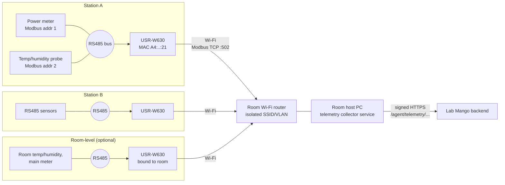
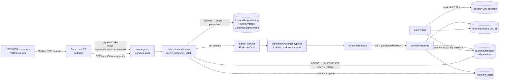
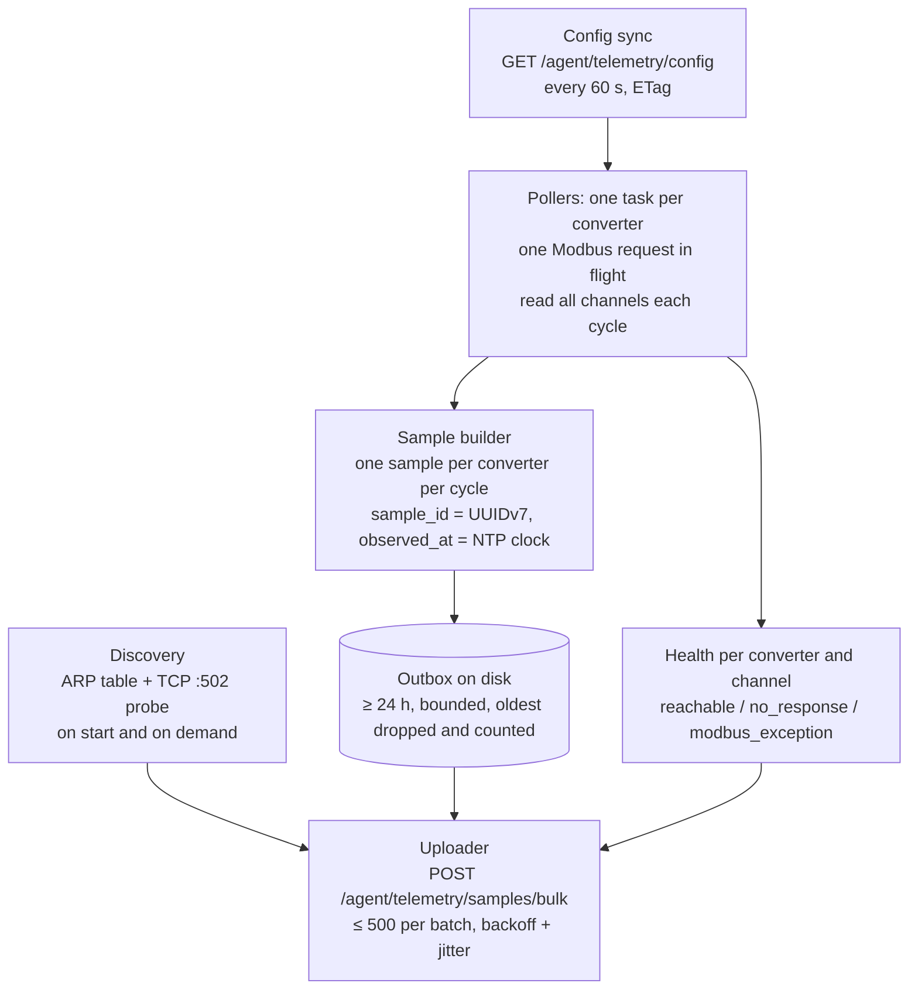
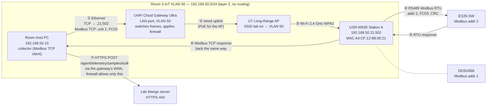
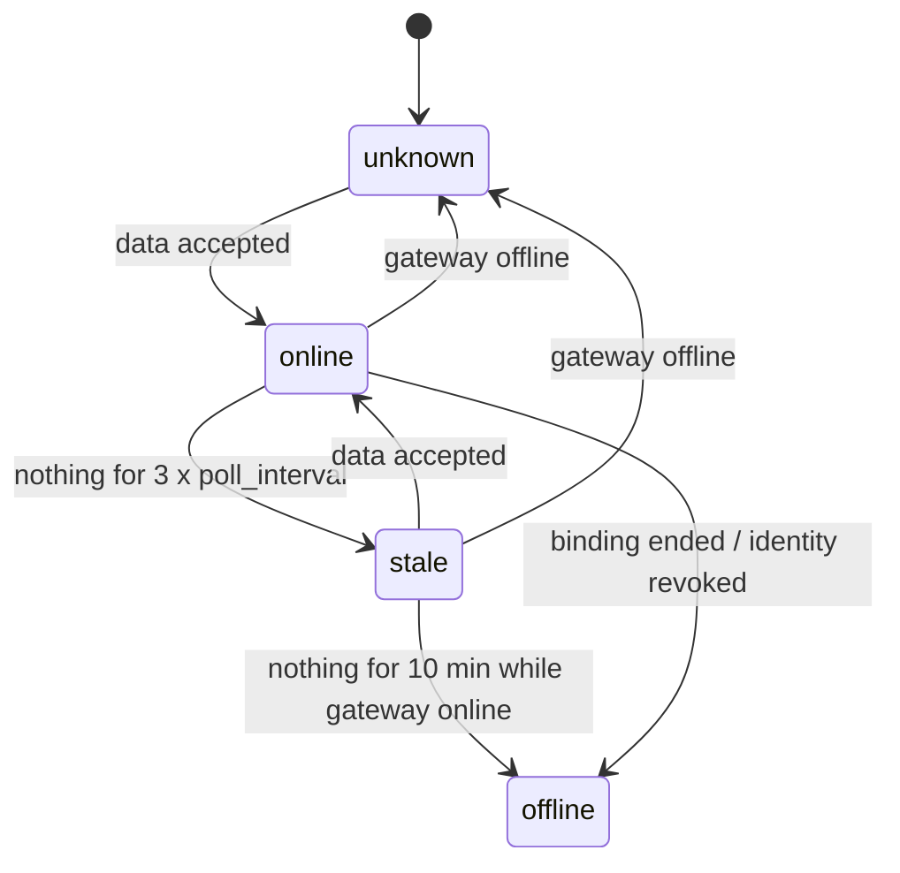
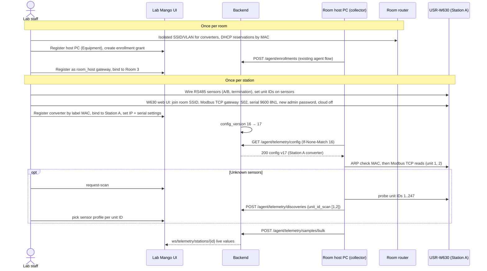

# Environment telemetry: real-time room and station power, temperature, humidity

> Status: **Proposed** (not approved, not implemented) · Risk tier: **T2** (new migrations and constraints,
> new device and operator API contracts, device authn, object-scoped authz, background jobs, cross-feature
> dependencies, retention) · Owner decision required before implementation.

Serial-to-Wi-Fi converters (USR-W630) on stations and in rooms expose RS485 sensor readings (power, temperature, humidity); a room host PC collects them and pushes to the backend. The backend stores them,
serves current values and history, and pushes changes to the React frontend in real time.

---

## 1. Repository facts (verified 2026-11-13)

What exists today. Everything else in this document is **Proposed**.

| Area | Verified state | Evidence |
|---|---|---|
| Room environment model | `RoomObservation`: `room`, `observed_at`, `source` (free text), `temperature_c`, `humidity_percent`, `power_usage_w`. DB checks: at least one value, temperature ≥ -273.15, humidity 0–100. Index `(room, -observed_at)`. | `core/labs/models/resource/location/room_observation.py:9-65` |
| Room environment API | `GET/POST /api/labs/rooms/{room_id}/observations`, paginated list, single-row create | `core/labs/features/locations/rooms/api/urls.py:22-24`, `.../rooms/api/views.py:169-194` |
| Room write path | `record_room_observation` does `full_clean()` + `save()` per row | `core/labs/features/locations/rooms/application/services.py:127-133` |
| Station environment data | **None.** `Station` has only design capacities (`power_capacity_w`, `power_reserved_w`, `cooling_capacity_w`), no measured values | `core/labs/models/resource/location/station.py:81-83` |
| Device identity | `AgentIdentity` with Ed25519 key, enrollment grants, revoke/decommission, signed `/agent/...` requests (`X-Agent-Id/Timestamp/Nonce/Signature`). **Bound to `labs.Equipment` only.** | `core/agents/models/agent_identity.py:30-35`, `core/agents/api/authentication.py:43-76` |
| Device ingest endpoints | heartbeat, equipment activity, session logs, booking actions. **No environment/telemetry endpoint.** | `core/agents/api/urls.py:22-58` |
| Generic agent events | `MonitoringEvent` (`METRIC_REPORTED` action, JSON payload) bound to a *computer* (`Equipment`) | `core/labs/models/monitoring/monitoring.py:8-36` |
| Real-time push | Django Channels + Redis pub/sub; `publish_service._publish(channel, data)`; WS routes registered by `register_route`. No room/station telemetry channel. | `core/websocket/publish_service.py:27-32`, `core/websocket/router.py:15-26`, `pyproject.toml:10-16` |

**Answer to "is it supported now?"** Partially. Rooms have a storage model and a manual HTTP API for the
three measurements. Stations have nothing. There is no node identity for room/station sensors, no ingest
path for nodes, no idempotency, no history aggregation, no retention, and no real-time push of this data.

### Drift found (report only; not changed by this proposal)

| Severity | Finding | Location |
|---|---|---|
| High | Any authenticated user or API key can create room observations; not object-scoped (AGENTS.md rule 5) | `core/common/api/command_views.py:36` via `core/labs/features/locations/api/views.py:7` and `.../rooms/api/views.py:169` |
| Medium | `RoomObservation` has no idempotency key; a node retrying a POST creates duplicates (write-safety §3) | `core/labs/models/resource/location/room_observation.py:9-29` |
| Medium | Monitoring WS dashboard admits every authenticated user; bench check is existence only, not object authz | `core/websocket/features/monitoring_dashboard/handler.py:17-27` |
| Low | WS messages are flat (`{"type", "bench_id", ...}`), not `{"type", "data"}` (STM-3) | `core/websocket/publish_service.py:44-53` |
| Low | `room_observations` selector has no time window; reads are bounded only by pagination | `core/labs/features/locations/rooms/queries/selectors.py:55-57` |

---

## 2. Requirements and quality attributes

**Functional**
- F1 A reading is about one *target*: a room, station, bench or equipment item (extendable to new types). A target
  may have many channels; a single collector may serve targets of different types (owner, 2026-11-13).
- F2 Gateways push readings with `observed_at`; v1 metrics `temperature_c`, `humidity_percent`, `power_w`; new
  metrics are added as data, not schema.
- F3 Operators see the latest value per scope, history over a time window, and live updates.
- F4 Operators enroll, bind, rebind, revoke nodes and configure RS485 channels. A node never chooses its scope.
- F5 Node connectivity (online/stale/offline) is visible.

**Quality attributes (targets to confirm, see §10)**
- Volume: 500 converters × 1 sample / 10 s ≈ 4.3 M rows/day raw.
- Ingest p95 < 200 ms per batch of ≤ 500 samples; live update to browser < 2 s after accept.
- At-least-once delivery from nodes; zero duplicates stored.
- Raw retention 30 days; aggregates kept 2 years.

**Out of scope for v1**: threshold alerts, energy billing / expense linkage, MQTT transport, control
commands to nodes. §9 shows where each attaches later.

### 2.1 Field topologies (stated by owner 2026-11-13)

**Hardware (owner, 2026-11-13):** each station has a **USR-W630** industrial serial-to-network converter
(RS232/RS485 ↔ Wi-Fi/Ethernet; vendor lists Modbus RTU↔TCP gateway, TCP/UDP socket and MQTT modes). Its
RS485 port wires to the station's Modbus RTU sensors. It joins the room's **Wi-Fi router**. A **room host PC**
on the same router collects from every converter and pushes to Lab Mango.

The W630 runs vendor firmware only; Lab Mango cannot install code on it. W630 feature claims here are from the
vendor's product listing and are **not verified** against its manual or firmware version.



Consequences for the design:
- The **room host PC is the gateway**: the only device with a server credential (`AgentIdentity` bound to the
  host PC's `Equipment`, `core/agents/models/agent_identity.py:31`). It *polls* the converters; converters
  never reach the server.
- Because the converter can't run our logic, the **host PC** owns timestamps (NTP clock), `sample_id`,
  buffering, retries and per-sensor health. There is no custom node firmware.
- A converter is identified by its **MAC** (printed on its label). Lab Mango decides which station (or room)
  that MAC belongs to; swapping or moving a converter is a server-side rebind and keeps the station's history.
- RS485 sensors are **channels** of a converter: Modbus unit ID + sensor profile (register map) + metric,
  configured in Lab Mango (D5).
- The earlier "station PC" topology remains possible with the same software: a station PC polls only its own
  station's converter (gateway scope = station). It is optional (Q11).

---

## 3. Key decisions

### D1 Device identity: host PC = signed agent; W630 = registered converter behind it (recommended)

| Option | For | Against |
|---|---|---|
| **A. Host PC and converters are `Equipment` (converter category `environment_converter`). Only the host PC holds an `AgentIdentity`. Converters are `TelemetryDevice` rows keyed by unique MAC.** (recommended) | No change to `core.agents`; one credential per room; Ed25519 runs on a normal PC (existing agent); converters get inventory/lifecycle/procurement; swap = server-side rebind | Server trusts the host PC to report honestly for converters in its room |
| B. Converters not modeled; host PC config file maps IP → station | Simplest server | Scope decided on the PC (breaks F4); IP changes silently move data; no converter health |
| C. Converter pushes MQTT itself to a broker, broker bridged to Lab Mango | No polling software | See D6-C |

Trust limits on the LAN: Modbus TCP has no authentication and the W630 has only a web-admin password, so
station data integrity rests on network isolation (§7), not on device crypto.

### D6 Collection mode: host PC polls each W630 over Modbus TCP (**decided by owner 2026-11-13**)

| Option | For | Against |
|---|---|---|
| **A. W630 in Modbus TCP gateway mode; host PC is the Modbus TCP client, polling `ip:502` with unit ID = RS485 address** (recommended) | All config in Lab Mango; host PC owns time and IDs; standard protocol; no broker | Host PC must run all the time; polling software needed |
| B. W630 transparent TCP server; host PC sends raw Modbus RTU frames (with CRC) over the socket | Works if the converter's gateway mode misbehaves | Host builds RTU frames; same config otherwise. Keep as fallback via `collection_mode` |
| C. W630 MQTT mode (converter polls registers itself and publishes) to a broker on the host PC | No host polling code | New broker dependency (rule 7); register maps configured in each W630's web UI (drift from Lab Mango); converter timestamps/IDs unreliable; **not verified** that W630 does register polling + JSON |
| D. Vendor cloud (USR Cloud) | Zero setup | Lab data leaves to a third-party cloud; rejected |

RS485 is half-duplex: the collector keeps **one request in flight per converter**, reads all of that
converter's channels sequentially each cycle (≈ 0.5–1 s timeout per request), and runs converters in parallel.

### D7 Collector identity: the collector is a separate service, so it needs its own server login

`AgentIdentity` allows one live identity per equipment (`agent_one_live_per_equipment`,
`core/agents/models/agent_identity.py:50-54`). Sharing the computer agent's private key between two processes
is not an option (`docs/agent-platform/device-design.md` §2: keys are unavailable to other components).

| Option | For | Against |
|---|---|---|
| **A. Host PC is dedicated and runs only the collector; the collector enrolls as that PC's one `AgentIdentity`** (recommended for v1) | No change to `core.agents`; existing enrollment, revoke and signing as is | The host PC cannot also run the computer agent |
| B. Register the collector as its own `Equipment` row and enroll against it | No agents change; host PC can also run the computer agent | An inventory row that is not a physical asset; confuses equipment reports |
| C. Add `purpose` (`computer_agent` / `telemetry_collector`) to `AgentIdentity`, unique per `(equipment, purpose)`; each endpoint accepts only its purpose | Least privilege (collector key can't call booking endpoints and vice versa); both can run on one PC | Migration on a security-critical table and auth change in `core.agents` (separate T2 task with security review) |

Recommendation: A now (Q13: dedicated host PC). Move to C if a host PC must also be a managed lab computer.
Under any option, `/agent/telemetry/*` additionally requires the signing identity's equipment to be a claimed
`room_host` gateway, so an ordinary computer agent cannot submit telemetry.

### D5 Sensor configuration: defined in Lab Mango, discovered by the host PC (recommended)

| Option | For | Against |
|---|---|---|
| **A. Lab Mango is the source of truth for *what is where and what it measures*; host PC discovers converters and scans RS485 addresses; staff confirm the sensor profile** (recommended) | Swap/move without field reconfiguration of the PC; one place to audit; channels map to metrics with DB constraints | Needs config sync (`GET /agent/telemetry/config`) and a profile library |
| B. Configured only in a host PC config file | No server work | Server can't validate what a reading means; per-room drift; swaps need someone at the PC |
| C. Fully automatic (guess sensor model from scan) | Zero touch | Modbus has no standard device ID; wrong register map = silently wrong data |

Split of responsibility:

| Configured in Lab Mango | Configured on the W630 (its web UI, once at install) | On the host PC |
|---|---|---|
| Converter registry (MAC, model), claim | Wi-Fi SSID/password of the room router | Lab Mango agent enrollment (existing) |
| Converter → station or room; host PC → room | Work mode = Modbus TCP gateway, port 502 | Telemetry collector polling, buffering, retry |
| Expected network address (IP from DHCP reservation) | Serial: baud, parity, data/stop bits — **must match** the profile in Lab Mango | NTP time sync |
| Channels: unit ID → profile → metric, enabled | Admin password changed; vendor cloud and unused services off | |
| Sensor profiles (register map, scale, serial settings) | | |
| Poll and push interval | | |

The collector cannot read or change W630 settings in v1. A serial mismatch shows up as `no_response` on every
channel of that converter and is surfaced in the UI as "check converter serial settings".

### D2 Transport: signed HTTPS batch push now; MQTT later only if measured need

| Option | For | Against |
|---|---|---|
| **A. `POST /agent/telemetry/samples/bulk`, signed, batched** (recommended) | Reuses auth/throttling/observability; no new infra; works through the existing proxy | One TLS request per batch; ~1–10 s latency floor depending on push interval |
| B. MQTT broker (e.g. EMQX/Mosquitto) + bridge worker | Low overhead for thousands of constrained nodes; QoS 1 | New service, new dependency (rule 7), second auth scheme, bridge must still call the same ingest command |
| C. Host PC holds a WebSocket to the backend | Lowest latency | Long-lived connections per gateway in ASGI workers; reconnection storms; signing per message not designed |

"Real time" is defined end to end: host PC polls every `poll_interval_s` and pushes every `push_interval_s`
(default 10 s each, a batch may hold one sample), backend publishes on commit, browser receives within ~1 s. Option B can be added later behind the
same application command (`record_telemetry_batch`) without changing storage or the operator API.

### D3 Storage: narrow readings table, partitioned by day, + rollups + latest (revised 2026-11-13 for extensibility)

Owner requirement (2026-11-13): telemetry must be extendable — new measured things (equipment, bench,
station, room, later others), new collector kinds, and new metrics without redesign.

| Option | For | Against |
|---|---|---|
| A. Wide row per sample (`temperature_c`, `humidity_percent`, `power_w` columns) | Fewest rows; typed columns | Every new metric = migration on the biggest table; a sample row mixes metrics that may belong to different targets (meter on equipment, probe on station) |
| **B. Narrow `TelemetryReading` (one row per channel per poll: `target`, `metric`, `value`), daily range partitions on `observed_at`** (recommended) | New metric = one `MetricDefinition` row; each reading has exactly one target; retention = drop a partition (instant) | ~3× rows; needs native partitioning via `RunSQL` migration and a composite primary key (Django 5.2 `CompositePrimaryKey`; repo pins `django==5.2.13`, `uv.lock:583-584`) |
| C. TimescaleDB / `pg_partman` | Managed partitions, compression | New database extension (rule 7) and infra change; not needed at this volume |

Volume with B: 500 sources × 3 channels × 1 per 10 s ≈ 13 M rows/day. Proposed retention: raw **7 days**
(≈ 90 M rows over 7 partitions), 1-minute rollups 30 days, 1-hour rollups 2 years (Q4). Load test before
approval (§8). Physical-range rules stay in PostgreSQL as per-metric CHECKs (§5.2), so rule 4 still holds.

`RoomObservation` and its API stay unchanged (rule 1; Q2).

### D4 Targets: one `TelemetryTarget` table with typed nullable FKs (not GenericForeignKey)

`PhysicalLocationNode` (`core/labs/models/resource/location/physical_location.py:14`) and `ResourceModel` are
abstract, so there is no shared table a single FK could point at.

| Option | For | Against |
|---|---|---|
| **A. `TelemetryTarget` row per measured thing: nullable FKs `room` / `station` / `bench` / `equipment`, exactly one set (DB CHECK); every other table references `target_id`** (recommended) | Real FKs with `PROTECT`; one place to extend (new target type = one nullable FK + CHECK update); readings stay one `bigint` wide | One extra join to show names |
| B. Nullable FKs repeated on every table (bindings, readings, rollups, latest) | No extra table | Each new target type touches every table, including the partitioned one |
| C. `GenericForeignKey` (`content_type`, `object_id`) | Infinitely open | No referential integrity, no `PROTECT` — violates AGENTS.md rule 4 |

### D8 Sources and gateways are typed kinds with per-kind settings

- A **gateway** is any signed agent that submits telemetry, with a **scope** that is itself a target:
  `room_host` (scope = room; this project's host PC), `station_pc` (scope = station), `equipment_agent`
  (scope = its own equipment, e.g. a lab computer's existing agent reporting its own power/temperature later).
- A **source** is what the gateway reads from: `modbus_tcp_converter` (USR-W630) now; later e.g. `snmp_pdu`,
  `ipmi_bmc`, `agent_self`. Kind-specific settings live in one-to-one tables (`ModbusConverterSettings`), so a
  new kind adds a table, not columns on a shared one.
- A **channel** is one metric read from one source (for Modbus: unit ID + profile). Each channel is bound to a
  **target** over time. The gateway never needs to know targets: it reports channel values, the server attributes them.

This is what makes "the collector can be on equipment, bench, station or room" work: a single W630 at a
station can carry a meter bound to one equipment item and a probe bound to the station itself.

---

## 4. Ownership and placement

New feature `core/labs/features/telemetry/` following `docs/architecture/feature-template.md`.
Models in `core/labs/models/telemetry/` per `docs/conventions/django-models.md` (to verify against that
document during model-design).

| Concept | Owner | Used through |
|---|---|---|
| `TelemetryTarget`, `MetricDefinition`, `TelemetryDevice`, `ModbusConverterSettings`, `GatewayScopeBinding`, `TelemetryChannel`, `ModbusChannelSettings`, `ChannelTargetBinding`, `SensorProfile`, `TelemetryReading`, `TelemetryRollup`, `TelemetryLatest`, `TelemetryDeviceHealth` | telemetry (new) | `telemetry/public.py`, `telemetry/contracts.py` |
| Room, Station, Bench existence, placement (bench → station → room), view policy | locations, benches | `core/labs/features/locations/public.py`, `core/labs/features/benches/public.py` (batched placement functions to add) |
| Equipment as target, current bench assignment; host PC / W630 / sensor assets, `environment_converter` category | equipment | `core/labs/features/equipment/public.py` (batched `current_bench_for(equipment_ids)` to add) |
| Host PC identity, signature verification | `core.agents` | `core/agents/public.py` (`require_active_agent_identity`) |
| WS channel publishing | `core.websocket` | `publish_service` (new `publish_telemetry_update`) |

Boundary enforcement: add the telemetry package to the existing import contracts checked by
`tests/architecture/test_import_boundaries.py` (no import of another feature's `models`/`application`
outside `public.py`/`contracts.py`).



---

## 5. Proposed models

### 5.0 Target, metric, and placement

**`TelemetryTarget`** — the thing a reading is *about*.

| Field | Type | Notes |
|---|---|---|
| `target_type` | char: `room` / `station` / `bench` / `equipment` | denormalized for CHECK and filtering |
| `room` | FK `labs.Room`, PROTECT, null | |
| `station` | FK `labs.Station`, PROTECT, null | |
| `bench` | FK `labs.Bench`, PROTECT, null | |
| `equipment` | FK `labs.Equipment`, PROTECT, null | |

DB: `CHECK (num_nonnulls(room_id, station_id, bench_id, equipment_id) = 1)`; `CHECK` that `target_type` names
the non-null FK; partial `UNIQUE` on each FK (one target row per resource). Created on first bind with
`INSERT … ON CONFLICT DO NOTHING` + re-read (race-safe). Adding a target type later (rack, building) = add one
nullable FK, extend both CHECKs and the placement resolver. Soft-deleted resources keep their target row;
binding to a soft-deleted resource is refused and its channels stop accepting readings.

**Placement resolver** (`resolve_placement(targets) -> {target_id: (room_id, station_id | None)}`, batched,
current placement at ingest time):

| Target | Room | Station |
|---|---|---|
| room | itself | none |
| station | `station.room` | itself |
| bench | `bench.station_slot.station.room` | `bench.station_slot.station` |
| equipment | via open `EquipmentAssignment` → bench → as bench | as bench |

`Bench.station_slot` is nullable (`core/labs/models/resource/bench/bench.py:48-53`) and equipment may be
unassigned; such targets are **not located** and their readings are rejected (`target_not_located`, Q18)
rather than guessed. Needs batched public functions from locations and equipment (no N+1; no import of their
models). The resolved `room_id` / `station_id` are snapshotted on each reading, so history does not move
when a bench or equipment is moved later.

**`MetricDefinition`** (reference data, seeded by data migration): `key` (PK slug, e.g. `temperature_c`),
`name`, `unit`, `value_min`, `value_max` (null = open), `kind` (`gauge` / `counter`), `aggregation`
(`mean` / `max` / `last`; counters roll up as delta), `decimals`, `active`. v1 rows: `temperature_c`
(≥ -273.15), `humidity_percent` (0–100), `power_w` (≥ 0). Adding `energy_wh` (counter), `voltage_v`,
`current_a`, `co2_ppm` later = one row (+ optional CHECK migration, §5.2).

### 5.1 Devices, gateways, sources and bindings

**`TelemetryDevice`** — a gateway or a source.

| Field | Type | Notes |
|---|---|---|
| `role` | `gateway` / `source` | |
| `kind` | gateway: `room_host` / `station_pc` / `equipment_agent`; source: `modbus_tcp_converter` (later `snmp_pdu`, `ipmi_bmc`, `agent_self`) | CHECK that kind matches role |
| `equipment` | OneToOne `labs.Equipment`, PROTECT, null | the physical box (host PC, W630); null while `discovered` |
| `device_uid` | char(64), **unique** | W630: MAC normalized `AA:BB:CC:DD:EE:FF`; gateways: `agent_uid`. `Equipment.mac_address` is not unique (`equipment.py:144`) |
| `model` | char(64), blank | e.g. `usr_w630` |
| `state` | `discovered` → `claimed` → `retired` | own state machine, not equipment lifecycle (rule 2) |
| `reported_by` | FK `TelemetryDevice` (gateway), null | gateway that last saw it |
| `config_version` / `config_version_applied` | int / int null | gateways only |
| `first_seen_at`, `last_seen_at` | datetime | |

DB: `CHECK (state = 'discovered' OR equipment_id IS NOT NULL)`.

**`ModbusConverterSettings`** (one-to-one with a `modbus_tcp_converter` source): `network_host`, `port`
(default 502, 1–65535), `collection_mode` (`modbus_tcp` / `rtu_over_tcp`), `serial_interface`
(`rs485` / `rs232`), `baud_rate`, `parity`, `data_bits`, `stop_bits`, `request_timeout_ms`. Partial `UNIQUE
(network_host, port)` among claimed sources. Other source kinds get their own settings table.

**`GatewayScopeBinding`**: `gateway`, `target` (FK `TelemetryTarget`), denormalized `gateway_kind`,
`valid_from`, `valid_to`.
- Exclusion on `gateway` range — one scope at a time.
- Partial exclusion on `target` range `WHERE gateway_kind = 'room_host'` — **one host PC per room**.
- Application check that the scope's `target_type` fits the kind (`room_host` → room, `station_pc` → station,
  `equipment_agent` → its own equipment).
- A source is served by whichever gateway's scope contains its channels' targets; `SourceGatewayAssignment`
  is not needed in v1 (the config endpoint derives it, §6.1).

**`TelemetryChannel`**: `source` (FK `TelemetryDevice`), `metric` (FK `MetricDefinition.key`), `enabled`,
`label`, optional `sensor_equipment` (FK `labs.Equipment`, null: the physical sensor as an inventory asset,
e.g. the DDSU666 itself — distinct from the *target* it measures).
Kind-specific addressing in one-to-one tables: `ModbusChannelSettings` (`unit_id` 1–247 CHECK, `profile` FK
`SensorProfile` version). `UNIQUE (source, unit_id, metric)` via the settings table + channel.

**`ChannelTargetBinding`**: `channel`, `target`, `valid_from`, `valid_to`.
- Exclusion on `channel` range — a channel measures one target at a time.
- No uniqueness on `target`: a target may have many channels (two probes, a meter and a probe).
- "Bind all channels of this W630 to Station A" is one UI action creating N bindings in one transaction.

All exclusion constraints use `btree_gist`, already installed by `core/labs/migrations/0001_initial.py`.
Common: `CHECK (valid_to IS NULL OR valid_to > valid_from)`; audit via `TimeStampedModel`, `UserStampedModel`.

**Ingest authorization rule** (application, under `select_for_update` on the gateway's scope binding): a
gateway may submit a reading for channel *c* at time *t* only if *c*'s source is claimed, *c* has a target
binding at *t*, and that target's placement is inside the gateway's scope:
`room` scope → placement room = scope room; `station` scope → placement station = scope station;
`equipment` scope → target = scope equipment. The config endpoint applies the same rule, so a gateway only
learns about channels it may report.

`config_version` on each gateway increments in the same transaction as any change that alters its config
(bindings, source settings, channels, profiles in use), under `select_for_update` on the gateway row.

### 5.1b `SensorProfile`: register maps for Modbus sensors

`SensorProfile` (reference data, versioned — an edit creates a new version): `key` (e.g. `chint_ddsu666`,
`es35_sw`), `version`, `name`, `register_map` JSON (per metric key: function code 3/4, register, word count,
data type `int16/uint16/int32/float32`, word order, scale, offset), supported serial settings. Validated
against a JSON schema on write; each `register_map` key must be an active `MetricDefinition`.
Application check at config build: all profiles on one converter support its serial settings (one RS485 bus
= one baud/parity); RS232 converter ⇒ one unit ID.

### 5.1c Device roles: "station node" and "room node" in this hardware

| Role | What it is | Does | Holds server credential? |
|---|---|---|---|
| **Station node** = USR-W630 at the station | Off-the-shelf converter, vendor firmware | Bridges the station's RS485 bus to Modbus TCP on the room Wi-Fi. Nothing else | No |
| **Room node** (optional) = a USR-W630 bound to the room | Same hardware, mounted in the room | Bridges room-level sensors (ambient temp/humidity, room main meter) | No |
| **Room host PC** = gateway | Dedicated PC on the room network | Runs the **telemetry collector**, a separate service from the Lab Mango computer agent (owner decision 2026-11-13; identity in D7) | Yes (`AgentIdentity` owned by the collector) |

So there is no separate "master node" hardware any more: the router gives the network, and the host PC does the master's job.

**Telemetry collector on the host PC** (for the agent team):



- Before polling a converter, check that the MAC in the host's ARP table for `network_host` matches the
  configured MAC; on mismatch, stop polling it and report `address_conflict` (catches DHCP mix-ups; it is not
  protection against a spoofing attacker). This works only when the host PC is on the **same VLAN** as the
  converters (§5.1e); across a routed hop the ARP entry is the gateway's MAC and the check must be disabled.
- `sample_id` is written to the outbox **before** the first send, so retries after a crash reuse it and the
  server deduplicates (`UNIQUE (channel, sample_id, observed_at)`).
- Values are decoded with the profile's register map and scale on the host PC; the server receives SI values
  (`temperature_c`, `humidity_percent`, `power_w`) plus `profile_version` for traceability.
- The collector is its **own deliverable** (own package, release and OS service: systemd or Windows service
  with auto-restart). It implements the existing signed-request protocol (`labmango-agent-request-v1`,
  `docs/agent-platform/backend-api.md:180-190`) itself; it never reads the computer agent's key.
- Its Modbus client is a rule-7 decision in the collector's codebase. Candidate: `pymodbus` (Modbus TCP and
  RTU-over-TCP in one library). Alternative considered: `minimalmodbus` (serial RTU only, cannot talk to a W630
  over TCP). The **backend never speaks Modbus** and needs no new dependency.
- On approval, the collector design moves to `docs/agent-platform/telemetry-collector.md` (agent-platform row
  of `docs/ai-team/documentation-map.md`).

### 5.1d Site hardware: sensor profiles (owner, 2026-11-13)

| Sensor | Role | Metric(s) | Register map status |
|---|---|---|---|
| **CHINT DDSU666** (single-phase; owner confirmed "one phase" 2026-11-13) | Electricity meter, RS485 Modbus RTU | `power_w` = active power; the meter also offers total active energy (kWh), relevant to Q5 | **Not verified.** The register table is in Appendix A (MODBUS-RTU) of the CHINT DDSU666 manual, which this session could not download. Community maps for the three-phase sibling DTSU666 store powers as float32 starting near `0x2000` with a ×0.1 W scale for power; the DDSU666 layout and scale must be taken from its own manual, not copied from DTSU666 |
| **ES35-SW** (owner link: epcb.vn product page, 2026-11-13) | Temperature/humidity transmitter, RS485 Modbus RTU | `temperature_c`, `humidity_percent` | **Not verified.** The product page could not be fetched from this session. Needed from the page/manual: default address, baud/parity, function code, temperature and humidity registers, data type, scale (often int16 × 0.1, not assumed) |

Wiring rules per station bus (also in the install checklist):
- Both sensors on one W630 share **one** serial setting (baud, parity, data/stop bits); set the W630 to the same.
- **Distinct Modbus addresses.** Meters and probes often ship with address 1; set e.g. DDSU666 = 1, ES35-SW = 2 on
  the device's own menu/tool before connecting both.
- A/B polarity consistent, 120 Ω termination at the two ends of the bus, common ground where the devices
  provide it.

The register numbers in the §6.1 config example are placeholders, not the verified DDSU666 map.
The first two `SensorProfile` rows are seeded by a data migration only after the register maps are verified on
one real station (Phase 1 bench test, §5.1f).

### 5.1f Phase 1 (owner's first priority): local network + W630 + sensors, proven before any backend work

Goal: one station's DDSU666 and ES35-SW readings arrive over the room Wi-Fi through a W630, with verified
register maps. No Lab Mango change is needed for this phase.

1. **Network** (§5.1e): create the room IoT VLAN and 2.4 GHz WPA2 SSID, DHCP reservation for the W630 MAC,
   firewall as listed. Connect a laptop (or the future host PC) to the IoT VLAN for testing.
2. **Sensors, before wiring them together**: give each its own address and the same serial settings, using
   each device's own menu or setup tool (e.g. DDSU666 = address 1, ES35-SW = address 2; both 9600 8N1 unless
   the manuals say otherwise). Record the values.
3. **Wiring**: one RS485 bus: W630 A/B → DDSU666 A/B → ES35-SW A/B, same polarity, 120 Ω at both ends, ES35-SW
   power supply per its spec.
4. **W630 web UI**: join the SSID; serial port = the settings from step 2; work mode **Modbus TCP gateway**
   (RTU↔TCP conversion), port 502; change the admin password; disable vendor cloud.
5. **Bench test from the laptop** with any Modbus TCP client tool (e.g. QModMaster, Modbus Poll, `mbpoll`):
   connect to `<W630 IP>:502`, unit ID 1 then 2, read the registers from each manual. Compare:
   DDSU666 power against the meter's display under a known load; ES35-SW against a reference thermometer.
   Record: register, function code, raw words, decoded value, display value, word order, scale.
6. **Hand back** the recorded table; it becomes the `chint_ddsu666@1` and `es35_sw@1` profiles.

**Data flow decided (Q16):** the host PC polls the W630 (D6-A); the W630 stays in Modbus TCP gateway mode and
does not publish MQTT.

### 5.1e Site network: UniFi Cloud Gateway Ultra + U7 Long-Range (owner, 2026-11-13)

Configured by staff in the UniFi Network app; Lab Mango does not configure UniFi in v1. UniFi supports VLANs,
per-SSID networks, fixed IPs and firewall rules; exact menu names vary by UniFi Network version (**not verified**
for the installed version).

| Item | Setting |
|---|---|
| Network | `lab-iot-room<N>`: its own VLAN per room, DHCP on |
| Fixed IPs | one DHCP reservation per W630 MAC; this IP goes in Lab Mango `network_host` |
| SSID | `lab-iot` on the U7-LR, **2.4 GHz only** (W630 is 2.4 GHz), WPA2-Personal (W630 WPA3 support not verified), mapped to the room's IoT VLAN |
| Host PC | wired to the Gateway Ultra on a port in the **same IoT VLAN** (keeps Modbus on L2 and makes the MAC check work), fixed IP |
| Firewall | IoT VLAN → internet: block. IoT VLAN → other networks: block. Host PC → W630s TCP 502: allow. Host PC → Lab Mango server TCP 443: allow. Admin network → W630 web UI (setup only): allow. Everything else into the IoT VLAN: block |
| W630 | joins `lab-iot`; Modbus TCP gateway mode on 502; serial = sensor settings; admin password changed; vendor cloud off |

If one Gateway Ultra serves several rooms, the per-room VLAN keeps each host PC from reaching another room's
converters. The server-side scope rule (§5.1) still rejects cross-room data if the network is misconfigured.

Converter lifecycle as seen by the backend: `discovered` → `claimed` (+ scope binding) → `retired`.
Connectivity is separate (§5.5).

### 5.1g Addressing and route path: how the host PC reaches each W630

In Modbus TCP gateway mode the W630 is the **server** (listens on TCP 502) and the host PC is the **client**,
so the host PC must know each W630's IP. The chain is:

| Step | Who | What |
|---|---|---|
| 1 | Staff, UniFi app | DHCP reservation: W630 MAC `A4:CF:12:9B:00:21` → `192.168.50.21` |
| 2 | Staff, Lab Mango (or discovery) | Source settings: `device_uid` = MAC, `network_host` = `192.168.50.21`, port 502 |
| 3 | Host PC | `GET /agent/telemetry/config` returns `network_host` per source (§6.1) |
| 4 | Host PC | ARP check: `192.168.50.21` resolves to the configured MAC, then connects |

Discovery (§6.1) can fill step 2 automatically: the host PC scans its IoT subnet for open port 502, reads the
MAC from its ARP table and reports both; staff only claim the device and link it to a target.

Alternatives considered:
- **DNS name instead of IP** (`w630-station-a.lab.local`): UniFi supports local DNS records, but it adds a second
  mapping to maintain; the IP stays the identifier.
- **Reverse connection** (W630 in TCP client mode connects *to* the host PC and identifies itself with a
  registration packet containing its MAC): the host PC then needs no W630 addresses and no fixed IPs. But the
  registration packet is a plain, spoofable string. It's also **not verified** that the W630 can do Modbus
  gateway conversion while acting as a TCP client. Keep it as a fallback only if fixed IPs become a burden.

**Route path for one read** (example IPs; host PC on the same IoT VLAN as the converters, §5.1e):



What changes at each hop for "read ES35-SW temperature" (register numbers are placeholders until the Phase 1
bench test):

| Hop | Protocol | Addressing used |
|---|---|---|
| Host PC → W630 | Modbus TCP over TCP/IP | IP `192.168.50.21`, port `502`, **unit ID 2**, FC 03, start register, count |
| W630 → sensor | Modbus RTU over RS485 | **slave address 2** (= unit ID), FC 03, same registers, CRC added by the W630 |
| Sensor → W630 → host PC | reverse | W630 matches the reply to the request and wraps it back into Modbus TCP |
| Host PC → Lab Mango | HTTPS, signed | no IPs or Modbus addresses: only W630 MAC (`device_uid`) + `channel_id` + value |

So the host PC needs **two addresses per reading**: the W630's IP (which box) and the Modbus unit ID (which
sensor on that box's RS485 bus). Both come from Lab Mango's config; nothing is hard-coded on the host PC.
The U7-LR is PoE-powered; whether the Gateway Ultra's LAN ports supply PoE is **not verified** (use a PoE
injector or PoE switch if not).

### 5.2 `TelemetryReading`: raw, append-only, partitioned by day

| Field | Type | Notes |
|---|---|---|
| `id` | bigint identity | primary key is `(observed_at, id)` (`CompositePrimaryKey`), required by partitioning |
| `observed_at` | timestamptz | partition key; host PC clock (NTP), UTC |
| `received_at` | timestamptz | server clock |
| `channel` | FK `TelemetryChannel`, PROTECT | |
| `target` | FK `TelemetryTarget`, PROTECT | from `ChannelTargetBinding` at `observed_at` |
| `metric` | FK `MetricDefinition.key` | from the channel; denormalized for queries and CHECKs |
| `value` | numeric(14,4) | SI unit of the metric |
| `room` | FK `labs.Room`, PROTECT | placement snapshot (§5.0) |
| `station` | FK `labs.Station`, PROTECT, null | placement snapshot |
| `source`, `gateway` | FK `TelemetryDevice`, PROTECT | provenance |
| `sample_id` | UUID | one per source per poll cycle; idempotency key |
| `profile_version` | char(64), blank | e.g. `chint_ddsu666@1` |
| `quality` | `ok` / `suspect` | |

DB constraints: `UNIQUE (channel_id, sample_id, observed_at)` (unique keys on a partitioned table must include
the partition key; a resent sample has the same `observed_at`). Per-metric physical rules as CHECKs:
`metric_id <> 'temperature_c' OR value >= -273.15`, `metric_id <> 'humidity_percent' OR value BETWEEN 0 AND 100`,
`metric_id <> 'power_w' OR value >= 0`. A new metric's range check is one `ALTER TABLE … ADD CONSTRAINT …
NOT VALID` + `VALIDATE` migration; the application also enforces `MetricDefinition` ranges.

Indexes (per partition): `(target_id, metric_id, observed_at DESC)`, `(room_id, observed_at DESC)`,
`(station_id, observed_at DESC) WHERE station_id IS NOT NULL`.

Partitions: daily, created 7 days ahead by a Celery beat task (idempotent `CREATE TABLE IF NOT EXISTS … PARTITION OF`);
retention drops partitions older than 7 days. A default partition catches anything outside the window
(alert if non-empty). Migration uses `RunSQL` inside `SeparateDatabaseAndState`; written plan needed (rule 6).
No `full_clean()` per row on ingest; DB constraints are the guard (`core/labs/models/base/agent_report.py:27-38`
reasoning), the serializer validates shape first.

### 5.3 `TelemetryRollup`: aggregates for charts

`target`, `metric`, `resolution` (`1m` / `1h`), `bucket_start`, `min`, `max`, `avg`, `last`, `count`
(counters: `delta`). `UNIQUE (target, metric, resolution, bucket_start)`. Recomputed idempotently by upsert from
raw. `1m` table partitioned monthly (30-day retention), `1h` unpartitioned (2 years).

### 5.4 `TelemetryLatest`: one row per channel for dashboards

`channel` (unique), `target`, `metric`, `observed_at`, `value`, `status` (`ok` / `no_response` / `error`).
A target's "current values" = latest rows of channels currently bound to it (plus descendants on request,
via the placement snapshot). Keeps dashboards off the raw table.

### 5.5 `TelemetryDeviceHealth` and channel status: separate state machines

Per device (gateway or source): `connectivity` ∈ {`online`, `stale`, `offline`, `unknown`}, `last_seen_at`,
`changed_at`. Per channel: `TelemetryLatest.status`. None of these is equipment lifecycle status or computing
live activity (AGENTS.md rule 2). A source behind an offline gateway is `unknown`, not `offline`
(`core/labs/features/equipment/queries/summaries.py:19`: missing telemetry is unknown).



---

---

## 6. Proposed API

All operator responses use the envelope and error rules in `docs/api/response-standard.md`.

### 6.1 Device ingest (signed, `core.agents` auth)

Only gateways call these. Identity comes from the signature; the body never carries a room, station, bench or
equipment id — **the collector never knows targets**; the server attributes every reading.

**Config pull** — `GET /agent/telemetry/config` with `If-None-Match: "<config_version>"` → `304` or `200`:

```json
{"data": {
  "config_version": 17, "scope": {"type": "room", "id": 3},
  "poll_interval_s": 10, "push_interval_s": 10,
  "sources": [
    {"device_uid": "A4:CF:12:9B:00:21", "kind": "modbus_tcp_converter", "model": "usr_w630",
     "settings": {"network_host": "192.168.50.21", "port": 502, "collection_mode": "modbus_tcp",
                  "serial": {"interface": "rs485", "baud_rate": 9600, "parity": "N", "data_bits": 8, "stop_bits": 1},
                  "request_timeout_ms": 800},
     "channels": [
       {"channel_id": 101, "metric": "power_w", "unit_id": 1, "profile": "chint_ddsu666@1"},
       {"channel_id": 102, "metric": "temperature_c", "unit_id": 2, "profile": "es35_sw@1"},
       {"channel_id": 103, "metric": "humidity_percent", "unit_id": 2, "profile": "es35_sw@1"}]}],
  "profiles": {"chint_ddsu666@1": {"register_map": {"power_w": {"fc": 3, "register": 8196,
               "words": 2, "type": "float32", "word_order": "big", "scale": 0.1}}}}
}}
```

Register numbers above are placeholders until the Phase 1 bench test (§5.1d). Only channels whose current
target is inside the gateway's scope are returned (§5.1); `settings` shape depends on the source `kind`.
The host PC re-pulls every 60 s and when an ingest response carries a newer `config_version`.

**Discovery** — `POST /agent/telemetry/discoveries`
`{"devices": [{"device_uid": "A4:CF:12:9B:00:21", "kind": "modbus_tcp_converter", "network_host":
"192.168.50.21", "port_502_open": true, "unit_id_scan": [1, 2]}]}`: idempotent upsert of `discovered` sources
(`UNIQUE device_uid`). `unit_id_scan` only after staff request a scan (`…/actions/request-scan`; probing
1–247 takes over a minute and blocks the bus). A MAC already claimed elsewhere is recorded, not reassigned.

**Ingest** — `POST /agent/telemetry/samples/bulk` — BLK-1/2/3, partial mode, max 500 operations, max 256 KiB body.
One operation = one source's poll cycle:

```json
{
  "mode": "partial",
  "operations": [
    {"data": {"device_uid": "A4:CF:12:9B:00:21", "sample_id": "0193…",
              "observed_at": "2026-11-13T09:00:10Z", "config_version": 17,
              "readings": [
                {"channel_id": 101, "value": "1830.5", "profile_version": "chint_ddsu666@1"},
                {"channel_id": 102, "value": "22.40"},
                {"channel_id": 103, "status": "no_response"}]}}
  ]
}
```

A channel that didn't answer is sent with `status`, never as `0`; it updates channel health only.
`200` with per-operation result in `data`: `accepted` | `duplicate` | `partially_accepted` (per-reading errors)
| `rejected` (+ ERR-1 error objects), and the current `config_version`. `Idempotency-Key` replays the batch response.

Validation and rejection (per reading unless stated):
- `observed_at` more than 2 min in the future, or older than raw retention → `observed_at_out_of_range`.
- Channel not belonging to this source, disabled, or with no target binding at `observed_at` → `channel_not_bound`.
- Target placement outside the gateway's scope → `outside_gateway_scope`; target not located → `target_not_located`.
- Value outside the metric's range → `value_out_of_range`.
- Unknown/unclaimed source → whole operation `source_not_claimed`. Gateway with no scope → `409` for the batch.
- Revoked / decommissioned identity → `401` for the whole request (existing behavior).
Never silently re-attributed. The host PC buffers unsent samples per `docs/agent-platform/device-design.md` §5.

### 6.2 Operator read

Same shape for every target type, nested under the existing resource routes:
`{base}` ∈ `/api/labs/rooms/{id}`, `/api/labs/stations/{id}`, `/api/labs/benches/{id}`, `/api/labs/equipment/{id}`
(existing prefixes; `…/equipment/{equipment_id}/activity` already exists in this style).

| Method and path | Purpose | Bounds |
|---|---|---|
| `GET {base}/telemetry/latest?metrics=&include_descendants=` | current value per channel of the target (descendants: everything placed in the room/station) | ≤ 200 channels |
| `GET {base}/telemetry?from=&to=&resolution=raw\|1m\|1h&metrics=&include_descendants=` | series per (target, metric) | raw ≤ 24 h, 1m ≤ 30 d, 1h ≤ 2 y; ≤ 50 series; else `422` |
| `GET /api/labs/telemetry/metrics` | `MetricDefinition` list (units, ranges) | |

### 6.3 Operator write: commissioning and configuration

| Method and path | Purpose |
|---|---|
| `GET /api/labs/telemetry/devices?role=&kind=&state=&room_id=` | gateways and sources with state, scope/binding, connectivity, config version applied |
| `POST /api/labs/telemetry/gateways` | register an enrolled agent's equipment as gateway (`room_host` / `station_pc` / `equipment_agent`) |
| `POST /api/labs/telemetry/gateways/{device_id}/actions/bind-scope` | set its scope target; ends previous binding |
| `POST /api/labs/telemetry/sources` | pre-register a source (kind + `device_uid`, e.g. W630 MAC from its label) |
| `POST /api/labs/telemetry/devices/{device_id}/actions/claim` | `discovered` → `claimed`; create or link Equipment |
| `PATCH /api/labs/telemetry/sources/{device_id}/settings` | kind-specific settings (W630: address, mode, serial) |
| `POST /api/labs/telemetry/sources/{device_id}/actions/request-scan` | ask the gateway to scan Modbus unit IDs |
| `GET/POST/PATCH/DELETE /api/labs/telemetry/sources/{device_id}/channels` | channels (metric + kind-specific address + optional `sensor_equipment`) |
| `POST /api/labs/telemetry/channels/{channel_id}/actions/bind-target` | `{"target": {"type": "station", "id": 5}}`; ends previous binding |
| `POST /api/labs/telemetry/sources/{device_id}/actions/bind-target` | bind **all** its channels to one target in one transaction |
| `POST /api/labs/telemetry/channels/{channel_id}/actions/unbind` | stop attributing (sensor removed) |
| `GET/POST /api/labs/telemetry/sensor-profiles` | register-map reference data (versioned) |

Gateway enrollment itself stays on the existing `POST /api/agents`, `/enrollment-grants`, `/agent/enrollments`.

### 6.5 Commissioning flow (how a station gets its W630)



Alternative start: plug the W630 in first; the collector's discovery reports its MAC as `discovered`, and
staff claim it from the list instead of typing the MAC.

**Swapping a broken W630**: configure the new one in its web UI the same way, give it the old DHCP reservation
(or update `network_host`), unbind the old converter, claim and bind the new MAC to the station. Channels can be
copied from the old converter in the same action. History stays on the station.

**Replacing the host PC**: enroll the new PC, register it as `room_host`, bind it to the room (the old binding
ends). Converter bindings don't change.

**Moving a station to another room**: rebind its converter; it must also move to the new room's router/SSID.

### 6.4 Real-time push

| WS route | Redis channel |
|---|---|
| `ws/telemetry/{target_type}/{id}` with `target_type` ∈ `rooms`, `stations`, `benches`, `equipment` | `ws:telemetry:{target_type}:{id}` |

Each accepted reading is published to its own target's channel **and** to its placement snapshot's station and
room channels, so a room dashboard sees everything inside it without subscribing per target.
Message (STM-3): `{"type": "telemetry.latest", "data": {"target": {"type": "equipment", "id": 88},
"channel_id": 101, "metric": "power_w", "observed_at": "…", "value": "1830.5"}}` and
`{"type": "telemetry.connectivity", "data": {…}}`. Published in `transaction.on_commit`, coalesced to the
newest reading per channel per batch, so a backfill sends one message per channel, not hundreds. Best-effort;
on (re)connect the client calls `…/telemetry/latest` (STM-4). Heartbeat every 30 s.

---

---

## 7. Write safety and authorization

| Write path | Race guard | Safe to run twice |
|---|---|---|
| `record_telemetry_batch` | `UNIQUE (channel, sample_id, observed_at)` + `INSERT … ON CONFLICT DO NOTHING`; target from exclusion-constrained binding range | Yes: duplicates reported as `duplicate`, no extra rows |
| `TelemetryLatest` upsert | `INSERT … ON CONFLICT (channel) DO UPDATE … WHERE excluded.observed_at > telemetry_latest.observed_at` | Yes: older or equal readings never overwrite newer |
| Bind channel / source to target, bind gateway scope | `select_for_update` on the channel (or gateway) and its open binding + exclusion constraint; target row via `ON CONFLICT DO NOTHING` on its partial unique | Same request twice: second sees identical open binding and returns it |
| Rollup task | upsert on `(target, metric, resolution, bucket_start)`; recompute from raw | Yes |
| Partition task | `CREATE TABLE IF NOT EXISTS … PARTITION OF`; `DROP TABLE IF EXISTS` for expired days | Yes |
| Connectivity task | conditional update `WHERE connectivity = old AND last_sample_at = seen` | Yes |

Authorization (deny-by-default, object-scoped):
- Device writes: signed gateway identity → its `TelemetryDevice` → active scope binding → only channels whose
  target placement is inside that scope (§5.1). A compromised host PC can at worst forge data for its own room.
- LAN between W630s and the host PC (no device auth available, see D1), required in the install checklist:
  dedicated SSID or VLAN for converters, WPA2/WPA3, no internet route for converters, router firewall allows
  TCP 502 only from the host PC, W630 default admin password changed, vendor cloud / unused socket and MQTT
  services disabled. Whether the W630 supports each of these toggles is **not verified**.
- Connectivity has three layers: host PC (agent heartbeat), converter (reachable / not), and channel (sensor
  answers / not). When the host PC is offline, its converters are `unknown`, not `offline` (matches the repo
  rule that missing telemetry is unknown, `core/labs/features/equipment/queries/summaries.py:19`).
- Operator reads: the caller must be allowed to view the target (room/station/bench/equipment), via a locations policy exposed in
  `locations/public.py`. **No such object-level policy exists today** (drift table §1), so the owner must
  decide the rule (Q3). WS handshakes apply the same check, not "exists".
- Binding management: lab staff only (`LABS_STAFF_ACCESS`, already used at
  `core/labs/features/locations/api/reference_data.py:24`).

---

## 8. Verification plan (when implemented)

- Model tests: every DB constraint rejects bad rows at the database (bypass `full_clean`).
- Ingest: duplicate batch, duplicate sample in one batch, out-of-order samples, unbound node, revoked node,
  future timestamp, 501 operations, oversized body.
- Concurrency: two concurrent batches with overlapping sample ids; latest never regresses.
- Query budgets: `latest` endpoint constant queries for 1 vs 200 nodes; history endpoint ≤ 3 queries.
- WS: unauthorized user closed with 4003; message shape STM-3; one message per converter per batch.
- Load test before approval of the D3 escalation trigger: 4.3 M rows/day for 30 days, measure history p95
  and retention delete duration.
- Quality gates per `docs/ai-team/quality-gates.md`; regenerate `openapi/` in the same change.

---

## 9. Later extensions (not in v1)

| Extension | Attaches at |
|---|---|
| Threshold alerts (temp/humidity bands; `power_w > Station.power_capacity_w`) | Rule table in telemetry; evaluated in `record_telemetry_batch` after commit; notify via `core.websocket` user notifications |
| Energy (`energy_wh` counter) for expense/billing | New `MetricDefinition` row (`kind = counter`) + channel; money logic is its own T2 change |
| New target types (rack, building) or collector kinds (SNMP PDU, IPMI, a lab computer's own agent) | One nullable FK on `TelemetryTarget` (D4); a new source kind + settings table (D8) |
| MQTT transport | Bridge worker calling `telemetry.public.record_telemetry_batch` |
| Long-range storage | TimescaleDB or native partitioning (D3 option D) |

---

## 10. Assumptions and open questions for the owner

Assumptions (not verified): the room host PC can run the collector service (Ed25519 signing happens there);
W630 Modbus TCP gateway mode works with the chosen sensors (validate on one station first); ~500 converters
at 10 s; production PostgreSQL ≥ 15 (CI uses 16).

| # | Question | Recommended default |
|---|---|---|
| Q1 | Approve host PC as gateway and W630 as Equipment-backed converter (D1-A)? (Polling D6-A is decided) | Yes |
| Q2 | Fate of `RoomObservation` and `/rooms/{id}/observations`: keep for manual entries, or deprecate after telemetry ships? | Keep in v1; decide after adoption |
| Q3 | Who may view a room's/station's telemetry? | Same users who can view the room; staff for all |
| Q4 | Poll/push interval, raw retention, rollup retention | 10 s; raw 7 d; 1m for 30 d; 1h for 2 y (changed for the narrow table, D3) |
| Q5 | `power_w` = DDSU666 active power. The meter also gives energy (kWh): store it for expenses? | `power_w` only in v1; energy as a follow-up (§9) |
| Q6 | Fix the drift items in §1 (esp. room observation write authz) as separate tasks? | Yes, separate T2 task for authz |
| Q7 | ~~Router model?~~ **Answered:** UniFi Cloud Gateway Ultra + U7 Long-Range; settings in §5.1e | — |
| Q8 | Exactly one W630 per station, or several (e.g. two RS485 buses)? | One; drop the station exclusion if needed |
| Q9 | **Answered:** CHINT DDSU666 (single-phase) + ES35-SW (§5.1d). Register maps still to verify in the Phase 1 bench test | Bench test results |
| Q10 | Room-level sensors: one extra W630 bound to the room, or none? | Optional per room |
| Q11 | Is the "station PC" topology still needed now that every station has a W630 on the room network? | Not in v1; room host PC only |
| Q12 | ~~Collector in the agent or separate?~~ **Answered: separate service.** Identity consequence in D7 | — |
| Q13 | Is the room host PC dedicated (runs only the collector, D7-A) and always on? | Dedicated, always on, wired |
| Q14 | One Gateway Ultra per room, or one for the building with a U7-LR per room? (Decides per-room VLANs, §5.1e) | One IoT VLAN per room either way |
| Q16 | ~~Host PC polls or W630 pushes?~~ **Answered: host PC polls the W630 and pushes to the server (D6-A).** | — |
| Q15 | Host PC OS (Windows/Linux) and the collector's language/runtime? | Linux + Python service |
| Q17 | v1 metric list: `temperature_c`, `humidity_percent`, `power_w` only, or also `energy_wh` / `voltage_v` / `current_a` from the DDSU666? | The three, others later as `MetricDefinition` rows |
| Q18 | A bench without a station slot, or equipment not assigned to a bench: reject its readings, or allow an explicit fallback room? | Reject (`target_not_located`) |
| Q19 | Room dashboards: include readings from everything inside the room by default? | Yes (`include_descendants=true` default for rooms) |
