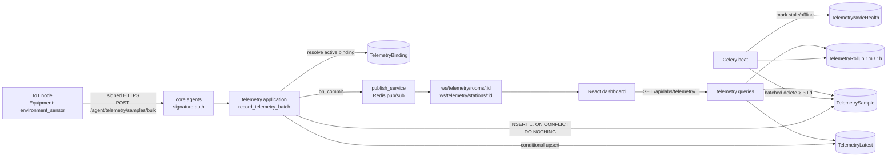
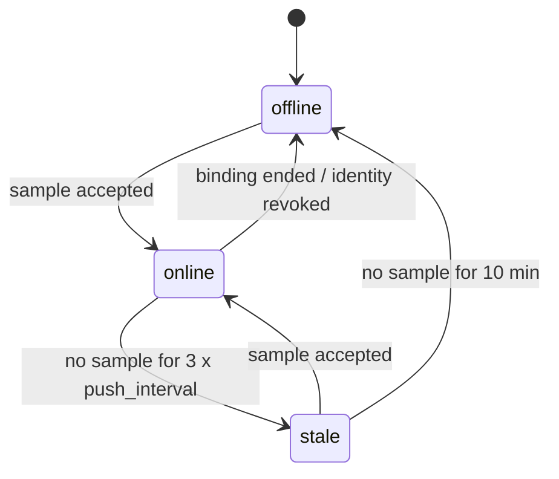

# Environment telemetry: real-time room and station power, temperature, humidity

> Status: **Proposed** (not approved, not implemented) · Risk tier: **T2** (new migrations and constraints,
> new device and operator API contracts, device authn, object-scoped authz, background jobs, cross-feature
> dependencies, retention) · Owner decision required before implementation.

IoT nodes in rooms and on stations push power, temperature and humidity samples. The backend stores them,
serves current values and history, and pushes changes to the React frontend in real time.

---

## 1. Repository facts (verified 2026-11-13)

What exists today. Everything else in this document is **Proposed**.

| Area | Verified state | Evidence |
|---|---|---|
| Room environment model | `RoomObservation`: `room`, `observed_at`, `source` (free text), `temperature_c`, `humidity_percent`, `power_usage_w`. DB checks: at least one value, temperature ≥ -273.15, humidity 0–100. Index `(room, -observed_at)`. | `core/labs/models/resource/location/room_observation.py:9-65` |
| Room environment API | `GET/POST /api/labs/rooms/{room_id}/observations`, paginated list, single-row create | `core/labs/features/locations/rooms/api/urls.py:22-24`, `.../rooms/api/views.py:169-194` |
| Room write path | `record_room_observation` does `full_clean()` + `save()` per row | `core/labs/features/locations/rooms/application/services.py:127-133` |
| Station environment data | **None.** `Station` has only design capacities (`power_capacity_w`, `power_reserved_w`, `cooling_capacity_w`), no measured values | `core/labs/models/resource/location/station.py:81-83` |
| Device identity | `AgentIdentity` with Ed25519 key, enrollment grants, revoke/decommission, signed `/agent/...` requests (`X-Agent-Id/Timestamp/Nonce/Signature`). **Bound to `labs.Equipment` only.** | `core/agents/models/agent_identity.py:30-35`, `core/agents/api/authentication.py:43-76` |
| Device ingest endpoints | heartbeat, equipment activity, session logs, booking actions. **No environment/telemetry endpoint.** | `core/agents/api/urls.py:22-58` |
| Generic agent events | `MonitoringEvent` (`METRIC_REPORTED` action, JSON payload) bound to a *computer* (`Equipment`) | `core/labs/models/monitoring/monitoring.py:8-36` |
| Real-time push | Django Channels + Redis pub/sub; `publish_service._publish(channel, data)`; WS routes registered by `register_route`. No room/station telemetry channel. | `core/websocket/publish_service.py:27-32`, `core/websocket/router.py:15-26`, `pyproject.toml:10-16` |

**Answer to "is it supported now?"** Partially. Rooms have a storage model and a manual HTTP API for the
three measurements. Stations have nothing. There is no node identity for room/station sensors, no ingest
path for nodes, no idempotency, no history aggregation, no retention, and no real-time push of this data.

### Drift found (report only; not changed by this proposal)

| Severity | Finding | Location |
|---|---|---|
| High | Any authenticated user or API key can create room observations; not object-scoped (AGENTS.md rule 5) | `core/common/api/command_views.py:36` via `core/labs/features/locations/api/views.py:7` and `.../rooms/api/views.py:169` |
| Medium | `RoomObservation` has no idempotency key; a node retrying a POST creates duplicates (write-safety §3) | `core/labs/models/resource/location/room_observation.py:9-29` |
| Medium | Monitoring WS dashboard admits every authenticated user; bench check is existence only, not object authz | `core/websocket/features/monitoring_dashboard/handler.py:17-27` |
| Low | WS messages are flat (`{"type", "bench_id", ...}`), not `{"type", "data"}` (STM-3) | `core/websocket/publish_service.py:44-53` |
| Low | `room_observations` selector has no time window; reads are bounded only by pagination | `core/labs/features/locations/rooms/queries/selectors.py:55-57` |

---

## 2. Requirements and quality attributes

**Functional**
- F1 A node measures one *scope*: a room or a station. A scope may have several nodes.
- F2 Nodes push samples with `observed_at`, any subset of `temperature_c`, `humidity_percent`, `power_w`.
- F3 Operators see the latest value per scope, history over a time window, and live updates.
- F4 Operators enroll, bind, rebind, revoke nodes. A node never chooses its scope.
- F5 Node connectivity (online/stale/offline) is visible.

**Quality attributes (targets to confirm, see §10)**
- Volume: 500 nodes × 1 sample / 10 s ≈ 4.3 M rows/day raw.
- Ingest p95 < 200 ms per batch of ≤ 500 samples; live update to browser < 2 s after accept.
- At-least-once delivery from nodes; zero duplicates stored.
- Raw retention 30 days; aggregates kept 2 years.

**Out of scope for v1**: threshold alerts, energy billing / expense linkage, MQTT transport, control
commands to nodes. §9 shows where each attaches later.

---

## 3. Key decisions

### D1 Node identity: reuse `core.agents` by registering each node as Equipment (recommended)

| Option | For | Against |
|---|---|---|
| **A. Node = `Equipment` in a new `environment_sensor` category; reuse `AgentIdentity` unchanged** (recommended) | No change to agents schema; reuses enrollment, Ed25519 signing, revoke, decommission, throttling, audit. Inventory, lifecycle, procurement, expense of sensors come free. | Each sensor is an inventory row (acceptable: they are physical assets). |
| B. Generalize `AgentIdentity.equipment` to a polymorphic subject | One identity model for every device kind | Migration on a security-critical table and constraint `agent_one_live_per_equipment`; changes `core.agents` contracts |
| C. Separate `TelemetryNode` identity with HMAC shared secret | Simpler firmware | Second device-auth scheme to secure and maintain; shared secrets stored server-side |

Constraint for option A: firmware must sign with Ed25519 (supported on ESP32-class MCUs via libsodium / mbedTLS
ports; **not verified** on the target hardware). If the hardware cannot, option C becomes the fallback and
needs its own security review.

### D2 Transport: signed HTTPS batch push now; MQTT later only if measured need

| Option | For | Against |
|---|---|---|
| **A. `POST /agent/telemetry/samples/bulk`, signed, batched** (recommended) | Reuses auth/throttling/observability; no new infra; works through the existing proxy | One TLS request per batch; ~1–10 s latency floor depending on push interval |
| B. MQTT broker (e.g. EMQX/Mosquitto) + bridge worker | Low overhead for thousands of constrained nodes; QoS 1 | New service, new dependency (rule 7), second auth scheme, bridge must still call the same ingest command |
| C. Node holds a WebSocket to the backend | Lowest latency | Long-lived connections per node in ASGI workers; reconnection storms; signing per message not designed |

"Real time" is defined end to end: node pushes every `push_interval_s` (default 10 s, a batch may hold one
sample), backend publishes on commit, browser receives within ~1 s. Option B can be added later behind the
same application command (`record_telemetry_batch`) without changing storage or the operator API.

### D3 Storage: new wide raw table + rollups + latest-value row; keep `RoomObservation` as is

| Option | For | Against |
|---|---|---|
| **A. New `TelemetrySample` (wide row) + `TelemetryRollup` + `TelemetryLatest`** (recommended) | Bounded queries; cheap dashboard reads; retention without touching rollups; existing room API unchanged (rule 1) | Two places for room environment data until owner decides the fate of `RoomObservation` (Q2) |
| B. Extend `RoomObservation` with `station` FK, node, sample id | One table | Changes a deployed model and API; manual and high-volume data mixed; retention would delete manual data |
| C. Narrow EAV `(scope, metric, value)` | Add metrics without migrations | 3× rows, weak DB typing, constraints per metric impossible |
| D. TimescaleDB hypertable / native partitioning | Best at very high volume | New extension/infra (rule 7); Django migrations need raw SQL |

Escalation trigger for D: raw table > ~200 M rows or retention delete > 5 min. Until then a BRIN index on
`observed_at` and batched deletes are enough (**not verified** with a load test; see §8).

### D4 Scope modeling: two nullable FKs with exactly-one DB check (not GenericForeignKey)

Keeps real foreign keys (`PROTECT`) and lets PostgreSQL enforce "room xor station". A station's room is
derivable, so room dashboards can optionally include station nodes in a query; they are not double-stored.

---

## 4. Ownership and placement

New feature `core/labs/features/telemetry/` following `docs/architecture/feature-template.md`.
Models in `core/labs/models/telemetry/` per `docs/conventions/django-models.md` (to verify against that
document during model-design).

| Concept | Owner | Used through |
|---|---|---|
| `TelemetryBinding`, `TelemetrySample`, `TelemetryRollup`, `TelemetryLatest`, `TelemetryNodeHealth` | telemetry (new) | `telemetry/public.py`, `telemetry/contracts.py` |
| Room, Station existence, view policy | locations | `core/labs/features/locations/public.py` |
| Sensor equipment, `environment_sensor` category | equipment | `core/labs/features/equipment/public.py` |
| Node identity, signature verification | `core.agents` | `core/agents/public.py` (`require_active_agent_identity`) |
| WS channel publishing | `core.websocket` | `publish_service` (new `publish_telemetry_update`) |

Boundary enforcement: add the telemetry package to the existing import contracts checked by
`tests/architecture/test_import_boundaries.py` (no import of another feature's `models`/`application`
outside `public.py`/`contracts.py`).



---

## 5. Proposed models

### 5.1 `TelemetryBinding`: which node measures which scope, and when

| Field | Type | Notes |
|---|---|---|
| `node` | FK `labs.Equipment`, PROTECT | Must be category `environment_sensor` (checked in application; category is reference data) |
| `room` | FK `labs.Room`, PROTECT, null | exactly one of room/station |
| `station` | FK `labs.Station`, PROTECT, null | |
| `valid_from` | datetime | |
| `valid_to` | datetime, null | open = current |
| `label` | char(100), blank | e.g. "rack inlet", "PDU A" |
| audit | `TimeStampedModel`, `UserStampedModel` | |

DB constraints:
- `CHECK ((room_id IS NULL) <> (station_id IS NULL))` — `telemetry_binding_one_scope`
- `CHECK (valid_to IS NULL OR valid_to > valid_from)`
- Exclusion constraint (btree_gist): `node WITH =, tstzrange(valid_from, valid_to) WITH &&` — a node has
  at most one scope at any instant. `btree_gist` is already installed by `core/labs/migrations/0001_initial.py`.

### 5.2 `TelemetrySample`: raw, append-only

| Field | Type | Notes |
|---|---|---|
| `id` | BigAutoField | |
| `node` | FK `labs.Equipment`, PROTECT | |
| `binding` | FK `TelemetryBinding`, PROTECT | scope resolved server-side at `observed_at` |
| `room` | FK `labs.Room`, null | denormalized from binding for indexed reads |
| `station` | FK `labs.Station`, null | denormalized from binding |
| `sample_id` | UUID | generated by node; idempotency key |
| `observed_at` | datetime | node clock, UTC |
| `received_at` | datetime | server clock |
| `temperature_c` | Decimal(6,2), null | |
| `humidity_percent` | Decimal(5,2), null | |
| `power_w` | Decimal(10,2), null | instantaneous active power |
| `quality` | char(16), default `ok` | `ok` / `suspect` (clock corrected, sensor flag) |

DB constraints (same physical rules as `RoomObservation`): at least one value; temperature ≥ -273.15;
humidity 0–100; `power_w ≥ 0`; exactly one of room/station; `UNIQUE (node, sample_id)`.

Indexes: `(room, observed_at DESC)` partial where room not null; `(station, observed_at DESC)` partial;
BRIN on `observed_at` for retention deletes. No `full_clean()` per row on ingest; DB constraints are the
guard (same reasoning as `core/labs/models/base/agent_report.py:27-38`), serializer validates shape first.

### 5.3 `TelemetryRollup`: aggregates for charts

`scope (room|station)`, `bucket_start`, `resolution` (`1m`, `1h`), and for each metric `min`, `max`, `avg`,
`count`. `UNIQUE (room, station, resolution, bucket_start)` with `NULLS NOT DISTINCT` (PostgreSQL 15+; CI runs
`postgres:16` per `.github/workflows/ci.yml:22`, production version not verified) or two partial unique indexes. Recomputed idempotently by upsert.

### 5.4 `TelemetryLatest`: one row per scope (and per node) for dashboards

`scope`, `node`, latest `observed_at` and values. `UNIQUE (node)`. Room/station "current" values are a
read over the scope's nodes (few rows). Keeps the dashboard off the raw table.

### 5.5 `TelemetryNodeHealth`: connectivity, a separate state machine

`node` (unique), `connectivity` ∈ {`online`, `stale`, `offline`}, `last_sample_at`, `changed_at`.
This is **not** the equipment lifecycle status and **not** computing live activity (AGENTS.md rule 2).



---

## 6. Proposed API

All operator responses use the envelope and error rules in `docs/api/response-standard.md`.

### 6.1 Device ingest (signed, `core.agents` auth)

`POST /agent/telemetry/samples/bulk` — BLK-1/2/3, partial mode, max 500 operations, max 256 KiB body.

```json
{
  "mode": "partial",
  "operations": [
    {"data": {"sample_id": "6f1c…", "observed_at": "2026-11-13T09:00:10Z",
              "temperature_c": "22.40", "humidity_percent": "41.0", "power_w": "1830.5"}}
  ]
}
```

`200` with per-item result in `data`: `accepted` | `duplicate` | `rejected` (+ ERR-1 error object).
`Idempotency-Key` header replays the original response for the whole batch. Node identity comes only from the
signature; the body carries no node id, room or station.

Validation and rejection:
- `observed_at` more than 2 min in the future, or older than raw retention → `rejected` (`observed_at_out_of_range`).
- No active binding covering `observed_at` → `rejected` (`node_not_bound`). The node keeps it for retry
  per `docs/agent-platform/device-design.md` §5.
- Revoked / decommissioned identity → `401` for the whole request (existing behavior).

### 6.2 Operator read

| Method and path | Purpose | Bounds |
|---|---|---|
| `GET /api/labs/rooms/{room_id}/telemetry/latest` | current values per node in the room (`include_stations=true` adds the room's station nodes) | ≤ 200 nodes |
| `GET /api/labs/stations/{station_id}/telemetry/latest` | current values for the station | |
| `GET /api/labs/rooms/{room_id}/telemetry?from=&to=&resolution=raw\|1m\|1h&metrics=` | history series | raw ≤ 24 h, 1m ≤ 31 d, 1h ≤ 2 y; else `422` |
| `GET /api/labs/stations/{station_id}/telemetry?…` | same for stations | same |

### 6.3 Operator write (node binding)

| Method and path | Purpose |
|---|---|
| `GET /api/labs/telemetry/nodes` | sensor nodes with binding and connectivity |
| `POST /api/labs/telemetry/nodes/{equipment_id}/bindings` | bind to room or station (ends the current binding in the same transaction) |
| `POST /api/labs/telemetry/bindings/{id}/actions/end` | end binding |

Enrollment itself stays on the existing `POST /api/agents`, `/enrollment-grants`, `/agent/enrollments`.

### 6.4 Real-time push

| WS route | Channel |
|---|---|
| `ws/telemetry/rooms/{room_id}` | `ws:telemetry:room:{room_id}` |
| `ws/telemetry/stations/{station_id}` | `ws:telemetry:station:{station_id}` |

Message (STM-3): `{"type": "telemetry.latest", "data": {"scope": {"type": "room", "id": 7}, "node_id": 42,
"observed_at": "…", "temperature_c": "22.40", "humidity_percent": "41.0", "power_w": "1830.5"}}` and
`{"type": "telemetry.connectivity", "data": {…}}`. Published in `transaction.on_commit`, one message per
node per batch (the newest sample), so a 500-sample backfill sends one message, not 500. Messages are
best-effort; on (re)connect the client calls `…/telemetry/latest` (documented per STM-4). Heartbeat every 30 s.

---

## 7. Write safety and authorization

| Write path | Race guard | Safe to run twice |
|---|---|---|
| `record_telemetry_batch` | `UNIQUE (node, sample_id)` + `bulk_create(ignore_conflicts=True)`; binding resolved by exclusion-constrained range lookup | Yes: duplicates reported as `duplicate`, no extra rows |
| `TelemetryLatest` upsert | `INSERT … ON CONFLICT (node) DO UPDATE … WHERE excluded.observed_at > telemetry_latest.observed_at` | Yes: older or equal samples never overwrite newer |
| Bind node | `select_for_update` on the node's open binding + exclusion constraint | Same request twice: second sees identical open binding and returns it |
| Rollup task | upsert on `(scope, resolution, bucket_start)`; recompute from raw | Yes |
| Retention task | delete in batches of 10 k by `observed_at < cutoff` | Yes |
| Connectivity task | conditional update `WHERE connectivity = old AND last_sample_at = seen` | Yes |

Authorization (deny-by-default, object-scoped):
- Device writes: signed identity → its node → its active binding. A node can only write its own bound scope.
- Operator reads: the caller must be allowed to view the room/station, via a locations policy exposed in
  `locations/public.py`. **No such object-level policy exists today** (drift table §1), so the owner must
  decide the rule (Q3). WS handshakes apply the same check, not "exists".
- Binding management: lab staff only (`LABS_STAFF_ACCESS`, already used at
  `core/labs/features/locations/api/reference_data.py:24`).

---

## 8. Verification plan (when implemented)

- Model tests: every DB constraint rejects bad rows at the database (bypass `full_clean`).
- Ingest: duplicate batch, duplicate sample in one batch, out-of-order samples, unbound node, revoked node,
  future timestamp, 501 operations, oversized body.
- Concurrency: two concurrent batches with overlapping sample ids; latest never regresses.
- Query budgets: `latest` endpoint constant queries for 1 vs 200 nodes; history endpoint ≤ 3 queries.
- WS: unauthorized user closed with 4003; message shape STM-3; one message per node per batch.
- Load test before approval of the D3 escalation trigger: 4.3 M rows/day for 30 days, measure history p95
  and retention delete duration.
- Quality gates per `docs/ai-team/quality-gates.md`; regenerate `openapi/` in the same change.

---

## 9. Later extensions (not in v1)

| Extension | Attaches at |
|---|---|
| Threshold alerts (temp/humidity bands; `power_w > Station.power_capacity_w`) | Rule table in telemetry; evaluated in `record_telemetry_batch` after commit; notify via `core.websocket` user notifications |
| Energy (`energy_wh` monotonic counter) for expense/billing | New nullable column + rollup delta; money logic is its own T2 change |
| MQTT transport | Bridge worker calling `telemetry.public.record_telemetry_batch` |
| Long-range storage | TimescaleDB or native partitioning (D3 option D) |

---

## 10. Assumptions and open questions for the owner

Assumptions (not verified): node hardware can do Ed25519 and HTTPS; ~500 nodes at 10 s; production
PostgreSQL ≥ 15 (CI uses 16).

| # | Question | Recommended default |
|---|---|---|
| Q1 | Approve node-as-Equipment (D1-A)? | Yes |
| Q2 | Fate of `RoomObservation` and `/rooms/{id}/observations`: keep for manual entries, or deprecate after telemetry ships? | Keep in v1; decide after adoption |
| Q3 | Who may view a room's/station's telemetry? | Same users who can view the room; staff for all |
| Q4 | Push interval, raw retention, rollup retention | 10 s; 30 d; 1m for 90 d, 1h for 2 y |
| Q5 | Is `power_w` per node real power at the PDU/meter, and is energy (kWh) needed for expenses? | `power_w` only in v1 |
| Q6 | Fix the drift items in §1 (esp. room observation write authz) as separate tasks? | Yes, separate T2 task for authz |
