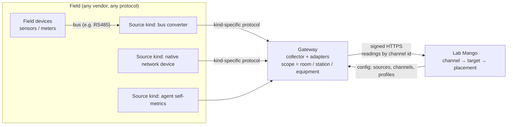
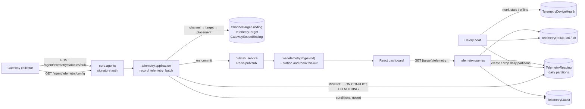
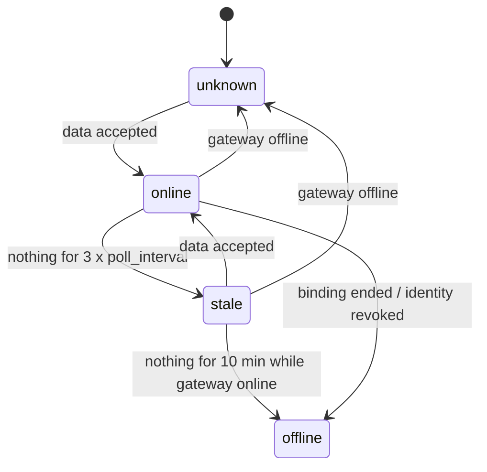
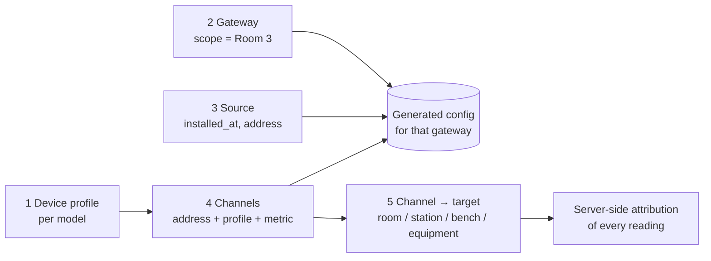
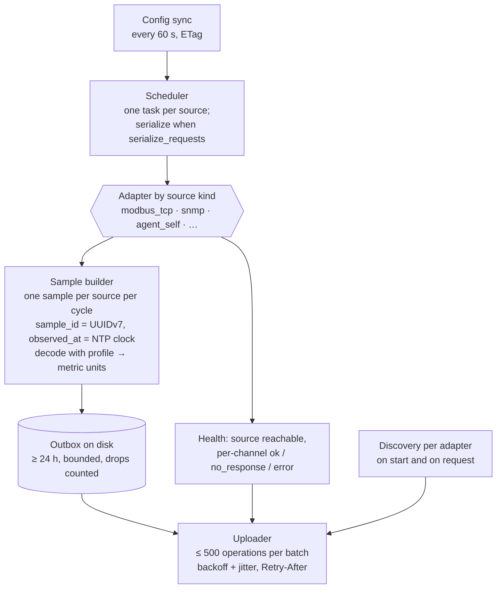
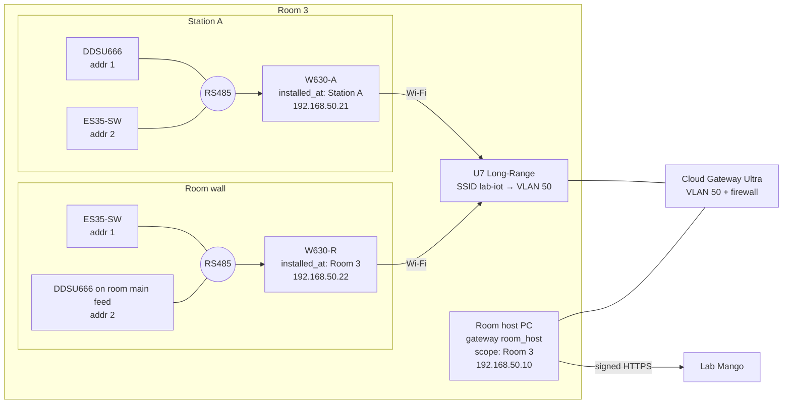

# Telemetry: real-time environment and power data for rooms, stations, benches and equipment

> Status: **Proposed** (not approved, not implemented) · Risk tier: **T2** (new migrations and constraints,
> new device and operator API contracts, device authn, object-scoped authz, background jobs, cross-feature
> dependencies, retention) · Owner decision required before implementation.

Field devices (sensors, meters, converters, other network devices) measure power, temperature, humidity
and, later, other metrics. A **gateway** (collector software with a Lab Mango identity) reads them and pushes
the readings to the backend. The backend attributes each reading to the room, station, bench or equipment
item it is about, stores it, serves current values and history, and pushes live updates to the frontend.

**How to read this document**
- **Part A (§1–§12) is the general design.** It names no specific hardware. Any device fits if it matches a
  *source kind* (how to reach it) and has a *device profile* (how to read it).
- **Part B (§13) is a worked example**: the owner's first deployment (USR-W630 converters, CHINT DDSU666 meter,
  ES35-SW probe, UniFi network). These products are examples, not requirements.
- Part C (§14) lists assumptions and open questions.

---

# Part A: General design

## 1. Repository facts (verified 2026-11-13)

What exists today. Everything else in this document is **Proposed**.

| Area | Verified state | Evidence |
|---|---|---|
| Room environment model | `RoomObservation`: `room`, `observed_at`, `source` (free text), `temperature_c`, `humidity_percent`, `power_usage_w`. DB checks: at least one value, temperature ≥ -273.15, humidity 0–100. Index `(room, -observed_at)` | `core/labs/models/resource/location/room_observation.py:9-65` |
| Room environment API | `GET/POST /api/labs/rooms/{room_id}/observations`, paginated list, single-row create | `core/labs/features/locations/rooms/api/urls.py:22-24`, `.../rooms/api/views.py:169-194` |
| Room write path | `record_room_observation` does `full_clean()` + `save()` per row | `core/labs/features/locations/rooms/application/services.py:127-133` |
| Station, bench, equipment measured data | **None.** `Station` has only design capacities (`power_capacity_w`, `power_reserved_w`, `cooling_capacity_w`) | `core/labs/models/resource/location/station.py:81-83` |
| Device identity | `AgentIdentity` with Ed25519 key, enrollment grants, revoke/decommission, signed `/agent/...` requests (`X-Agent-Id/Timestamp/Nonce/Signature`). Bound to `labs.Equipment` only; one live identity per equipment (`agent_one_live_per_equipment`) | `core/agents/models/agent_identity.py:30-35`, `:50-54`; `core/agents/api/authentication.py:43-76` |
| Signed request protocol | `labmango-agent-request-v1`, NUL-joined fields + SHA-256 of body, 300 s skew, nonce replay check | `docs/agent-platform/backend-api.md:180-190` |
| Device ingest endpoints | heartbeat, equipment activity, session logs, booking actions. **No telemetry endpoint** | `core/agents/api/urls.py:22-58` |
| Generic agent events | `MonitoringEvent` (`METRIC_REPORTED`, JSON payload) bound to a computer (`Equipment`) | `core/labs/models/monitoring/monitoring.py:8-36` |
| Real-time push | Django Channels + Redis pub/sub; `publish_service._publish(channel, data)`; routes via `register_route`. No telemetry channel | `core/websocket/publish_service.py:27-32`, `core/websocket/router.py:15-26`, `pyproject.toml:10-16` |
| Location hierarchy | Bench → `station_slot` (OneToOne, **nullable**) → `StationSlot.station` → `Station.room`; equipment → open `EquipmentAssignment` → bench | `core/labs/models/resource/bench/bench.py:48-53`, `.../location/station_slot.py:19`, `.../location/station.py:45` |
| Shared location parent | `PhysicalLocationNode` and `ResourceModel` are **abstract**; no shared table to point one FK at | `core/labs/models/resource/location/physical_location.py:14` |
| Platform | Django 5.2.13 (has `CompositePrimaryKey`); `btree_gist` installed; CI PostgreSQL 16 | `uv.lock:583-584`, `core/labs/migrations/0001_initial.py`, `.github/workflows/ci.yml:22` |

**Is it supported now?** Partially. Rooms have a storage model and a manual HTTP API for the three
measurements. Stations, benches and equipment have nothing. There is no device identity for sensors, no ingest
path, no idempotency, no aggregation, no retention, and no real-time push of this data.

### 1.1 Drift found (report only; not changed by this proposal)

| Severity | Finding | Location |
|---|---|---|
| High | Any authenticated user or API key can create room observations; not object-scoped (AGENTS.md rule 5) | `core/common/api/command_views.py:36` via `core/labs/features/locations/api/views.py:7` and `.../rooms/api/views.py:169` |
| Medium | `RoomObservation` has no idempotency key; a device retrying a POST creates duplicates (write-safety §3) | `core/labs/models/resource/location/room_observation.py:9-29` |
| Medium | Monitoring WS dashboard admits every authenticated user; bench check is existence only | `core/websocket/features/monitoring_dashboard/handler.py:17-27` |
| Low | WS messages are flat (`{"type", "bench_id", ...}`), not `{"type", "data"}` (STM-3) | `core/websocket/publish_service.py:44-53` |
| Low | `room_observations` selector has no time window | `core/labs/features/locations/rooms/queries/selectors.py:55-57` |

---

## 2. Requirements and quality attributes

**Functional**
- F1 A reading is about exactly one **target**: a room, station, bench or equipment item. New target types can
  be added later. A target may have any number of measurements.
- F2 **Where a device is installed is independent of what it measures.** A device installed in a room may
  measure the room, a station, a bench or an equipment item there; a device on a station may measure the station
  or an equipment item on it.
- F3 New **device models, protocols, collector kinds and metrics** are added without reshaping existing tables
  (as reference data, or as one new settings table and collector adapter).
- F4 Lab Mango is the single place where devices, what they measure, and how to read them are configured.
  Gateways download this configuration; a gateway never decides what a reading is about.
- F5 Operators see current values, history over a bounded window, and live updates for any target, optionally
  including everything placed inside it (a room view shows its stations, benches and equipment).
- F6 Gateway, device and per-measurement health are visible.

**Quality attributes (targets to confirm, §14)**
- Volume: 500 sources × 3 measurements × 1 per 10 s ≈ 13 M readings/day.
- Ingest p95 < 200 ms per batch of ≤ 500 operations; live update in the browser < 2 s after acceptance.
- At-least-once delivery from gateways; zero duplicates stored.
- Retention: raw 7 days; 1-minute aggregates 30 days; 1-hour aggregates 2 years (Q4).

**Out of scope for v1**: threshold alerts, energy billing, MQTT ingestion, control commands to devices,
configuring network equipment from Lab Mango. §12 shows where each attaches later.

---

## 3. Concepts

| Concept | Meaning | Examples |
|---|---|---|
| **Target** | The thing a reading is *about* | Room 3, Station A, Bench A-2, Freezer F-02 (equipment) |
| **Metric** | What is measured, with unit and valid range | `temperature_c`, `humidity_percent`, `power_w`; later `energy_wh`, `co2_ppm` |
| **Source** | An addressable device the gateway reads from. Has a **kind** (how to reach it) and an **install location** (where it physically is) | a serial-to-network converter, a native Modbus TCP meter, an SNMP power strip, a computer's own sensors |
| **Field device** | A sensor or meter behind a source, when the source is a bus converter | an RS485 meter or probe at a Modbus address |
| **Device profile** | How to read one device *model* over one protocol (register or object map, data types, scale) | "meter model X: active power at register R, float32" |
| **Channel** | One metric read from one source (for a bus: one field device at one address). Each channel is **bound to a target** over time | "source S, Modbus address 2, profile P, `temperature_c` → Station A" |
| **Gateway** | Collector software with a Lab Mango identity and a **scope** (a target). Reads sources in its scope and pushes readings | a dedicated room PC, a station PC, a lab computer's agent |
| **Placement** | The room and station a target sits in, resolved by Lab Mango from the location hierarchy | Bench A-2 → Station A → Room 3 |



### 3.1 Design principles

- **P1 Configure once, in Lab Mango.** Gateways download their config (sources, addresses, channels, device
  profiles); nothing about *what is measured* is set on the gateway.
- **P2 The gateway never knows targets.** It reports "source *S*, channel *C*, value *V* at time *T*". Lab
  Mango maps channel → target → placement. Moving a sensor to another target is a server-side change only.
- **P3 Install location ≠ measured target.** Each source records where it is installed (which decides which
  gateway reads it). Each channel records what it measures. They may differ, within the gateway's scope.
- **P4 Extend by adding, not reshaping.**

  | To add… | Do this | Touches existing tables? |
  |---|---|---|
  | a device model (new meter or probe) | add a `DeviceProfile` row (after a bench test) | No |
  | a metric | add a `MetricDefinition` row (+ optional range CHECK migration) | No |
  | a source kind or protocol (SNMP, IPMI, HTTP/JSON) | add a kind, a settings table, a channel-addressing table, and a collector adapter | No |
  | a gateway kind | add a kind + scope rule | No |
  | a target type (rack, building) | add one nullable FK to `TelemetryTarget` + placement rule | Only `TelemetryTarget` |

- **P5 Only gateways hold credentials.** Sources and field devices never reach Lab Mango. Where a source kind
  has no device authentication (Modbus TCP, SNMPv2c), integrity comes from network isolation (§10).

### 3.2 Topology patterns (all may be mixed in one room)

| Pattern | Gateway | Sources | Status |
|---|---|---|---|
| **TP1 Room gateway + bus converters** | dedicated room PC (`room_host`, scope = room) | converters installed **in the room or on stations**, each bridging a field bus | v1; worked example §13 |
| TP2 Room gateway + native network devices | `room_host` | devices that speak a network protocol directly (Modbus TCP meter, SNMP PDU) | v1 for Modbus TCP; other protocols later |
| TP3 Station gateway | station PC (`station_pc`, scope = station) | sources installed at that station | supported by the model; not planned for v1 (Q11) |
| TP4 Equipment self-reporting | a lab computer's agent (`equipment_agent`, scope = its equipment) | `agent_self` (its own temperature/power) | later |

---

## 4. Key decisions

### D1 Identity: only gateways authenticate; sources are registered devices

| Option | For | Against |
|---|---|---|
| **A. Gateway holds an `AgentIdentity`; sources are `TelemetryDevice` rows keyed by a unique device UID (MAC, serial), optionally linked to an `Equipment` asset** (recommended) | No change to `core.agents`; one credential per gateway; works for devices that can't do crypto; swap a device = server-side rebind | Lab Mango trusts the gateway to report honestly for sources in its scope (bounded by scope, §6.5) |
| B. Every source gets its own `AgentIdentity` | End-to-end proof per device | Most field devices and converters can't sign; vendor firmware |
| C. Sources not modeled; gateway config file maps address → target | Simplest server | Breaks F4/P1; IP changes silently move data; no device health |

### D2 Configuration: owned by Lab Mango, pulled by the gateway, helped by discovery

| Option | For | Against |
|---|---|---|
| **A. Lab Mango is the source of truth for sources, channels, profiles and bindings; gateway pulls `GET /agent/telemetry/config`; gateway discovery reports devices it finds; staff confirm** (recommended) | One place to audit; swaps need no gateway change; DB constraints on what readings mean | Config sync and a profile library to maintain |
| B. Config only on the gateway | No server work | Per-gateway drift; Lab Mango can't validate meaning |
| C. Fully automatic (guess device model from scans) | Zero touch | Many protocols (e.g. Modbus) have no standard device ID; wrong map = silently wrong data |

### D3 Collection: the gateway polls sources

| Option | For | Against |
|---|---|---|
| **A. Gateway polls each source on an interval using the kind's protocol** (recommended; **owner decided 2026-11-13** for the first deployment) | Gateway owns timestamps and idempotency IDs; config stays in Lab Mango; no broker | Gateway must run continuously |
| B. Sources push (MQTT/HTTP) to a broker or endpoint on the gateway | No polling code per device | New broker dependency (rule 7); per-device config outside Lab Mango; device timestamps and IDs often unreliable |
| C. Vendor cloud integrations | Zero setup | Lab data leaves to third parties; rejected |

A push-capable source can be added later as its own source kind whose adapter *receives* instead of polls;
the server-side contract (§7.1) does not change.

### D4 Transport gateway → Lab Mango: signed HTTPS batches

| Option | For | Against |
|---|---|---|
| **A. `POST /agent/telemetry/samples/bulk`, signed with the existing agent protocol, batched** (recommended) | Reuses auth, throttling, observability; no new infra | One TLS request per batch; ~1–10 s latency floor |
| B. MQTT broker + bridge worker | Low overhead at very large device counts | New service and dependency; second auth scheme |
| C. Gateway WebSocket | Lowest latency | Long-lived connections per gateway; signing per message not designed |

"Real time" end to end: gateway polls every `poll_interval_s` and pushes every `push_interval_s` (default 10 s
each); Lab Mango publishes on commit; the browser receives within ~1 s.

### D5 Targets: one `TelemetryTarget` table with typed nullable FKs

| Option | For | Against |
|---|---|---|
| **A. `TelemetryTarget` row per measured thing: nullable FKs `room` / `station` / `bench` / `equipment`, exactly one set (DB CHECK); all other tables reference `target_id`** (recommended) | Real FKs with `PROTECT`; one place to extend | One extra join for names |
| B. Nullable FKs repeated on every table | No extra table | Each new target type touches every table, including the partitioned one |
| C. `GenericForeignKey` | Open-ended | No referential integrity — violates AGENTS.md rule 4 |

### D6 Kinds with per-kind settings; device profiles per protocol

- Gateways, sources and channel addressing each have a **kind**. Kind-specific fields live in **one-to-one
  settings tables** (`ModbusSourceSettings`, `ModbusChannelSettings`; later `SnmpSourceSettings`, …), never as
  nullable columns on shared tables.
- How to read a device model is a versioned **`DeviceProfile`** with a `protocol` and a protocol-specific read
  map validated by a JSON schema per protocol.
- The collector has one **adapter** per source kind behind a common interface (`poll(source, channels) →
  readings`, `discover() → devices`).

### D7 Storage: narrow readings, daily partitions, rollups, latest

| Option | For | Against |
|---|---|---|
| A. Wide row per sample (one column per metric) | Fewest rows | New metric = migration on the biggest table; one row would mix metrics of different targets |
| **B. Narrow `TelemetryReading` (one row per channel per poll), daily range partitions on `observed_at`** (recommended) | New metric = data; one target per row; retention = drop a partition | ~3× rows; native partitioning via `RunSQL` and `CompositePrimaryKey` (Django 5.2.13) |
| C. TimescaleDB / `pg_partman` | Managed partitions, compression | New database extension (rule 7); not needed at this volume |

Physical-range rules stay in PostgreSQL as per-metric CHECKs (§6.6). `RoomObservation` and its API stay
unchanged (rule 1; Q2).

### D8 Collector is a separate service with its own identity

`AgentIdentity` allows one live identity per equipment (`core/agents/models/agent_identity.py:50-54`), and
private keys are never shared between processes (`docs/agent-platform/device-design.md` §2). Owner decided the
collector is a separate service (2026-11-13).

| Option | For | Against |
|---|---|---|
| **A. The gateway PC is dedicated; the collector enrolls as that PC's one `AgentIdentity`** (recommended for v1) | No `core.agents` change | That PC can't also run the computer agent |
| B. Register the collector as its own `Equipment` row | No agents change | Inventory row that isn't a physical asset |
| C. Add `purpose` (`computer_agent` / `telemetry_collector`) to `AgentIdentity`, unique per `(equipment, purpose)`; endpoints accept only their purpose | Least privilege; both on one PC; needed for TP4 | Migration and auth change on a security-critical table (separate T2 task) |

Under any option, `/agent/telemetry/*` also requires the signing identity's equipment to be a claimed gateway.

---

## 5. Ownership and placement

New feature `core/labs/features/telemetry/` following `docs/architecture/feature-template.md`; models in
`core/labs/models/telemetry/` (to verify against `docs/conventions/django-models.md` during model design).

| Concept | Owner | Used through |
|---|---|---|
| `TelemetryTarget`, `MetricDefinition`, `TelemetryDevice` + per-kind settings, `TelemetryChannel` + per-protocol addressing, `DeviceProfile`, `GatewayScopeBinding`, `ChannelTargetBinding`, `TelemetryReading`, `TelemetryRollup`, `TelemetryLatest`, `TelemetryDeviceHealth` | telemetry (new) | `telemetry/public.py`, `telemetry/contracts.py` |
| Room, Station, Bench existence and placement; view policy | locations, benches | `locations/public.py`, `benches/public.py` (batched placement functions to add) |
| Equipment as target; current bench assignment; gateway / source / field-device assets | equipment | `equipment/public.py` (batched `current_bench_for(equipment_ids)` to add) |
| Gateway identity, signature verification | `core.agents` | `core/agents/public.py` (`require_active_agent_identity`) |
| WS publishing | `core.websocket` | `publish_service` (new `publish_telemetry_update`) |

Boundary enforcement: add the telemetry package to the import contracts checked by
`tests/architecture/test_import_boundaries.py`.



---

## 6. Data model

All exclusion constraints use `btree_gist` (installed). Bindings share `CHECK (valid_to IS NULL OR valid_to >
valid_from)`. Configuration tables use `TimeStampedModel`, `UserStampedModel`.

### 6.1 `TelemetryTarget` and placement

| Field | Type | Notes |
|---|---|---|
| `target_type` | `room` / `station` / `bench` / `equipment` | denormalized for CHECK and filtering |
| `room`, `station`, `bench`, `equipment` | FK, PROTECT, null | exactly one set |

DB: `CHECK (num_nonnulls(room_id, station_id, bench_id, equipment_id) = 1)`; CHECK that `target_type` names the
non-null FK; partial `UNIQUE` per FK. Created on first use with `INSERT … ON CONFLICT DO NOTHING` + re-read.
Soft-deleted resources keep their target row; binding to them is refused and their channels stop accepting
readings.

**Placement** (`resolve_placement(target_ids) → {target_id: (room_id, station_id | None)}`, batched, current
placement at ingest time):

| Target | Room | Station |
|---|---|---|
| room | itself | none |
| station | `station.room` | itself |
| bench | `bench.station_slot.station.room` | `bench.station_slot.station` |
| equipment | open `EquipmentAssignment` → bench → as bench | as bench |

A bench without a station slot or equipment without an open assignment is **not located**; its readings are
rejected (`target_not_located`, Q18), never guessed. The resolved room and station are snapshotted on each
reading, so history does not move when something is relocated later.

### 6.2 `MetricDefinition` (reference data)

`key` (PK slug), `name`, `unit`, `value_min`, `value_max` (null = open), `kind` (`gauge` / `counter`),
`aggregation` (`mean` / `max` / `last`; counters roll up as delta), `decimals`, `active`.
v1 seed: `temperature_c` (≥ -273.15), `humidity_percent` (0–100), `power_w` (≥ 0). Later examples:
`energy_wh` (counter), `voltage_v`, `current_a`, `co2_ppm`, `differential_pressure_pa`.

### 6.3 `TelemetryDevice`: gateways and sources

| Field | Type | Notes |
|---|---|---|
| `role` | `gateway` / `source` | |
| `kind` | gateway: `room_host` / `station_pc` / `equipment_agent`. Source: `modbus_tcp` (v1); later `snmp`, `ipmi`, `agent_self`, … | CHECK kind ∈ role's kinds |
| `device_uid` | char(64), **unique** | source: MAC or serial, normalized; gateway: `agent_uid`. `Equipment.mac_address` isn't unique (`equipment.py:144`) |
| `equipment` | OneToOne `labs.Equipment`, PROTECT, null | the physical asset; null while `discovered` |
| `manufacturer`, `model` | char, blank | informational |
| `installed_at` | FK `TelemetryTarget`, PROTECT, null (sources) | **where it physically is**: a room, station, bench or equipment. Decides which gateway reads it (§6.5). Not used for attribution |
| `state` | `discovered` → `claimed` → `retired` | own state machine, not equipment lifecycle (rule 2) |
| `reported_by` | FK gateway, null | gateway that last saw it |
| `config_version`, `config_version_applied` | int, int null | gateways only |
| `first_seen_at`, `last_seen_at` | datetime | |

DB: `CHECK (state = 'discovered' OR equipment_id IS NOT NULL)`; `CHECK (role = 'gateway' OR state = 'discovered'
OR installed_at_id IS NOT NULL)` (a claimed source has an install location).

**Per-kind source settings** (one-to-one; one table per kind):

| Kind | Settings table | Fields |
|---|---|---|
| `modbus_tcp` (v1) | `ModbusSourceSettings` | `network_host`, `port` (default 502), `framing` (`mbap` = standard Modbus TCP, `rtu_over_tcp` = raw RTU frames over a socket), `serial_interface` / `baud_rate` / `parity` / `data_bits` / `stop_bits` (null for native Modbus TCP devices; set for bus converters, informational: the converter itself holds them), `request_timeout_ms`, `serialize_requests` (true when a shared half-duplex bus sits behind the source). Partial `UNIQUE (network_host, port)` among claimed |
| `snmp` (later) | `SnmpSourceSettings` | host, port, version, credentials reference (never the secret in plain text) |
| `agent_self` (later) | none | the gateway is the source |

### 6.4 Channels and device profiles

**`TelemetryChannel`**: `source` (FK device, role = source), `metric` (FK `MetricDefinition.key`), `label`,
`enabled`, optional `field_device_equipment` (FK `labs.Equipment`: the physical sensor or meter as an
inventory asset; distinct from the target it measures).

**Per-protocol channel addressing** (one-to-one):

| Protocol | Table | Fields |
|---|---|---|
| Modbus | `ModbusChannelSettings` | denormalized `source_id`, `unit_id` (1–247 CHECK), `profile` (FK `DeviceProfile`, protocol = modbus). `UNIQUE (source_id, unit_id, channel.metric)` via denormalized `metric` |
| SNMP (later) | `SnmpChannelSettings` | `profile`, index (e.g. outlet number) |

**`DeviceProfile`** (reference data, versioned: an edit creates a new version; only `approved` versions can be
used by channels): `key`, `version`, `protocol`, `manufacturer`, `model`, `status` (`draft` / `approved`),
`read_map` JSON, `comm_defaults` JSON (e.g. serial defaults), `notes`, `approved_by`, `approved_at`.
`read_map` keys must be active metrics; values follow the protocol's JSON schema. For Modbus:
`{function_code: 3|4, register, words, type: int16|uint16|int32|uint32|float32, word_order, scale, offset}`.
Approval requires a recorded bench test (Part B §13.7 shows one).

Config-build checks per source: all Modbus profiles behind one `serialize_requests` source must support the
source's serial settings (one bus = one baud/parity); an RS232 source carries one unit ID.

### 6.5 Bindings, scope, and who reads what

**`GatewayScopeBinding`**: `gateway`, `target`, denormalized `gateway_kind`, `valid_from`, `valid_to`.
- Exclusion on `gateway` range: one scope at a time.
- Partial exclusion on `target` range `WHERE gateway_kind = 'room_host'`: one room gateway per room.
- Scope type fits the kind: `room_host` → room, `station_pc` → station, `equipment_agent` → its own equipment.

**`ChannelTargetBinding`**: `channel`, `target`, `valid_from`, `valid_to`.
- Exclusion on `channel` range: a channel measures one target at a time. A target may have many channels.
- "Bind all channels of this source to target X" is one action creating N bindings in one transaction.

**Which gateway reads a source**: the gateway whose scope contains the placement of the source's
`installed_at`. **Which readings it may submit**: channels whose current target's placement is also inside
that scope. Both rules use the same `within(placement, scope)` test:

| Scope | `within` is true when |
|---|---|
| room | placement room = scope room |
| station | placement station = scope station |
| equipment | target = scope equipment |

Binding a channel to a target outside its source's gateway scope is refused at write time
(`target_outside_gateway_scope`); ingest repeats the check under `select_for_update` on the scope binding.
The config endpoint applies the same rules, so a gateway only learns about sources and channels it may use.

`config_version` on a gateway increments in the same transaction as any change that alters its config
(scope, sources' install location or settings, channels, bindings, profiles in use), under
`select_for_update` on the gateway row.

### 6.6 `TelemetryReading` (raw, append-only, partitioned by day)

| Field | Type | Notes |
|---|---|---|
| `id` | bigint identity | PK `(observed_at, id)` via `CompositePrimaryKey` (required by partitioning) |
| `observed_at` | timestamptz | partition key; gateway clock (NTP), UTC |
| `received_at` | timestamptz | server clock |
| `channel` | FK `TelemetryChannel` | |
| `target` | FK `TelemetryTarget` | from `ChannelTargetBinding` at `observed_at` |
| `metric` | FK `MetricDefinition.key` | denormalized from channel |
| `value` | numeric(14,4) | in the metric's unit |
| `room`, `station` | FK, `station` null | placement snapshot |
| `source`, `gateway` | FK `TelemetryDevice` | provenance |
| `sample_id` | UUID | one per source per poll cycle; idempotency key |
| `profile_version` | char(64), blank | e.g. `vendor_model@3` |
| `quality` | `ok` / `suspect` | |

DB: `UNIQUE (channel_id, sample_id, observed_at)`. Per-metric CHECKs, e.g.
`metric_id <> 'humidity_percent' OR value BETWEEN 0 AND 100`, `metric_id <> 'temperature_c' OR value >= -273.15`,
`metric_id <> 'power_w' OR value >= 0`; a new metric's check is an `ADD CONSTRAINT … NOT VALID` + `VALIDATE`
migration. Indexes per partition: `(target_id, metric_id, observed_at DESC)`, `(room_id, observed_at DESC)`,
`(station_id, observed_at DESC) WHERE station_id IS NOT NULL`.

Partitions: daily, created 7 days ahead by a Celery beat task (`CREATE TABLE IF NOT EXISTS … PARTITION OF`);
expired days dropped; a default partition catches outliers (alert if non-empty). Migration via `RunSQL` inside
`SeparateDatabaseAndState`, with a written plan (rule 6). No per-row `full_clean()` on ingest; the database
is the guard (as in `core/labs/models/base/agent_report.py:27-38`).

### 6.7 `TelemetryRollup`

`target`, `metric`, `resolution` (`1m` / `1h`), `bucket_start`, `min`, `max`, `avg`, `last`, `count` (counters:
`delta`). `UNIQUE (target, metric, resolution, bucket_start)`; idempotent upsert from raw. `1m` partitioned
monthly (30 days), `1h` unpartitioned (2 years).

### 6.8 `TelemetryLatest`

One row per channel: `channel` (unique), `target`, `metric`, `observed_at`, `value`, `status`
(`ok` / `no_response` / `error`). A target's current values = latest rows of channels bound to it (plus
everything placed inside it on request).

### 6.9 Health: separate state machines

Per device (gateway or source): `connectivity` ∈ {`online`, `stale`, `offline`, `unknown`}, `last_seen_at`,
`changed_at`. Per channel: `TelemetryLatest.status`. None of these is equipment lifecycle status or computing
live activity (AGENTS.md rule 2). A source behind an offline gateway is `unknown`, not `offline`
(`core/labs/features/equipment/queries/summaries.py:19`: missing telemetry is unknown).



---

## 7. API

Operator responses follow `docs/api/response-standard.md`.

### 7.1 Gateway endpoints (signed, `core.agents` auth)

The body never carries a room, station, bench or equipment id.

**Config** — `GET /agent/telemetry/config`, `If-None-Match: "<config_version>"` → `304` or `200`:

```json
{"data": {
  "config_version": 17,
  "scope": {"type": "room", "id": 3},
  "poll_interval_s": 10, "push_interval_s": 10,
  "sources": [
    {"device_uid": "<source uid>", "kind": "<source kind>",
     "settings": {"…": "kind-specific, e.g. address and port"},
     "channels": [
       {"channel_id": 101, "metric": "power_w", "address": {"…": "protocol-specific"}, "profile": "<key>@<version>"}
     ]}
  ],
  "profiles": {"<key>@<version>": {"protocol": "<protocol>", "read_map": {"…": "…"}}}
}}
```

Sources are those installed inside the scope; channels are those bound to targets inside the scope. Gateways
re-pull every 60 s and when an ingest response carries a newer `config_version`. Part B §13.4 shows a filled-in
example.

**Discovery** — `POST /agent/telemetry/discoveries`
`{"devices": [{"kind": "<source kind>", "device_uid": "<uid>", "address": {…}, "probe": {…}}]}`: idempotent upsert
of `discovered` sources (`UNIQUE device_uid`). `probe` holds kind-specific findings (Modbus: unit IDs that
answered), filled only when staff request a scan. A UID already claimed elsewhere is recorded, not reassigned.

**Ingest** — `POST /agent/telemetry/samples/bulk` (BLK-1/2/3; partial mode; ≤ 500 operations; ≤ 256 KiB).
One operation = one source's poll cycle:

```json
{"mode": "partial",
 "operations": [
   {"data": {"device_uid": "<source uid>", "sample_id": "<uuid, persisted before first send>",
             "observed_at": "2026-11-13T09:00:10Z", "config_version": 17,
             "readings": [
               {"channel_id": 101, "value": "1830.5", "profile_version": "<key>@<version>"},
               {"channel_id": 102, "status": "no_response"}]}}]}
```

A channel that didn't answer is sent with `status`, never as `0`. Response `200` with per-operation results:
`accepted` | `duplicate` | `partially_accepted` | `rejected` (+ ERR-1 errors), plus the current
`config_version`. `Idempotency-Key` replays the batch response.

Rejections (per reading unless stated): `observed_at_out_of_range` (> 2 min future or older than raw
retention); `channel_not_bound` (wrong source, disabled, no binding at `observed_at`); `outside_gateway_scope`;
`target_not_located`; `value_out_of_range`; `source_not_claimed` (whole operation); no gateway scope → `409`
(batch); revoked identity → `401`. Never silently re-attributed.

### 7.2 Operator read

`{base}` ∈ `/api/labs/rooms/{id}`, `/api/labs/stations/{id}`, `/api/labs/benches/{id}`,
`/api/labs/equipment/{id}` (existing style, e.g. `…/equipment/{equipment_id}/activity`).

| Method and path | Purpose | Bounds |
|---|---|---|
| `GET {base}/telemetry/latest?metrics=&include_descendants=` | current value per channel of the target (and of everything placed inside it) | ≤ 200 channels |
| `GET {base}/telemetry?from=&to=&resolution=raw\|1m\|1h&metrics=&include_descendants=` | series per (target, metric) | raw ≤ 24 h, 1m ≤ 30 d, 1h ≤ 2 y; ≤ 50 series; else `422` |
| `GET {base}/telemetry/sources` | sources **installed** at this target, with health | ≤ 200 |
| `GET /api/labs/telemetry/metrics` | metric definitions | |

### 7.3 Operator write (configuration)

| Method and path | Purpose |
|---|---|
| `GET /api/labs/telemetry/devices?role=&kind=&state=&installed_in=` | gateways and sources with state, install location, health |
| `POST /api/labs/telemetry/gateways` | register an enrolled agent's equipment as a gateway of a kind |
| `POST /api/labs/telemetry/gateways/{id}/actions/bind-scope` | set its scope target |
| `POST /api/labs/telemetry/sources` | pre-register a source: kind, `device_uid`, `installed_at`, settings |
| `POST /api/labs/telemetry/devices/{id}/actions/claim` | `discovered` → `claimed`; set `installed_at`; create or link Equipment |
| `PATCH /api/labs/telemetry/sources/{id}` | install location and kind-specific settings |
| `POST /api/labs/telemetry/sources/{id}/actions/request-scan` | ask its gateway to probe (Modbus: unit IDs) |
| `GET/POST/PATCH/DELETE /api/labs/telemetry/sources/{id}/channels` | channels with protocol-specific address and profile |
| `POST /api/labs/telemetry/sources/{id}/channels/from-profile` | create all channels a profile provides at one address in one call |
| `POST /api/labs/telemetry/channels/{id}/actions/bind-target` | `{"target": {"type": "equipment", "id": 88}}` |
| `POST /api/labs/telemetry/sources/{id}/actions/bind-target` | bind all its channels to one target |
| `POST /api/labs/telemetry/channels/{id}/actions/unbind` | stop attributing |
| `GET/POST /api/labs/telemetry/device-profiles`, `POST …/{id}/actions/approve` | profiles and approval |

Gateway enrollment stays on `POST /api/agents`, `/enrollment-grants`, `/agent/enrollments`.

### 7.4 Real-time push

`ws/telemetry/{target_type}/{id}` (`rooms`, `stations`, `benches`, `equipment`) → Redis
`ws:telemetry:{target_type}:{id}`. Each reading is published to its target and to its placement's station and
room, so a room dashboard sees everything inside it. Message (STM-3):
`{"type": "telemetry.latest", "data": {"target": {"type": "equipment", "id": 88}, "channel_id": 101,
"metric": "power_w", "observed_at": "…", "value": "1830.5"}}`; also `telemetry.connectivity`. Published on
commit, coalesced to the newest reading per channel per batch. On (re)connect the client calls
`…/telemetry/latest` (STM-4). Heartbeat every 30 s.

---

## 8. Setup in Lab Mango (general)

Five things are configured. Each answers one question:

| # | Configure | How often | Answers |
|---|---|---|---|
| 1 | **Device profile** | once per device *model*, ever | "How do I read this model?" |
| 2 | **Gateway** + scope | once per gateway | "Which collector reads which room / station?" |
| 3 | **Source** + install location + settings | once per device | "Where is this device, and how is it reached?" |
| 4 | **Channels** (from the profile, at an address) | once per field device | "What can be read from it?" |
| 5 | **Channel → target** | once per channel; changes when things move | "What is each measurement about?" |

Items 1–4 are merged into the gateway's config automatically. Item 5 stays on the server: it turns channel
readings into target data.



**Proposed UI**: every room, station, bench and equipment page gets a **Telemetry** tab with two lists:
"Measurements about this" (channels bound here) and "Devices installed here" (sources whose
`installed_at` is here). An **Add device** wizard covers items 3–5 on one screen: install location defaults to
the current page; picking a profile at an address creates its channels; "Measures" defaults to the install
location and can be changed to any target inside the same gateway scope.

### 8.1 Commissioning flow (any source kind)

```mermaid
sequenceDiagram
  actor Tech as Lab staff
  participant UI as Lab Mango UI
  participant API as Backend
  participant GW as Gateway (collector)
  participant SRC as Source device
  Note over Tech,GW: Once per gateway
  Tech->>UI: Register gateway PC as Equipment, create enrollment grant
  GW->>API: POST /agent/enrollments (existing flow)
  Tech->>UI: Register as gateway, bind scope (e.g. Room 3)
  Note over Tech,SRC: Once per source
  Tech->>SRC: Install, connect to the scope's network, kind-specific device setup
  alt Pre-register
    Tech->>UI: Add device: uid, installed_at, settings
  else Discover
    GW->>API: POST /agent/telemetry/discoveries
    Tech->>UI: Claim discovered device, set installed_at
  end
  Tech->>UI: Add channels from profile at address; set "Measures" (target)
  API->>API: config_version +1
  GW->>API: GET /agent/telemetry/config
  GW->>SRC: Poll per adapter
  GW->>API: POST /agent/telemetry/samples/bulk
  API-->>UI: ws/telemetry/{type}/{id} live values
```

**Swap a broken source**: claim the replacement with the same install location, copy channels and bindings in
one action, retire the old one. History stays with the targets.
**Replace a gateway**: enroll the new one and bind it to the same scope (the old binding ends). Sources and
channels don't change.
**Move a field device** to measure something else: rebind its channel. Nothing changes on the gateway.
**Move a source** to another room: change `installed_at` (it then belongs to that room's gateway) and connect it
to that room's network.

---

## 9. Gateway collector (general)

A separate service (D8) with a Lab Mango identity, implementing `labmango-agent-request-v1`
(`docs/agent-platform/backend-api.md:180-190`) itself; it never reads another process's key.



- Adapters implement `poll(source, channels) → readings` and `discover() → devices`. Adding a source kind adds
  an adapter; scheduling, outbox, upload and health are shared.
- `sample_id` is persisted before the first send, so retries after a crash are deduplicated server-side.
- The gateway decodes raw values with the profile and sends values in metric units, plus `profile_version`.
- Identity checks per kind where possible (e.g. MAC vs IP via ARP when on the same layer-2 network); mismatch
  stops polling that source and reports `address_conflict`.
- Libraries per adapter are rule-7 decisions in the collector codebase; **the backend speaks no field protocol**
  and needs no new dependency.
- Runs as an OS service (systemd or Windows service) with auto-restart. On approval its design moves to
  `docs/agent-platform/telemetry-collector.md` (agent-platform row of `docs/ai-team/documentation-map.md`).

---

## 10. Write safety and authorization

| Write path | Race guard | Safe to run twice |
|---|---|---|
| `record_telemetry_batch` | `UNIQUE (channel, sample_id, observed_at)` + `INSERT … ON CONFLICT DO NOTHING`; target from exclusion-constrained binding range | Yes: `duplicate`, no extra rows |
| `TelemetryLatest` upsert | `ON CONFLICT (channel) DO UPDATE … WHERE excluded.observed_at > telemetry_latest.observed_at` | Yes: never regresses |
| Bind channel / source to target; bind gateway scope; set install location | `select_for_update` on the row and its open binding + exclusion constraint; target row via `ON CONFLICT DO NOTHING` | Yes: second call returns the identical open binding |
| Discovery upsert | `UNIQUE device_uid` + `ON CONFLICT DO UPDATE last_seen_at` | Yes |
| Rollup task | upsert on `(target, metric, resolution, bucket_start)` | Yes |
| Partition task | `CREATE TABLE IF NOT EXISTS …`; `DROP TABLE IF EXISTS …` | Yes |
| Connectivity task | conditional update on old state and `last_seen_at` | Yes |

Authorization (deny-by-default, object-scoped):
- **Gateway writes**: signed identity → claimed gateway → active scope → only sources installed and channels
  bound inside that scope (§6.5). A compromised gateway can at worst forge data for its own scope.
- **Unauthenticated source protocols** (Modbus TCP, SNMPv2c): required install rule is network isolation:
  sources on a dedicated network segment per gateway scope, no internet route, only the gateway may reach the
  source ports, default device passwords changed, vendor cloud services off.
- **Operator reads**: the caller must be allowed to view the target. **No object-level location policy exists
  today** (§1.1), so the owner decides the rule (Q3). WS handshakes apply the same check.
- **Configuration writes**: lab staff only (`LABS_STAFF_ACCESS`, used at
  `core/labs/features/locations/api/reference_data.py:24`). Profile approval: staff with an explicit permission.

---

## 11. Verification plan (when implemented)

- Model tests: every DB constraint rejects bad rows at the database (bypass `full_clean`), including
  `num_nonnulls`, exclusion constraints, per-metric CHECKs.
- Placement: each target type resolves correctly; unlocated bench/equipment rejected; snapshot unaffected by later moves.
- Scope: channel bound outside scope refused at write; ingest rejects out-of-scope; config omits them.
- Ingest: duplicate batch, duplicate sample, out-of-order, unbound channel, revoked gateway, future timestamp,
  501 operations, oversized body, `no_response` channel.
- Concurrency: overlapping concurrent batches; latest never regresses.
- Query budgets: `latest` constant for 1 vs 200 channels; history ≤ 3 queries; `include_descendants` bounded.
- WS: unauthorized closed with 4003; STM-3 shape; station/room fan-out; coalescing.
- Load test: 13 M readings/day for 7 days; history p95; partition drop duration.
- Quality gates per `docs/ai-team/quality-gates.md`; regenerate `openapi/` in the same change.

---

## 12. Later extensions

| Extension | Attaches at |
|---|---|
| Threshold alerts (bands per metric/target; `power_w > Station.power_capacity_w`) | rule table in telemetry, evaluated after commit; notify via `core.websocket` |
| Energy for expenses | `energy_wh` counter metric + channels; money logic is its own T2 change |
| New source kinds (SNMP PDU, IPMI, HTTP/JSON devices) | kind + settings table + channel addressing + collector adapter (D6) |
| Equipment self-reporting (TP4) | `equipment_agent` gateway + `agent_self` source; needs D8-C |
| New target types (rack, building) | one nullable FK on `TelemetryTarget` + placement rule (D5) |
| MQTT ingestion | push-receiving adapter on the gateway, or a bridge calling `record_telemetry_batch` |
| Long-range storage | TimescaleDB or compression (D7-C) |

---

# Part B: Worked example (owner's first deployment, 2026-11-13)

> Example only. Product names, addresses, IPs and register numbers below illustrate the general design; any
> device that fits a source kind and has an approved device profile works the same way.

## 13. Room 3 with USR-W630 converters on a station and on the room wall

### 13.1 Hardware and topology (TP1)

| Item | Product (owner) | Role in the general design |
|---|---|---|
| Serial-to-network converter | **USR-W630** (RS232/RS485 ↔ Wi-Fi/Ethernet; vendor lists Modbus RTU↔TCP gateway, socket and MQTT modes) | source, kind `modbus_tcp`, `framing = mbap`, `serialize_requests = true` |
| Electricity meter | **CHINT DDSU666** (single-phase, RS485 Modbus RTU) | field device; profile `chint_ddsu666` |
| Temperature/humidity probe | **ES35-SW** (RS485 Modbus RTU) | field device; profile `es35_sw` |
| Network | **UniFi Cloud Gateway Ultra + U7 Long-Range** | per-room isolated segment (§13.5) |
| Gateway | dedicated room PC running the collector service | gateway, kind `room_host`, scope Room 3 |

W630s are installed **both on stations and in the room**:
- **W630-A on Station A** reads Station A's meter and probe.
- **W630-R on the Room 3 wall** reads the room's ambient probe and the meter on the room's main feed.



The W630 runs vendor firmware only; W630 feature claims are from vendor listings and are **not verified**
against its manual (search results: [PUSR product page](https://www.pusr.com/products/38.html),
[spec sheet](https://cdn.soselectronic.com/productdata/86/bb/1231936d/usr-w630s.pdf)).

### 13.2 Device profiles (draft until the bench test)

| Profile | Metrics | Register map status |
|---|---|---|
| `chint_ddsu666` | `power_w` (active power); the meter also offers energy (kWh, Q5) | **Not verified.** Take Appendix A (MODBUS-RTU) of the CHINT DDSU666 manual. Maps for the three-phase DTSU666 use float32 with ×0.1 W for power; do not copy them for DDSU666 |
| `es35_sw` | `temperature_c`, `humidity_percent` | **Not verified.** Owner's product page (epcb.vn) could not be fetched from this session; take address, baud, function code, registers, type and scale from it |

### 13.3 What staff enter in Lab Mango

| # | Item | Values |
|---|---|---|
| 1 | Device profiles | `chint_ddsu666@1`, `es35_sw@1` (approved after §13.7) |
| 2 | Gateway | room PC (Equipment) enrolled; kind `room_host`; scope **Room 3** |
| 3 | Source W630-A | `device_uid` `A4:CF:12:9B:00:21`; `installed_at` **Station A**; `network_host` 192.168.50.21; port 502; 9600 8N1 |
| 3 | Source W630-R | `device_uid` `A4:CF:12:9B:00:35`; `installed_at` **Room 3**; `network_host` 192.168.50.22; port 502; 9600 8N1 |
| 4–5 | Channels and targets | table below |

| Channel | Source | Address | Profile | Metric | Measures (target) |
|---|---|---|---|---|---|
| 101 | W630-A | 1 | `chint_ddsu666@1` | `power_w` | Station A |
| 102 | W630-A | 2 | `es35_sw@1` | `temperature_c` | Station A |
| 103 | W630-A | 2 | `es35_sw@1` | `humidity_percent` | Station A |
| 201 | W630-R | 1 | `es35_sw@1` | `temperature_c` | Room 3 |
| 202 | W630-R | 1 | `es35_sw@1` | `humidity_percent` | Room 3 |
| 203 | W630-R | 2 | `chint_ddsu666@1` | `power_w` | Room 3 |

Variant: if Station A's meter feeds only one instrument, bind channel 101 to that **equipment** instead
(e.g. Freezer F-02). Nothing changes on the W630 or the room PC.

### 13.4 Generated config for the Room 3 gateway

```json
{"data": {
  "config_version": 17, "scope": {"type": "room", "id": 3},
  "poll_interval_s": 10, "push_interval_s": 10,
  "sources": [
    {"device_uid": "A4:CF:12:9B:00:21", "kind": "modbus_tcp",
     "settings": {"network_host": "192.168.50.21", "port": 502, "framing": "mbap",
                  "serialize_requests": true, "request_timeout_ms": 800},
     "channels": [
       {"channel_id": 101, "metric": "power_w",          "address": {"unit_id": 1}, "profile": "chint_ddsu666@1"},
       {"channel_id": 102, "metric": "temperature_c",    "address": {"unit_id": 2}, "profile": "es35_sw@1"},
       {"channel_id": 103, "metric": "humidity_percent", "address": {"unit_id": 2}, "profile": "es35_sw@1"}]},
    {"device_uid": "A4:CF:12:9B:00:35", "kind": "modbus_tcp",
     "settings": {"network_host": "192.168.50.22", "port": 502, "framing": "mbap",
                  "serialize_requests": true, "request_timeout_ms": 800},
     "channels": [
       {"channel_id": 201, "metric": "temperature_c",    "address": {"unit_id": 1}, "profile": "es35_sw@1"},
       {"channel_id": 202, "metric": "humidity_percent", "address": {"unit_id": 1}, "profile": "es35_sw@1"},
       {"channel_id": 203, "metric": "power_w",          "address": {"unit_id": 2}, "profile": "chint_ddsu666@1"}]}
  ],
  "profiles": {
    "chint_ddsu666@1": {"protocol": "modbus", "read_map": {
      "power_w": {"function_code": 3, "register": 0, "words": 2, "type": "float32", "word_order": "big", "scale": 1}}},
    "es35_sw@1": {"protocol": "modbus", "read_map": {
      "temperature_c":    {"function_code": 3, "register": 0, "words": 1, "type": "int16", "scale": 0.1},
      "humidity_percent": {"function_code": 3, "register": 0, "words": 1, "type": "uint16", "scale": 0.1}}}
  }
}}
```

All register numbers and scales above are **placeholders** until §13.7. Targets are not in the config (P2).

### 13.5 Network, addressing and route path

UniFi settings (staff, UniFi Network app; menu names vary by version, **not verified**):

| Item | Setting |
|---|---|
| Network | `lab-iot-room3`, VLAN 50, DHCP |
| Fixed IPs | reservation per W630 MAC (.21, .22); same IPs entered in Lab Mango |
| SSID | `lab-iot` on the U7-LR, 2.4 GHz only, WPA2-Personal (W630 WPA3 support not verified), mapped to VLAN 50 |
| Room PC | wired, same VLAN 50, fixed IP .10 (keeps Modbus on layer 2 and lets the collector check MAC vs IP) |
| Firewall | VLAN 50 → internet: block; → other networks: block. Room PC → W630s TCP 502: allow. Room PC → Lab Mango TCP 443: allow. Admin network → W630 web UI (setup only): allow |
| PoE | the U7-LR is PoE-powered; whether the Gateway Ultra's LAN ports supply PoE is **not verified** (else PoE injector/switch) |

The W630 in Modbus TCP gateway mode is a **server** on port 502, so the room PC must know each W630's IP:
UniFi reservation → entered on the source in Lab Mango (or filled by discovery: subnet scan for port 502 + ARP
MAC) → delivered in the config → ARP check → connect. Alternatives considered: local DNS names (one more
mapping to maintain); W630 connecting out to the room PC with a MAC "registration packet" (no fixed IPs needed,
but the packet is spoofable and Modbus conversion in that mode is not verified).

Route of one read (temperature from W630-R's probe):

| Hop | Protocol | Addressing |
|---|---|---|
| ① room PC → W630-R | Modbus TCP over Ethernet → Gateway Ultra → U7-LR → Wi-Fi | IP 192.168.50.22, port 502, **unit ID 1**, FC 03, register, count |
| ② W630-R → ES35-SW | Modbus RTU on RS485 | **address 1**, FC 03, same registers, CRC added by the W630 |
| ③ reply | reverse | W630 wraps the RTU reply back into Modbus TCP |
| ④ room PC → Lab Mango | signed HTTPS via the Gateway Ultra WAN | only `device_uid` `A4:CF:12:9B:00:35`, `channel_id` 201, value |

### 13.6 Ingest and attribution

```json
{"mode": "partial", "operations": [
  {"data": {"device_uid": "A4:CF:12:9B:00:35", "sample_id": "0193…", "observed_at": "2026-11-13T09:00:10Z",
            "config_version": 17,
            "readings": [{"channel_id": 201, "value": "24.10"}, {"channel_id": 202, "value": "55.2"},
                         {"channel_id": 203, "value": "4120.0"}]}}]}
```

Lab Mango: signature → room PC → scope Room 3. Source `A4:…:35` is installed in Room 3 (inside scope). Channel
201 → bound to **Room 3** → placement (Room 3, no station) → stored as `temperature_c` of Room 3 → pushed to
`ws/telemetry/rooms/3`. A reading from channel 102 would be stored for **Station A**, placement (Room 3,
Station A), and pushed to both `ws/telemetry/stations/{A}` and `ws/telemetry/rooms/3`.

### 13.7 Phase 1: field setup and bench test (owner's first priority; no Lab Mango change)

1. **Network** as in §13.5. Put a laptop on VLAN 50 for testing.
2. **Field devices, before wiring them together**: give each a different address and the same serial
   settings using each device's own menu or tool (e.g. meter 1, probe 2; 9600 8N1 unless the manuals say
   otherwise). Record them.
3. **Wiring**: one RS485 bus per W630, consistent A/B polarity, 120 Ω at both ends, probe powered per its spec.
4. **W630 web UI**: join `lab-iot`; serial = step 2 settings; work mode **Modbus TCP gateway**, port 502; change
   the admin password; disable vendor cloud and unused services. The W630 does not publish MQTT (D3, decided).
5. **Bench test** with any Modbus TCP client (QModMaster, Modbus Poll, `mbpoll`): connect to each W630 IP on
   502, read each unit ID with the manual's registers. Compare the meter with its display under a known load,
   the probe with a reference thermometer. Record register, function code, raw words, decoded value, display
   value, word order, scale.
6. **Hand back** the table; it becomes the approved `chint_ddsu666@1` and `es35_sw@1` profiles.

### 13.8 Example-specific notes

- Modbus TCP has no authentication and the W630 has only a web-admin password, so data integrity in this
  deployment rests on §13.5's isolation (§10).
- RS485 is half-duplex: the collector keeps one request in flight per W630 (`serialize_requests = true`), runs
  W630s in parallel, ~0.5–1 s timeout per request. A serial mismatch shows as `no_response` on every channel of
  that W630 ("check converter serial settings").
- Fallback if the W630's gateway mode misbehaves: `framing = rtu_over_tcp` (collector builds RTU frames).
- Candidate Modbus library for the collector: `pymodbus` (Modbus TCP and RTU-over-TCP); `minimalmodbus` was
  considered but is serial-only.

---

# Part C: Assumptions and open questions

Assumptions (not verified): the gateway PC can run the collector service; the W630's Modbus TCP gateway mode
works with the chosen field devices (validate on one station first); ~500 sources at 10 s; production
PostgreSQL ≥ 15 (CI uses 16).

**General design**

| # | Question | Recommended default |
|---|---|---|
| Q1 | Approve the general model: gateway-only identity (D1), Lab Mango-owned config (D2), polling (D3, decided), targets (D5), kinds and profiles (D6) | Yes |
| Q2 | Keep `RoomObservation` and `/rooms/{id}/observations` for manual entries, or deprecate after telemetry ships? | Keep in v1 |
| Q3 | Who may view a target's telemetry? | Same users who can view the target; staff see all |
| Q4 | Intervals and retention | 10 s; raw 7 d; 1m 30 d; 1h 2 y |
| Q5 | Store energy (kWh) for expenses? | Later, as `energy_wh` |
| Q6 | Fix §1.1 drift items (especially room observation write authz) as separate tasks? | Yes |
| Q8 | One source per station, or several? | Several allowed; no uniqueness on `installed_at` |
| Q11 | Station gateways (TP3) in v1? | No; room gateway only |
| Q13 | Gateway PC dedicated to the collector (D8-A)? | Yes, always on, wired |
| Q15 | Gateway OS and collector language | Linux + Python service |
| Q17 | v1 metrics | `temperature_c`, `humidity_percent`, `power_w` |
| Q18 | Unlocated bench/equipment: reject readings, or allow a fallback room? | Reject |
| Q19 | Room views include everything inside by default? | Yes |
| Q20 | Who may approve device profiles? | Lab staff with a dedicated permission |

**Worked example**

| # | Question | Status |
|---|---|---|
| Q7 | Network equipment | **Answered:** UniFi Cloud Gateway Ultra + U7 Long-Range (§13.5) |
| Q9 | Field devices | **Answered:** CHINT DDSU666 (single-phase) + ES35-SW; register maps pending the bench test (§13.7) |
| Q10 | Room-level sensors | **Answered:** W630s may be installed in the room as well as on stations (§13.1) |
| Q12 | Collector inside the agent or separate | **Answered:** separate service (D8) |
| Q14 | One Gateway Ultra per room, or one for the building with a U7-LR per room? | Open; one isolated VLAN per room either way |
| Q16 | Gateway polls the W630, or W630 pushes | **Answered:** gateway polls (D3) |
