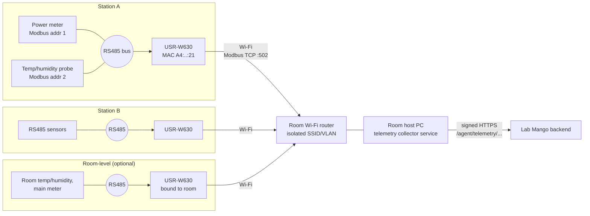
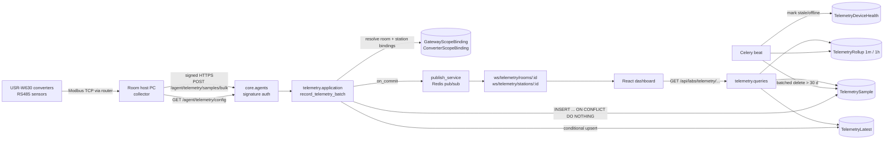
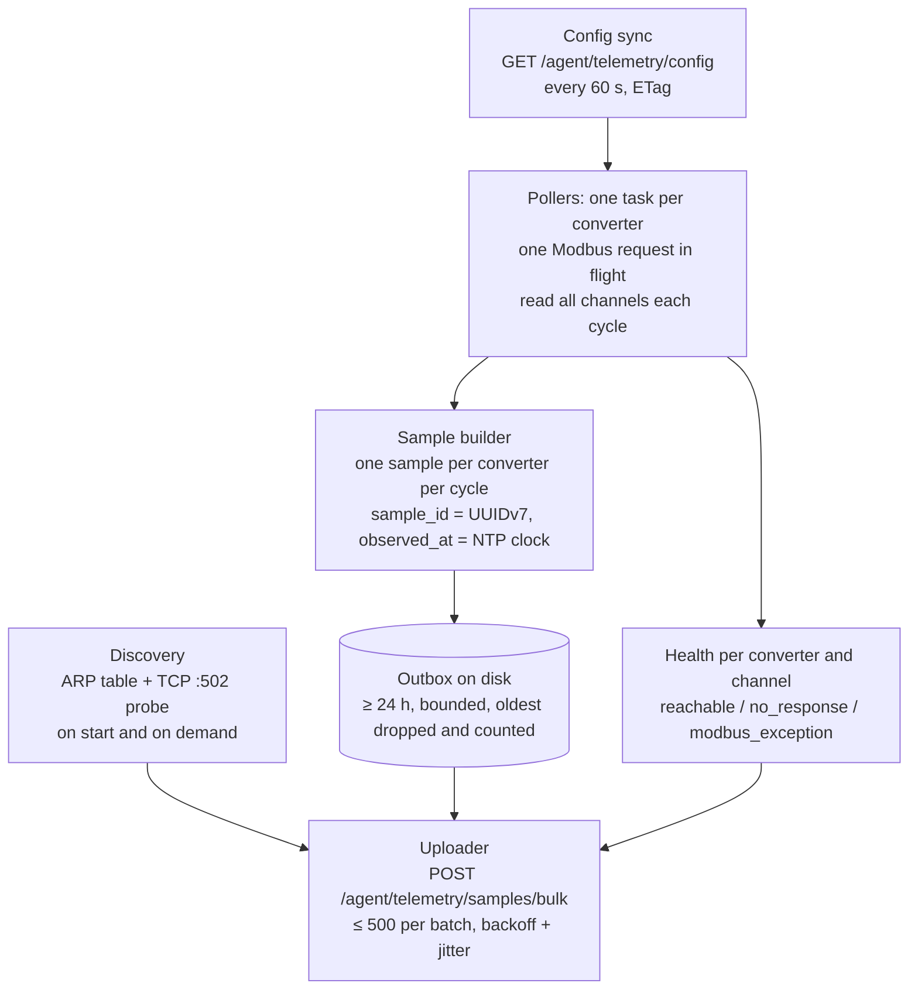
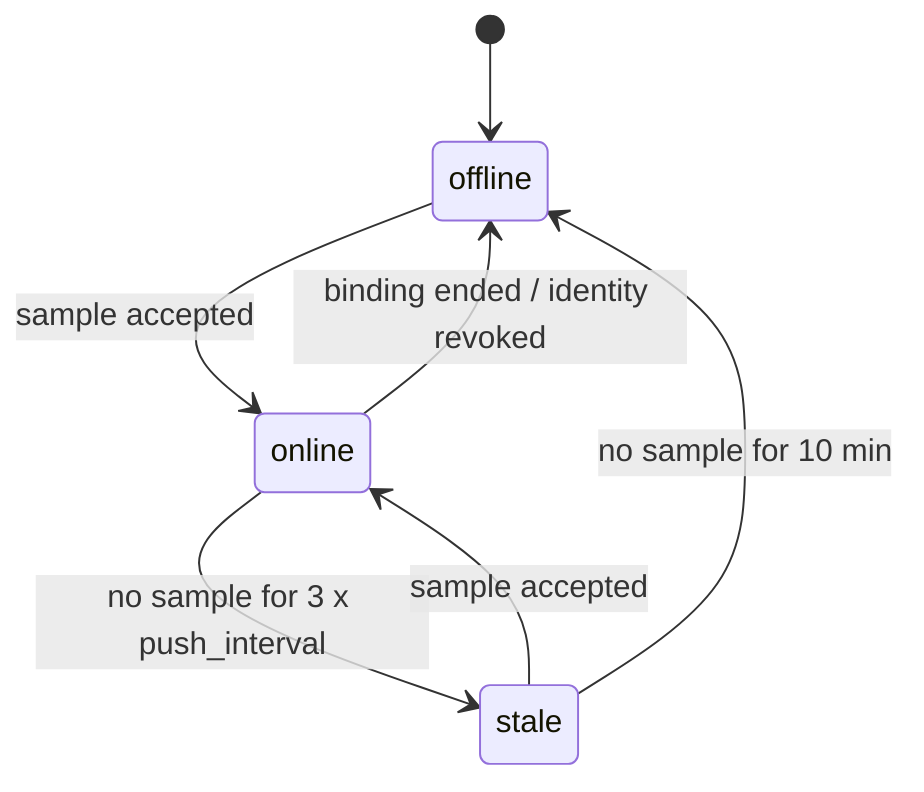
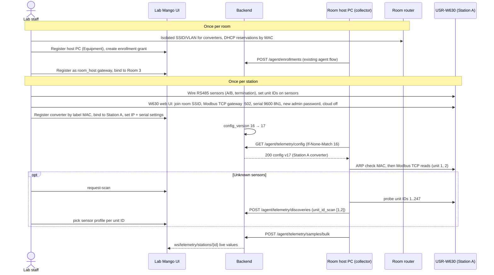

# Environment telemetry: real-time room and station power, temperature, humidity

> Status: **Proposed** (not approved, not implemented) · Risk tier: **T2** (new migrations and constraints,
> new device and operator API contracts, device authn, object-scoped authz, background jobs, cross-feature
> dependencies, retention) · Owner decision required before implementation.

Serial-to-Wi-Fi converters (USR-W630) on stations and in rooms expose RS485 sensor readings (power, temperature, humidity); a room host PC collects them and pushes to the backend. The backend stores them,
serves current values and history, and pushes changes to the React frontend in real time.

---

## 1. Repository facts (verified 2026-11-13)

What exists today. Everything else in this document is **Proposed**.

| Area | Verified state | Evidence |
|---|---|---|
| Room environment model | `RoomObservation`: `room`, `observed_at`, `source` (free text), `temperature_c`, `humidity_percent`, `power_usage_w`. DB checks: at least one value, temperature ≥ -273.15, humidity 0–100. Index `(room, -observed_at)`. | `core/labs/models/resource/location/room_observation.py:9-65` |
| Room environment API | `GET/POST /api/labs/rooms/{room_id}/observations`, paginated list, single-row create | `core/labs/features/locations/rooms/api/urls.py:22-24`, `.../rooms/api/views.py:169-194` |
| Room write path | `record_room_observation` does `full_clean()` + `save()` per row | `core/labs/features/locations/rooms/application/services.py:127-133` |
| Station environment data | **None.** `Station` has only design capacities (`power_capacity_w`, `power_reserved_w`, `cooling_capacity_w`), no measured values | `core/labs/models/resource/location/station.py:81-83` |
| Device identity | `AgentIdentity` with Ed25519 key, enrollment grants, revoke/decommission, signed `/agent/...` requests (`X-Agent-Id/Timestamp/Nonce/Signature`). **Bound to `labs.Equipment` only.** | `core/agents/models/agent_identity.py:30-35`, `core/agents/api/authentication.py:43-76` |
| Device ingest endpoints | heartbeat, equipment activity, session logs, booking actions. **No environment/telemetry endpoint.** | `core/agents/api/urls.py:22-58` |
| Generic agent events | `MonitoringEvent` (`METRIC_REPORTED` action, JSON payload) bound to a *computer* (`Equipment`) | `core/labs/models/monitoring/monitoring.py:8-36` |
| Real-time push | Django Channels + Redis pub/sub; `publish_service._publish(channel, data)`; WS routes registered by `register_route`. No room/station telemetry channel. | `core/websocket/publish_service.py:27-32`, `core/websocket/router.py:15-26`, `pyproject.toml:10-16` |

**Answer to "is it supported now?"** Partially. Rooms have a storage model and a manual HTTP API for the
three measurements. Stations have nothing. There is no node identity for room/station sensors, no ingest
path for nodes, no idempotency, no history aggregation, no retention, and no real-time push of this data.

### Drift found (report only; not changed by this proposal)

| Severity | Finding | Location |
|---|---|---|
| High | Any authenticated user or API key can create room observations; not object-scoped (AGENTS.md rule 5) | `core/common/api/command_views.py:36` via `core/labs/features/locations/api/views.py:7` and `.../rooms/api/views.py:169` |
| Medium | `RoomObservation` has no idempotency key; a node retrying a POST creates duplicates (write-safety §3) | `core/labs/models/resource/location/room_observation.py:9-29` |
| Medium | Monitoring WS dashboard admits every authenticated user; bench check is existence only, not object authz | `core/websocket/features/monitoring_dashboard/handler.py:17-27` |
| Low | WS messages are flat (`{"type", "bench_id", ...}`), not `{"type", "data"}` (STM-3) | `core/websocket/publish_service.py:44-53` |
| Low | `room_observations` selector has no time window; reads are bounded only by pagination | `core/labs/features/locations/rooms/queries/selectors.py:55-57` |

---

## 2. Requirements and quality attributes

**Functional**
- F1 A node measures one *scope*: a room or a station. A scope may have several nodes.
- F2 Nodes push samples with `observed_at`, any subset of `temperature_c`, `humidity_percent`, `power_w`.
- F3 Operators see the latest value per scope, history over a time window, and live updates.
- F4 Operators enroll, bind, rebind, revoke nodes and configure RS485 channels. A node never chooses its scope.
- F5 Node connectivity (online/stale/offline) is visible.

**Quality attributes (targets to confirm, see §10)**
- Volume: 500 converters × 1 sample / 10 s ≈ 4.3 M rows/day raw.
- Ingest p95 < 200 ms per batch of ≤ 500 samples; live update to browser < 2 s after accept.
- At-least-once delivery from nodes; zero duplicates stored.
- Raw retention 30 days; aggregates kept 2 years.

**Out of scope for v1**: threshold alerts, energy billing / expense linkage, MQTT transport, control
commands to nodes. §9 shows where each attaches later.

### 2.1 Field topologies (stated by owner 2026-11-13)

**Hardware (owner, 2026-11-13):** each station has a **USR-W630** industrial serial-to-network converter
(RS232/RS485 ↔ Wi-Fi/Ethernet; vendor lists Modbus RTU↔TCP gateway, TCP/UDP socket and MQTT modes). Its
RS485 port wires to the station's Modbus RTU sensors. It joins the room's **Wi-Fi router**. A **room host PC**
on the same router collects from every converter and pushes to Lab Mango.

The W630 runs vendor firmware only; Lab Mango cannot install code on it. W630 feature claims here are from the
vendor's product listing and are **not verified** against its manual or firmware version.



Consequences for the design:
- The **room host PC is the gateway**: the only device with a server credential (`AgentIdentity` bound to the
  host PC's `Equipment`, `core/agents/models/agent_identity.py:31`). It *polls* the converters; converters
  never reach the server.
- Because the converter can't run our logic, the **host PC** owns timestamps (NTP clock), `sample_id`,
  buffering, retries and per-sensor health. There is no custom node firmware.
- A converter is identified by its **MAC** (printed on its label). Lab Mango decides which station (or room)
  that MAC belongs to; swapping or moving a converter is a server-side rebind and keeps the station's history.
- RS485 sensors are **channels** of a converter: Modbus unit ID + sensor profile (register map) + metric,
  configured in Lab Mango (D5).
- The earlier "station PC" topology remains possible with the same software: a station PC polls only its own
  station's converter (gateway scope = station). It is optional (Q11).

---

## 3. Key decisions

### D1 Device identity: host PC = signed agent; W630 = registered converter behind it (recommended)

| Option | For | Against |
|---|---|---|
| **A. Host PC and converters are `Equipment` (converter category `environment_converter`). Only the host PC holds an `AgentIdentity`. Converters are `TelemetryDevice` rows keyed by unique MAC.** (recommended) | No change to `core.agents`; one credential per room; Ed25519 runs on a normal PC (existing agent); converters get inventory/lifecycle/procurement; swap = server-side rebind | Server trusts the host PC to report honestly for converters in its room |
| B. Converters not modeled; host PC config file maps IP → station | Simplest server | Scope decided on the PC (breaks F4); IP changes silently move data; no converter health |
| C. Converter pushes MQTT itself to a broker, broker bridged to Lab Mango | No polling software | See D6-C |

Trust limits on the LAN: Modbus TCP has no authentication and the W630 has only a web-admin password, so
station data integrity rests on network isolation (§7), not on device crypto.

### D6 Collection mode: host PC polls each W630 over Modbus TCP (recommended)

| Option | For | Against |
|---|---|---|
| **A. W630 in Modbus TCP gateway mode; host PC is the Modbus TCP client, polling `ip:502` with unit ID = RS485 address** (recommended) | All config in Lab Mango; host PC owns time and IDs; standard protocol; no broker | Host PC must run all the time; polling software needed |
| B. W630 transparent TCP server; host PC sends raw Modbus RTU frames (with CRC) over the socket | Works if the converter's gateway mode misbehaves | Host builds RTU frames; same config otherwise. Keep as fallback via `collection_mode` |
| C. W630 MQTT mode (converter polls registers itself and publishes) to a broker on the host PC | No host polling code | New broker dependency (rule 7); register maps configured in each W630's web UI (drift from Lab Mango); converter timestamps/IDs unreliable; **not verified** that W630 does register polling + JSON |
| D. Vendor cloud (USR Cloud) | Zero setup | Lab data leaves to a third-party cloud; rejected |

RS485 is half-duplex: the collector keeps **one request in flight per converter**, reads all of that
converter's channels sequentially each cycle (≈ 0.5–1 s timeout per request), and runs converters in parallel.

### D7 Collector identity: the collector is a separate service, so it needs its own server login

`AgentIdentity` allows one live identity per equipment (`agent_one_live_per_equipment`,
`core/agents/models/agent_identity.py:50-54`). Sharing the computer agent's private key between two processes
is not an option (`docs/agent-platform/device-design.md` §2: keys are unavailable to other components).

| Option | For | Against |
|---|---|---|
| **A. Host PC is dedicated and runs only the collector; the collector enrolls as that PC's one `AgentIdentity`** (recommended for v1) | No change to `core.agents`; existing enrollment, revoke and signing as is | The host PC cannot also run the computer agent |
| B. Register the collector as its own `Equipment` row and enroll against it | No agents change; host PC can also run the computer agent | An inventory row that is not a physical asset; confuses equipment reports |
| C. Add `purpose` (`computer_agent` / `telemetry_collector`) to `AgentIdentity`, unique per `(equipment, purpose)`; each endpoint accepts only its purpose | Least privilege (collector key can't call booking endpoints and vice versa); both can run on one PC | Migration on a security-critical table and auth change in `core.agents` (separate T2 task with security review) |

Recommendation: A now (Q13: dedicated host PC). Move to C if a host PC must also be a managed lab computer.
Under any option, `/agent/telemetry/*` additionally requires the signing identity's equipment to be a claimed
`room_host` gateway, so an ordinary computer agent cannot submit telemetry.

### D5 Sensor configuration: defined in Lab Mango, discovered by the host PC (recommended)

| Option | For | Against |
|---|---|---|
| **A. Lab Mango is the source of truth for *what is where and what it measures*; host PC discovers converters and scans RS485 addresses; staff confirm the sensor profile** (recommended) | Swap/move without field reconfiguration of the PC; one place to audit; channels map to metrics with DB constraints | Needs config sync (`GET /agent/telemetry/config`) and a profile library |
| B. Configured only in a host PC config file | No server work | Server can't validate what a reading means; per-room drift; swaps need someone at the PC |
| C. Fully automatic (guess sensor model from scan) | Zero touch | Modbus has no standard device ID; wrong register map = silently wrong data |

Split of responsibility:

| Configured in Lab Mango | Configured on the W630 (its web UI, once at install) | On the host PC |
|---|---|---|
| Converter registry (MAC, model), claim | Wi-Fi SSID/password of the room router | Lab Mango agent enrollment (existing) |
| Converter → station or room; host PC → room | Work mode = Modbus TCP gateway, port 502 | Telemetry collector polling, buffering, retry |
| Expected network address (IP from DHCP reservation) | Serial: baud, parity, data/stop bits — **must match** the profile in Lab Mango | NTP time sync |
| Channels: unit ID → profile → metric, enabled | Admin password changed; vendor cloud and unused services off | |
| Sensor profiles (register map, scale, serial settings) | | |
| Poll and push interval | | |

The collector cannot read or change W630 settings in v1. A serial mismatch shows up as `no_response` on every
channel of that converter and is surfaced in the UI as "check converter serial settings".

### D2 Transport: signed HTTPS batch push now; MQTT later only if measured need

| Option | For | Against |
|---|---|---|
| **A. `POST /agent/telemetry/samples/bulk`, signed, batched** (recommended) | Reuses auth/throttling/observability; no new infra; works through the existing proxy | One TLS request per batch; ~1–10 s latency floor depending on push interval |
| B. MQTT broker (e.g. EMQX/Mosquitto) + bridge worker | Low overhead for thousands of constrained nodes; QoS 1 | New service, new dependency (rule 7), second auth scheme, bridge must still call the same ingest command |
| C. Host PC holds a WebSocket to the backend | Lowest latency | Long-lived connections per gateway in ASGI workers; reconnection storms; signing per message not designed |

"Real time" is defined end to end: host PC polls every `poll_interval_s` and pushes every `push_interval_s`
(default 10 s each, a batch may hold one sample), backend publishes on commit, browser receives within ~1 s. Option B can be added later behind the
same application command (`record_telemetry_batch`) without changing storage or the operator API.

### D3 Storage: new wide raw table + rollups + latest-value row; keep `RoomObservation` as is

| Option | For | Against |
|---|---|---|
| **A. New `TelemetrySample` (wide row) + `TelemetryRollup` + `TelemetryLatest`** (recommended) | Bounded queries; cheap dashboard reads; retention without touching rollups; existing room API unchanged (rule 1) | Two places for room environment data until owner decides the fate of `RoomObservation` (Q2) |
| B. Extend `RoomObservation` with `station` FK, node, sample id | One table | Changes a deployed model and API; manual and high-volume data mixed; retention would delete manual data |
| C. Narrow EAV `(scope, metric, value)` | Add metrics without migrations | 3× rows, weak DB typing, constraints per metric impossible |
| D. TimescaleDB hypertable / native partitioning | Best at very high volume | New extension/infra (rule 7); Django migrations need raw SQL |

Escalation trigger for D: raw table > ~200 M rows or retention delete > 5 min. Until then a BRIN index on
`observed_at` and batched deletes are enough (**not verified** with a load test; see §8).

### D4 Scope modeling: two nullable FKs with exactly-one DB check (not GenericForeignKey)

Keeps real foreign keys (`PROTECT`) and lets PostgreSQL enforce "room xor station". A station's room is
derivable, so room dashboards can optionally include station converters in a query; they are not double-stored.

---

## 4. Ownership and placement

New feature `core/labs/features/telemetry/` following `docs/architecture/feature-template.md`.
Models in `core/labs/models/telemetry/` per `docs/conventions/django-models.md` (to verify against that
document during model-design).

| Concept | Owner | Used through |
|---|---|---|
| `TelemetryDevice`, `GatewayScopeBinding`, `ConverterScopeBinding`, `TelemetryConverterSettings`, `SensorProfile`, `TelemetryChannel`, `TelemetrySample`, `TelemetryRollup`, `TelemetryLatest`, `TelemetryDeviceHealth` | telemetry (new) | `telemetry/public.py`, `telemetry/contracts.py` |
| Room, Station existence, view policy | locations | `core/labs/features/locations/public.py` |
| Host PC and converter equipment, `environment_converter` category | equipment | `core/labs/features/equipment/public.py` |
| Host PC identity, signature verification | `core.agents` | `core/agents/public.py` (`require_active_agent_identity`) |
| WS channel publishing | `core.websocket` | `publish_service` (new `publish_telemetry_update`) |

Boundary enforcement: add the telemetry package to the existing import contracts checked by
`tests/architecture/test_import_boundaries.py` (no import of another feature's `models`/`application`
outside `public.py`/`contracts.py`).



---

## 5. Proposed models

### 5.0 `TelemetryDevice`: host PC gateway or W630 converter

| Field | Type | Notes |
|---|---|---|
| `equipment` | OneToOne `labs.Equipment`, PROTECT, null | null while `discovered` (not yet claimed into inventory) |
| `role` | char: `room_host` / `station_pc` / `converter` | gateways point at a PC's existing Equipment |
| `device_uid` | char(64), **unique** | converter MAC, normalized `AA:BB:CC:DD:EE:FF`; for gateways the `agent_uid`. `Equipment.mac_address` is not unique (`equipment.py:144`), so uniqueness lives here |
| `model` | char(64), blank | e.g. `usr_w630` |
| `state` | `discovered` → `claimed` → `retired` | own state machine, not equipment lifecycle (rule 2) |
| `reported_by` | FK `TelemetryDevice` (gateway), null | host PC that last saw it |
| `config_version` | int, default 0 | gateways only: bumped on any config change in scope |
| `config_version_applied` | int, null | gateways only: reported by host PC |
| `first_seen_at`, `last_seen_at` | datetime | |

Converter-only settings (`TelemetryConverterSettings`, one-to-one, so gateway rows carry no unused columns):

| Field | Type | Notes |
|---|---|---|
| `network_host` | char(253) | IP or hostname; pin it with a DHCP reservation on the router |
| `port` | int, default 502 | `CHECK (port BETWEEN 1 AND 65535)` |
| `collection_mode` | `modbus_tcp` / `rtu_over_tcp` | D6-A / D6-B |
| `serial_interface` | `rs485` / `rs232` | RS232 = one device only |
| `baud_rate`, `parity`, `data_bits`, `stop_bits` | int, char(1), int, int | what the W630 web UI must be set to |
| `request_timeout_ms` | int, default 800 | |

DB: `CHECK (state = 'discovered' OR equipment_id IS NOT NULL)`; `UNIQUE (network_host, port)` among
claimed converters (partial index) so two converters can't be configured on the same address.

### 5.1 Bindings: gateway → scope, converter → station or room

`GatewayScopeBinding`: `gateway` (FK `TelemetryDevice`), `room` (FK `labs.Room`, null), `station`
(FK `labs.Station`, null), `valid_from`, `valid_to`.
- `CHECK ((room_id IS NULL) <> (station_id IS NULL))`; `room_host` ⇒ room set, `station_pc` ⇒ station set
  (CHECK on a denormalized `gateway_role` column, or application check).
- Exclusion on `gateway` range — a gateway has one scope at a time.
- Exclusion on `room` range (partial `WHERE room_id IS NOT NULL`) — **one host PC per room** at a time.
- A `station_pc` scope is set **explicitly**, not derived live from the PC's bench assignment
  (`EquipmentAssignment` → `Bench.station_slot` → `StationSlot.station`); the UI pre-fills it and warns on mismatch.

`ConverterScopeBinding`: `converter` (FK `TelemetryDevice`), `station` (FK `labs.Station`, null), `room`
(FK `labs.Room`, null), `label`, `valid_from`, `valid_to`.
- `CHECK ((room_id IS NULL) <> (station_id IS NULL))` — a converter measures a station, or the room itself
  (wall-mounted room sensors, main meter).
- Exclusion on `converter` range — one scope at a time.
- Exclusion on `station` range (partial) — one converter per station (relax if a station gets two, Q8).
- The binding does not name a gateway: which PC polls is a transport fact, so replacing the host PC needs no
  converter rebind.

**Ingest authorization rule** (application, under `select_for_update` on the gateway's binding): a gateway may
submit a sample for converter *c* at time *t* only if *c*'s binding at *t* is inside the gateway's scope:
`room_host` → the station's room (or the bound room) equals the scope room; `station_pc` → same station.
The same rule filters what `GET /agent/telemetry/config` returns, so a host PC never even learns about
converters outside its room.

All exclusion constraints use `btree_gist`, already installed by `core/labs/migrations/0001_initial.py`.
Common: `CHECK (valid_to IS NULL OR valid_to > valid_from)`; audit via `TimeStampedModel`, `UserStampedModel`.

### 5.1b `SensorProfile` and `TelemetryChannel`: RS485 configuration

`SensorProfile` (reference data, staff-managed): `key` (e.g. `chint_ddsu666`, `es35_sw`), `name`,
`register_map` JSON (per metric: function code 3/4, register, word count, data type `int16/uint16/int32/float32`,
word order, scale, offset, unit), supported serial settings. Validated against a JSON schema on write.
Profiles are versioned: an edit creates a new version, so history keeps the register map it was read with.

`TelemetryChannel`: `converter` (FK `TelemetryDevice`), `unit_id` (Modbus slave address 1–247), `profile`
(FK `SensorProfile` version), `metric` (`temperature_c` / `humidity_percent` / `power_w`), `enabled`.
- `UNIQUE (converter, unit_id, metric)`; `CHECK (unit_id BETWEEN 1 AND 247)`.
- Application checks at config build: every profile on a converter supports the converter's serial settings
  (one RS485 bus = one baud/parity); RS232 converter ⇒ one unit ID.

`config_version` on the gateway increments in the same transaction as any change to bindings, converter
settings or channels in its scope (`select_for_update` on the gateway row), so the host PC knows when to re-pull.

### 5.1c Device roles: "station node" and "room node" in this hardware

| Role | What it is | Does | Holds server credential? |
|---|---|---|---|
| **Station node** = USR-W630 at the station | Off-the-shelf converter, vendor firmware | Bridges the station's RS485 bus to Modbus TCP on the room Wi-Fi. Nothing else | No |
| **Room node** (optional) = a USR-W630 bound to the room | Same hardware, mounted in the room | Bridges room-level sensors (ambient temp/humidity, room main meter) | No |
| **Room host PC** = gateway | Dedicated PC on the room network | Runs the **telemetry collector**, a separate service from the Lab Mango computer agent (owner decision 2026-11-13; identity in D7) | Yes (`AgentIdentity` owned by the collector) |

So there is no separate "master node" hardware any more: the router gives the network, and the host PC does the master's job.

**Telemetry collector on the host PC** (for the agent team):



- Before polling a converter, check that the MAC in the host's ARP table for `network_host` matches the
  configured MAC; on mismatch, stop polling it and report `address_conflict` (catches DHCP mix-ups; it is not
  protection against a spoofing attacker). This works only when the host PC is on the **same VLAN** as the
  converters (§5.1e); across a routed hop the ARP entry is the gateway's MAC and the check must be disabled.
- `sample_id` is written to the outbox **before** the first send, so retries after a crash reuse it and the
  server deduplicates (`UNIQUE (converter, sample_id)`).
- Values are decoded with the profile's register map and scale on the host PC; the server receives SI values
  (`temperature_c`, `humidity_percent`, `power_w`) plus `profile_version` for traceability.
- The collector is its **own deliverable** (own package, release and OS service: systemd or Windows service
  with auto-restart). It implements the existing signed-request protocol (`labmango-agent-request-v1`,
  `docs/agent-platform/backend-api.md:180-190`) itself; it never reads the computer agent's key.
- Its Modbus client is a rule-7 decision in the collector's codebase. Candidate: `pymodbus` (Modbus TCP and
  RTU-over-TCP in one library). Alternative considered: `minimalmodbus` (serial RTU only, cannot talk to a W630
  over TCP). The **backend never speaks Modbus** and needs no new dependency.
- On approval, the collector design moves to `docs/agent-platform/telemetry-collector.md` (agent-platform row
  of `docs/ai-team/documentation-map.md`).

### 5.1d Site hardware: sensor profiles (owner, 2026-11-13)

| Sensor | Role | Metric(s) | Register map status |
|---|---|---|---|
| **CHINT DDSU666** (single-phase; owner confirmed "one phase" 2026-11-13) | Electricity meter, RS485 Modbus RTU | `power_w` = active power; the meter also offers total active energy (kWh), relevant to Q5 | **Not verified.** The register table is in Appendix A (MODBUS-RTU) of the CHINT DDSU666 manual, which this session could not download. Community maps for the three-phase sibling DTSU666 store powers as float32 starting near `0x2000` with a ×0.1 W scale for power; the DDSU666 layout and scale must be taken from its own manual, not copied from DTSU666 |
| **ES35-SW** (owner link: epcb.vn product page, 2026-11-13) | Temperature/humidity transmitter, RS485 Modbus RTU | `temperature_c`, `humidity_percent` | **Not verified.** The product page could not be fetched from this session. Needed from the page/manual: default address, baud/parity, function code, temperature and humidity registers, data type, scale (often int16 × 0.1, not assumed) |

Wiring rules per station bus (also in the install checklist):
- Both sensors on one W630 share **one** serial setting (baud, parity, data/stop bits); set the W630 to the same.
- **Distinct Modbus addresses.** Meters and probes often ship with address 1; set e.g. DTSU666 = 1, ES35 = 2 on
  the device's own menu/tool before connecting both.
- A/B polarity consistent, 120 Ω termination at the two ends of the bus, common ground where the devices
  provide it.

The register numbers in the §6.1 config example are placeholders, not the verified DDSU666 map.
The first two `SensorProfile` rows are seeded by a data migration only after the register maps are verified on
one real station (Phase 1 bench test, §5.1f).

### 5.1f Phase 1 (owner's first priority): local network + W630 + sensors, proven before any backend work

Goal: one station's DDSU666 and ES35-SW readings arrive over the room Wi-Fi through a W630, with verified
register maps. No Lab Mango change is needed for this phase.

1. **Network** (§5.1e): create the room IoT VLAN and 2.4 GHz WPA2 SSID, DHCP reservation for the W630 MAC,
   firewall as listed. Connect a laptop (or the future host PC) to the IoT VLAN for testing.
2. **Sensors, before wiring them together**: give each its own address and the same serial settings, using
   each device's own menu or setup tool (e.g. DDSU666 = address 1, ES35-SW = address 2; both 9600 8N1 unless
   the manuals say otherwise). Record the values.
3. **Wiring**: one RS485 bus: W630 A/B → DDSU666 A/B → ES35-SW A/B, same polarity, 120 Ω at both ends, ES35-SW
   power supply per its spec.
4. **W630 web UI**: join the SSID; serial port = the settings from step 2; work mode **Modbus TCP gateway**
   (RTU↔TCP conversion), port 502; change the admin password; disable vendor cloud.
5. **Bench test from the laptop** with any Modbus TCP client tool (e.g. QModMaster, Modbus Poll, `mbpoll`):
   connect to `<W630 IP>:502`, unit ID 1 then 2, read the registers from each manual. Compare:
   DDSU666 power against the meter's display under a known load; ES35-SW against a reference thermometer.
   Record: register, function code, raw words, decoded value, display value, word order, scale.
6. **Hand back** the recorded table; it becomes the `chint_ddsu666@1` and `es35_sw@1` profiles.

**If "W630 pushes data" means the W630 itself sends readings** (it polls the sensors and publishes over MQTT
or HTTP), test that in step 4 as well: search results confirm the W630 has an MQTT client, but not that it
can poll registers and publish decoded values by itself (that is documented for other PUSR models such as
the USR-N720). If it can, D6-C becomes an option; it still needs a broker on the host PC (new dependency,
rule 7) and per-device register config in each W630, so D6-A (host PC polls) stays recommended until owner decides (Q16).

### 5.1e Site network: UniFi Cloud Gateway Ultra + U7 Long-Range (owner, 2026-11-13)

Configured by staff in the UniFi Network app; Lab Mango does not configure UniFi in v1. UniFi supports VLANs,
per-SSID networks, fixed IPs and firewall rules; exact menu names vary by UniFi Network version (**not verified**
for the installed version).

| Item | Setting |
|---|---|
| Network | `lab-iot-room<N>`: its own VLAN per room, DHCP on |
| Fixed IPs | one DHCP reservation per W630 MAC; this IP goes in Lab Mango `network_host` |
| SSID | `lab-iot` on the U7-LR, **2.4 GHz only** (W630 is 2.4 GHz), WPA2-Personal (W630 WPA3 support not verified), mapped to the room's IoT VLAN |
| Host PC | wired to the Gateway Ultra on a port in the **same IoT VLAN** (keeps Modbus on L2 and makes the MAC check work), fixed IP |
| Firewall | IoT VLAN → internet: block. IoT VLAN → other networks: block. Host PC → W630s TCP 502: allow. Host PC → Lab Mango server TCP 443: allow. Admin network → W630 web UI (setup only): allow. Everything else into the IoT VLAN: block |
| W630 | joins `lab-iot`; Modbus TCP gateway mode on 502; serial = sensor settings; admin password changed; vendor cloud off |

If one Gateway Ultra serves several rooms, the per-room VLAN keeps each host PC from reaching another room's
converters. The server-side scope rule (§5.1) still rejects cross-room data if the network is misconfigured.

Converter lifecycle as seen by the backend: `discovered` → `claimed` (+ scope binding) → `retired`.
Connectivity is separate (§5.5).

### 5.2 `TelemetrySample`: raw, append-only

| Field | Type | Notes |
|---|---|---|
| `id` | BigAutoField | |
| `converter` | FK `TelemetryDevice`, PROTECT | the W630 the reading came through |
| `gateway` | FK `TelemetryDevice`, PROTECT | host PC that submitted it (first accepted copy) |
| `converter_binding` | FK `ConverterScopeBinding`, PROTECT | scope resolved server-side at `observed_at` |
| `room` | FK `labs.Room`, null | denormalized from binding for indexed reads |
| `station` | FK `labs.Station`, null | denormalized from binding |
| `sample_id` | UUID | generated by node; idempotency key |
| `observed_at` | datetime | node clock, UTC |
| `received_at` | datetime | server clock |
| `temperature_c` | Decimal(6,2), null | |
| `humidity_percent` | Decimal(5,2), null | |
| `power_w` | Decimal(10,2), null | instantaneous active power |
| `quality` | char(16), default `ok` | `ok` / `suspect` (clock corrected, sensor flag) |

DB constraints (same physical rules as `RoomObservation`): at least one value; temperature ≥ -273.15;
humidity 0–100; `power_w ≥ 0`; exactly one of room/station; `UNIQUE (converter, sample_id)`.

Indexes: `(room, observed_at DESC)` partial where room not null; `(station, observed_at DESC)` partial;
BRIN on `observed_at` for retention deletes. No `full_clean()` per row on ingest; DB constraints are the
guard (same reasoning as `core/labs/models/base/agent_report.py:27-38`), serializer validates shape first.

### 5.3 `TelemetryRollup`: aggregates for charts

`scope (room|station)`, `bucket_start`, `resolution` (`1m`, `1h`), and for each metric `min`, `max`, `avg`,
`count`. `UNIQUE (room, station, resolution, bucket_start)` with `NULLS NOT DISTINCT` (PostgreSQL 15+; CI runs
`postgres:16` per `.github/workflows/ci.yml:22`, production version not verified) or two partial unique indexes. Recomputed idempotently by upsert.

### 5.4 `TelemetryLatest`: one row per converter for dashboards

`scope`, `node`, latest `observed_at` and values. `UNIQUE (node)`. Room/station "current" values are a
read over the scope's nodes (few rows). Keeps the dashboard off the raw table.

### 5.5 `TelemetryDeviceHealth`: connectivity, a separate state machine

`node` (unique), `connectivity` ∈ {`online`, `stale`, `offline`}, `last_sample_at`, `changed_at`.
This is **not** the equipment lifecycle status and **not** computing live activity (AGENTS.md rule 2).



---

## 6. Proposed API

All operator responses use the envelope and error rules in `docs/api/response-standard.md`.

### 6.1 Device ingest (signed, `core.agents` auth)

Only gateways call these (room host PC, or optional station PC; same endpoints, scope differs). Identity comes from the
signature; the body never carries a room or station id.

**Config pull** — `GET /agent/telemetry/config` with `If-None-Match: "<config_version>"` → `304` or `200`:

```json
{"data": {
  "config_version": 17, "scope": {"type": "room", "id": 3},
  "poll_interval_s": 10, "push_interval_s": 10,
  "converters": [
    {"device_uid": "A4:CF:12:9B:00:21", "model": "usr_w630", "label": "Station A",
     "network_host": "192.168.50.21", "port": 502, "collection_mode": "modbus_tcp",
     "serial": {"interface": "rs485", "baud_rate": 9600, "parity": "N", "data_bits": 8, "stop_bits": 1},
     "request_timeout_ms": 800,
     "channels": [
       {"unit_id": 1, "metric": "power_w", "profile": "chint_ddsu666@1"},
       {"unit_id": 2, "metric": "temperature_c", "profile": "es35_sw@1"},
       {"unit_id": 2, "metric": "humidity_percent", "profile": "es35_sw@1"}]}],
  "profiles": {"chint_ddsu666@1": {"register_map": {"power_w": {"fc": 3, "register": 8196,
               "words": 2, "type": "float32", "word_order": "big", "scale": 0.1}}}}
}}
```

Only converters bound inside the gateway's scope are returned. The config never contains server or
converter credentials. The host PC re-pulls every 60 s and when an ingest response carries a newer `config_version`.

**Discovery** — `POST /agent/telemetry/discoveries`
`{"devices": [{"device_uid": "A4:CF:12:9B:00:21", "network_host": "192.168.50.21", "port_502_open": true,
"unit_id_scan": [1, 2]}]}`: idempotent upsert of `discovered` devices (`UNIQUE device_uid`). `unit_id_scan`
is filled only when staff request a scan for that converter (`…/actions/request-scan`): probing 1–247 at
~300 ms each takes over a minute and blocks the bus. A MAC already bound under another room is recorded but
not reassigned (operator sees a conflict).

**Health** — `POST /agent/telemetry/health` (or inside each ingest batch): per converter `reachable`,
`address_conflict`, last error; per channel `ok` / `no_response` / `modbus_exception:<code>`.

**Ingest** — `POST /agent/telemetry/samples/bulk` — BLK-1/2/3, partial mode, max 500 operations, max 256 KiB body.

```json
{
  "mode": "partial",
  "operations": [
    {"data": {"device_uid": "A4:CF:12:9B:00:21", "sample_id": "0193…",
              "observed_at": "2026-11-13T09:00:10Z", "config_version": 17,
              "temperature_c": "22.40", "humidity_percent": "41.0", "power_w": "1830.5",
              "profile_versions": {"power_w": "chint_ddsu666@1"}}}
  ]
}
```

`device_uid` is always the converter MAC. A metric whose channel didn't answer this cycle is omitted (null),
never sent as 0. `sample_id` is created by the host PC and persisted before sending, so retries stay deduplicated.
`200` with per-item result in `data`: `accepted` | `duplicate` | `rejected` (+ ERR-1 error object), and the
current `config_version`. `Idempotency-Key` header replays the original response for the whole batch.

Validation and rejection:
- `observed_at` more than 2 min in the future, or older than raw retention → `rejected` (`observed_at_out_of_range`).
- Unknown/unclaimed `device_uid`, or converter not bound inside **this gateway's scope** at `observed_at`
  → `rejected` (`converter_not_bound`). Never silently re-attributed.
- Gateway with no active scope binding → `409` for the whole batch (`gateway_not_bound`).
- Revoked / decommissioned identity → `401` for the whole request (existing behavior).
- The host PC buffers unsent samples per `docs/agent-platform/device-design.md` §5.

### 6.2 Operator read

| Method and path | Purpose | Bounds |
|---|---|---|
| `GET /api/labs/rooms/{room_id}/telemetry/latest` | current values per converter in the room (`include_stations=true` adds the room's station converters) | ≤ 200 converters |
| `GET /api/labs/stations/{station_id}/telemetry/latest` | current values for the station | |
| `GET /api/labs/rooms/{room_id}/telemetry?from=&to=&resolution=raw\|1m\|1h&metrics=` | history series | raw ≤ 24 h, 1m ≤ 31 d, 1h ≤ 2 y; else `422` |
| `GET /api/labs/stations/{station_id}/telemetry?…` | same for stations | same |

### 6.3 Operator write: commissioning and configuration

| Method and path | Purpose |
|---|---|
| `GET /api/labs/telemetry/devices?state=discovered&room_id=` | devices with state, binding, connectivity, config version applied |
| `POST /api/labs/telemetry/gateways` | register an enrolled PC as gateway: `room_host` or `station_pc` (existing PC Equipment with an active agent) |
| `POST /api/labs/telemetry/gateways/{device_id}/actions/bind-scope` | bind to a room (host PC) or station (station PC); ends previous binding |
| `POST /api/labs/telemetry/converters` | pre-register a converter by MAC (typed or scanned from its label) before it's discovered |
| `POST /api/labs/telemetry/devices/{device_id}/actions/claim` | `discovered` → `claimed`: staff confirm MAC matches the label; create or link Equipment |
| `PATCH /api/labs/telemetry/converters/{device_id}/settings` | network address, mode, serial settings |
| `POST /api/labs/telemetry/devices/{device_id}/actions/bind-scope` | bind converter to a station or the room (ends previous binding) |
| `POST /api/labs/telemetry/devices/{device_id}/actions/unbind` | end the current binding (removed or broken) |
| `POST /api/labs/telemetry/converters/{device_id}/actions/request-scan` | ask the host PC to scan RS485 unit IDs |
| `GET/POST/PATCH/DELETE /api/labs/telemetry/converters/{device_id}/channels` | RS485 channels |
| `GET/POST /api/labs/telemetry/sensor-profiles` | register-map reference data (versioned) |

Host PC enrollment itself stays on the existing `POST /api/agents`, `/enrollment-grants`, `/agent/enrollments`.

### 6.5 Commissioning flow (how a station gets its W630)



Alternative start: plug the W630 in first; the collector's discovery reports its MAC as `discovered`, and
staff claim it from the list instead of typing the MAC.

**Swapping a broken W630**: configure the new one in its web UI the same way, give it the old DHCP reservation
(or update `network_host`), unbind the old converter, claim and bind the new MAC to the station. Channels can be
copied from the old converter in the same action. History stays on the station.

**Replacing the host PC**: enroll the new PC, register it as `room_host`, bind it to the room (the old binding
ends). Converter bindings don't change.

**Moving a station to another room**: rebind its converter; it must also move to the new room's router/SSID.

### 6.4 Real-time push

| WS route | Channel |
|---|---|
| `ws/telemetry/rooms/{room_id}` | `ws:telemetry:room:{room_id}` |
| `ws/telemetry/stations/{station_id}` | `ws:telemetry:station:{station_id}` |

Message (STM-3): `{"type": "telemetry.latest", "data": {"scope": {"type": "room", "id": 7}, "node_id": 42,
"observed_at": "…", "temperature_c": "22.40", "humidity_percent": "41.0", "power_w": "1830.5"}}` and
`{"type": "telemetry.connectivity", "data": {…}}`. Published in `transaction.on_commit`, one message per
node per batch (the newest sample), so a 500-sample backfill sends one message, not 500. Messages are
best-effort; on (re)connect the client calls `…/telemetry/latest` (documented per STM-4). Heartbeat every 30 s.

---

## 7. Write safety and authorization

| Write path | Race guard | Safe to run twice |
|---|---|---|
| `record_telemetry_batch` | `UNIQUE (converter, sample_id)` + `bulk_create(ignore_conflicts=True)`; binding resolved by exclusion-constrained range lookup | Yes: duplicates reported as `duplicate`, no extra rows |
| `TelemetryLatest` upsert | `INSERT … ON CONFLICT (node) DO UPDATE … WHERE excluded.observed_at > telemetry_latest.observed_at` | Yes: older or equal samples never overwrite newer |
| Bind node | `select_for_update` on the node's open binding + exclusion constraint | Same request twice: second sees identical open binding and returns it |
| Rollup task | upsert on `(scope, resolution, bucket_start)`; recompute from raw | Yes |
| Retention task | delete in batches of 10 k by `observed_at < cutoff` | Yes |
| Connectivity task | conditional update `WHERE connectivity = old AND last_sample_at = seen` | Yes |

Authorization (deny-by-default, object-scoped):
- Device writes: signed host PC identity → its `TelemetryDevice` → active scope binding → only converters bound
  inside that scope. A compromised host PC can at worst forge data for its own room.
- LAN between W630s and the host PC (no device auth available, see D1), required in the install checklist:
  dedicated SSID or VLAN for converters, WPA2/WPA3, no internet route for converters, router firewall allows
  TCP 502 only from the host PC, W630 default admin password changed, vendor cloud / unused socket and MQTT
  services disabled. Whether the W630 supports each of these toggles is **not verified**.
- Connectivity has three layers: host PC (agent heartbeat), converter (reachable / not), and channel (sensor
  answers / not). When the host PC is offline, its converters are `unknown`, not `offline` (matches the repo
  rule that missing telemetry is unknown, `core/labs/features/equipment/queries/summaries.py:19`).
- Operator reads: the caller must be allowed to view the room/station, via a locations policy exposed in
  `locations/public.py`. **No such object-level policy exists today** (drift table §1), so the owner must
  decide the rule (Q3). WS handshakes apply the same check, not "exists".
- Binding management: lab staff only (`LABS_STAFF_ACCESS`, already used at
  `core/labs/features/locations/api/reference_data.py:24`).

---

## 8. Verification plan (when implemented)

- Model tests: every DB constraint rejects bad rows at the database (bypass `full_clean`).
- Ingest: duplicate batch, duplicate sample in one batch, out-of-order samples, unbound node, revoked node,
  future timestamp, 501 operations, oversized body.
- Concurrency: two concurrent batches with overlapping sample ids; latest never regresses.
- Query budgets: `latest` endpoint constant queries for 1 vs 200 nodes; history endpoint ≤ 3 queries.
- WS: unauthorized user closed with 4003; message shape STM-3; one message per converter per batch.
- Load test before approval of the D3 escalation trigger: 4.3 M rows/day for 30 days, measure history p95
  and retention delete duration.
- Quality gates per `docs/ai-team/quality-gates.md`; regenerate `openapi/` in the same change.

---

## 9. Later extensions (not in v1)

| Extension | Attaches at |
|---|---|
| Threshold alerts (temp/humidity bands; `power_w > Station.power_capacity_w`) | Rule table in telemetry; evaluated in `record_telemetry_batch` after commit; notify via `core.websocket` user notifications |
| Energy (`energy_wh` monotonic counter) for expense/billing | New nullable column + rollup delta; money logic is its own T2 change |
| MQTT transport | Bridge worker calling `telemetry.public.record_telemetry_batch` |
| Long-range storage | TimescaleDB or native partitioning (D3 option D) |

---

## 10. Assumptions and open questions for the owner

Assumptions (not verified): the room host PC can run the collector service (Ed25519 signing happens there);
W630 Modbus TCP gateway mode works with the chosen sensors (validate on one station first); ~500 converters
at 10 s; production PostgreSQL ≥ 15 (CI uses 16).

| # | Question | Recommended default |
|---|---|---|
| Q1 | Approve host PC as gateway and W630 as Equipment-backed converter (D1-A) with Modbus TCP polling (D6-A)? | Yes |
| Q2 | Fate of `RoomObservation` and `/rooms/{id}/observations`: keep for manual entries, or deprecate after telemetry ships? | Keep in v1; decide after adoption |
| Q3 | Who may view a room's/station's telemetry? | Same users who can view the room; staff for all |
| Q4 | Push interval, raw retention, rollup retention | 10 s; 30 d; 1m for 90 d, 1h for 2 y |
| Q5 | `power_w` = DTSU666 total active power. The meter also gives energy (kWh): store it for expenses? | `power_w` only in v1; energy as a follow-up (§9) |
| Q6 | Fix the drift items in §1 (esp. room observation write authz) as separate tasks? | Yes, separate T2 task for authz |
| Q7 | ~~Router model?~~ **Answered:** UniFi Cloud Gateway Ultra + U7 Long-Range; settings in §5.1e | — |
| Q8 | Exactly one W630 per station, or several (e.g. two RS485 buses)? | One; drop the station exclusion if needed |
| Q9 | **Answered:** CHINT DDSU666 (single-phase) + ES35-SW (§5.1d). Register maps still to verify in the Phase 1 bench test | Bench test results |
| Q10 | Room-level sensors: one extra W630 bound to the room, or none? | Optional per room |
| Q11 | Is the "station PC" topology still needed now that every station has a W630 on the room network? | Not in v1; room host PC only |
| Q12 | ~~Collector in the agent or separate?~~ **Answered: separate service.** Identity consequence in D7 | — |
| Q13 | Is the room host PC dedicated (runs only the collector, D7-A) and always on? | Dedicated, always on, wired |
| Q14 | One Gateway Ultra per room, or one for the building with a U7-LR per room? (Decides per-room VLANs, §5.1e) | One IoT VLAN per room either way |
| Q16 | Data flow: host PC polls the W630 (D6-A), or the W630 pushes MQTT to a broker on the host PC (D6-C)? | D6-A unless the Phase 1 test shows a reason |
| Q15 | Host PC OS (Windows/Linux) and the collector's language/runtime? | Linux + Python service |
