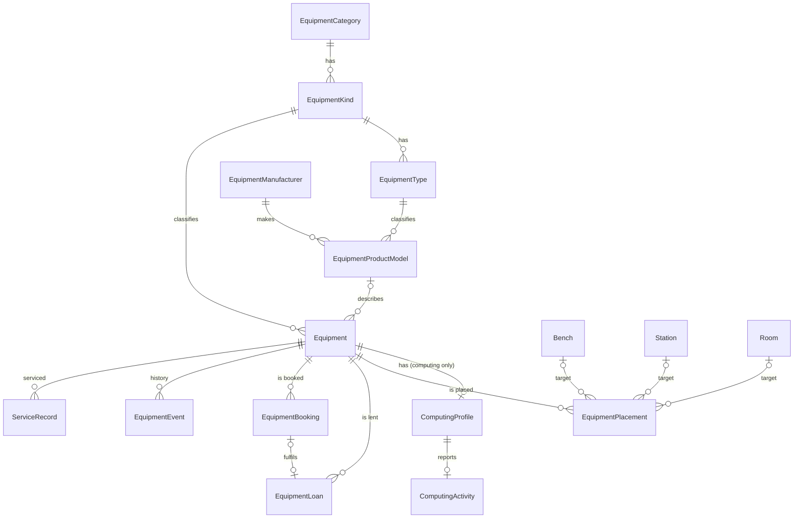

# Design: Equipment management redesign (state, location, custody, category model)

- Tier: T2 · Status: Draft, owner decisions recorded below, not approved for implementation · Date: 2026-11-10
- Scope: `core/labs/features/equipment`, `core/labs/models/resource/equipment`, bench status, and the
  cross-feature reads of equipment tables. No code, migration, or deployed contract is changed by this document.
- Companion: [equipment booking](equipment-booking.md) builds on the placement, state, and loan records
  defined here. This document is the owner of those definitions; the booking proposal links to them.

Statements marked **Evidence** were read from the repository on the date above. Nothing was executed
(no database was available), so defects are "confirmed by reading". Everything else is **Proposed**.

## Problem and acceptance criteria

The equipment feature has a sound technical base (command/query layering, row locks backed by partial
unique and exclusion constraints, a `public.py` boundary), but three modelling decisions hold it back:

1. One status enum carries five different facts (lifecycle, condition, utilisation, custody, location).
2. Equipment has no location or custody record of its own; location exists only as a side effect of a
   bench assignment or the single `storage_room` column.
3. Category is modelled twice: as data (`kind.category`) and as 12 multi-table-inheritance subclasses.

Acceptance criteria for the redesign:

| # | Criterion |
|---|---|
| AC1 | Lifecycle, condition, placement, custody, booking, and live activity are separate records with separate rules (extends AGENTS rule 2). |
| AC2 | Every unit is, at any time, in exactly one of: placed (bench, station, room, or an untracked place described in text), on loan, or location unknown. |
| AC3 | "Available" is computed from those records and cannot be set by hand. |
| AC4 | Changing condition never changes where a unit is. |
| AC5 | Each invariant PostgreSQL can express is a constraint; the rest are enforced in one command under a named lock. |
| AC6 | Other features read equipment through `public.py` projections only. |
| AC7 | Adding an equipment category needs no migration and no new routes. |
| AC8 | Every equipment and catalog write has a server-side, object-scoped permission. |

## Owner decisions recorded (2026-11-10)

| # | Decision |
|---|---|
| OD1 | Remove `Equipment.storage_room`; use a location (placement) model instead. |
| OD2 | A storage place may be outside the tracked rooms and stations. It is recorded as text. |
| OD3 | Bench is virtual; its seven-value `lifecycle_status` is more than is needed. (Proposal below keeps a reduced state; owner to confirm.) |
| OD4 | A loan has no code of its own. Nothing in the system reads one. |
| OD5 | Marking equipment lost is always a manual coordinator action. No timer does it or prompts for it. |
| OD6 | A booking can be created only when the equipment is available at that moment. |
| OD7 | Overdue reminders: at the due time, one day later, then daily, capped at one week. |

## Current state (from repository evidence)

### Confirmed defects

| # | Severity | Finding | Evidence |
|---|---|---|---|
| D1 | Critical | Every equipment write (create, update, delete, assign, change status, catalog create) is open to any authenticated user or API key. Only the computing-activity PATCH requires a coordinator. | `core/common/api/command_views.py:37`; no `permission_classes` in `core/labs/features/equipment/api/views.py`; contrast `categories/computing/api.py:60` |
| D2 | Critical | `POST /api/labs/equipment` creates a bare `Equipment` row with no subclass row, because the category check is skipped for the base model. Such a unit is invisible to its category endpoints and a computing unit gets no `ComputingActivity`. | `api/views.py` (`EquipmentListCreateAPIView.handle_post`); `application/create_equipment.py:99-101` |
| D3 | High | Create rejects fields its own serializers accept (`firmware_version`, `power_draw_w`, `weight_kg`, `warranty_until`, `calibration_required`, and `storage_room_id` on the generic route). On category routes a storage room reaches `reference.active`, which `Room` does not have. | `application/create_equipment.py:23,42-59,69`; `api/serializers.py:112-136`; `api/category_serializers.py:17-38` |
| D4 | High | Soft delete has no guards: it leaves the active bench assignment, license seats, and reserving bookings pointing at a deleted unit. Bench delete does check these. | `application/delete_equipment.py`; contrast `features/benches/application/services.py:186-191` |
| D5 | High | Leaderboard "current status counts" count every history row, not the latest per unit. | `features/leaderboard/queries/selectors.py:275` |
| D6 | Low | Filters use `kind__key`; `EquipmentKind` has no `key` field. Reachability from the API is not verified. | `queries/equipment.py:93,361,450` |
| D7 | Low | N+1: the list serializer emits `storage_room`, no selector joins it. | `queries/equipment.py:76-85`; `api/serializers.py:50` |
| D8 | Low | Docs drift: `architecture.md` cites `core/labs/signals.py` (absent); `spec.md` lists `PATCH`/`DELETE /equipment/{id}` (the view is GET-only). | `features/equipment/docs/` |

### Design problems

- **Status conflation.** `EquipmentStatus` (`models/resource/equipment/equipment.py:171-180`) mixes
  lifecycle (`on_order`, `lost`), condition (`broken`, `maintenance`), utilisation (`in_use`, `available`),
  custody (`borrowed`, `transferred`), and location (`in_storage`). There is no transition table. Any
  non-`in_use` status closes the bench assignment (`application/_status_transition.py:45-48`).
  `assign_equipment` never checks status. New equipment gets no status record, so it is excluded from
  `assignable` selectors (`queries/equipment.py:381`). Loans, transfers, and storage are free-text JSON
  (`api/serializers.py:147-240`).
- **No location of record.** A unit is "somewhere" only through an active `EquipmentAssignment` or `storage_room`.
- **Current status is derived**, by correlated subquery over history, so status filters cannot use an
  index. `Bench` stores `lifecycle_status` as a column; the two resources disagree on the pattern.
- **Bench status is unenforced.** `Bench.LIFECYCLE_STATUSES` has seven values including `reserved` and
  `active`, set by hand; no module under `features/bench_bookings/application/` reads it.
- **Category twice.** Of 12 subclasses, 4 add no columns and one adds only an M2M. Agreement between the
  class and `kind.category` is enforced only in `clean()`. Categories can be created at runtime
  (`api/reference_data.py:24`) but get no model and no routes.
- **Three attribute mechanisms.** Typed subclass columns hold make-and-model facts (display size and
  resolution, power channels and rating, material, dimensions); `ProductModelSpecification` is an
  entity-attribute-value table for the same kind of fact; `metadata`, `details`, `remark`, `log_label`
  are four more free-form fields.
- **Generic foreign keys** for service records (string id) and purchase allocations (bigint id), with no
  referential integrity. Calibration has no interval and gates nothing.
- **Boundary leaks.** Benches, bench bookings, dashboard, licenses, monitoring, analytics, and leaderboard
  query `EquipmentAssignment`, `EquipmentStatusRecord`, or `ComputingActivity` directly (for example
  `features/bench_bookings/application/state_transitions.py:38`).
- **Generated API surface.** `openapi/labs-equipment.yml` has 187 paths: 10 routes for each of 12
  categories built with `type()` in `api/categories.py`, two near-identical options selectors, aliased
  parameters, and three identifier routes per category.

## Proposed behavior and invariants

### 1. Equipment state: two stored axes

| Axis | Values | Replaces |
|---|---|---|
| `lifecycle_state` | `planned`, `in_service`, `retired`, `lost` | `on_order`, `lost`, and soft delete as the only "gone" signal |
| `condition` | `operational`, `in_maintenance`, `out_of_service` | `maintenance`, `broken` |

Both are columns on `Equipment`, set at creation (`planned` or `in_service`, `operational`). History moves
to an append-only `EquipmentEvent` (axis, from, to, reason, actor, time).

Allowed transitions:

| Axis | From | To |
|---|---|---|
| lifecycle | `planned` | `in_service`, `retired` |
| lifecycle | `in_service` | `retired`, `lost` |
| lifecycle | `lost` | `in_service` (found), `retired` |
| lifecycle | `retired` | none (terminal) |
| condition | any | any other, only while `in_service` |

Rules:
- Entering `retired` or `lost` requires no active placement on a bench and closes any other active
  placement. `lost` closes the active loan with reason `lost` and cancels future bookings (OD5: manual only).
- A condition change never opens or closes a placement (AC4).
- `in_use`, `available`, `in_storage`, `borrowed`, and `transferred` are no longer statuses. They are read from
  placement and loan.

**Available** (computed, AC3): `lifecycle_state = in_service` and `condition = operational` and no active
bench placement and no active loan and (calibration not overdue, when the unit requires calibration).

### 2. Location: `EquipmentPlacement`

Replaces `EquipmentAssignment` and `Equipment.storage_room` (OD1).

| Field | Notes |
|---|---|
| `equipment` | FK, PROTECT |
| `bench`, `station`, `room` | nullable FKs, PROTECT; at most one set |
| `location_note` | text; required when no FK is set (OD2); otherwise an optional detail such as "Cabinet 3, shelf B" |
| `role`, `position`, `monitor` | carried over from `EquipmentAssignment`; bench placements only |
| `placed_at`, `removed_at` | `removed_at IS NULL` is the current placement |

| Situation | Recorded as |
|---|---|
| Installed on a bench | placement with `bench` |
| At a tracked station or room | placement with `station` or `room` |
| Somewhere untracked | placement with only `location_note` |
| With a person | no active placement; an active loan |
| Unknown | neither |

The room of a bench-mounted unit is derived (bench, then station, then room) and never copied, because a
bench can move. One equipment-owned selector answers "everything in room X". If the same untracked
places recur, promote `location_note` values to a lookup table later; do not start with one.

### 3. Custody: `EquipmentLoan`

| Field | Notes |
|---|---|
| `equipment` | FK, PROTECT |
| `borrower` | FK user, PROTECT |
| `booking` | one-to-one to `EquipmentBooking`, nullable (reserved for custody that is not a booking, such as an external calibration vendor) |
| `handed_over_at`, `handed_over_by` | |
| `due_at` | equals the booking end; an extension updates both in one transaction |
| `returned_at`, `received_by` | |
| `condition_out`, `condition_in` | short text |
| `close_reason` | `returned`, `lost`, `written_off`; null while open |

No code field (OD4). Overdue is computed: `returned_at IS NULL AND due_at < now()`.

### 4. Bench state

Reduce `Bench.lifecycle_status` to `planned`, `in_service`, `out_of_service`, `retired` (OD3, to confirm).
Remove `reserved` and `active`; the dashboard computes them from bookings and computing activity. Bench
booking creation refuses a bench that is not `in_service`. `maintenance` maps to `out_of_service`.

### 5. Category model

Single `Equipment` table. Keep a one-to-one profile table only where behaviour exists: `ComputingProfile`
(hostname, MAC, IP, OS, technical user, RDP file) with `ComputingActivity` keyed on it. Make-and-model
facts move to the product model's specifications. Remaining per-unit variation goes into an `attributes`
JSON column validated against a schema held on `EquipmentCategory`. `EquipmentCategory` gains capability
flags (`bookable`, `placeable_on_bench`, `calibratable`, `monitored`) so `api/capabilities.py` stops
advertising every capability for every category.

## Module ownership and allowed dependencies

| Area | Owns | Others use it through |
|---|---|---|
| Equipment | identity, lifecycle and condition, placement, loans, service records, computing profile | `public.py` commands (`place_equipment`, `remove_placement`, `hand_over_equipment`, `return_equipment`, `change_condition`, `change_lifecycle`) and read projections |
| Equipment catalog (sub-package of equipment) | categories, kinds, types, manufacturers, product models, specifications | `public.py` |
| Equipment bookings (new) | schedule and approval only | calls equipment's public custody commands |
| Benches, locations | bench and station/room lifecycle | ask equipment "is anything placed here" |
| Organization (new home, to confirm) | departments and resource groups, today served from the equipment feature | its own `public.py` |

Add an import-boundary test covering Labs features (AC6); the existing architecture tests do not prove this rule.

## API contract (endpoints, errors, breaking?)

All of these are breaking and need a compatibility plan per `docs/api/response-standard.md` and AGENTS rule 6.

| Change | Contract effect |
|---|---|
| `status` on equipment responses | replaced by `lifecycle_state`, `condition`, `availability` (computed), `placement`, `loan` |
| `POST /equipment/{id}/actions/change-status` | replaced by `actions/change-condition` and `actions/change-lifecycle`; old route kept as a deprecated adapter for a sunset period |
| `/equipment/{id}/assignment` | becomes `/equipment/{id}/placement` (bench, station, room, or note); old route kept as a deprecated alias for bench placements |
| `storage_room`, `storage_room_id` | removed |
| Bench `lifecycle_status` | value set shrinks to four |
| Category routes | one `/equipment` collection with a `category` filter and polymorphic detail; category routes become deprecated aliases |

Stable errors (existing `Conflict` base): `equipment_not_available`, `equipment_already_placed`,
`equipment_on_loan`, `invalid_state_transition`, `equipment_has_future_bookings`.

## Data model, constraints, concurrency

Constraints (names are proposals):

| Constraint | Kind | Rule |
|---|---|---|
| `equipment_placement_one_target` | check | `num_nonnulls(bench, station, room) = 1` or (all null and `location_note <> ''`) |
| `equipment_placement_bench_fields` | check | `role`, `position`, `monitor` at defaults unless `bench` is set |
| `one_active_placement_per_equipment` | partial unique | `(equipment)` where `removed_at IS NULL` (today `one_active_bench_per_equipment`) |
| `equipment_placement_end_after_start` | check | carried over |
| `one_active_loan_per_equipment` | partial unique | `(equipment)` where `returned_at IS NULL` |
| `equipment_loan_closed_has_reason` | check | `returned_at IS NULL` if and only if `close_reason IS NULL` |
| `equipment_lifecycle_valid`, `equipment_condition_valid` | check | values in the enumerations |
| `equipment_condition_only_in_service` | check | `condition = 'operational'` unless `lifecycle_state = 'in_service'` |
| `equipment_serial_per_model_uniq` | partial unique | `(product_model, serial_number)` where both set and not deleted |

"A unit on loan has no active placement" and "a retired unit has neither" span tables and cannot be
check constraints. They are enforced in the commands below while holding the `Equipment` row lock.

| Write path | Race | Guard (constraint name / lock order) | Idempotency (key or natural target state) | Concurrency test |
|---|---|---|---|---|
| `place_equipment` | two placements for one unit | lock `Equipment`, then `Bench` if bench target; `one_active_placement_per_equipment` | same target already active returns it | two simultaneous placements, one wins |
| `remove_placement` | double removal | lock `Equipment`; row lock on placement | no active placement returns none | repeat call is a no-op |
| `hand_over_equipment` | two loans; loan while placed | lock `Equipment`; `one_active_loan_per_equipment`; closes active placement in the same transaction | active loan for the same booking returns it | simultaneous hand-over of two bookings |
| `return_equipment` | double return | lock `Equipment`; row lock on loan | already closed returns it | repeat call is a no-op |
| `change_condition`, `change_lifecycle` | lost update | lock `Equipment`; transition table; checks above | target state already current returns without an event | concurrent conflicting transitions |
| `delete_equipment` | delete during placement or loan | lock `Equipment`; refuse on active placement, loan, license seat, or reserving booking | already deleted is a no-op | delete racing a placement |

Lock order everywhere: `Equipment`, then `Bench`, then placement, loan, or booking rows. This matches the
existing convention stated in `queries/equipment.py` (`lock_active_equipment_bench_assignment`).

## Read paths and query budget

| Endpoint | Query function | `select_related` / `prefetch_related` / annotations | Budget (N queries) | Page cap |
|---|---|---|---|---|
| `GET /equipment` | `list_equipment` | join kind, category, type, manufacturer, product model, owner, department, group; `Exists` for active loan; one subquery for active placement target | page + count = 2, plus 1 for M2M prefetch where a profile needs it | 100 |
| `GET /equipment/{id}` | `get_equipment` | same, plus computing profile and activity | 2 | n/a |
| status summary | `get_equipment_status_summary` | aggregate on stored columns | 1 | n/a |
| "equipment in room X" | new selector | placement joined to bench and station for derived room | 1 | 100 |

Status filters become plain indexed predicates. Add trigram indexes on `sku`, `name`, `serial_number`;
representative-volume query plans are not verified.

## Authorization and threat notes

- D1 is fixed first and independently: coordinator role for all equipment and catalog writes, deny by default.
- Object scope: the owning department or group is the natural scope. Whether coordinators are scoped per
  department or lab-wide is an open question.
- Hand-over and return are coordinator-only.
- `location_note`, `condition_out`, `condition_in` are free text shown to other users: length-capped and
  never rendered as HTML.

## Async/integration behavior

No external calls inside equipment transactions. WebSocket and notification effects are emitted after
commit, as `categories/computing/application.py` already does. RDP file generation moves out of
`ComputingEquipment.save()` into the computing command.

## Migration, rollout, rollback

Each step is its own T2 change with its own plan and approval. Order matters because later steps read earlier ones.

| Step | Change | Data migration | Rollback |
|---|---|---|---|
| 0 | Fix D1 to D5 on the current model | none | revert |
| 1 | `EquipmentPlacement` | rename and extend `EquipmentAssignment` (state-only rename where possible); `storage_room` becomes a room placement for units with no active assignment; drop the column in a later release | keep the column until step 1 is verified |
| 2 | `lifecycle_state`, `condition`, `EquipmentEvent` | backfill from the latest `EquipmentStatusRecord` using the table below; keep the old table read-only | columns are additive; adapter keeps old route working |
| 3 | `EquipmentLoan` | none (legacy `borrowed` rows have no borrower FK; see table) | additive |
| 4 | Equipment bookings feature | none | feature routes removable |
| 5 | Bench state reduction | map `reserved`, `active` to `in_service`; `maintenance` to `out_of_service`; `available` to `in_service` | value map is reversible only for unchanged rows |
| 6 | Single-table equipment and `ComputingProfile` | copy subclass columns into profile, product-model specifications, or `attributes`; largest step, plan separately | separate plan |

Backfill from the latest legacy status:

| Legacy status | `lifecycle_state` | `condition` | Other |
|---|---|---|---|
| none recorded | `in_service` | `operational` | list for coordinator review |
| `on_order` | `planned` | `operational` | |
| `available` | `in_service` | `operational` | |
| `in_use` | `in_service` | `operational` | existing assignment becomes a bench placement |
| `in_storage` | `in_service` | `operational` | placement from `storage_room`, else `location_note` from `metadata.location` |
| `maintenance` | `in_service` | `in_maintenance` | |
| `broken` | `in_service` | `out_of_service` | |
| `lost` | `lost` | `operational` | |
| `borrowed` | `in_service` | `operational` | no loan row can be built from text; `location_note` "On loan to <borrower>" and list for coordinator review |
| `transferred` | open question | | `location_note` from `metadata.destination` |

## Observability

Log command name, equipment id, target, actor id, and outcome for every placement, loan, and state
change. `EquipmentEvent` is the audit trail for state; placement and loan rows are their own history.

## Test plan (criterion → test)

| Criterion | Test |
|---|---|
| AC1, AC4 | changing condition leaves the active placement untouched |
| AC2 | constraint tests for one target, one active placement, one active loan; hand-over closes placement |
| AC3 | availability matrix over lifecycle, condition, placement, loan, calibration |
| AC5 | PostgreSQL concurrency tests from the write-path table |
| AC6 | import-boundary test over Labs features |
| AC7 | create a category at runtime, then create, list, and filter a unit in it |
| AC8 | denied-access tests per write endpoint and per object scope |
| D2 to D5 | regression test per defect |

## Other models and features worth improving

Found while reviewing; each is outside the core redesign and can be scheduled separately.

| Area | Improvement | Evidence or status |
|---|---|---|
| Bench bookings | Refuse bookings on a bench that is not in service | no reference to `lifecycle_status` under `features/bench_bookings/application/` |
| Bench bookings | Read computing activity through equipment `public.py` instead of traversing `equipment__computingequipment__activity` | `features/bench_bookings/application/state_transitions.py:38` |
| Leaderboard | Count the latest status per unit, or read the new stored columns | D5 |
| Service records | Real foreign key to equipment instead of a generic key with a string id; add a calibration interval on the product model (overridable per unit) and let "overdue" block hand-over | `models/resource/base/service_record.py` |
| Bench | Remove deprecated `last_inspected_at`, `next_inspection_due_at` once readers use service records | marked deprecated in `models/resource/bench/bench.py` |
| Licenses | The seat limit lives in `LicenseAssignment.clean()`. Whether `assign_license` runs it is not verified; if not, the limit is unenforced. The license row is locked, so a check inside the command would be race-safe | `models/resource/license/assignment.py`; `features/licenses/application/assignments.py` |
| Monitoring | `MonitoringEvent.bench` runs one query per event when read in a list | `models/monitoring/monitoring.py:124-137` |
| Computing activity | `booking_code` is free text reported by the agent; resolve it to a booking at write time or document it as untrusted | `models/activity/computing_activity.py` |
| Equipment | Optional parent/child link for assemblies (rack with modules, PC with cards); rename `sku` to asset tag, since a SKU names a catalog item, not a unit | proposal, low priority |
| Organization | Move department and resource-group endpoints out of the equipment feature | `features/equipment/api/urls.py:66-72` |
| Equipment API | Single options selector; remove parameter aliases; fix D6 to D8 | `queries/equipment.py` |

## Alternatives considered

| Topic | Alternative | Why not |
|---|---|---|
| Location | Keep `storage_room` and add `station` | three unrelated columns, no history, cannot express untracked places |
| Location | One unified location tree for room, station, bench, cabinet | `Room` and `Station` are full resources with their own status and slots; merging them is a far larger change |
| Location | Copy the room onto each placement | goes stale when a bench moves |
| State | Keep one enum, add a transition table | cannot represent "broken while on loan"; custody stays free text |
| Custody | Hand-over columns on `EquipmentBooking` only | equipment could not compute availability without importing the booking feature; no room for non-booking custody |
| Category | Keep multi-table inheritance | D2; category cannot change; runtime categories have no model |
| Category | Pure entity-attribute-value, or JSON only | untyped and slow to filter; computing has real behaviour and indexed columns |

## Open questions / decisions needed from the owner

1. Confirm the reduced bench state (four values) rather than removing bench status entirely.
2. What does legacy `transferred` mean: moved to another site but still ours (placement with a note), or
   handed to another organisation (`retired`)?
3. Are coordinators scoped per department, or lab-wide?
4. Is a three-level taxonomy (category, kind, type) needed, or can one level go?
5. Should a flag on `Room` mark storage rooms for reporting?
6. Sunset period for the deprecated `change-status` and `assignment` routes.
7. Approve step 0 (defect fixes) independently of the redesign.
