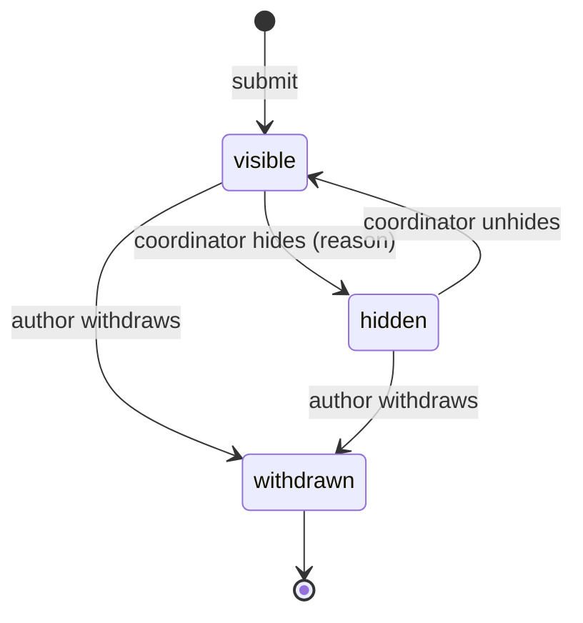
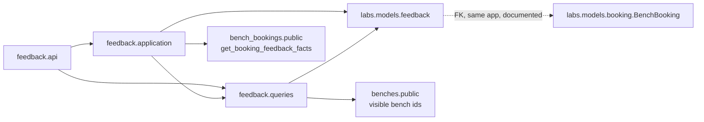

# Design: Booking feedback and bench rating

- Tier: T2 (new models and constraints, new public API, authorization, cross-feature dependency,
  personal data) · Status: Draft, awaits owner approval; not approved for implementation · Date: 2026-11-12
- Domain: Labs (`core/labs/features/feedback`, a feature that does not exist yet; models in
  `core/labs/models/feedback/`)
- Depends on: `bench_bookings` (booking status and the booking user), `benches` (bench visibility).
- Does not replace: support desk ticket CSAT (`core/support_desk/features/tickets/application/submit_csat.py`).

**Central rule.** People rate a bench through a booking they actually used. A rating is
attached to exactly one **completed** bench booking, so every score comes from real use, and there is at
most one rating per booking. A rating never changes the bench lifecycle status, the booking status, or
the live activity status (AGENTS.md rule 2). The feedback moderation status is a separate state machine.

## 1. Problem and acceptance criteria

Lab users have no structured way to say whether a bench was fit for use. Coordinators find out about a
dirty bench, a missing cable, or a noisy room by chance. Feedback gives coordinators a per-bench signal they
can act on, and gives users an honest summary when they choose a bench.

| # | Acceptance criterion |
|---|---|
| AC1 | The booking user of a **completed** bench booking can submit one rating: score 1 to 5, an optional comment of up to 2000 characters, and up to 5 tags from a seeded list, within the feedback window (default 14 days after `ends_at`). |
| AC2 | A booking that is not completed, a window that has closed, or an actor who is not the booking user is rejected with a stable error code. A booking the actor cannot see returns `404`. |
| AC3 | Two simultaneous submissions for one booking create one row. Replaying an identical submission returns the stored rating. A different submission returns `409 feedback_already_submitted`. |
| AC4 | The author can edit score, comment and tags while the window is open and the rating is `visible`. Edits require `If-Match`. A stale ETag returns `412`, a missing one `428`. |
| AC5 | The author can withdraw a rating at any time. Withdrawal erases the comment and tags, and the rating no longer counts in any aggregate. |
| AC6 | A coordinator can hide a rating (reason required) and unhide it. Each moderation change is recorded as an immutable event. Hidden ratings do not count in aggregates. |
| AC7 | A bench rating summary returns the count and the score distribution of `visible` ratings. `average_score` is `null` while the count is below 3. |
| AC8 | Lab users read only their own ratings. Coordinators and admins read all ratings, including the author. Every other access returns `404`. API-key and anonymous callers have no access. |
| AC9 | A user can list their completed bookings that are still waiting for a rating. |
| AC10 | Every list and detail endpoint has a constant query budget test. |
| AC11 | OpenAPI is regenerated in the same change. The feature and its routes are behind `LABS_FEEDBACK_ENABLED` (default off). |

Out of scope for v1, listed as open questions in section 14: rating equipment, rooms, stations and
licenses; peers reading each other's comments; notification prompts; free-form app feedback.

## 2. Current state (repository facts, verified 2026-11-12)

- No feedback or rating feature exists in Labs. `grep -ri "feedback\|rating"` under `core/labs` finds
  only unrelated analytics and equipment fields.
- Support desk has a ticket CSAT: score fields on `SupportTicket` with check constraint
  `ticket_csat_score_1_to_5` (`core/support_desk/models/ticket.py:185`), the command `submit_csat`, the
  route `tickets/<key>/csat`, a window setting `csat_window_days`, and an activity record. That CSAT rates
  **support service**, not lab resources. This design leaves it alone and reuses its proven choices:
  a 1 to 5 scale, a time window, an activity trail.
- Booking status is a state machine: `BOOKING_STATUS_TRANSITIONS` in `core/labs/models/booking/base.py:21`.
  `completed` is terminal, so after we have read "completed" the status cannot change back.
- `Booking.requester` is "who the booking is for; defaults to the creator when empty"
  (`core/labs/models/booking/base.py:105-111`). This design calls `requester or creator` the
  **booking user**.
- Booking read scope: `visible_to` in `core/labs/features/bench_bookings/queries/bench_bookings.py:95`.
  Coordinators and admins see everything; users see bookings they **created**.
- Labs roles: `admin` ⊃ `coordinator` ⊃ `user` (`core/users/access.py:47`). Generic role building blocks
  are in `core/common/api/permissions.py`.
- Business errors subclass `core.common.domain.errors` (`NotFound`, `Forbidden`, `Conflict`,
  `VersionConflict`, `DomainError`), which `core.common.api` maps to HTTP status codes.
- `resource_audit` records physical inspections of resources, not change logs, so it does not fit
  moderation history (`core/labs/features/resource_audit/public.py:35`).

**Drift found (reported, not copied):**

| Location | Drift | Effect on this design |
|---|---|---|
| `core/labs/features/bench_bookings/queries/bench_bookings.py:104` | `visible_to` scopes users by `creator_id`. A user booked *on behalf of* (`requester`) cannot see their own booking. | Eligibility uses the booking user (`requester or creator`), not `visible_to`. Open question Q3. |
| `core/labs/features/bench_bookings/queries/bench_bookings.py:121` | `get_bench_booking` is exported through `public.py` and returns an ORM model. The feature template requires named DTOs across features. | We add a DTO-returning facade instead of using it (section 4). |
| `core/support_desk/features/tickets/application/submit_csat.py:42` | Read-modify-write on the ticket without `select_for_update` or a version check. Two amendments race and the last one wins. | Not repeated here. Out of scope to fix; reported for the support desk owner. |

## 3. Proposed behavior and invariants

### 3.1 Eligibility (all must hold, checked in the command)

1. `LABS_FEEDBACK_ENABLED` is true.
2. The booking exists, and the actor is its booking user: `coalesce(requester_id, creator_id) = actor.id`.
   Otherwise `404 bench_booking_not_found`, so a booking's existence is not revealed (ERR-5).
3. `booking.status == completed`. Otherwise `409 booking_not_completed`. Cancelled and expired bookings
   cannot be rated.
4. `now <= booking.ends_at + LABS_FEEDBACK_WINDOW_DAYS`. Otherwise `409 feedback_window_closed`.
5. No rating exists yet for this booking (unique constraint, section 6).

Coordinators do not rate on behalf of users. A coordinator who booked a bench for themselves is the
booking user and can rate it like anyone else.

### 3.2 Content rules

| Field | Rule | Enforced in |
|---|---|---|
| `score` | integer 1 to 5 | serializer + CHECK `booking_feedback_score_1_to_5` |
| `comment` | optional; NFC-normalized; control characters other than `\n` and `\t` are rejected; trimmed; at most 2000 characters; over-length returns `422`, never truncated (FMT-8) | serializer + CHECK `booking_feedback_comment_max_length` |
| `tag_ids` | 0 to 5 distinct ids of **active** tags; replace semantics (REL-9) | serializer + command; uniqueness by `booking_feedback_tag_unique` |

Clients render comments as plain text. The API never returns HTML.

### 3.3 Moderation state machine (separate from every other status)



- One transition function `ensure_feedback_moderation_transition` with an explicit
  `FEEDBACK_MODERATION_TRANSITIONS` map, next to the model (the same pattern as
  `ensure_booking_status_transition`).
- Moving to the status the rating already has does nothing and returns `200`. A transition that is not in
  the map returns `409 invalid_state_transition` (ACT-3).
- `withdrawn` is terminal. The author can always withdraw, even a hidden rating, because it is their
  personal data.
- Only `visible` ratings count in aggregates and appear to other people.
- The author can edit only a `visible` rating (`409 feedback_hidden` otherwise), and only while the window
  is open (`409 feedback_window_closed`).

### 3.4 Aggregates

- `rating_count`: number of `visible` ratings for the bench.
- `score_distribution`: five entries, one per score 1 to 5, each with its count, always present.
- `average_score`: mean of visible scores rounded to 1 decimal place, or `null` when
  `rating_count < LABS_FEEDBACK_MIN_RATINGS_FOR_AVERAGE` (default 3). This limits how far one rating can
  swing the average and makes it harder to work out who gave which score.
- Computed when read (no cached summary table in v1; see Alternatives).

## 4. Module ownership and allowed dependencies

```text
core/labs/models/feedback/
├── __init__.py            # re-exports; added to core/labs/models/__init__.py
├── feedback.py            # BookingFeedback, FeedbackModerationStatus, transition map
├── tag.py                 # FeedbackTag (seeded lookup), BookingFeedbackTag (through)
└── moderation_event.py    # FeedbackModerationEvent (immutable)

core/labs/features/feedback/          # split layout (more than 4 use cases)
├── public.py  urls.py  contracts.py  exceptions.py
├── api/          urls.py views.py serializers.py filters.py
├── application/  submit_feedback.py update_feedback.py withdraw_feedback.py
│                 moderate_feedback.py policies.py
├── queries/      list_feedback.py bench_ratings.py eligible_bookings.py options.py
├── tests/        api/ application/ queries/ conftest.py factories.py test_public.py
└── docs/         spec.md architecture.md   (written on approval; this proposal moves there)
```

The feature name `feedback` is a mass noun, which the naming rules allow (feature template section 5).



| Edge | Kind | Why it is allowed |
|---|---|---|
| `feedback` → `bench_bookings.public.get_booking_feedback_facts` | behavior, **new export** | Returns a frozen DTO `BookingFeedbackFacts(booking_id, bench_id, bench_name, booking_code, booking_user_id, status, ends_at)` defined in `bench_bookings/contracts.py`. No ORM model crosses the boundary. |
| `feedback` → `benches.public` (visibility of benches) | behavior | Rating summaries are shown only for benches the actor can see. Use an existing export if one fits; **not verified**. Otherwise add one export. |
| `BookingFeedback.bench_booking` → `BenchBooking` | same-app FK, cross-owner | Written only by the feedback commands. The reverse is read only by feedback queries. Documented in both features' architecture docs. |
| Nobody imports `feedback` in v1 | | Later consumers (analytics, leaderboard, dashboard) use `feedback.public` read projections only. |

How the boundaries are enforced: add an architecture test in `tests/architecture/` that checks
`core.labs.features.feedback` imports other features only through `public` and `contracts` modules, and
that nothing outside the feature imports its private layers. `lint-imports` is not configured
(quality gates), so this test is the gate; an import-linter contract is a follow-up.

## 5. API contract (new, additive, nothing breaks)

All routes live under the existing slashless `/api/labs/` prefix, with the standard envelope and errors.
When `LABS_FEEDBACK_ENABLED` is false, every route returns `404`.

| Method and path | Who | Purpose | Success |
|---|---|---|---|
| `POST /api/labs/feedback` | booking user | Submit a rating | `201` + `Location`; `200` on an identical replay |
| `GET /api/labs/feedback` | user (own) · coordinator (all) | List ratings, page style, maximum page size 100 | `200` |
| `GET /api/labs/feedback/{id}` | author · coordinator | Detail, with a strong `ETag` | `200` |
| `PATCH /api/labs/feedback/{id}` | author | Edit score, comment, tags; `If-Match` required | `200` + new `ETag` |
| `DELETE /api/labs/feedback/{id}` | author | Withdraw; `If-Match` required | `204` |
| `POST /api/labs/feedback/{id}/actions/hide` | coordinator | Hide `{ "reason": "..." }` | `200` detail |
| `POST /api/labs/feedback/{id}/actions/unhide` | coordinator | Unhide | `200` detail |
| `GET /api/labs/feedback/eligible-bookings` | user | Completed bookings with an open window and no rating | `200` |
| `GET /api/labs/feedback/options` | any lab role | Active tags (OPT) | `200` |
| `GET /api/labs/bench-ratings` | any lab role | Summaries for `bench_id=1,2,3` (at most 100 ids) | `200` |
| `GET /api/labs/bench-ratings/{bench_id}` | any lab role | Summary for one bench | `200` |

`{id}` uses the `int` path converter, so `eligible-bookings` and `options` cannot be shadowed by the
detail route. A routing test checks this.

**List filters on `/feedback`** (allowlisted; unknown keys return `400`, COL-4): `bench_id`,
`bench_booking_id`, `score_min`, `score_max`, `moderation_status` (coordinator only), `tag_id`,
`has_comment`, `created_after`, `created_before`, `author_id` (coordinator only). Ordering: `-created_at`
(default), `score`, `-score`, always followed by `-id` as a tiebreaker (COL-5).

**Request: submit**

```json
{ "bench_booking_id": 5012, "score": 2, "comment": "Monitor flickers; HDMI cable missing.", "tag_ids": [4, 7] }
```

**Response: detail** (coordinator view)

```json
{ "data": {
    "id": 81,
    "uid": "0b9d7c3e-5a61-4f0e-9d7e-2f4b1c8a6e10",
    "bench_booking": { "id": 5012, "name": "BB-2026-5012" },
    "bench": { "id": 14, "name": "Bench A-03" },
    "author": { "id": 77, "name": "Minh Le" },
    "score": 2,
    "comment": "Monitor flickers; HDMI cable missing.",
    "tags": [ { "id": 4, "name": "Equipment not working" }, { "id": 7, "name": "Missing accessories" } ],
    "moderation_status": { "value": "visible", "label": "Visible" },
    "moderation": null,
    "is_editable": false,
    "editable_until": "2026-11-26T17:00:00Z",
    "edited_at": null,
    "created_at": "2026-11-12T09:14:03Z",
    "updated_at": "2026-11-12T09:14:03Z"
} }
```

`moderation` is `null` unless the rating is hidden, and then it is
`{ "reason", "moderated_by": {id, name}, "moderated_at" }` (NUL-4). `is_editable` is computed for the
current actor. A coordinator viewing someone else's rating gets `false`.

**Response: bench rating**

```json
{ "data": {
    "bench": { "id": 14, "name": "Bench A-03" },
    "rating_count": 12,
    "average_score": 4.3,
    "score_distribution": [
      { "score": 1, "count": 0 }, { "score": 2, "count": 1 }, { "score": 3, "count": 1 },
      { "score": 4, "count": 3 }, { "score": 5, "count": 7 } ],
    "last_rated_at": "2026-11-12T09:14:03Z"
} }
```

`average_score` is a JSON number with 1 documented decimal place (FMT-4). A bench with no ratings returns
`rating_count: 0`, `average_score: null`, five zero counts and `last_rated_at: null`; it does not
return `404`. This is a computed view, so it has no audit fields (STR-8).

**Errors (stable codes)**

| Status | Code | When |
|---|---|---|
| 404 | `bench_booking_not_found` | Booking missing, or the actor is not its booking user |
| 404 | `feedback_not_found` | Missing, outside the actor's scope, or withdrawn (STR-3) |
| 409 | `booking_not_completed` | Booking status is not `completed` |
| 409 | `feedback_window_closed` | Submit or edit after the window closed |
| 409 | `feedback_already_submitted` | A different rating already exists for the booking; `details` carries the existing `feedback_id` |
| 409 | `feedback_hidden` | Author edits a hidden rating |
| 409 | `invalid_state_transition` | Moderation transition not in the map |
| 412 / 428 | `precondition_failed` / `precondition_required` | `If-Match` stale or missing (RW-5) |
| 422 | `validation_failed` with `details` | Score out of range, comment too long or with control characters, more than 5 tags, inactive or unknown tag (`does_not_exist` on `tag_ids[n]`), unknown or read-only field |
| 403 | `permission_denied` | Authenticated user without a lab role, or a user calling a coordinator action |

**Idempotency.** Submit is idempotent on its natural key, the booking: replaying the same score, comment
and tags returns `200` with the stored rating. Edit, hide and unhide are "set to target state" operations.
`Idempotency-Key` (RW-6) is not offered, because the project has no compliant implementation yet
(write-safety section 3) and the natural key already covers the retry case.

## 6. Data model, constraints, concurrency

### `FeedbackTag` (seeded controlled vocabulary, REL-5)

`id` (fixed, seeded), `key` (unique slug), `name`, `polarity` (`positive` | `negative`, CHECK),
`is_active`, `sort_order`. Seeded with fixed ids by a data migration, identical in every environment.
Proposed seed (the owner confirms): clean and tidy, equipment working, well set up, quiet, dirty,
equipment not working, missing accessories, noisy, network problem, too hot or cold. Admins change it in
Django admin. Tags are deactivated, never deleted (`PROTECT` from the through table).

### `BookingFeedback`

| Field | Type | Notes |
|---|---|---|
| `id` | bigint PK | |
| `uid` | UUID, unique | REL-2 |
| `bench_booking` | FK `BenchBooking`, `PROTECT` | unique (one rating per booking) |
| `author` | FK user, `PROTECT` | Users are deactivated, not deleted; anonymization: Q6 |
| `score` | smallint | |
| `comment` | text, default `""` | |
| `tags` | M2M `FeedbackTag` through `BookingFeedbackTag` | |
| `moderation_status` | varchar(16) | `visible` · `hidden` · `withdrawn` |
| `hidden_reason` | text, default `""` | |
| `moderated_by` | FK user, nullable, `SET_NULL` | |
| `moderated_at` | timestamptz, nullable | |
| `withdrawn_at` | timestamptz, nullable | |
| `edited_at` | timestamptz, nullable | the last time the author edited content |
| `version` | integer, default 1 | ETag source; increases on every stored change |
| `created_at`, `updated_at` | timestamptz | |

**Constraints (PostgreSQL is the guard):**

| Name | Rule |
|---|---|
| `booking_feedback_one_per_bench_booking` | `UNIQUE (bench_booking_id)` |
| `booking_feedback_score_1_to_5` | `score BETWEEN 1 AND 5` |
| `booking_feedback_comment_max_length` | `char_length(comment) <= 2000` |
| `booking_feedback_status_valid` | `moderation_status IN ('visible','hidden','withdrawn')` |
| `booking_feedback_hidden_has_reason` | `moderation_status <> 'hidden' OR (btrim(hidden_reason) <> '' AND moderated_at IS NOT NULL)` |
| `booking_feedback_withdrawn_is_erased` | `moderation_status <> 'withdrawn' OR (withdrawn_at IS NOT NULL AND comment = '')` |
| `booking_feedback_version_positive` | `version >= 1` |
| `booking_feedback_tag_unique` (through table) | `UNIQUE (feedback_id, tag_id)` |

The 5-tag limit spans rows, which a CHECK constraint cannot express. The command enforces it while it
holds the row lock on the feedback, and every tag write goes through that command.

Tags of a withdrawn rating are deleted in the same transaction as the withdrawal.

**Indexes:** `(moderation_status, created_at DESC, id)` for the coordinator inbox;
`(author_id, created_at DESC)` for "my feedback"; the unique index on `bench_booking_id` serves the join
from benches through bookings. Bench aggregates join `BenchBooking.bench_id`. That column's index is
**not verified** and is checked during implementation with `EXPLAIN (ANALYZE, BUFFERS)`.
Status: reasoned, not measured.

### `FeedbackModerationEvent` (immutable, `created_at` only)

`feedback` FK `CASCADE`, `actor` FK user `SET_NULL`, `from_status`, `to_status`, `reason`, `created_at`.
Written in the same transaction as every hide, unhide and withdraw. It is never updated.

### Write paths

| Write path | Race | Guard | Idempotency | Concurrency test |
|---|---|---|---|---|
| `submit_feedback` | Two submissions for one booking | `booking_feedback_one_per_bench_booking`. The insert runs in a nested savepoint; an `IntegrityError` is mapped **by constraint name** and anything else is re-raised. | Natural key `bench_booking_id`: identical content returns the existing row, different content returns `409` | Two threads, separate connections, same booking → one row, one `201`, one `200`/`409` |
| `submit_feedback` versus a booking status change | Booking leaves `completed` | None needed: `completed` is terminal in `BOOKING_STATUS_TRANSITIONS` | | Test that a cancelled or expired booking is rejected |
| `update_feedback` | Lost update between two tabs | `If-Match` → expected `version`; `UPDATE … WHERE id=%s AND version=%s AND moderation_status='visible'`; 0 rows → re-read to tell `412` from `409 feedback_hidden`. Tag replacement runs in the same transaction after `select_for_update` on the feedback row. | Same content → no write, `updated_at` and `version` unchanged (WRT-5) | Two updates with the same ETag → one `200`, one `412` |
| `withdraw_feedback` | Withdraw while being edited or hidden | `select_for_update` on the feedback row, then the transition map, then the version check | Already withdrawn → state unchanged; the response is `404` (STR-3) | Withdraw racing hide → final status `withdrawn`, two events at most, no constraint error |
| `hide_feedback` / `unhide_feedback` | Two coordinators at once | `select_for_update` on the feedback row before reading its status | Same target → no-op `200`, no event | Two hides → one event |

Lock order inside the feature: the feedback row only. No command locks a booking or a bench row, so no
lock order across tables needs to be agreed with `bench_bookings` or `benches`. Every command opens
exactly one `transaction.atomic()`. Input-only checks (score, length, tag count) run before it opens.
Nothing calls the network inside the transaction.

## 7. Read paths and query budget

| Endpoint | Query function | Data the query provides | Budget | Page cap |
|---|---|---|---|---|
| `GET /feedback` | `list_feedback(actor, filters)` | `select_related("bench_booking__bench", "author", "moderated_by")`, `Prefetch("tags", to_attr="tag_list")` | 3 (count, page, tags) + fixed auth queries | 100 |
| `GET /feedback/{id}` | `get_feedback` = `list_feedback(...).get(pk=id)` | as above | 2 | — |
| `GET /feedback/eligible-bookings` | `list_eligible_bookings(actor)` | completed, `ends_at >= now - window`, booking user = actor, `~Exists(BookingFeedback)` | 2 | 100 |
| `GET /bench-ratings` | `bench_ratings(actor, bench_ids)` | one `GROUP BY bench_id` with `Count(filter=Q(score=n))` ×5 and `Max(created_at)`, over visible benches only | 2 (visible benches, aggregate) | 100 ids |
| `GET /bench-ratings/{bench_id}` | same, one id | | 2 | — |
| `GET /feedback/options` | `list_feedback_tag_options()` | `.only("id", "name", "polarity")` | 1 | hard cap 100 |

Each budget is a `django_assert_num_queries` test with at least 3 rows, each with related tags.
Serializer method fields read only annotations and prefetched data.

## 8. Authorization and threat notes

| Actor | Submit | Read own | Read all | Edit / withdraw own | Hide / unhide | Bench ratings |
|---|---|---|---|---|---|---|
| Anonymous, API key, agent | — | — | — | — | — | — |
| Authenticated without a lab role | — | — | — | — | — | — |
| Lab user | own completed booking | yes | — | yes | — | benches the user can see |
| Coordinator | own completed booking | yes | yes | own only | yes | yes |
| Admin | as coordinator | | | | | |

- Deny by default: a `RolePermission` subclass at the HTTP edge, and `ensure_*` policies in commands with
  the facts gathered by the command. Queries apply object scope (users get `author_id = actor.id`).
  Out-of-scope reads return `404`, never `403` (ERR-5).
- Coordinators cannot change a rating's score or text. They can only hide it, so a coordinator cannot
  quietly improve a bench's numbers. Every hide is recorded with a reason.
- Retaliation risk: authors are visible to coordinators (needed to follow up on a problem). If the owner
  wants anonymous ratings, that is Q2 and changes the read serializers only.
- Comments can contain personal data or abuse. Mitigations: length limit, control characters rejected,
  plain-text rendering, hide workflow, erasure on withdrawal, comment text never written to logs.
- Gaming: one rating per completed booking is enforced by the database. Mass-booking to inflate ratings
  would also need completed bookings. The minimum count for an average blunts a single extreme rating.
- No new dependency.

## 9. Async and integration behavior

None in v1: no Celery task, no handler, no outbox. A low score does not open a support ticket
automatically. When a user submits a score of 2 or lower, the client shows "Report a problem", which calls
the **existing** support desk ticket endpoint and links the bench as a resource. The two features stay
independent, and the support desk keeps owning ticket creation. A "please rate your booking" notification
is a possible follow-up (Q5) through the bench booking notification outbox that already exists
(`bench_bookings/application/notification_intents.py`).

## 10. Migration, rollout, rollback

1. Migration A (schema, additive): four new tables, constraints and indexes. No change to existing
   tables. Reversible.
2. Migration B (data): seed `FeedbackTag` with fixed ids. Reversible (delete the seeded ids).
3. Code ships with `LABS_FEEDBACK_ENABLED=False`. Enable in staging, then production, through
   configuration only.
4. Rollback: set the flag to false (routes return `404`, nothing is lost). Reversing the migrations is
   allowed only before production holds feedback rows; after that, keep the tables.
5. OpenAPI is regenerated (`spectacular_modules`) in the same change. The frontend adds the screens behind
   the same flag.

## 11. Observability

- Structured log events (no comment text, no author name): `feedback.submitted`, `feedback.updated`,
  `feedback.withdrawn`, `feedback.hidden`, `feedback.unhidden`, each with `feedback_id`,
  `bench_booking_id`, `bench_id`, `actor_id`, `score`, `request_id`.
- `IntegrityError` mapped to a duplicate is logged at `info`. An unmapped constraint error propagates as
  `500` and is logged at `error`.
- Signals worth watching on a dashboard (follow-up): ratings per day, share of scores of 2 or lower per
  bench, hides per coordinator.

## 12. Test plan (criterion → test)

| AC | Test (under `core/labs/features/feedback/tests/`) |
|---|---|
| AC1 | `application/test_submit_feedback.py::test_booking_user_submits_rating`, `::test_requester_on_behalf_is_booking_user`; `api/test_submit.py::test_201_with_location` |
| AC2 | `::test_rejects_not_completed[reserved,in_progress,cancelled,expired]`, `::test_rejects_after_window`, `::test_other_user_gets_404` |
| AC3 | `::test_concurrent_submit_creates_one_row` (`transaction=True`, two connections), `::test_identical_replay_returns_200`, `::test_different_replay_409_with_existing_id` |
| AC4 | `test_update_feedback.py::test_if_match_required_428`, `::test_stale_etag_412`, `::test_concurrent_updates_one_wins`, `::test_noop_update_keeps_version`, `::test_hidden_cannot_be_edited` |
| AC5 | `test_withdraw_feedback.py::test_erases_comment_and_tags`, `::test_excluded_from_bench_rating`, `::test_withdrawn_detail_404` |
| AC6 | `test_moderate_feedback.py::test_hide_requires_reason`, `::test_event_written_once`, `::test_user_cannot_hide_403`, `::test_withdrawn_cannot_be_unhidden_409` |
| AC7 | `queries/test_bench_ratings.py::test_average_null_below_three`, `::test_distribution_has_five_entries`, `::test_hidden_excluded`, `::test_invisible_bench_excluded` |
| AC8 | `api/test_visibility.py` matrix: anonymous, API key, no lab role, user, coordinator, admin for each route |
| AC9 | `queries/test_eligible_bookings.py::test_excludes_rated_expired_window_and_cancelled` |
| AC10 | `api/test_query_budget.py` per endpoint with 3 or more rows |
| AC11 | `api/test_routes.py::test_flag_off_returns_404`, `::test_detail_does_not_shadow_named_routes`; OpenAPI parity gate |
| Model | `core/labs/tests/models/test_feedback_constraints.py`: each named constraint rejects a direct invalid write |
| Boundary | `tests/architecture/test_feedback_boundaries.py`; `test_public.py` export and DTO signatures |

Gates to report on implementation (quality gates): ruff check and format and mypy on changed paths,
focused tests, `tests/architecture`, `makemigrations --check --dry-run`, OpenAPI regenerate, OpenAPI tests,
OpenAPI parity, Spectral.

## 13. Alternatives considered

| Option | Why not chosen (for v1) |
|---|---|
| Generic `content_type` / `object_id` rating on any resource | Cannot use real foreign keys, so PostgreSQL cannot check that the target exists or enforce one rating per use. Weak typing everywhere. Can be added later as new typed FKs and a "exactly one target" CHECK. |
| Rate the bench directly, without a booking | Anyone could rate a bench they never used, and "one per user per bench" hides changes over time. Tying the rating to a completed booking proves use and makes each rating a clear event. |
| Cached `BenchRatingSummary` table, updated in the write transaction | Faster reads, but adds a second copy of the truth, a counter race, and a reconciliation job (a background job is T2 surface too). At lab scale, a grouped aggregate over an indexed join for at most 100 benches is cheap. Switch when a measured p95 of `/bench-ratings` passes the response budget, or above roughly 1 million feedback rows. The CHECK `rating_count = c1+…+c5` would then guard the summary. |
| Extend support desk CSAT to resources | CSAT measures support service and lives in another app with its own lifecycle. Combining them mixes two meanings of "satisfaction" and creates a cross-app write dependency. |
| Thumbs up or down | Too coarse to rank benches or see a trend. The 1 to 5 scale matches the CSAT that already exists, so users see one consistent scale. |
| Free-text-only feedback | Cannot be aggregated. Tags give structured, actionable reasons; the comment stays optional. |

## 14. Open questions for the owner

| # | Question | Default if unanswered |
|---|---|---|
| Q1 | Should equipment bookings be rated too? The equipment booking revision (R1, R4) says engineers cannot see equipment and some borrowers have no account, so a user-facing rating does not fit today. | Benches only in v1 |
| Q2 | Can lab users read other people's comments on a bench (with the author hidden), or only the aggregate? | Aggregate only |
| Q3 | `visible_to` scopes by `creator`; this design treats `requester or creator` as the booking user. Should booking visibility match this? | Feedback uses the booking user; booking visibility is unchanged and reported as drift |
| Q4 | Window length and minimum count for an average | 14 days, 3 ratings |
| Q5 | Prompt users to rate after a booking completes (in-app or email)? | No prompt; the `eligible-bookings` list only |
| Q6 | Retention: how long are comments kept, and are authors anonymized after an account is deactivated? | Kept while the bench exists; the author relation shows "Deleted user" after anonymization (REL-12) |
| Q7 | Should a coordinator be able to answer a rating ("fixed the cable")? | Not in v1; would be a `FeedbackResponse` model later |
| Q8 | Confirm the seeded tag list | List in section 6 |

## 15. Assumptions and gaps

- **Assumed:** benches expose a reusable visibility check through `benches.public` (not verified). If not,
  one export is added there, which widens this change to the benches feature.
- **Assumed:** `BenchBooking.ends_at` is not edited after a booking completes (not verified). If it is,
  the window moves with it, which is acceptable.
- **Not verified:** an index on `BenchBooking.bench_id` for the aggregate join.
- **Gap:** no import-linter contract; the architecture test is the boundary gate.
- **Residual risk:** computing aggregates on read needs a measured budget before the feature is enabled
  for every bench list in the UI.
