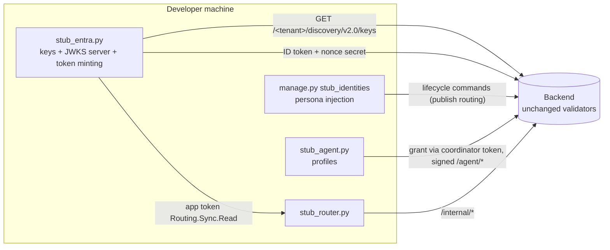

# Design: Local identity stubs for routing tests (stub Entra, stub users, stub agents)

- Tier: **T2** (authentication configuration, system checks, a new user-lifecycle caller, dev tooling that
  creates users) · Status: **Draft, not approved** · Date: 2026-11-17
- Required reviews: Security (owner of AUTH rules and system checks), QA, Independent review; human owner
  approval before merge.
- Related: `docs/agent-platform/routing-sync.md` section 15 (stubs and tooling), ADR 004.

## Problem and acceptance criteria

Routing needs two identity populations to test against: **users** (keyed by
`entra:<tenant>:<oid>`, routing-sync.md section 5.1) and **agents** (keyed by `agent_uid`). Today a
developer cannot produce an Entra-bound user locally without a real Entra tenant: every Entra path
validates an RS256 token against Microsoft's JWKS, and `EntraIdentity` rows are created only by first login
or the `bind_entra_identity` operator command, which needs a real object ID. There is a stub agent and a
stub router, but no stub identity provider and no way to inject users.

Acceptance criteria:

| ID | Criterion |
|---|---|
| AC-1 | One command starts a local token issuer; the backend validates its tokens through the **unchanged** production validators (`aad_login`, `EntraAccessTokenAuthentication`, `RoutingSyncAuthentication`). |
| AC-2 | One command injects a declared set of test users (personas) with Entra bindings and Labs roles; running it twice changes nothing. |
| AC-3 | Every user injection, deactivation, unlink, replace and delete goes through the `core.users` lifecycle commands, so routing changes (`users` upserts and tombstones) are published exactly as in production. No direct `EntraIdentity` writes. |
| AC-4 | A persona's `user_key` is deterministic: the same persona gets the same key after a database reset. |
| AC-5 | A stub user can log in end to end (`POST /api/aad-login`) and call the API; a stub coordinator can create an agent enrollment grant, and the stub agent can enroll with it and send signed requests. |
| AC-6 | The stub router can authenticate with a stub **application** token (Method A) and see the injected users and agents. |
| AC-7 | Negative tokens (expired, wrong audience, wrong tenant, missing role, delegated token on the sync API, unknown `kid`, issuer unreachable) can be produced on demand. |
| AC-8 | None of this can be turned on in production: system checks fail closed, and the inject command refuses to run outside local settings or against non-stub users. |
| AC-9 | Pytest gets the same capability as a fixture, replacing ad-hoc RSA keys and `_jwks_client` patches. |

Non-goals: emulating the Entra login UI or OAuth authorization-code flow; changing any validator, endpoint
or payload; routing non-Entra users; a Router implementation.

## Current state (from repository evidence)

| Fact | Evidence |
|---|---|
| ID-token login validates RS256 via `PyJWKClient(settings.AAD_JWKS_URL)`, `aud=AAD_AUDIENCE`, `iss=AAD_ISSUER`, requires `tid`, `oid`, `sub`, `nonce`, checks `tid == AAD_TENANT_ID` | `core/users/features/auth/aad_login/service.py:39-69` |
| `AAD_ISSUER` is derived as `https://login.microsoftonline.com/{AAD_TENANT_ID}/v2.0`; tenant, audience and JWKS URL are env-configurable | `config/settings/base.py:101-107` |
| First login binds an unbound `oid` to an existing user whose username matches `preferred_username` (allowed domains only, no guests, never re-binds); never creates users | `config/settings/base.py:116-128`, `aad_login/service.py:106-155` |
| Login issues a Lab Mango JWT carrying `auth_source=entra`, `entra_tid`, `entra_oid`; `EntraJWTAuthentication` re-checks the binding on each request | `aad_login/service.py:185-190`, `core/users/features/auth/authentication.py:12-28` |
| Delegated access tokens (audit tool) use the same JWKS URL, need `scp` with `ENTRA_API_AUDIT_SCOPE` | `core/users/features/auth/access_token.py:73-104` |
| Routing sync Method A: JWKS from `ROUTING_SYNC_JWKS_URL` (defaults to `AAD_JWKS_URL`), `aud=ROUTING_SYNC_AUDIENCE`, issuer per `ROUTING_SYNC_ENTRA_TENANT_IDS`, rejects `scp`, needs role `Routing.Sync.Read`; Method B static token hashes also exist | `core/routing/api/authentication.py:63-140`, `config/settings/base.py:138-143` |
| `EntraIdentity(tenant_id, object_id)` unique as `users_entra_unique_subject`; `user` is one-to-one, `PROTECT` | `core/users/models/entra_identity.py:7-18` |
| Lifecycle commands publish routing changes and are gated by a caller allowlist (`aad-login`, `bind-entra-identity-command`, `urs-sync`) | `core/users/features/lifecycle/application.py:178-195` |
| Labs roles come from `URSGroup.labs_role` (`admin`, `coord`, `user`) linked to a Django `Group` | `core/users/access.py:1-75` |
| System check `users.E013` requires `AAD_JWKS_URL` to start with `https://login.microsoftonline.com/` whenever `ENTRA_API_ACCESS_TOKENS_ENABLED` (default `True`), **including local** | `core/users/checks.py:46-63` |
| `PyJWKClient` rejects `file://` URLs (PyJWT installed here): `Invalid JWKS URI scheme 'file'` | verified in this session with the project's PyJWT |
| Stub agent supports one key file (`~/.labmango-stub-agent.json`) and needs a grant created out of band | `tools/stub_agent.py:1-17,66-72` |
| Tests generate RSA keys and patch `_jwks_client` per module | `core/users/tests/features/auth/test_aad_login.py:39,63`, `test_entra_access_token.py:21-26` |

Drift found:
- `docs/agent-platform/routing-sync.md:610` lists `tools/stub_producer.py`; the file does not exist (`tools/`
  holds only `stub_agent.py` and `stub_router.py`). This design absorbs its user half (section "Lifecycle
  scenarios"); the agent half stays with `stub_agent.py`.

## Proposed behavior and invariants

Three cooperating stubs, all development and test only.



### 1. Stub Entra issuer — `tools/stub_entra.py`

Standalone script (stdlib + `PyJWT[crypto]` + `cryptography`, both already dependencies; no new dependency).
State lives outside the repository in `~/.labmango-stub/entra/` (private key, JWKS, issued `kid`s).

| Command | Does |
|---|---|
| `init [--tenant UUID]` | Generates an RSA-2048 key (`kid` = SHA-256 thumbprint prefix) and prints the `.env` block below. Default tenant is the reserved stub tenant `5705ab00-0000-4000-8000-000000000001` |
| `serve [--port 8765]` | HTTP server on **127.0.0.1 only** serving `GET /<tenant>/discovery/v2.0/keys`. Stopping it simulates "Entra unreachable" |
| `rotate [--keep-old]` | New signing key; with `--keep-old` both are published (rotation overlap), without it old tokens fail with unknown `kid` |
| `id-token --persona alice` | Prints `{"id_token", "nonce_secret"}` for `POST /api/aad-login`. `nonce` = base64url(SHA-256(secret)), matching `nonce_for_secret` |
| `login --persona alice --base-url URL` | Does the exchange and stores the Lab Mango `access`/`refresh` under `~/.labmango-stub/sessions/alice.json` |
| `call --persona alice GET /api/...` | Sends a request with the stored access token (refreshes once on `401`) |
| `access-token --persona alice [--scope LabMango.Audit]` | Delegated access token (`scp`) for `EntraAccessTokenAuthentication` views |
| `app-token [--role Routing.Sync.Read] [--aud api://labmango-dept_a]` | Application-only token (`idtyp=app`, `roles`, no `scp`) for `stub_router.py --token` |
| fault flags on every mint | `--expired`, `--not-yet-valid`, `--aud X`, `--tenant X`, `--no-role`, `--with-scp`, `--unknown-kid`, `--alg HS256`, `--stale-iat` (older than `ENTRA_LOGIN_MAX_TOKEN_AGE`), `--guest` (`#EXT#` UPN, `acct=1`) |

Claims mirror Entra v2.0: `iss=https://login.microsoftonline.com/<tenant>/v2.0`, `tid`, `oid`, `sub`
(pairwise, derived from `oid` and audience), `preferred_username`, `name`, `iat`, `nbf`, `exp` (1 h),
`ver=2.0`. Persona `oid`s come from the same manifest as the inject command (below), so the token's `oid`
always matches the injected binding.

Local `.env` block printed by `init`:

```dotenv
AAD_TENANT_ID=5705ab00-0000-4000-8000-000000000001
AAD_AUDIENCE=labmango-local
AAD_JWKS_URL=http://127.0.0.1:8765/5705ab00-0000-4000-8000-000000000001/discovery/v2.0/keys
ENTRA_STUB_ISSUER_ENABLED=True
ENTRA_BIND_ALLOWED_DOMAINS=stub.labmango.test
ROUTING_SYNC_AUDIENCE=api://labmango-dept_a
```

No validator changes. The issuer string still names `login.microsoftonline.com`, which is what
`AAD_ISSUER` and the routing issuer set expect; only the key source differs, and that is the trust anchor.

### 2. Persona manifest and injection — `manage.py stub_identities`

Personas are declared in `tools/stub_identities.json` (committed; contains no secrets). Each persona:

```json
{
  "namespace": "8f0c4f6e-6c1e-4b8e-9f43-labmango0001",
  "personas": [
    {"key": "alice", "backend": "dept_a", "labs_role": "user",  "bound": true,  "active": true},
    {"key": "carol", "backend": "dept_a", "labs_role": "coord", "bound": true,  "active": true},
    {"key": "adam",  "backend": "dept_a", "labs_role": "admin", "bound": true,  "active": true},
    {"key": "dave",  "backend": "dept_a", "labs_role": "user",  "bound": false, "active": true},
    {"key": "ivy",   "backend": "dept_a", "labs_role": "user",  "bound": true,  "active": false},
    {"key": "bob",   "backend": "dept_b", "labs_role": "user",  "bound": true,  "active": true}
  ]
}
```

(The namespace value above is illustrative; the real file holds a valid UUID.)

Derived, never stored by hand:
- username `stub.<key>`; UPN `stub.<key>@stub.labmango.test` (`.test` is a reserved TLD);
- `oid = uuid5(namespace, "<tenant>:<key>:<generation>")`, generation starts at 0 (AC-4);
- `user_key = entra:<tenant>:<oid>`, printed by `stub_identities list` for routing assertions.

Persona roles cover the routing and authorization matrix: `dave` exercises first-login
bind-by-username; `ivy` must be absent from the `users` stream; `bob` belongs to another backend, so a
two-backend local setup (`BACKEND_ID=dept_a` and `dept_b` sharing one stub tenant) gives the stub router
disjoint claims to merge.

Subcommands (all in `core/users/management/commands/stub_identities.py`, inside the owning feature):

| Subcommand | Effect, via |
|---|---|
| `seed [--persona K]` | For personas whose `backend == BACKEND_ID`: create the user if missing (unusable password, `account_type=CUSTOMER`), put it in the stub Django group mapped to its `labs_role`, then `bind_entra_identity` if `bound` and `set_user_active` to match `active` |
| `deactivate K` / `activate K` | `set_user_active` → tombstone / upsert |
| `unlink K` | `unlink_entra_identity` → tombstone |
| `replace K` | generation + 1, `replace_entra_identity` → tombstone old key, upsert new |
| `delete K` | `delete_user` → tombstone |
| `reset` | `delete` every `stub.*` user, then `seed` |
| `list` | persona, username, active, bound, `user_key` |

Lifecycle commands are called through `core.users.public` with a new caller label
`stub-identities-command` holding the same capabilities as `bind-entra-identity-command` plus
`users.lifecycle.activity.write`. This is an access-control change to the allowlist at
`core/users/features/lifecycle/application.py:180` and is why the tier is T2.

Stub groups: `seed` ensures three `URSGroup` rows (`stub-admin`, `stub-coord`, `stub-user`) each linked to a
Django group with the matching `labs_role`. Creating `URSGroup` rows directly is inside `core.users`; whether
URS sync would later delete or overwrite rows it did not import is **not verified** and must be checked
before implementation (open question Q3).

### 3. Stub agent profiles — `tools/stub_agent.py` (extension)

- `--profile NAME` selects `~/.labmango-stub/agents/<NAME>.json`; the current `--key-file` keeps working
  (rule 1: existing invocations unchanged).
- `provision --as carol --equipment-uid UID --profile lab1-pc` does what is manual today: uses carol's
  stored session from `stub_entra.py login` to call `POST /api/agents`, then enrolls with the returned
  grant. One command gives a routable `agent_uid` (AC-5).
- `activity --remote-user` accepts `@alice` and expands it to `stub.alice` so activity rows reference
  injected users.

### 4. Pytest fixture — `tests/stubs/entra.py`

The key, JWKS and minting code lives in one importable module (`tools/stub_entra.py` exposes
`StubIssuer`); `tests/stubs/entra.py` provides:
- `stub_entra` fixture: a `StubIssuer` with an in-memory key, patching the three JWKS clients
  (`aad_login.service._jwks_client`, `access_token._jwks_client`, `routing.api.authentication._get_jwks_client`)
  to return its keys, and settings overrides for tenant and audiences;
- `stub_entra.persona("alice")` → seeded user via the same lifecycle path as the command;
- `stub_entra.id_token(...)`, `.access_token(...)`, `.app_token(...)` with the same fault flags.

Whether `tools` is importable from tests under the current pytest configuration
(`pyproject.toml:91`, `testpaths = ["core", "tests"]`) is **not verified**; fallback is moving `StubIssuer`
to `tests/stubs/issuer.py` and having the script import it.

## Module ownership and allowed dependencies

| Piece | Owner | May import |
|---|---|---|
| `tools/stub_entra.py`, `tools/stub_agent.py` | dev tooling (not deployed) | stdlib, PyJWT, cryptography; **no Django**, talks to the backend over HTTP only |
| `stub_identities` command | `core.users` | `core.users` internals and `core.users.public` only; nothing from `core.routing` (publication happens inside the lifecycle commands) |
| `tests/stubs/entra.py` | QA | `core.users.public`, the three patched module paths (test-only patching) |

No new cross-feature edge.

## API contract

No endpoint, payload, error or OpenAPI change. The stubs consume existing endpoints only:
`POST /api/aad-login`, token refresh, `POST /api/agents`, `/agent/*`, `/internal/*`.

## Data model, constraints, concurrency

No schema change, no migration.

| Write path | Race | Guard | Idempotency | Concurrency test |
|---|---|---|---|---|
| `seed` create user | two `seed` runs at once | unique `username` (existing `AbstractUser` constraint); `get_or_create` retried once on `IntegrityError` | natural target state: exists with same fields → no write | two threads `seed` the same persona; one user, one binding, one routing upsert |
| `seed` bind | concurrent seed / first login of same persona | `users_entra_unique_subject` + `select_for_update` in the lifecycle command | `bind_entra_identity` returns `changed=False` when already bound | covered by existing lifecycle tests; add one seed-vs-login race |
| `replace` / `unlink` / `delete` / `(de)activate` | concurrent lifecycle calls | lifecycle commands' row locks | target state; second call is `changed=False`, no extra routing version | re-run each subcommand; assert routing head unchanged on the second run |
| stub groups | concurrent seed | unique group name | `get_or_create` | included in the seed race test |

## Authorization and threat notes

The main risk is a token minted on a laptop being accepted by a real deployment. Controls, all fail-closed:

1. **Trust anchor is the JWKS URL.** Production keeps `users.E003`, which pins
   `AAD_JWKS_URL` to Microsoft for the configured tenant (`core/users/checks.py:21`).
2. **New setting `ENTRA_STUB_ISSUER_ENABLED`** (default `False`; `production.py` sets it `False`
   unconditionally, same pattern as `ENTRA_SSO_ONLY` at `production.py:10`).
3. **`users.E013` relaxed only under the flag:** when `ENTRA_STUB_ISSUER_ENABLED` is on, `AAD_JWKS_URL` may be
   `http://127.0.0.1:<port>/` or `http://localhost:<port>/`; any other host still errors.
4. **New check `users.E014`:** error if the flag is on and any of: `ENTRA_SSO_ONLY`, `not DEBUG`,
   `AAD_TENANT_ID` differs from the reserved stub tenant.
5. **New check `users.E015`:** error if `ENTRA_SSO_ONLY` (production) and `AAD_TENANT_ID` equals the stub tenant,
   or `ROUTING_SYNC_ENTRA_TENANT_IDS` contains it.
6. **Inject command refuses** unless checks 2 and 4 pass, and it reads, changes or deletes **only** users whose
   username starts with `stub.` and whose binding (if any) is in the stub tenant. It never touches real users
   in a copied database (rule 9).
7. Private keys and session files live in `~/.labmango-stub/` with mode `0600`; `.gitignore` gets
   `.labmango-stub/` in case someone points it inside the repo. Tokens are never logged.
8. The JWKS server binds to `127.0.0.1` only.

Security review must confirm: the caller label scope (point 6 enforces scope in the command, not in the
allowlist), and that relaxing E013 under a flag is acceptable versus option B in Alternatives.

## Async/integration behavior

None new. Routing publication is synchronous inside the lifecycle transaction (existing behavior).

## Migration, rollout, rollback

No migration. Rollout is a single merge of tooling plus settings and checks; production behavior is
unchanged because the flag is forced off. Rollback is a revert; developer state in `~/.labmango-stub/` is
disposable.

Suggested implementation slices (one writer each):
1. Settings flag + checks E013/E014/E015 + tests (Security-reviewed).
2. `tools/stub_entra.py` + `StubIssuer` + pytest fixture.
3. `stub_identities` command + caller label + persona manifest.
4. `stub_agent.py` profiles and `provision`.
5. Docs: update routing-sync.md section 15 (replace the `stub_producer.py` line) and add a local how-to.

## Observability

The command prints one line per persona with `changed` / `unchanged` and the `user_key`. The lifecycle
commands already write audit events; stub actions are attributed to caller `stub-identities-command`.

## Test plan (criterion → test)

| AC | Test | Would fail if |
|---|---|---|
| AC-1 | fixture-minted ID token logs in through `aad_login`; app token passes `RoutingSyncAuthentication`; delegated token passes `EntraAccessTokenAuthentication` | claim shape diverges from a validator |
| AC-2 | `call_command("stub_identities", "seed")` twice; second run writes nothing (query count of writes = 0) | seed is not idempotent |
| AC-3 | after `seed`, `RoutingChange` has one `users` upsert per bound active persona; after `unlink alice` a `delete` for her old key; patching the lifecycle command to raise leaves no user/binding | the command bypasses the lifecycle path |
| AC-4 | `reset` then `list` returns the same keys as before | oid derivation is not deterministic |
| AC-5 | integration (local, not CI): `stub_entra login carol` → `stub_agent provision` → `heartbeat` 200 | end-to-end chain breaks |
| AC-6 | `stub_router.py` snapshot with app token contains alice, carol, adam, not ivy or dave | eligibility or auth wrong |
| AC-7 | one parametrized test per fault flag asserting the documented status (`401`/`403`/`503`) | a fault flag is wrong or a validator regresses |
| AC-8 | check tests: E014 with `DEBUG=False`; E015 with production settings and stub tenant; E013 still errors for a non-loopback http URL under the flag; command refuses on a `stub.`-less user and with the flag off | a guard is missing |
| AC-9 | migrate `test_aad_login.py` and `test_entra_access_token.py` to the fixture (separate T0 follow-up) | — |

## Alternatives considered

| Option | Why not chosen |
|---|---|
| A real Entra test tenant with test users | Needs tenant admin, per-developer app registrations and network access; cannot mint negative tokens; slow. Keep it for staging |
| B. Keep E013 strict and set `ENTRA_API_ACCESS_TOKENS_ENABLED=False` locally | Works for login and routing, but delegated access-token views cannot be exercised locally. Acceptable fallback if Security rejects the E013 relaxation |
| A `DEBUG`-only "login as user" endpoint | Bypasses the real validators, so it tests nothing about Entra; adds an API surface that could leak to production |
| `file://` JWKS | Rejected by `PyJWKClient` (verified) |
| Writing `EntraIdentity` rows directly / Django fixtures | Skips routing publication and audit (violates AC-3, PUB-9) |
| `mock-oauth2-server` or a similar container | New dependency (rule 7); still needs the same settings relaxation |

## Open questions / decisions needed from the owner

- **Q1** Approve the new lifecycle caller label `stub-identities-command` (access-control allowlist change).
- **Q2** Approve relaxing `users.E013` under `ENTRA_STUB_ISSUER_ENABLED`, or choose fallback B.
- **Q3** Can stub `URSGroup` rows coexist with URS sync, or must stub roles use a separate mechanism? (not verified)
- **Q4** Confirm the reserved stub tenant UUID and that no real tenant can collide with it.
- **Q5** Should CI run the AC-5/AC-6 end-to-end flow (needs the JWKS server and two backends), or local only?
