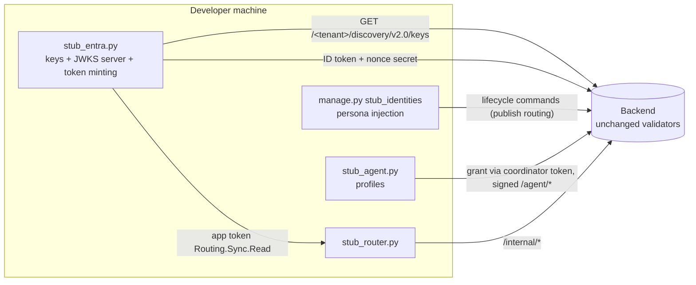

# Design: Local identity stubs for routing tests (stub Entra, stub users, stub agents)

- Tier: **T2** (authentication configuration, system checks, a new user-lifecycle caller, dev tooling that
  creates users and lab data) · Status: **Implemented on branch `claude/routing-subs-agent-user-tests-i72c6q`;
  awaiting Security / QA / independent review and owner approval before merge** · Date: 2026-11-17
- Required reviews: Security (owner of AUTH rules and system checks), QA, Independent review; human owner
  approval before merge.
- Related: `docs/agent-platform/routing-sync.md` section 15 (stubs and tooling), ADR 004.

## Problem and acceptance criteria

Routing needs two identity populations to test against: **users** (keyed by
`entra:<tenant>:<oid>`, routing-sync.md section 5.1) and **agents** (keyed by `agent_uid`). Today a
developer cannot produce an Entra-bound user locally without a real Entra tenant: every Entra path
validates an RS256 token against Microsoft's JWKS, and `EntraIdentity` rows are created only by first login
or the `bind_entra_identity` operator command, which needs a real object ID. There is a stub agent and a
stub router, but no stub identity provider and no way to inject users.

Acceptance criteria:

| ID | Criterion |
|---|---|
| AC-1 | One command starts a local token issuer; the backend validates its tokens through the **unchanged** production validators (`aad_login`, `EntraAccessTokenAuthentication`, `RoutingSyncAuthentication`). |
| AC-2 | One command injects a declared set of test users (personas) with Entra bindings and Labs roles; running it twice changes nothing. |
| AC-3 | Every user injection, deactivation, unlink, replace and delete goes through the `core.users` lifecycle commands, so routing changes (`users` upserts and tombstones) are published exactly as in production. No direct `EntraIdentity` writes. |
| AC-4 | A persona's `user_key` is deterministic: the same persona gets the same key after a database reset. |
| AC-5 | A stub user can log in end to end (`POST /api/aad-login`) and call the API; a stub coordinator can create an agent enrollment grant, and the stub agent can enroll with it and send signed requests. |
| AC-6 | The stub router can authenticate with a stub **application** token (Method A) and see the injected users and agents. |
| AC-7 | Negative tokens (expired, wrong audience, wrong tenant, missing role, delegated token on the sync API, unknown `kid`, issuer unreachable) can be produced on demand. |
| AC-8 | None of this can be turned on in production: system checks fail closed, and the inject command refuses to run outside local settings or against non-stub users. |
| AC-9 | Pytest gets the same capability as a fixture, replacing ad-hoc RSA keys and `_jwks_client` patches. |
| AC-10 | The stub agent covers **every** agent-facing and operator endpoint in `core/agents/api/urls.py`: info, enrollment, heartbeat, activity, session logs, booking validate / check-in / extend / complete, and operator list, detail, grants, grant revoke, revoke, decommission. |
| AC-11 | One command seeds a local lab topology (bench, computing equipment assigned to it, project) and one command creates an approved bench booking for a stub user, printing its booking code for the agent. |
| AC-12 | Named scenarios run the full chain (user books → agent validates, checks in, extends, completes → routing sees the agent) and the main failure cases, reporting pass/fail per step. |

Non-goals: emulating the Entra login UI or OAuth authorization-code flow; changing any validator, endpoint
or payload; routing non-Entra users; a Router implementation; **giving the agent booking powers it does not
have.** ADR 004 ("Agent booking capability boundary") forbids an agent to create, approve, cancel or reassign
bookings. The stubs therefore create the booking **as a stub user** through the user API, and only then
drive the agent's validate / check-in / extend / complete actions on it.

## Current state (from repository evidence)

| Fact | Evidence |
|---|---|
| ID-token login validates RS256 via `PyJWKClient(settings.AAD_JWKS_URL)`, `aud=AAD_AUDIENCE`, `iss=AAD_ISSUER`, requires `tid`, `oid`, `sub`, `nonce`, checks `tid == AAD_TENANT_ID` | `core/users/features/auth/aad_login/service.py:39-69` |
| `AAD_ISSUER` is derived as `https://login.microsoftonline.com/{AAD_TENANT_ID}/v2.0`; tenant, audience and JWKS URL are env-configurable | `config/settings/base.py:101-107` |
| First login binds an unbound `oid` to an existing user whose username matches `preferred_username` (allowed domains only, no guests, never re-binds); never creates users | `config/settings/base.py:116-128`, `aad_login/service.py:106-155` |
| Login issues a Lab Mango JWT carrying `auth_source=entra`, `entra_tid`, `entra_oid`; `EntraJWTAuthentication` re-checks the binding on each request | `aad_login/service.py:185-190`, `core/users/features/auth/authentication.py:12-28` |
| Delegated access tokens (audit tool) use the same JWKS URL, need `scp` with `ENTRA_API_AUDIT_SCOPE` | `core/users/features/auth/access_token.py:73-104` |
| Routing sync Method A: JWKS from `ROUTING_SYNC_JWKS_URL` (defaults to `AAD_JWKS_URL`), `aud=ROUTING_SYNC_AUDIENCE`, issuer per `ROUTING_SYNC_ENTRA_TENANT_IDS`, rejects `scp`, needs role `Routing.Sync.Read`; Method B static token hashes also exist | `core/routing/api/authentication.py:63-140`, `config/settings/base.py:138-143` |
| `EntraIdentity(tenant_id, object_id)` unique as `users_entra_unique_subject`; `user` is one-to-one, `PROTECT` | `core/users/models/entra_identity.py:7-18` |
| Lifecycle commands publish routing changes and are gated by a caller allowlist (`aad-login`, `bind-entra-identity-command`, `urs-sync`) | `core/users/features/lifecycle/application.py:178-195` |
| Labs roles come from `URSGroup.labs_role` (`admin`, `coord`, `user`) linked to a Django `Group` | `core/users/access.py:1-75` |
| System check `users.E013` requires `AAD_JWKS_URL` to start with `https://login.microsoftonline.com/` whenever `ENTRA_API_ACCESS_TOKENS_ENABLED` (default `True`), **including local** | `core/users/checks.py:46-63` |
| `PyJWKClient` rejects `file://` URLs (PyJWT installed here): `Invalid JWKS URI scheme 'file'` | verified in this session with the project's PyJWT |
| Stub agent supports one key file (`~/.labmango-stub-agent.json`) and needs a grant created out of band | `tools/stub_agent.py:1-17,66-72` |
| Tests generate RSA keys and patch `_jwks_client` per module | `core/users/tests/features/auth/test_aad_login.py:39,63`, `test_entra_access_token.py:21-26` |

Drift found:
- `docs/agent-platform/routing-sync.md:610` lists `tools/stub_producer.py`; the file does not exist (`tools/`
  holds only `stub_agent.py` and `stub_router.py`). This design absorbs its user half (section "Lifecycle
  scenarios"); the agent half stays with `stub_agent.py`.

## Proposed behavior and invariants

Three cooperating stubs, all development and test only.



### 1. Stub Entra issuer — `tools/stub_entra.py`

Standalone script (stdlib + `PyJWT[crypto]` + `cryptography`, both already dependencies; no new dependency).
State lives outside the repository in `~/.labmango-stub/entra/` (private key, JWKS, issued `kid`s).

| Command | Does |
|---|---|
| `init [--tenant UUID]` | Generates an RSA-2048 key (`kid` = SHA-256 thumbprint prefix) and prints the `.env` block below. Default tenant is the reserved stub tenant `00000000-0000-0000-0000-0000000057ab` |
| `serve [--port 8765]` | HTTP server on **127.0.0.1 only** serving `GET /<tenant>/discovery/v2.0/keys`. Stopping it simulates "Entra unreachable" |
| `rotate [--keep-old]` | New signing key; with `--keep-old` both are published (rotation overlap), without it old tokens fail with unknown `kid` |
| `id-token --persona alice` | Prints `{"id_token", "nonce_secret"}` for `POST /api/aad-login`. `nonce` = base64url(SHA-256(secret)), matching `nonce_for_secret` |
| `login --persona alice --base-url URL` | Does the exchange and stores the Lab Mango `access`/`refresh` under `~/.labmango-stub/sessions/alice.json` |
| `call --persona alice GET /api/...` | Sends a request with the stored access token (refreshes once on `401`) |
| `access-token --persona alice [--scope LabMango.Audit]` | Delegated access token (`scp`) for `EntraAccessTokenAuthentication` views |
| `app-token [--role Routing.Sync.Read] [--aud api://labmango-dept_a]` | Application-only token (`idtyp=app`, `roles`, no `scp`) for `stub_router.py --token` |
| fault flags on every mint | `--expired`, `--not-yet-valid`, `--aud X`, `--tenant X`, `--no-role`, `--with-scp`, `--unknown-kid`, `--alg HS256`, `--stale-iat` (older than `ENTRA_LOGIN_MAX_TOKEN_AGE`), `--guest` (`#EXT#` UPN, `acct=1`) |

Claims mirror Entra v2.0: `iss=https://login.microsoftonline.com/<tenant>/v2.0`, `tid`, `oid`, `sub`
(pairwise, derived from `oid` and audience), `preferred_username`, `name`, `iat`, `nbf`, `exp` (1 h),
`ver=2.0`. Persona `oid`s come from the same manifest as the inject command (below), so the token's `oid`
always matches the injected binding.

Local `.env` block printed by `init`:

```dotenv
AAD_TENANT_ID=00000000-0000-0000-0000-0000000057ab
AAD_AUDIENCE=labmango-local
AAD_JWKS_URL=http://127.0.0.1:8765/00000000-0000-0000-0000-0000000057ab/discovery/v2.0/keys
ENTRA_STUB_ISSUER_ENABLED=True
ENTRA_BIND_ALLOWED_DOMAINS=stub.labmango.test
ROUTING_SYNC_AUDIENCE=api://labmango-dept_a
```

No validator changes. The issuer string still names `login.microsoftonline.com`, which is what
`AAD_ISSUER` and the routing issuer set expect; only the key source differs, and that is the trust anchor.

### 2. Persona manifest and injection — `manage.py stub_identities`

Personas are declared in `tools/stub_identities.json` (committed; contains no secrets). Each persona:

```json
{
  "namespace": "8f0c4f6e-6c1e-4b8e-9f43-labmango0001",
  "personas": [
    {"key": "alice", "backend": "dept_a", "labs_role": "user",  "bound": true,  "active": true},
    {"key": "carol", "backend": "dept_a", "labs_role": "coord", "bound": true,  "active": true},
    {"key": "adam",  "backend": "dept_a", "labs_role": "admin", "bound": true,  "active": true},
    {"key": "dave",  "backend": "dept_a", "labs_role": "user",  "bound": false, "active": true},
    {"key": "ivy",   "backend": "dept_a", "labs_role": "user",  "bound": true,  "active": false},
    {"key": "bob",   "backend": "dept_b", "labs_role": "user",  "bound": true,  "active": true}
  ]
}
```

(The namespace value above is illustrative; the real file holds a valid UUID.)

Derived, never stored by hand:
- username `stub.<key>`; UPN `stub.<key>@stub.labmango.test` (`.test` is a reserved TLD);
- `oid = uuid5(namespace, "<tenant>:<key>:<generation>")`, generation starts at 0 (AC-4);
- `user_key = entra:<tenant>:<oid>`, printed by `stub_identities list` for routing assertions.

Persona roles cover the routing and authorization matrix: `dave` exercises first-login
bind-by-username; `ivy` must be absent from the `users` stream; `bob` belongs to another backend, so a
two-backend local setup (`BACKEND_ID=dept_a` and `dept_b` sharing one stub tenant) gives the stub router
disjoint claims to merge.

Subcommands (all in `core/users/management/commands/stub_identities.py`, inside the owning feature):

| Subcommand | Effect, via |
|---|---|
| `seed [--persona K]` | For personas whose `backend == BACKEND_ID`: create the user if missing (unusable password, `account_type=CUSTOMER`, `is_urs_managed=False`), put it in the stub Django group mapped to its `labs_role`, then `bind_entra_identity` if `bound` and `set_user_active` to match `active` |
| `deactivate K` / `activate K` | `set_user_active` → tombstone / upsert |
| `unlink K` | `unlink_entra_identity` → tombstone |
| `replace K` | generation + 1, `replace_entra_identity` → tombstone old key, upsert new |
| `delete K` | `delete_user` → tombstone |
| `reset` | `delete` every `stub.*` user, then `seed` |
| `list` | persona, username, active, bound, `user_key` |

Lifecycle commands are called through `core.users.public` with a new caller label
`stub-identities-command` holding the same capabilities as `bind-entra-identity-command` plus
`users.lifecycle.activity.write`. This is an access-control change to the allowlist at
`core/users/features/lifecycle/application.py:180` and is why the tier is T2.

Stub groups (decision D3): `seed` ensures three `URSGroup` rows (`stub-admin`, `stub-coord`, `stub-user`),
each linked to a Django group with the matching `labs_role`, with **`active=False`** and `urs_group_id` taken
from a reserved range (`9_000_000_000_001`–`9_000_000_000_003`). Stub users are created with
**`is_urs_managed=False`**. Verified effect:
- the scheduled URS sync fetches only `URSGroup.objects.filter(active=True)` (`core/users/tasks.py:9`), so it
  never fetches, fails on, or rewrites the stub groups;
- URS activity reconciliation only touches `is_urs_managed=True` users
  (`core/users/features/urs_sync/sync_group/service.py:303-311`), so it never deactivates stub users;
- role resolution reads `labs_role` through group membership without filtering on `active`
  (`core/users/access.py`, `effective_labs_roles`), so the roles still apply.
Running `seed` again recreates anything that was removed.

### 3. Stub agent — `tools/stub_agent.py` (full device and operator coverage)

The existing commands (`enroll`, `heartbeat`, `activity`, `send`, `headers`) and `--key-file` keep working
unchanged (rule 1). Additions:

**Profiles.** `--profile NAME` selects `~/.labmango-stub/agents/<NAME>.json` (mode `0600`). A profile stores
`base_url`, `backend_id`, `agent_uid`, `equipment_uid`, private key, and the last session-log `event_key` (for
replay tests). `profiles` lists them.

**Device API: one subcommand per endpoint** (all signed except `info` and `enroll`):

| Subcommand | Endpoint | Notes |
|---|---|---|
| `info` | `GET /agent/info` | prints `backend_key`, capabilities, endpoint map |
| `enroll` | `POST /agent/enrollments` | existing; also stores `equipment_uid` |
| `heartbeat [--every 60] [--count N]` | `POST /agent/heartbeat` | loop mode keeps the agent "online" for health tests |
| `activity --status ... [--remote-user @alice] [--booking-code BK]` | `PATCH /agent/equipment/activity` | `@alice` expands to `stub.alice` |
| `session-log --remote-user @alice --minutes 45 [--booking-code BK] [--event-key UUID \| --repeat-last]` | `POST /agent/session-logs` | generates `event_key`, `login_at`/`logout_at`, `active_duration_seconds`; `--repeat-last` resends the same `event_key` to test idempotency |
| `booking validate --code BK` | `POST /agent/bookings/actions/validate` | |
| `booking check-in --code BK` | `POST /agent/bookings/actions/check-in` | |
| `booking extend --code BK (--to ISO \| --by 30m)` | `POST /agent/bookings/actions/extend` | `--by` reads the current `ends_at` from `validate` first |
| `booking complete --code BK` | `POST /agent/bookings/actions/complete` | |
| `session --as @alice --code BK --minutes 45 [--extend-by 30m]` | composite | validate → check-in → `activity active` → heartbeats → optional extend → `session-log` → complete → `activity free`; the typical workstation login, end to end |

**Signing fault flags** (on every signed subcommand): `--skew SECONDS` (outside
`AGENT_REQUEST_MAX_SKEW_S`), `--replay` (reuse the previous nonce), `--tamper-body` (sign one body, send
another), `--wrong-key` (sign with a fresh key), `--path-mismatch`. Each must be rejected with `401`.

**Operator API** (uses a stub user's Lab Mango session from `stub_entra.py login`; `--as carol` by default,
because these views require `IsLabCoordinator`):

| Subcommand | Endpoint |
|---|---|
| `agents list [--equipment-uid U] [--state S]` | `GET /api/agents` |
| `agents show ID` | `GET /api/agents/{id}` |
| `grant create (--equipment-uid U \| --agent ID) [--ttl 15]` | `POST /api/agents` or `POST /api/agents/{id}/enrollment-grants` |
| `grant list --agent ID` / `grant revoke --agent ID --grant GID` | `GET .../enrollment-grants`, `POST .../actions/revoke` |
| `revoke --agent ID` / `decommission --agent ID` | `POST /api/agents/{id}/actions/revoke` / `decommission` |
| `provision --as carol --equipment stub-pc-1 --profile lab1-pc` | grant create + enroll in one step; `--equipment` resolves a stub lab key to its UID |

Running `--as alice` (role `user`) on any operator subcommand must give `403`; this is an authorization test
for free.

**Shared code.** HTTP, state-directory and persona-session helpers move to `tools/stub_common.py`, used by
`stub_agent.py`, `stub_entra.py` and `stub_scenario.py`. Standard library only.

### 4. Stub lab topology — `manage.py stub_lab`

An agent booking action needs a bench, a computing equipment assigned to that bench, a project and an
approved booking; creating these by hand through the reference-data API is slow and brittle. A command in
`core.labs` (owner of those models) seeds them from `tools/stub_lab.json`:

```json
{
  "benches":   [{"key": "bench-1", "name": "STUB Bench 1"}, {"key": "bench-2", "name": "STUB Bench 2"}],
  "computing": [{"key": "pc-1", "bench": "bench-1"}, {"key": "pc-2", "bench": "bench-2"}, {"key": "pc-loose"}],
  "projects":  [{"key": "proj-1", "name": "STUB Project", "members": ["@alice", "@carol"]}]
}
```

| Subcommand | Effect |
|---|---|
| `seed` | Creates missing rows (names prefixed `STUB `, natural key = stub key stored in an existing name/code field) through the `core.labs` feature application commands, including the reference data they require. `pc-loose` has no bench, for the "not assigned" case |
| `list` | stub key → id / UID (benches, equipment UIDs for `provision`, project ids) |
| `reset` | Deletes `STUB `-prefixed bookings, assignments, equipment, benches, projects in dependency order |

Same guards as `stub_identities`: refuses unless `ENTRA_STUB_ISSUER_ENABLED` and DEBUG, and touches only
`STUB `-prefixed rows. Project members are resolved through `core.users.public`
(`resolve_user_id_for_login_name`); no other cross-feature import. Which application command creates each
object, and which field carries the stub key, is **not verified** and is settled in implementation slice 4.

**Bookings are created as a user, never by the command.** `tools/stub_scenario.py book --as @alice --bench
bench-1 --start +2m --minutes 60` calls `POST /api/bench-bookings` with alice's session (`bench_id`,
`starts_at`, `ends_at`, `reason`, `project_id`). If the response is pending approval, it calls
`POST /api/bench-bookings/{id}/actions/approve` as carol. It prints the `booking_code` for the agent. This
exercises the real booking rules and authorization, which a database insert would skip.

### 5. Scenario runner — `tools/stub_scenario.py`

Runs scripted, named scenarios against a running local backend using the three stubs. Each step prints
`PASS`/`FAIL`, the HTTP status and the expected status; the exit code is non-zero on any failure.

| Scenario | Steps (expected) |
|---|---|
| `setup` | `stub_entra init` check → `stub_identities seed` → `stub_lab seed` → `stub_agent provision` for pc-1 and pc-2 (prints the `.env` lines still missing) |
| `booking-happy-path` | alice books bench-1 → agent pc-1 `session --as @alice --extend-by 30m` → each step 200 with `is_eligible`/`is_checked_in`/`is_extended`/`is_completed` true → alice sees the booking completed |
| `booking-wrong-bench` | alice books bench-1 → agent pc-2 validates → `is_eligible=false`; check-in refused |
| `booking-unassigned-agent` | agent on `pc-loose` validates any code → not eligible |
| `booking-early-late` | booking starting in 2 h → validate not eligible; ended booking → not eligible |
| `booking-extend-conflict` | carol books bench-1 right after alice's booking → extending alice's into it is refused |
| `booking-idempotent` | check-in twice, complete twice, same session-log `event_key` twice → no duplicates, second calls succeed without change |
| `agent-lifecycle` | revoke pc-2 → signed calls `401`/`403` → routing `agents` stream shows a `delete` |
| `signing-faults` | each signing fault flag → `401` |
| `operator-authz` | alice on operator endpoints → `403`; carol → 200 |
| `entra-faults` | every `stub_entra` fault flag on `aad-login`, audit token view and `/internal/*` → documented status; stop JWKS server → cold backend `503` on sync |
| `routing-users` | `stub_identities unlink/replace/deactivate/delete` → stub router sees the matching tombstones and upserts; `ivy` and `dave` never appear |
| `all` | all of the above in order, ending with `stub_lab reset` |

### 6. Pytest fixture — `tests/stubs/entra.py`

The key, JWKS and minting code lives in one importable module (`tools/stub_entra.py` exposes
`StubIssuer`); `tests/stubs/entra.py` provides:
- `stub_entra` fixture: a `StubIssuer` with an in-memory key, patching the three JWKS clients
  (`aad_login.service._jwks_client`, `access_token._jwks_client`, `routing.api.authentication._get_jwks_client`)
  to return its keys, and settings overrides for tenant and audiences;
- `stub_entra.persona("alice")` → seeded user via the same lifecycle path as the command;
- `stub_entra.id_token(...)`, `.access_token(...)`, `.app_token(...)` with the same fault flags.

Whether `tools` is importable from tests under the current pytest configuration
(`pyproject.toml:91`, `testpaths = ["core", "tests"]`) is **not verified**; fallback is moving `StubIssuer`
to `tests/stubs/issuer.py` and having the script import it.

## Module ownership and allowed dependencies

| Piece | Owner | May import |
|---|---|---|
| `tools/stub_entra.py`, `tools/stub_agent.py`, `tools/stub_scenario.py`, `tools/stub_common.py` | dev tooling (not deployed) | stdlib, PyJWT, cryptography; **no Django**, talks to the backend over HTTP only (except `stub_scenario.py setup`, which shells out to `manage.py`) |
| `stub_identities` command | `core.users` | `core.users` internals and `core.users.public` only; nothing from `core.routing` (publication happens inside the lifecycle commands) |
| `stub_lab` command | `core.labs` | `core.labs` feature application commands; `core.users.public` for member lookup |
| `tests/stubs/entra.py` | QA | `core.users.public`, the three patched module paths (test-only patching) |

No new cross-feature edge.

## API contract

No endpoint, payload, error or OpenAPI change. The stubs consume existing endpoints only:
`POST /api/aad-login`, token refresh, `/api/agents*`, `/api/bench-bookings*`, `/agent/*`, `/internal/*`.
The agent does not get a booking-create capability (ADR 004).

## Data model, constraints, concurrency

No schema change, no migration.

| Write path | Race | Guard | Idempotency | Concurrency test |
|---|---|---|---|---|
| `seed` create user | two `seed` runs at once | unique `username` (existing `AbstractUser` constraint); `get_or_create` retried once on `IntegrityError` | natural target state: exists with same fields → no write | two threads `seed` the same persona; one user, one binding, one routing upsert |
| `seed` bind | concurrent seed / first login of same persona | `users_entra_unique_subject` + `select_for_update` in the lifecycle command | `bind_entra_identity` returns `changed=False` when already bound | covered by existing lifecycle tests; add one seed-vs-login race |
| `replace` / `unlink` / `delete` / `(de)activate` | concurrent lifecycle calls | lifecycle commands' row locks | target state; second call is `changed=False`, no extra routing version | re-run each subcommand; assert routing head unchanged on the second run |
| stub groups | concurrent seed | unique group name; `users_ursgroup_unique_urs_group_id` on the reserved id | `get_or_create` | included in the seed race test |
| `stub_lab seed` | concurrent seed | existing unique constraints of each labs model on the stub natural key (exact constraint per model **not verified**; if a model has none, one `pg_advisory_xact_lock` on a fixed stub key serializes the whole seed) | target state per stub key | two threads seed; one row per stub key |
| booking create / agent actions | real concurrency | unchanged production guards (booking exclusion constraints, agent nonce uniqueness) | the stubs add none; scenarios assert the production behavior | `booking-idempotent`, `booking-extend-conflict` scenarios |

## Authorization and threat notes

The main risk is a token minted on a laptop being accepted by a real deployment. Controls, all fail-closed:

1. **Trust anchor is the JWKS URL.** Production keeps `users.E003`, which pins
   `AAD_JWKS_URL` to Microsoft for the configured tenant (`core/users/checks.py:21`).
2. **New setting `ENTRA_STUB_ISSUER_ENABLED`** (default `False`; `production.py` sets it `False`
   unconditionally, same pattern as `ENTRA_SSO_ONLY` at `production.py:10`).
3. **`users.E013` relaxed only under the flag:** when `ENTRA_STUB_ISSUER_ENABLED` is on, `AAD_JWKS_URL` may be
   `http://127.0.0.1:<port>/` or `http://localhost:<port>/`; any other host still errors.
4. **New check `users.E014`:** error if the flag is on and any of: `ENTRA_SSO_ONLY`, `not DEBUG`,
   `AAD_TENANT_ID` differs from the reserved stub tenant.
5. **New check `users.E015`:** error if `ENTRA_SSO_ONLY` (production) and `AAD_TENANT_ID` equals the stub tenant,
   or `ROUTING_SYNC_ENTRA_TENANT_IDS` contains it.
6. **Inject commands (`stub_identities`, `stub_lab`) refuse** unless checks 2 and 4 pass, and it reads, changes or deletes **only** users whose
   username starts with `stub.` and whose binding (if any) is in the stub tenant (`stub_lab`: only `STUB `-prefixed lab rows). It never touches real users
   in a copied database (rule 9).
7. Private keys and session files live in `~/.labmango-stub/` with mode `0600`; `.gitignore` gets
   `.labmango-stub/` in case someone points it inside the repo. Tokens are never logged.
8. The JWKS server binds to `127.0.0.1` only.
9. The stub agent has no capability beyond a real agent: it signs the same requests with its own enrolled key.
   Bookings are created through the user API under the user's own authorization (ADR 004 boundary preserved).

Security review must confirm: the caller label scope (point 6 enforces scope in the command, not in the
allowlist), and that relaxing E013 under a flag is acceptable versus option B in Alternatives.

## Async/integration behavior

None new. Routing publication is synchronous inside the lifecycle transaction (existing behavior).

## Migration, rollout, rollback

No migration. Rollout is a single merge of tooling plus settings and checks; production behavior is
unchanged because the flag is forced off. Rollback is a revert; developer state in `~/.labmango-stub/` is
disposable.

Suggested implementation slices (one writer each):
1. Settings flag + checks E013/E014/E015 + tests (Security-reviewed).
2. `tools/stub_entra.py` + `tools/stub_common.py` + `StubIssuer` + pytest fixture.
3. `stub_identities` command + caller label + persona manifest + stub groups.
4. `stub_lab` command + lab manifest (Backend Engineer, `core.labs`).
5. `stub_agent.py`: profiles, all device subcommands, signing faults, operator subcommands, `provision`, `session`.
6. `tools/stub_scenario.py` with the scenario table.
7. Docs: update routing-sync.md section 15 (replace the `stub_producer.py` line) and add a local how-to
   (`docs/agent-platform/local-testing.md`).

## Observability

The command prints one line per persona with `changed` / `unchanged` and the `user_key`. The lifecycle
commands already write audit events; stub actions are attributed to caller `stub-identities-command`.

## Test plan (criterion → test)

| AC | Test | Would fail if |
|---|---|---|
| AC-1 | fixture-minted ID token logs in through `aad_login`; app token passes `RoutingSyncAuthentication`; delegated token passes `EntraAccessTokenAuthentication` | claim shape diverges from a validator |
| AC-2 | `call_command("stub_identities", "seed")` twice; second run writes nothing (query count of writes = 0) | seed is not idempotent |
| AC-3 | after `seed`, `RoutingChange` has one `users` upsert per bound active persona; after `unlink alice` a `delete` for her old key; patching the lifecycle command to raise leaves no user/binding | the command bypasses the lifecycle path |
| AC-4 | `reset` then `list` returns the same keys as before | oid derivation is not deterministic |
| AC-5 | integration (local, not CI): `stub_entra login carol` → `stub_agent provision` → `heartbeat` 200 | end-to-end chain breaks |
| AC-6 | `stub_router.py` snapshot with app token contains alice, carol, adam, not ivy or dave | eligibility or auth wrong |
| AC-7 | one parametrized test per fault flag asserting the documented status (`401`/`403`/`503`) | a fault flag is wrong or a validator regresses |
| AC-8 | check tests: E014 with `DEBUG=False`; E015 with production settings and stub tenant; E013 still errors for a non-loopback http URL under the flag; command refuses on a `stub.`-less user and with the flag off | a guard is missing |
| AC-9 | migrate `test_aad_login.py` and `test_entra_access_token.py` to the fixture (separate T0 follow-up) | — |
| AC-10 | unit tests for `stub_agent.py` against a fake HTTP server: each subcommand hits the documented method/path with a body the backend serializer accepts; signature verifies with `core/agents/application.py` `agent_request_message` | the stub drifts from the signing contract or an endpoint |
| AC-11 | `call_command("stub_lab", "seed")` twice → no second write; `pc-1` resolves to bench-1 through the same assignment query the agent booking views use | seed is not idempotent or the assignment is invisible to agents |
| AC-12 | `stub_scenario.py all` passes on a fresh local database (local; see D5) | any chain step regresses |

## Alternatives considered

| Option | Why not chosen |
|---|---|
| A real Entra test tenant with test users | Needs tenant admin, per-developer app registrations and network access; cannot mint negative tokens; slow. Keep it for staging |
| B. Keep E013 strict and set `ENTRA_API_ACCESS_TOKENS_ENABLED=False` locally | Works for login and routing, but delegated access-token views cannot be exercised locally. Acceptable fallback if Security rejects the E013 relaxation |
| A `DEBUG`-only "login as user" endpoint | Bypasses the real validators, so it tests nothing about Entra; adds an API surface that could leak to production |
| `file://` JWKS | Rejected by `PyJWKClient` (verified) |
| Writing `EntraIdentity` rows directly / Django fixtures | Skips routing publication and audit (violates AC-3, PUB-9) |
| `mock-oauth2-server` or a similar container | New dependency (rule 7); still needs the same settings relaxation |

## Decisions (recommended by Claude at the owner's request, 2026-11-17; confirmed at approval)

The owner asked Claude to pick the best option for each open question. These are recommendations recorded
as the design baseline; per `AGENTS.md`, the human owner still confirms them when approving this T2 design.

| # | Question | Decision | Why |
|---|---|---|---|
| D1 | New lifecycle caller `stub-identities-command`? | **Yes.** Capabilities: `identity.bind`, `identity.replace`, `identity.unlink`, `user.delete`, `activity.write`. Only the `stub_identities` command uses it; the command enforces the `stub.*` scope and the flag guards | The only way to inject users that publishes routing changes like production (AC-3). Reusing `bind-entra-identity-command` would blur the audit trail between real operator actions and test data |
| D2 | Relax `users.E013` or disable access tokens locally? | **Relax under `ENTRA_STUB_ISSUER_ENABLED`, loopback HTTP only**, together with E014/E015 | Keeps the audit-tool access-token path testable locally. The relaxation can't reach production: the flag is forced off there, E014 rejects it without DEBUG or with a non-stub tenant, and E003 still pins production JWKS. Fallback B stays available if Security rejects this |
| D3 | Stub roles vs URS sync? | **Stub `URSGroup` rows with `active=False` and reserved ids; stub users with `is_urs_managed=False`** | Verified: sync fetches only active groups (`core/users/tasks.py:9`) and reconciles only URS-managed users (`sync_group/service.py:303-311`); role resolution ignores `active`. No change to URS sync needed |
| D4 | Stub tenant UUID | **`00000000-0000-0000-0000-0000000057ab`** | UUID version nibble 0. Entra tenant IDs are random version-4 UUIDs, so a real tenant can't have this value. It still parses as a UUID, as `checks.py` and the validators require. E015 bans it in production |
| D5 | End-to-end flows in CI? | **Fixture-level tests in CI** (AC-1–4, 7–11, run by the normal `pytest` gate); **`stub_scenario.py all` local only** for now, with an optional manual `workflow_dispatch` job as a later DevOps change | Fixture tests give CI the auth, routing and idempotency coverage cheaply. The full scenario needs a running server, a JWKS server and possibly two backends; putting it in every PR is slow and flaky. Adding a workflow is a CI change (T2, DevOps), so it stays a separate decision |

Remaining owner decisions: approve this design (T2), and whether to schedule the D5 manual CI job.

## Implementation notes (2026-11-17)

The owner asked for every stub to live under `tools/`. The result differs from the sections above as follows;
behavior, guards and decisions D1–D5 are unchanged.

| Design said | Implemented as | Why |
|---|---|---|
| `tools/stub_entra.py`, `tools/stub_scenario.py`, `tools/stub_common.py` | `tools/stubs/{entra,scenario,common}.py`, one entry point `python -m tools.stubs <tool>` | Owner request: one folder |
| `manage.py stub_identities` in `core.users` | `tools/stubs/identities.py` (Django script). The guards, the caller label and the lifecycle calls stay in `core/users/features/lifecycle/stub.py`, exported through `core.users.public` | Tooling in `tools/`; enforcement stays next to the code it protects |
| `manage.py stub_lab` in `core.labs`, `reset` | `tools/stubs/lab.py`; `seed`, `list`, `clear-bookings` (no destructive `reset`) | Labs has no public create command for equipment or projects. The seed creates reference rows as `tests/factories.py` does and places computers with the public `place_equipment` command. Natural keys: `STUB-` SKUs (`equipment_active_sku_unique`, bench SKU) and project `code` (unique) |
| `tests/stubs/entra.py` fixture | `tools/stubs/testing.py` (`stub_entra_environment`) + `tests/stubs/conftest.py` | Reusable from any test |
| Stub agent extension | `tools/stubs/agent.py` and `tools/stubs/router.py`; the old `tools/stub_agent.py` and `tools/stub_router.py` entry points were removed (2026-11-18, owner request) | Dev tooling only, never deployed; same subcommands and flags under `python -m tools.stubs agent` / `router` |
| Stub `URSGroup` linked through `ensure_linked_group` | Django group `stub-<role>` linked directly | `tests/architecture/test_users_feature_boundaries.py`: `lifecycle` must not import `urs_sync` |

Found while implementing:
- `POST /api/aad-login` needs the CSRF cookie and header (`CookieCSRFPermission`); the stub login does `GET
  /api/csrf-token` first, like the browser.
- `IsLabCoordinator` lets every Labs role **read** agents; only coordinators and admins write. The `operator-authz`
  scenario asserts that (user reads 200, user grant 403, no-role read 403).
- The default login throttle (10/min) is too low for scenarios; the printed `.env` block raises it locally.
- Seeding activity before the binding keeps inactive personas out of the routing stream entirely (no transient
  upsert).
- Not covered by an automated race test: concurrent `lab seed` runs (each row is still protected by its unique
  constraint).
