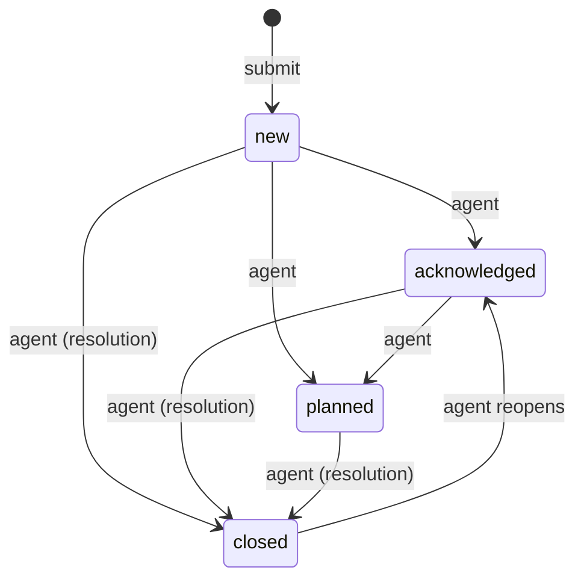
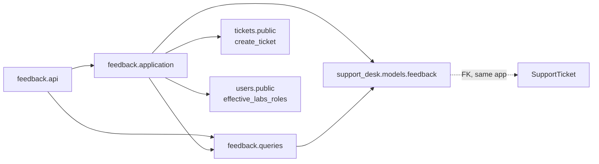

# Design: Product feedback and page rating

- Tier: T2 (new models and constraints, new public API, authorization, personal data, cross-feature call)
  · Status: Draft, awaits owner approval; not approved for implementation · Date: 2026-11-12
- Domain: Support desk (`core/support_desk/features/feedback`, a feature that does not exist yet; models in
  `core/support_desk/models/feedback/`)
- Depends on: `support_desk.features.tickets` (convert feedback to a ticket), `core.users.public` (roles).

**Central rule.** Feedback is about **the Lab Mango application itself**: any page, any screen. It is
not attached to a lab resource, a booking or a ticket. A signed-in user can, from any page, either
**rate the page** (1 to 5) or **send general feedback** (bug, idea, praise, question). Support agents
triage it, answer the question "which pages do people struggle with", and turn real problems into tickets.

## 1. Problem and acceptance criteria

Today the only way to tell the team "this page is confusing" or "this button is broken" is to open a
support ticket, which is heavy for a one-line remark and mixes product signals with operational requests.
We have no measure of how satisfied users are with each page.

| # | Acceptance criterion |
|---|---|
| AC1 | Any signed-in user can submit, from any page, a **page rating**: score 1 to 5, optional comment of up to 4000 characters. |
| AC2 | Any signed-in user can submit **general feedback**: a category (`bug`, `suggestion`, `praise`, `question`, `other`), a message of 1 to 4000 characters, optional score. |
| AC3 | Every submission records the page it was sent from (`page_key`), the app version, and limited client context. It never stores the full URL, query string or page content. |
| AC4 | A retried or double-clicked submit creates one row (`client_submission_id`). Reusing the id with a different body returns `422 idempotency_key_reuse`. |
| AC5 | Each user can submit at most 20 feedback items per hour (configurable). Above that: `429` with `Retry-After`. |
| AC6 | Users see and can delete their own feedback while it is still `new`. Agents and admins see all feedback, with author. Everyone else gets `404`. API keys and agents (devices) have no access. |
| AC7 | Agents move feedback through a triage state machine (`new` → `acknowledged` → `planned` → `closed` with a resolution). Each change needs `If-Match`, is recorded as an immutable event, and a disallowed change returns `409 invalid_state_transition`. |
| AC8 | An agent can convert feedback into a support ticket on behalf of the author. Converting twice returns the same ticket. |
| AC9 | Agents get page insights for a period of at most 366 days: per `page_key`, the rating count, average, score distribution, share of 4 and 5 ("satisfied"), and general feedback count by category. |
| AC10 | Every list and detail endpoint has a constant query budget test. |
| AC11 | OpenAPI is regenerated in the same change. Everything is behind `SUPPORT_FEEDBACK_ENABLED` (default off). |

Out of scope for v1 (see open questions, section 14): screenshots and attachments, anonymous submissions,
feedback from signed-out pages (login), replying to the author, automatic retention purge, NPS surveys.

## 2. Current state (repository facts, verified 2026-11-12)

- No product feedback feature exists. `grep -ri feedback core` finds nothing relevant.
- `support_desk` is installed (`config/settings/base.py:70`), mounted at `/api/support/`
  (`core/support_desk/api_urls.py:6`), and already serves **every** signed-in user as a requester
  (`IsSupportRequester`, `core/support_desk/features/tickets/api/permissions.py:27`).
- Support roles come from Labs roles: admin → support admin, coordinator → support agent, everyone else →
  requester (`resolve_support_role`, `core/support_desk/features/tickets/application/policies.py:19`).
- `tickets.public` exports `create_ticket` and `CreateTicketInput`
  (`core/support_desk/features/tickets/public.py:64,95`). The input supports `on_behalf_of_id` and
  `idempotency_key`; `SupportTicket.idempotency_key` is `unique=True` (`core/support_desk/models/ticket.py:163`).
- Ticket notifications already use a transactional outbox with a unique
  `(event, recipient, channel)` constraint (`core/support_desk/models/outbox.py:43`).
- Ticket CSAT (`submit_csat`) rates the support **service** for one resolved ticket. It stays as it is;
  this feature uses the same 1 to 5 scale so users see one scale everywhere.
- DRF throttles are configured with per-scope rates from the environment (`config/settings/base.py:374-385`).
  Throttles fail closed with `503` on a cache outage (`core/users/tests/features/auth/test_cache_outage.py`).
- Request correlation ids exist (`core/common/api/correlation.py:16`).

**Why support desk and not a new app.** Core architecture says a stateful business capability needs an
owning app, and that new apps are created "only when requirements establish that ownership"
(`docs/architecture/core-architecture.md`, sections 3 and 4). Support desk already owns the people who would
triage feedback (agents), the requester population (all users), the ticket that feedback turns into, and
the notification outbox. A separate `core/feedback` app would duplicate role resolution and need a
cross-app call to create tickets. See Alternatives and Q1.

**Drift found (reported, not copied):**

| Location | Drift | Effect on this design |
|---|---|---|
| `core/support_desk/models/*.py` | Models are flat files, not `models/<feature>/` as the feature template requires. | New models go in `core/support_desk/models/feedback/`. |
| `core/support_desk/features/tickets/application/create_ticket.py:94` | The ticket idempotency key is global, not scoped to the caller (RW-6 says credential and endpoint). | Conversion uses a namespaced deterministic key `feedback:<uid>` so it cannot collide with client keys. |
| `core/support_desk/features/tickets/application/submit_csat.py:42` | CSAT amendment is a read-modify-write without a lock or version check. | Not repeated here; reported for the support desk owner. |

## 3. Proposed behavior and invariants

### 3.1 Two kinds of feedback, one model

| | `page_rating` | `general` |
|---|---|---|
| Opened from | A small "Rate this page" prompt or the footer widget | "Send feedback" in the user menu or footer |
| `score` | required, 1 to 5 | optional |
| `category` | `null` | required |
| `message` | optional | required, not blank |
| `page_key` | required | required (the page the user was on) |

Both kinds are checked by PostgreSQL constraints (section 6), not only by the serializer.

### 3.2 Page context, captured without leaking data

- `page_key`: a stable **route identifier** from the frontend route table, such as
  `labs.benches.detail` or `support.tickets.list`. Never a URL: URLs carry ids, search text and tokens.
  Pattern `^[a-z0-9][a-z0-9_.-]{0,99}$`, checked by a constraint. The frontend owns the list; the backend
  does not keep an allowlist, so a new page needs no backend release. Unknown keys are accepted and show up
  in insights, which makes typos visible.
- `app_version`: the frontend build identifier (at most 40 characters).
- `client_context`: one object with a **fixed schema**, never free-form: `locale` (BCP 47), `timezone`
  (IANA), `viewport_width`, `viewport_height` (integers 0 to 10000), `color_scheme` (`light` | `dark`).
  Unknown keys return `422` (RW-3). Stored as columns, not JSON, so they can be queried and constrained.
- `user_agent`: taken by the server from the request header, cut to 512 characters, never from the body.
- `request_id`: the server's correlation id of the submit request, so an agent can find the logs.

### 3.3 Content rules

| Field | Rule |
|---|---|
| `message` | NFC-normalized, trimmed, control characters other than `\n` and `\t` rejected, at most 4000 characters; over-length returns `422`, never truncated (FMT-8). Rendered as plain text only. |
| `score` | integer 1 to 5 |
| `category` | enum (ENU-5: fixed in code, drives triage behavior) |
| `client_submission_id` | UUID generated by the client per submission, required |

### 3.4 Triage state machine (owned by this feature only)



- `resolution` is set exactly when `status = closed`: `implemented`, `declined`, `duplicate`,
  `converted_to_ticket`, `no_action_needed`.
- `duplicate` needs `duplicate_of` pointing to another feedback item that is not itself a duplicate (no
  chains). `converted_to_ticket` needs `ticket`.
- One transition function `ensure_feedback_status_transition` with an explicit
  `FEEDBACK_STATUS_TRANSITIONS` map, next to the model (the same pattern as
  `ensure_booking_status_transition`). Same target status and resolution → no-op `200`.
- Reopening a closed item clears `resolution` and `duplicate_of`, and a converted item cannot be reopened (`409 invalid_state_transition`), because the ticket now owns the work.
- The author can delete their own item only while it is `new`. After triage it belongs to the team's record
  (`409 feedback_already_triaged`); erasure requests then go through Q6.

### 3.5 Convert to ticket

`POST /api/support/feedback/{id}/actions/convert-to-ticket` with `category_id` and optional
`priority_id`. The command:

1. locks the feedback row; if `ticket_id` is already set, returns the item unchanged (idempotent);
2. calls `tickets.public.create_ticket` with subject `"[Feedback] <category or 'Page rating'>: <page_key>"`,
   the message and page context as description, `on_behalf_of_id = author`, and
   `idempotency_key = "feedback:<uid>"`;
3. sets `ticket`, `status = closed`, `resolution = converted_to_ticket`, writes an event.

All of this runs in one database transaction. `create_ticket` queues its notifications in the outbox,
so no network call happens inside the transaction. Whether `create_ticket` lets an agent create on behalf
of any user is enforced by its own policy (`can_create_ticket_on_behalf`); this feature does not bypass it.

### 3.6 Insights

For a period (`created_after`, `created_before`, at most 366 days, default the last 30 days) and an
optional `page_key` prefix (`labs.`), one row per `page_key`:

`rating_count`, `average_score` (1 decimal place, `null` while `rating_count < 5`), `score_distribution`
(five entries, always present), `satisfied_ratio` (share of scores 4 and 5, 0 to 1, 2 decimal places,
`null` with the average), `general_count_by_category` (one entry per category, always present),
`last_submitted_at`. Computed when read from indexed columns; no cache table in v1.

## 4. Module ownership and allowed dependencies

```text
core/support_desk/models/feedback/
├── __init__.py              # re-exported from core/support_desk/models/__init__.py
├── feedback.py              # ProductFeedback, enums, FEEDBACK_STATUS_TRANSITIONS
└── event.py                 # ProductFeedbackEvent (immutable)

core/support_desk/features/feedback/        # split layout
├── public.py  urls.py  contracts.py  exceptions.py
├── api/          urls.py views.py serializers.py filters.py permissions.py
├── application/  submit_feedback.py delete_feedback.py transition_feedback.py
│                 convert_feedback.py policies.py
├── queries/      list_feedback.py feedback_insights.py options.py
├── tests/        api/ application/ queries/ conftest.py factories.py test_public.py
└── docs/         spec.md architecture.md   (written on approval; this proposal moves there)
```



| Edge | Why it is allowed |
|---|---|
| `feedback.application` → `tickets.public.create_ticket` | Behavior through the owner's public command; same app, same database transaction. |
| `feedback` → `core.users.public` | Role resolution, the same edge `tickets` already uses. Support role helpers move to an app-level `support_desk` policy module if both features need them (not inside `tickets`' private layers). |
| `ProductFeedback.ticket` → `SupportTicket` | Same-app FK, written only by `convert_feedback`. Documented in both features' architecture docs. |
| Nothing imports `feedback` in v1 | A future dashboard tile uses `feedback.public` read projections only. |

`resolve_support_role` currently lives in `tickets/application/policies.py`, a private layer. The feedback
feature must not import it. The implementation either exports it from `tickets.public` or moves it to
`core/support_desk/policies.py` (app level). This is the only change outside the new feature; it is
named here so the reviewer can check it.

Enforcement: an architecture test in `tests/architecture/` checks that `support_desk.features.feedback`
imports other features only through `public` and `contracts`, and that nothing outside imports its private
layers. `lint-imports` is not configured (quality gates).

## 5. API contract (new, additive, nothing breaks)

All routes under the existing `/api/support/` prefix, slashless, standard envelope and errors. When
`SUPPORT_FEEDBACK_ENABLED` is false every route returns `404`.

| Method and path | Who | Purpose | Success |
|---|---|---|---|
| `POST /api/support/feedback` | any signed-in user | Submit; throttle scope `support_feedback` | `201` + `Location`; `200` on identical replay |
| `GET /api/support/feedback` | requester (own) · agent (all) | List, page style, maximum page size 100 | `200` |
| `GET /api/support/feedback/{id}` | author · agent | Detail with strong `ETag` | `200` |
| `DELETE /api/support/feedback/{id}` | author, while `new` | Delete | `204` |
| `POST /api/support/feedback/{id}/actions/transition` | agent | `{to_status, resolution, duplicate_of_id, note}`; `If-Match` required | `200` + new `ETag` |
| `POST /api/support/feedback/{id}/actions/convert-to-ticket` | agent | `{category_id, priority_id}` | `200` |
| `GET /api/support/feedback/{id}/events` | agent | Triage history | `200` |
| `GET /api/support/feedback/insights` | agent | Per-page summary, paginated, max 100 rows | `200` |
| `GET /api/support/feedback/options` | any signed-in user | Kinds, categories, statuses, resolutions | `200` |

`{id}` uses the `int` converter so `insights` and `options` are not shadowed; a routing test checks it.

**List filters** (allowlisted, unknown keys `400`): `kind`, `category`, `status`, `resolution`,
`page_key`, `page_key_prefix`, `score_min`, `score_max`, `has_message`, `app_version`, `created_after`,
`created_before`, `author_id` (agent only), `q` (agent only, message text). Ordering: `-created_at` (default),
`created_at`, `score`, `-score`, always with `-id` as tiebreaker.

**Request: page rating**

```json
{ "client_submission_id": "4f1c2b9e-6a3d-4c71-9b2e-0d8f5a7c3e11", "kind": "page_rating",
  "page_key": "labs.benches.detail", "app_version": "2026.11.3",
  "score": 2, "message": "Couldn't find where to extend my booking.",
  "client_context": { "locale": "en-GB", "timezone": "Asia/Ho_Chi_Minh",
                      "viewport_width": 1440, "viewport_height": 900, "color_scheme": "dark" } }
```

**Request: general feedback**

```json
{ "client_submission_id": "a2e7…", "kind": "general", "category": "bug",
  "page_key": "labs.equipment.list", "app_version": "2026.11.3",
  "message": "Filter by category resets when I change page.", "client_context": { … } }
```

**Response: detail** (agent view)

```json
{ "data": {
    "id": 3051,
    "uid": "9c0f3a8e-1b2d-4e5f-8a9b-7c6d5e4f3a21",
    "kind": { "value": "page_rating", "label": "Page rating" },
    "category": null,
    "score": 2,
    "message": "Couldn't find where to extend my booking.",
    "page_key": "labs.benches.detail",
    "app_version": "2026.11.3",
    "client_context": { "locale": "en-GB", "timezone": "Asia/Ho_Chi_Minh", "viewport_width": 1440,
                        "viewport_height": 900, "color_scheme": "dark", "user_agent": "Mozilla/5.0 …" },
    "author": { "id": 77, "name": "Minh Le" },
    "status": { "value": "closed", "label": "Closed" },
    "resolution": { "value": "converted_to_ticket", "label": "Converted to ticket" },
    "triage": { "note": "Extend button hidden on small screens.", "triaged_by": { "id": 5, "name": "Support Agent" },
                "triaged_at": "2026-11-12T10:02:11Z" },
    "duplicate_of": null,
    "ticket": { "id": 918, "name": "SUP-918" },
    "request_id": "b1f2c3d4e5f60718293a4b5c6d7e8f90",
    "can_delete": false,
    "created_at": "2026-11-12T09:14:03Z",
    "updated_at": "2026-11-12T10:02:11Z"
} }
```

A requester reading their own item gets the same shape, with `triage.note`, `triaged_by`, `user_agent`
and `request_id` set to `null` and listed in `meta.restricted_fields` (SEC-3). They do see `status` and
`resolution`, so they know their feedback was read.

**Errors (stable codes)**

| Status | Code | When |
|---|---|---|
| 404 | `feedback_not_found` | Missing, or outside the actor's scope (ERR-5) |
| 409 | `feedback_already_triaged` | Author deletes after triage started |
| 409 | `invalid_state_transition` | Transition not in the map, or reopening a converted item |
| 412 / 428 | `precondition_failed` / `precondition_required` | `If-Match` stale or missing (RW-5) |
| 422 | `validation_failed` with `details` | Wrong field set for the kind, score out of range, message too long or blank, bad `page_key`, unknown `client_context` key, `duplicate_of_id` is self or a duplicate (`does_not_exist` / `invalid`), unknown or read-only field |
| 422 | `idempotency_key_reuse` | Same `client_submission_id` with a different body |
| 429 | `rate_limited` | Over the per-user submit rate, with `Retry-After` |
| 403 | `permission_denied` | A requester calling an agent route |
| 503 | `service_unavailable` | Throttle store down (fails closed, as login does) |

## 6. Data model, constraints, concurrency

### `ProductFeedback`

| Field | Type | Notes |
|---|---|---|
| `id` | bigint PK | |
| `uid` | UUID, unique | REL-2 |
| `author` | FK user, `PROTECT` | Users are deactivated, not deleted; anonymization: Q6 |
| `client_submission_id` | UUID | |
| `kind` | varchar(16) | `page_rating` · `general` |
| `category` | varchar(16), nullable | `bug` · `suggestion` · `praise` · `question` · `other` |
| `score` | smallint, nullable | |
| `message` | text, default `""` | |
| `page_key` | varchar(100) | |
| `app_version` | varchar(40), default `""` | |
| `locale`, `timezone` | varchar(35), varchar(64), default `""` | |
| `viewport_width`, `viewport_height` | smallint, nullable | |
| `color_scheme` | varchar(8), default `""` | |
| `user_agent` | varchar(512), default `""` | server-captured |
| `request_id` | char(32), default `""` | |
| `status` | varchar(16), default `new` | |
| `resolution` | varchar(24), nullable | |
| `triage_note` | text, default `""` | at most 2000 characters |
| `triaged_by` | FK user, nullable, `SET_NULL` | |
| `triaged_at` | timestamptz, nullable | |
| `duplicate_of` | FK self, nullable, `PROTECT` | |
| `ticket` | FK `SupportTicket`, nullable, `PROTECT`, unique | |
| `version` | integer, default 1 | ETag source |
| `created_at`, `updated_at` | timestamptz | |

**Constraints (PostgreSQL is the guard):**

| Name | Rule |
|---|---|
| `product_feedback_author_submission_unique` | `UNIQUE (author_id, client_submission_id)` |
| `product_feedback_kind_valid` | `kind IN ('page_rating','general')` |
| `product_feedback_score_1_to_5` | `score IS NULL OR score BETWEEN 1 AND 5` |
| `product_feedback_page_rating_shape` | `kind <> 'page_rating' OR (score IS NOT NULL AND category IS NULL)` |
| `product_feedback_general_shape` | `kind <> 'general' OR (category IS NOT NULL AND btrim(message) <> '')` |
| `product_feedback_category_valid` | `category IS NULL OR category IN ('bug','suggestion','praise','question','other')` |
| `product_feedback_message_max_length` | `char_length(message) <= 4000` |
| `product_feedback_page_key_format` | `page_key ~ '^[a-z0-9][a-z0-9_.-]{0,99}$'` |
| `product_feedback_viewport_range` | each viewport value `IS NULL OR BETWEEN 0 AND 10000` |
| `product_feedback_status_valid` | `status IN ('new','acknowledged','planned','closed')` |
| `product_feedback_resolution_iff_closed` | `(status = 'closed') = (resolution IS NOT NULL)` |
| `product_feedback_resolution_valid` | `resolution IS NULL OR resolution IN (…five values…)` |
| `product_feedback_duplicate_iff_resolution` | `(resolution = 'duplicate') = (duplicate_of_id IS NOT NULL)` (with `resolution IS NULL` treated as false) |
| `product_feedback_not_duplicate_of_self` | `duplicate_of_id IS NULL OR duplicate_of_id <> id` |
| `product_feedback_converted_iff_ticket` | `(resolution = 'converted_to_ticket') = (ticket_id IS NOT NULL)` (same null handling) |
| `product_feedback_ticket_unique` | `UNIQUE (ticket_id)` where not null |
| `product_feedback_version_positive` | `version >= 1` |

"No duplicate chains" spans rows and is enforced by the transition command while it holds locks on both rows
(section 6, write paths).

**Indexes:** `(status, created_at DESC, id)` for the triage inbox; `(author_id, created_at DESC)` for
"my feedback"; `(created_at, page_key) INCLUDE (kind, score, category)` for insights over a period.
Reasoned, not measured; the implementation attaches `EXPLAIN (ANALYZE, BUFFERS)` for insights.
`q` search on `message` is a full scan on a large table; flagged, no trigram index in v1
(query-performance section 5).

### `ProductFeedbackEvent` (immutable, `created_at` only)

`feedback` FK `CASCADE`, `actor` FK user `SET_NULL`, `event_type` (`status_changed`, `converted_to_ticket`),
`from_status`, `to_status`, `resolution`, `note`, `created_at`. Written in the same transaction as the change.

### Write paths

| Write path | Race | Guard | Idempotency | Concurrency test |
|---|---|---|---|---|
| `submit_feedback` | Double click, network retry | `product_feedback_author_submission_unique`; insert in a nested savepoint, `IntegrityError` mapped **by constraint name**, anything else re-raised | Same `client_submission_id` + same body hash → `200` with the stored item; different body → `422 idempotency_key_reuse` | Two threads, same id → one row |
| `submit_feedback` | Flooding | DRF `ScopedRateThrottle` scope `support_feedback`, rate from `THROTTLE_SUPPORT_FEEDBACK` (default `20/hour`), per user | | Throttle test with a fake clock |
| `delete_feedback` | Delete while an agent triages | `select_for_update` on the row, then `status = new` check | Already gone → `404`, state unchanged | Delete racing transition → exactly one wins, no orphan event |
| `transition_feedback` | Two agents at once; lost update | `If-Match` → expected `version`; `select_for_update` on the row; for `duplicate`, lock both rows in one ordered query (`order_by("pk")`) | Same target status and resolution → no-op `200`, no event, `version` unchanged | Two transitions with the same ETag → one `200`, one `412` |
| `convert_feedback` | Two agents convert at once | `select_for_update` on the feedback row; `ticket_id` already set → return; ticket created with `idempotency_key = "feedback:<uid>"` (unique on `SupportTicket`); `product_feedback_ticket_unique` | Second call returns the same ticket | Two conversions → one ticket |

Lock order inside the feature: feedback rows by ascending `pk`, then whatever `create_ticket` locks. No
other command locks feedback rows. One `transaction.atomic()` per command; input checks run before it;
no network call inside it.

## 7. Read paths and query budget

| Endpoint | Query function | Data the query provides | Budget | Page cap |
|---|---|---|---|---|
| `GET /feedback` | `list_feedback(actor, filters)` | `select_related("author", "triaged_by", "ticket", "duplicate_of")` with `.only(...)` on the related rows | 2 (count, page) + fixed auth queries | 100 |
| `GET /feedback/{id}` | `list_feedback(...).get(pk=id)` | as above | 1 | — |
| `GET /feedback/{id}/events` | `list_feedback_events(actor, feedback_id)` | `select_related("actor")` | 3 (scope check, count, page) | 100 |
| `GET /feedback/insights` | `feedback_insights(actor, period, prefix)` | one `GROUP BY page_key` with filtered `Count` / `Avg` aggregates | 2 (count of groups, page) | 100 rows |
| `GET /feedback/options` | static enums | no database | 0 | — |

Each budget is a `django_assert_num_queries` test with at least 3 rows and their related rows.

## 8. Authorization and threat notes

| Actor | Submit | Read own | Read all | Delete own (`new`) | Triage / convert | Insights |
|---|---|---|---|---|---|---|
| Anonymous, API key, agent device | — | — | — | — | — | — |
| Signed-in user (support requester) | yes | yes (restricted fields) | — | yes | — | — |
| Support agent (Labs coordinator) | yes | yes | yes | yes | yes | yes |
| Support admin (Labs admin) | as agent | | | | | |

- Deny by default: a permission class at the HTTP edge, `ensure_*` policies in commands, and object scope
  in queries (requesters get `author_id = actor.id`). Out-of-scope reads return `404`.
- Signed-in users only. Accepting feedback from the login page means an anonymous, abuse-prone endpoint and
  is left to Q3.
- **Personal data.** Messages may contain names, emails, or pasted secrets. Messages and triage notes are
  never written to logs. The full URL is never stored. User agent is visible to agents only. Delete is
  allowed while `new`. Retention is Q6.
- **Injection.** Plain-text rendering only; the API returns no HTML. `page_key` is pattern-checked, so it
  cannot carry markup or a URL into the agent UI.
- **Abuse.** Per-user rate limit, one row per `client_submission_id`, message length limit. The throttle
  fails closed on a cache outage (`503`), matching login.
- **Data quality.** The average is hidden below 5 ratings for a page, so one person cannot define a page's
  score.
- No new dependency.

## 9. Async and integration behavior

None in v1. No Celery task and no outbox of its own. Conversion reuses the ticket outbox through
`create_ticket`. Planned follow-ups, each needing its own approval: a "your feedback was addressed"
notification through the support desk outbox (Q5), and a batched retention purge task (Q6).

**Frontend behavior** (for the React team; the API does not depend on it):
- "Rate this page" prompt: at most once per `page_key` per user every 30 days, never in the first 3 visits
  to a page, never during a form submit; dismissal counts as shown. Remembered in browser storage, so
  losing it only means one extra prompt.
- "Send feedback" is always available from the user menu and does not depend on the prompt.
- One `client_submission_id` per opened form, reused on retry.
- When a `bug` is submitted, the UI says "For urgent problems, open a support ticket" with a link.

## 10. Migration, rollout, rollback

1. Migration (schema, additive): two new tables in `support_desk`, with constraints and indexes. No change to
   existing tables. Reversible.
2. Settings: `SUPPORT_FEEDBACK_ENABLED` (default `False`), throttle rate `support_feedback`
   (`THROTTLE_SUPPORT_FEEDBACK`, default `20/hour`), `SUPPORT_FEEDBACK_MIN_RATINGS_FOR_AVERAGE` (default 5).
3. Enable in staging, then production, through configuration only. The frontend shows the widget behind the
   same flag (read from an existing config endpoint, or a new `GET /api/support/feedback/options` field;
   **not verified** which exists).
4. Rollback: flag off (routes `404`, data kept). Reversing the migration is allowed only before production
   holds feedback rows.
5. OpenAPI regenerated (`spectacular_modules`) in the same change.

## 11. Observability

- Structured log events without message text: `feedback.submitted` (`feedback_id`, `kind`, `category`,
  `score`, `page_key`, `app_version`, `actor_id`, `request_id`), `feedback.transitioned`,
  `feedback.converted` (with `ticket_id`), `feedback.deleted`.
- `feedback.throttled` at `info` with `actor_id`, to spot abuse or a broken client resubmitting.
- Duplicate submits mapped from `IntegrityError` are logged at `info`; an unmapped constraint error is a
  `500` at `error`.
- Dashboard (follow-up): ratings per day, lowest-rated pages by `app_version` (a drop after a release is the
  most useful signal this feature gives), untriaged `new` count and age.

## 12. Test plan (criterion → test)

| AC | Test (under `core/support_desk/features/feedback/tests/`) |
|---|---|
| AC1, AC2 | `application/test_submit_feedback.py::test_page_rating`, `::test_general_feedback`, `::test_kind_shape_rules[...]`; `api/test_submit.py::test_201_with_location` |
| AC3 | `::test_user_agent_from_header_not_body`, `::test_unknown_client_context_key_422`, `::test_page_key_pattern[...]`, `::test_request_id_recorded` |
| AC4 | `::test_concurrent_same_submission_one_row` (`transaction=True`, two connections), `::test_identical_replay_200`, `::test_different_body_422` |
| AC5 | `api/test_throttle.py::test_21st_submit_429_with_retry_after`, `::test_cache_outage_503` |
| AC6 | `api/test_visibility.py` matrix: anonymous, API key, requester, agent, admin for every route; `::test_requester_restricted_fields`; `application/test_delete_feedback.py::test_only_new`, `::test_other_user_404` |
| AC7 | `application/test_transition_feedback.py::test_allowed_map`, `::test_disallowed_409`, `::test_if_match_428_412`, `::test_noop_keeps_version`, `::test_duplicate_chain_rejected`, `::test_converted_cannot_reopen`, `::test_event_written_once` |
| AC8 | `application/test_convert_feedback.py::test_creates_ticket_on_behalf_of_author`, `::test_twice_returns_same_ticket`, `::test_concurrent_convert_one_ticket`, `::test_ticket_policy_denial_propagates` |
| AC9 | `queries/test_feedback_insights.py::test_average_null_below_min`, `::test_distribution_five_entries`, `::test_period_over_366_days_400`, `::test_prefix_filter` |
| AC10 | `api/test_query_budget.py`, one test per endpoint with 3 or more rows |
| AC11 | `api/test_routes.py::test_flag_off_404`, `::test_detail_does_not_shadow_named_routes`; OpenAPI parity gate |
| Model | `core/support_desk/tests/models/test_product_feedback_constraints.py`: each named constraint rejects a direct invalid write |
| Boundary | `tests/architecture/test_support_feedback_boundaries.py`; `test_public.py` exports and DTOs |

Gates to report on implementation (quality gates): ruff check and format and mypy on changed paths, focused
tests, `tests/architecture`, `makemigrations --check --dry-run`, OpenAPI regenerate, OpenAPI tests,
OpenAPI parity, Spectral.

## 13. Alternatives considered

| Option | Why not chosen (for v1) |
|---|---|
| New `core/feedback` Django app | Clean name, but duplicates support role resolution, needs a cross-app call to create tickets, and adds an app before requirements show independent ownership (core architecture, section 4). Becomes right if product feedback gets a separate owning team or lifecycle (Q1). |
| Third-party widget (Hotjar, Usersnap, …) | Fastest, but sends user text and page context to an outside service, needs a new dependency and vendor review (AGENTS.md rules 7 and 9), and keeps the data away from tickets. |
| Feedback as a ticket type | Every remark becomes a ticket with SLA, assignment and notifications: too heavy, and it pollutes support metrics. Conversion keeps the path to a ticket when it is warranted. |
| Store the full URL | Simple, but URLs carry ids, search text and sometimes tokens. A route key gives the same grouping without the data. |
| JSON `metadata` for client context | Flexible, but untyped and unbounded. Fixed columns are validated, constrained and queryable; adding a field is a small migration. |
| Cached insight table | Faster reads but a second copy of the truth and a background job. A grouped aggregate over an indexed period is enough at this volume; switch when measured p95 passes the budget. |
| NPS ("how likely are you to recommend") | A different question about the whole product, usually asked on a schedule. Can be a third `kind` later (Q8). |

## 14. Open questions for the owner

| # | Question | Default if unanswered |
|---|---|---|
| Q1 | Owner: support desk feature, or a separate `core/feedback` app with its own team? | Support desk feature |
| Q2 | Who triages: all support agents (Labs coordinators), or a dedicated product team role? | All support agents |
| Q3 | Accept feedback from signed-out pages (login, password reset)? | No |
| Q4 | Allow screenshots? They often contain other people's data. Would reuse the support desk attachment storage and scanner. | No screenshots in v1 |
| Q5 | Notify the author when their feedback is closed as `implemented` or `converted_to_ticket`? | No notification in v1; status visible in "My feedback" |
| Q6 | Retention: how long are messages kept, and are authors anonymized after deactivation? | Keep 24 months, then erase message and author (scores stay for insights); purge task is a follow-up |
| Q7 | Let users submit anonymously (author hidden from agents, kept for abuse handling)? | No |
| Q8 | Add an NPS survey kind later? | Not planned |
| Q9 | Confirm limits: 4000-character message, 20 per hour, average shown from 5 ratings, 366-day insight period | As stated |

## 15. Assumptions and gaps

- **Assumed:** the frontend has a stable route identifier per page it can send as `page_key` (not verified
  in this repository; the frontend is separate).
- **Assumed:** agents may create tickets on behalf of any requester under `can_create_ticket_on_behalf` (not
  verified in detail; conversion fails with that policy's error if not).
- **Not verified:** whether an existing endpoint exposes feature flags to the frontend.
- **Required change outside the feature:** support role resolution must be reachable without importing
  `tickets/application/policies.py` (section 4).
- **Gap:** no import-linter contract; the architecture test is the boundary gate.
- **Residual risk:** `q` text search is a full scan; acceptable at expected volume, revisit with measurements.
