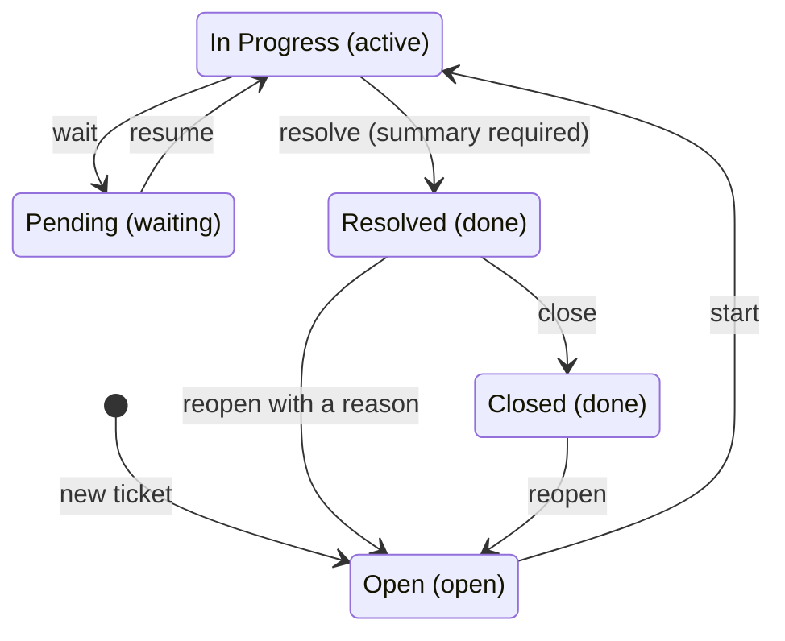
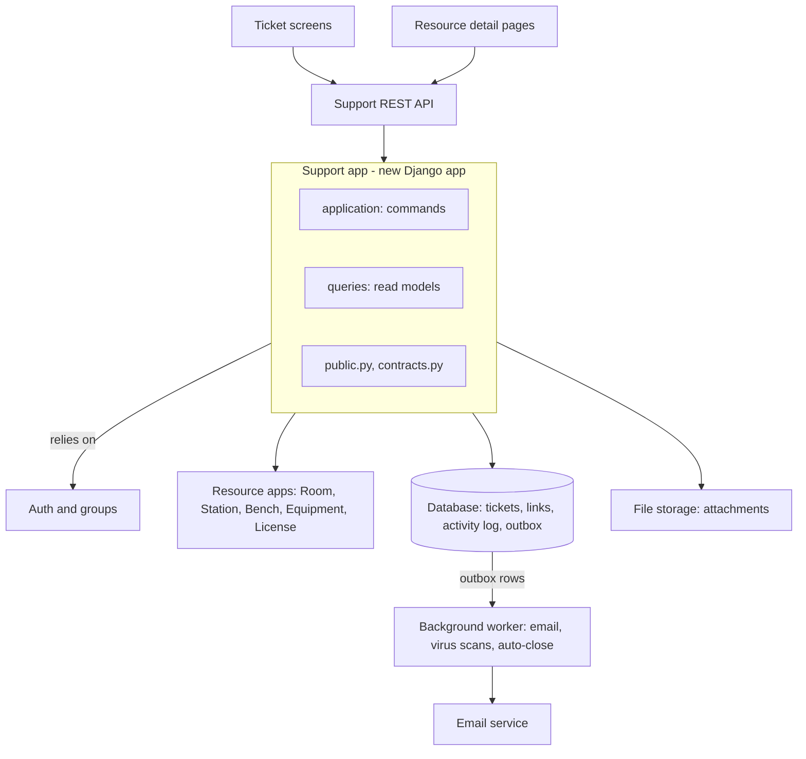

# Feature Spec: Support Ticket Management with Resource Traceability

**Product:** Lab Mango  |  **Status:** Draft  |  **Replaces:** Jira-based support workflow

## 1. Background and Problem Statement

Jira will no longer be supported for the team's support workflow. Support requests are currently tracked outside Lab Mango, so there is no reliable link between an incident and the lab resources involved (rooms, stations, benches, equipment, licenses). This makes recurring problems hard to spot and resource-level troubleshooting slow.

## 2. Objective

Provide a ticket system built into Lab Mango that lets users report issues, lets support staff investigate and resolve them, and keeps a permanent, queryable link between each ticket and the Lab Mango resources it concerns.

## 3. Goals and Non-Goals

**Goals**

- Replace the Jira support workflow for the team at first release.
- Give support agents a single queue with fast filtering.
- Show, for any resource, its full incident history, even after the resource is renamed, moved, reassigned or deleted.
- Reuse Lab Mango authentication and authorization; no separate user store.

**Non-goals (first release)**

- Migration of historical Jira tickets (see Decisions).
- SLA timers, escalation rules, and automated breach alerts.
- Email-to-ticket intake and external customer portals.
- Dashboards and analytics beyond list filters and counts.
- Custom per-category workflows.

## 4. Users and Roles

| Role | Can do |
| --- | --- |
| Requester | Create tickets; view all tickets (read-only on others, no internal notes); comment and attach files on own tickets; reopen own Resolved/Closed tickets within the reopen window |
| Support Agent | View the full queue; assign/self-assign; change status and priority; add public comments and internal notes; link/unlink resources; record resolution |
| Administrator | Everything an agent can do, plus manage categories, priorities, statuses and transitions, and permissions; reopen any ticket |

Resource visibility: a user sees a linked resource on a ticket only if they already have access to that resource. Otherwise the ticket shows the resource's identifier and type only. Requesters can link only resources they can access; if a resource is not visible to them, they describe it in the ticket and a support agent links it.

## 5. Functional Requirements

### 5.1 Ticket Lifecycle

- **FR-1** Create a ticket with: subject (required), description (required), category (required), priority (from the administrator-defined list), and optional linked resources and attachments.
- **FR-2** Generate a unique, human-readable, immutable ID on creation (e.g. `SUP-000123`). IDs are never reused.
- **FR-3** Store requester, assignee (nullable), status, created, updated, resolved and closed timestamps.
- **FR-4** Default statuses: Open, In Progress, Pending, Resolved, Closed. Status names and the allowed transitions are admin-configurable, but each status maps to a fixed system state (Open, Active, Waiting, Done) so reports stay stable.
- **FR-5** Default transitions: Open → In Progress → Pending ↔ In Progress → Resolved → Closed. Resolved → Open (reopen) is allowed. Closed → Open is allowed for agents and administrators; requesters may reopen only within a configurable window (default 14 days).
- **FR-6** Resolving a ticket requires a resolution summary and root cause or troubleshooting findings. Reopening requires a reason, and the original resolution is preserved in the history.
- **FR-7** Assignment: agents can assign to any agent or self-assign; assignment changes are recorded. Unassigned tickets appear in the queue's Unassigned filter.
- **FR-8** Optional auto-close of Resolved tickets after a configurable period with no requester response (default off).

### 5.2 Lab Resource Traceability

- **FR-9** A ticket can link zero or more resources of type Room, Station, Bench, Equipment, or License. Duplicate links to the same resource are rejected.
- **FR-10** Ticket details show each linked resource's type, identifier and name, and link to the resource detail page (subject to access rights).
- **FR-11** Each resource detail page has a Support Tickets section listing linked tickets (open and past), with ID, subject, status, priority and date, and a link to the full filtered queue.
- **FR-12** **Historical snapshot:** when a link is created, store the resource's type, stable ID, name/label and key context at that moment (e.g. parent room or station for a bench). Display the snapshot if the resource is later renamed, moved or deleted, and flag it as "changed" or "deleted" when it differs from the current state.
- **FR-13** Resource links are never hard-deleted. Removing a link marks it inactive, records who and when, and keeps it in the activity history and in the resource's ticket history (shown with an "unlinked" indicator).
- **FR-14** Resources referenced by tickets must not lose their ticket history when soft-deleted or archived.

### 5.3 Communication and Investigation

- **FR-15** Comments: public (visible to requester) and internal notes (agents and administrators only). Comments are append-only; edits and deletions are limited to the author within a short window, with the original retained in the audit trail.
- **FR-16** Attachments (screenshots, logs, diagnostic files) on tickets and comments. Configurable allowed file types and size limits (suggested default 25 MB per file), with malware scanning if the platform supports it. Attachments inherit the ticket's access rules and are never publicly accessible.
- **FR-17** Notifications to the requester and assignee on assignment, new public comment, status change and resolution (in-app and email, both required for Release 1).

### 5.4 Search and Tracking

- **FR-18** "My Tickets" view for requesters with current status and last update, plus an All Tickets view: every Lab Mango user can read all tickets, while internal notes stay agent-only.
- **FR-19** Support queue for agents with default sort by priority then age, plus saved filters such as Unassigned and Assigned to me.
- **FR-20** Filters: ticket ID, status, priority, category, requester, assignee, linked resource (type and specific resource), and created/updated date range. Free-text search covers subject and description.
- **FR-21** Resource-centric search: show all open and historical tickets for a chosen resource, including tickets where the link was later removed.

### 5.5 Audit and Activity History

- **FR-22** An immutable, chronological activity log per ticket covering: creation, field changes (old and new values), assignment, status transitions, comments added/edited/deleted, attachments added/removed, resource links added/removed, resolution, and reopen. Each entry records actor, timestamp and event type.
- **FR-23** Activity history cannot be edited or deleted through the UI or API.

### 5.6 Access Control and Administration

- **FR-24** Use Lab Mango authentication; map roles (Requester, Agent, Administrator) to existing groups or permissions.
- **FR-25** Enforce permissions server-side on every API endpoint, list, search result, attachment download and resource-page ticket list. Internal notes are never returned to requesters.
- **FR-26** Administrators manage categories, priorities, statuses and transitions, and the default reopen window. Items in use are deactivated rather than deleted. No categories or priorities ship predefined: the system starts empty, and ticket creation stays disabled until an administrator defines at least one category and one priority.

## 6. Non-Functional Requirements

- **Performance:** queue and search results under 2 seconds for up to 100,000 tickets (target; confirm with team).
- **Auditability:** all state changes are traceable to a user.
- **Data integrity:** ticket IDs and resource links remain valid across resource changes.
- **Privacy:** all authenticated users can read all tickets, so descriptions and attachments are visible to everyone; the UI warns requesters, and agents can mark an attachment restricted (agent-only).
- **Accessibility and UX:** consistent with Lab Mango UI standards.

## 7. Initial Delivery Scope (Release 1)

**Included:** ticket submission and lifecycle (including reopen), assignment, public and internal comments, attachments, resource linking with historical snapshot, ticket-to-resource and resource-to-ticket navigation, search and filtering, role-based access control, admin configuration of categories/priorities/statuses, auditable activity history, and in-app and email notifications.

**Deferred:** Jira migration, SLA tracking, email intake, analytics dashboards, bulk actions, ticket merge/duplicate handling, and custom fields.

## 8. Acceptance Criteria (examples)

1. Given a requester, when they submit a ticket with required fields, then a unique ID is generated and the ticket appears in My Tickets with status Open.
2. Given a ticket linked to Station S1, when S1 is renamed or deleted, then the ticket still shows the original name and an indicator of the change.
3. Given an agent viewing resource R's page, then all past and current tickets linked to R are listed, including those whose link was removed.
4. Given a requester, then internal notes are never visible in the UI, API or search, and other users' tickets are read-only for them.
5. Given a ticket moved to Resolved without a resolution summary, then the transition is rejected.
6. Given any change to a ticket, then a corresponding activity entry exists with actor and timestamp, and cannot be edited.
7. Given a Resolved ticket, when it is reopened with a reason, then the previous resolution remains in the history and the status becomes Open.

## 9. Success Metrics

- Support team stops using Jira for new tickets after release.
- At least 80% of tickets have a linked resource where applicable.
- Reduction in time to find prior incidents for a resource (baseline to be measured).
- Median time to first response and time to resolution tracked from launch.

## 10. Dependencies and Assumptions

- Lab Mango authentication, groups and permissions are available for role mapping.
- Resource models (Room, Station, Bench, Equipment, License) have stable identifiers and expose detail pages.
- File storage is available for attachments.
- An SMTP or email service is available for outbound notifications.

## 11. Ticket Lifecycle

A ticket moves through five default statuses. Each status maps to a fixed system state (open, active, waiting, done), so an administrator can rename or add statuses without breaking reports or rules.

Resolved is the only exit from active work, and it requires a summary; reopening returns a ticket to Open without erasing the earlier resolution.

| Transition | Who | Required input |
| --- | --- | --- |
| New ticket to Open | Requester, or an agent on behalf of someone | Subject, description, category, priority |
| Open to In Progress | Agent | None; the agent becomes assignee if none is set |
| In Progress to Pending | Agent | Reason: what the ticket is waiting for |
| Pending to In Progress | Agent, or automatically when the requester replies | None |
| In Progress to Resolved | Agent | Resolution summary and troubleshooting findings |
| Resolved to Closed | Agent, administrator, or automatically after the optional auto-close period | None |
| Resolved or Closed to Open (reopen) | Requester within the reopen window, agents and administrators at any time | Reason; the earlier resolution stays in the history |

Every transition is checked against the configured workflow, rejected if the required input is missing, and recorded in the activity history with actor and time.

## 12. Feature Design

This section turns the requirements into concrete behavior: what the user sees, what the system enforces, and what is recorded.

### 12.1 Ticket creation

- The form asks for subject (max 200 characters), description (sanitized Markdown subset), category and priority from the admin-defined lists, optional resource links and attachments. The requester is taken from the session, never from the request body.
- Agents may create a ticket on behalf of someone else. The record then stores both the requester and the creator, and the activity history shows "created by X on behalf of Y".
- The ticket key is `SUP-` plus a zero-padded number from a database-level sequence, so concurrent creates never collide and numbers are never reused. The key is immutable and unique.
- Create calls accept an idempotency key, so a double click or a client retry returns the existing ticket instead of a duplicate.
- Creation is blocked, with a clear message, until an administrator has defined at least one category and one priority.

### 12.2 Resource linking and historical traceability

- A ticket can link Room, Station, Bench, Equipment and License records. The picker searches by type and name, and a requester sees only resources they are allowed to access. If the right resource is not visible to them, they describe it in the ticket and a support agent links it.
- Each link stores the resource type, its stable identifier, and a snapshot taken at link time: display name, code or label, and parent context where one exists (for example Bench, in Station, in Room). Links reference the identifier only, never the name.
- The ticket shows the snapshot with a badge when the live resource differs ("renamed", "moved", "archived", "deleted") and links to the live detail page when it still exists and the viewer may open it.
- Unlinking sets the link inactive and records who, when and why. The link, its snapshot and its history entries stay forever, so a resource's incident history survives re-assignment, renaming, archiving or deletion.
- A resource detail page gets a Support Tickets panel: counts of open and total tickets, a list with ID, subject, status, priority and date (including tickets whose link was later removed, shown as unlinked), and a link to the queue pre-filtered to that resource.
- If hardware is replaced by a new record, agents link the new record to ongoing tickets; the old link remains, so both records show the incident.

### 12.3 Comments and attachments

- Comments are public (requester and agents) or internal (agents and administrators only). The visibility is chosen when writing and cannot be changed afterwards, so nothing private becomes public by accident.
- An author may edit or delete their own comment within 15 minutes (configurable). Edits and deletions are soft: the original text is kept in the audit trail and the comment shows "edited" or "removed".
- Attachments go through an allowlist of extensions plus a content-type check on the file's real bytes, a size limit (25 MB default) and a per-ticket count limit. Files are stored under random keys in object or file storage, with a SHA-256 hash and a scan status, and are served only through an authenticated download endpoint with `Content-Disposition: attachment`.
- Because every user can read every ticket, the UI warns requesters not to attach credentials or secrets, and agents can mark an attachment restricted so only agents and administrators can download it.

### 12.4 Notifications

Email and in-app notifications are both required for Release 1. Email is sent as multipart (HTML and plain text) with the subject `[SUP-000123] <subject>`, deep links to the ticket, and no attachments.

| Event | Recipients | Channels |
| --- | --- | --- |
| Ticket created | Requester (confirmation); support queue | Email, in-app |
| Assigned or reassigned | New assignee; requester | Email, in-app |
| Public comment | Requester and assignee, except the author | Email, in-app |
| Internal note | Assignee and agents who commented | In-app |
| Status changed | Requester; assignee | Email, in-app |
| Resolved | Requester, with the resolution summary and a reopen link | Email, in-app |
| Reopened | Assignee, or the support queue if unassigned | Email, in-app |

Users can mute non-critical email (comments, status changes) in their preferences; assignment and resolution emails always send. Delivery uses a transactional outbox (see section 14), so a ticket change and its notification are saved together and sent with retries.

### 12.5 Search and filtering

- Filters: ticket key, status, priority, category, requester, assignee, linked resource (type and specific record), created and updated ranges, and "unassigned". Filters combine with AND and are shareable as URLs.
- Free-text search covers subject, description and public comments; internal notes are searched only for agents.
- Lists use keyset pagination and a default sort of priority rank, then oldest first. Agents can save filters such as Unassigned and Assigned to me.
- Resource-centric search lists every ticket ever linked to a resource, including inactive links, so agents can answer "what happened to this bench before?" in one query.

### 12.6 Roles and permissions

| Action | Requester | Support agent | Administrator |
| --- | --- | --- | --- |
| Read any ticket and its public comments | Yes | Yes | Yes |
| Read internal notes and restricted attachments | No | Yes | Yes |
| Create a ticket | Yes | Yes, also on behalf of others | Yes |
| Public comment and attach files | Own tickets | Any ticket | Any ticket |
| Internal note | No | Yes | Yes |
| Change category or priority | No | Yes | Yes |
| Assign | No | Yes | Yes |
| Move status | Reopen own, within the window | Yes, per workflow | Yes, per workflow |
| Link a resource | Only resources they can access | Any resource | Any resource |
| Unlink a resource | No | Yes | Yes |
| Configure categories, priorities, workflow, settings | No | No | Yes |

Permissions are enforced in the service layer on every read and write, not only in the UI, and are mapped to Lab Mango groups so no separate user store exists.

## 13. Data Model

Ten entities cover tickets, configuration, traceability, conversation, audit and delivery. Names are proposals and follow the Lab Mango model conventions.

| Entity | Purpose | Key fields and constraints |
| --- | --- | --- |
| SupportCategory | Admin-defined ticket categories | `name` (unique among active), `description`, `is_active`, `sort_order` |
| SupportPriority | Admin-defined priorities | `name`, `rank` (lower is more urgent), `is_default`, `is_active` |
| SupportStatus | Workflow states | `name`, `system_state` (open, active, waiting, done), `is_initial`, `is_active`, `sort_order` |
| SupportStatusTransition | Allowed moves between statuses | `from_status`, `to_status`, `allowed_roles`, `requires_reason`, `requires_resolution`; unique (from, to) |
| SupportTicket | The ticket | `key` (unique), `number` (sequence), `subject`, `description`, `category`, `priority`, `status`, `requester`, `created_by`, `assignee` (nullable), `created_at`, `updated_at`, `first_response_at`, `resolved_at`, `closed_at`, `reopen_count`, `resolution_summary`, `root_cause`, `version` |
| TicketResourceLink | Ticket-to-resource traceability | `ticket`, `resource_type` (room, station, bench, equipment, license), `resource_id` (no database foreign key), `snapshot` (JSON), `linked_by`, `linked_at`, `is_active`, `unlinked_by`, `unlinked_at`, `unlink_reason`; unique (ticket, resource_type, resource_id) where active |
| TicketComment | Conversation | `ticket`, `author`, `body`, `visibility` (public or internal, immutable), `created_at`, `edited_at`, `deleted_at` |
| TicketAttachment | Evidence files | `ticket`, `comment` (nullable), `uploaded_by`, `storage_key`, `filename`, `content_type`, `size`, `sha256`, `scan_status`, `is_restricted`, `created_at`, `deleted_at` |
| TicketActivity | Append-only audit log | `ticket`, `event_type`, `actor` (null for system), `actor_name` (snapshot), `occurred_at`, `payload` (JSON with field, old, new), `correlation_id` |
| NotificationOutbox | Reliable email and in-app delivery | `event_id`, `recipient`, `channel`, `payload`, `status`, `attempts`, `next_attempt_at`, `sent_at`; unique (event_id, recipient, channel) |

Configuration values (reopen window, auto-close period, attachment limits, comment edit window, retention) live in a single SupportSettings record, edited by administrators and audited.

**Integrity rules**

- Resource links keep the type and identifier with no database foreign key, so archiving or deleting a resource never cascades into, or is blocked by, its tickets. The snapshot keeps the display data.
- Category, priority, status and user references are protected: configuration items are deactivated, never deleted, and users are deactivated, never removed. Activity rows keep an actor-name snapshot.
- TicketActivity is insert-only. The application has no update or delete path, and the database role used by the application has no UPDATE or DELETE grant on the table (or a trigger rejects them).
- Every ticket change runs in one transaction that writes the ticket, its activity entry and its outbox rows together. A status move is validated against SupportStatusTransition inside that transaction.
- Tickets carry a version number for optimistic concurrency: a write from a stale view is rejected with a conflict instead of silently overwriting another agent's change.

**Indexes**

- SupportTicket: unique key; (status, priority, created_at) for the queue; (assignee, status); (requester, created_at); category; full-text index on subject and description where the database supports it.
- TicketResourceLink: (resource_type, resource_id, ticket) for the resource page; (ticket, is_active).
- TicketComment (ticket, created_at); TicketActivity (ticket, occurred_at); NotificationOutbox (status, next_attempt_at).

## 14. Architecture

Support tickets ship as one new Django app inside the Lab Mango backend. It reuses Lab Mango authentication, authorization, database and storage, reaches resources only through adapters, and adds no separate service or user store.

The screens and the API sit in front of the support app; Lab Mango login, resource apps, database and file storage sit behind it, and a worker sends email from the outbox.

### 14.1 Application structure

- **Layers.** The app follows the feature-layer convention: `models`, `application` (commands), `queries` (read models), `public.py` (the only surface other apps may import), `contracts.py` (DTOs, enums, adapter interface) and `exceptions.py`. Views stay thin.
- **Single write path.** Every change goes through an application command that checks permissions, validates the workflow, and writes the ticket, its activity entry and its notification rows in one transaction.
- **Resource adapters.** One adapter per resource type (Room, Station, Bench, Equipment, License) implements `get_reference`, `can_view`, `search` and `snapshot`. The support app never imports resource models, and resource apps never import support models. A new resource type is one new adapter.
- **Resource page integration.** Resource detail pages read their ticket panel through `public.py` or the REST endpoint, so the dependency runs one way.

### 14.2 API

A REST API under `/api/support/`, documented in the repository's OpenAPI spec and checked in CI. Errors use the platform's standard format; stale writes return 409; create accepts an idempotency key.

- `POST` and `GET /tickets`, `GET /tickets/{key}`: create, queue and search (all filters, keyset pagination), detail.
- `PATCH /tickets/{key}`, `POST /tickets/{key}/assign`, `POST /tickets/{key}/transitions`: agent updates, assignment, status moves and reopen.
- `POST` and `DELETE /tickets/{key}/resources`: link and unlink resources.
- `GET` and `POST /tickets/{key}/comments`; `POST /tickets/{key}/attachments`; `GET /attachments/{id}/download`.
- `GET /tickets/{key}/activity`: the audit history.
- `GET /resources/{type}/{id}/tickets`: every ticket ever linked to a resource.
- Admin endpoints for categories, priorities, statuses, transitions and settings.

### 14.3 Security

- Authentication is Lab Mango's own. Roles map to Lab Mango groups; the service layer checks them on every call, and queries drop internal notes and restricted attachments on the server, never in the UI.
- Resource visibility goes through each adapter's `can_view`, so a user never learns more about a resource than they could already see.
- Markdown input is sanitized with an allowlist, output is encoded, and ticket creation and uploads are rate limited.
- Uploaded files stay quarantined until the virus scan reports clean, live outside any public path, and are served only through the authenticated download endpoint.
- Administrator changes to configuration and settings are written to the audit log like ticket changes.

### 14.4 Reliability and operations

- **Transactional outbox.** Notifications are saved with the change and sent by a background worker with retries, exponential backoff and a failed state that raises an alert. The unique (event, recipient, channel) key prevents duplicate emails.
- **Background jobs.** The worker also runs attachment scans and the optional auto-close of Resolved tickets.
- **Performance.** The queue and resource panel use the indexes in section 13, keyset pagination and `select_related` to avoid N+1 queries.
- **Observability.** Structured logs carry the ticket key and a correlation ID; metrics cover tickets created, queue depth, outbox lag and send failures, with alerts on lag and failures.
- **Change safety.** Migrations are additive and reversible; the ticket sequence is created in a migration; the feature ships behind a flag so Jira can run in parallel until the team switches.
- **Testing.** Unit tests for the workflow and the permission matrix, integration tests for snapshots and resource deletion, and contract tests against the OpenAPI spec.

### 14.5 Retention (proposal, to confirm with compliance)

| Data | Proposed retention | Notes |
| --- | --- | --- |
| Tickets, comments, activity log | Kept indefinitely | Resource incident history is the purpose of the feature |
| Attachments | Purged a configurable number of days after Closed | The record, hash and a tombstone stay, and the purge is logged |
| Notification outbox rows | Removed a short, configurable period after sending | Operational data only |
| Legal hold | Administrator can place a hold on a ticket | A hold pauses any purge on that ticket |

## 15. Decisions and Remaining Questions

| # | Question | Decision |
| --- | --- | --- |
| 1 | Import historical Jira tickets? | No. Migration is out of scope. |
| 2 | Can requesters see colleagues' tickets? | Yes. All users can read all tickets; internal notes stay agent-only; only the requester and agents can write. |
| 3 | Default categories and priorities? | None predefined. Administrators define them before the system accepts tickets. |
| 4 | Email notifications in Release 1? | Yes, required. |
| 5 | Link resources the requester cannot access? | No. The ticket handler (support agent) links them on the requester's behalf. |
| 6 | Retention of closed tickets and attachments? | Production-grade, configurable policy; proposal in section 14, to be confirmed with compliance. |

**Still open**

- Requester reopen window: 14 days proposed (see FR-5).
- Attachment sensitivity: since all users read all tickets, confirm whether agent-restricted attachments are enough.
- Email provider and sender identity for outbound notifications.
